# OpenMediaPlatform — Benutzerhandbuch

Anleitung für Bediener/Operatoren der Weboberfläche (Flow Editor,
Instanz-Start, Workflows, Alarme, Administration). Screenshots stammen
aus einer echten, lokal laufenden Entwicklungsinstanz (`make start`),
kein Mockup.

Für den technischen Dev-Betrieb (Installation, `make`-Targets,
Troubleshooting) siehe [`HANDBUCH.md`](HANDBUCH.md). **Bei der
Erstinstallation zuerst `make preflight` ausführen:** es prüft, ob der
Rechner alles Nötige hat, und nennt zu jedem Problem den Befehl zur
Behebung (`HANDBUCH.md` §1.1). Für Architektur-
Hintergrund siehe [`../ARCHITECTURE.md`](../ARCHITECTURE.md).

## 1. Anmelden

Beim Öffnen von `http://localhost:8000` (bzw. der URL, unter der der
Orchestrator erreichbar ist) erscheint zuerst die Anmeldemaske:

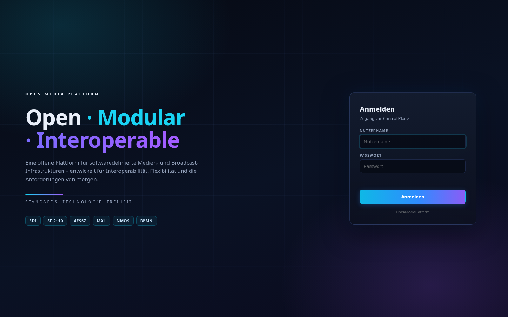

Nutzername/Passwort vergibt der Administrator über die
Administration-Ansicht (Abschnitt 7). Im lokalen Dev-Betrieb existiert
standardmäßig ein `admin`-Nutzer (siehe `HANDBUCH.md` Abschnitt 3 für
das Dev-Passwort — nicht für den Produktivbetrieb geeignet).

Nach erfolgreicher Anmeldung bleibt die Sitzung angemeldet (Token im
Browser gespeichert), bis auf „Abmelden" geklickt wird oder das Token
abläuft. Wird der Nutzer gelöscht oder sein Passwort geändert, endet die
Sitzung sofort. Neue Passwörter brauchen mindestens 10 Zeichen und dürfen den
Nutzernamen nicht enthalten.

**Zu viele Fehlversuche:** Nach 5 falschen Anmeldungen mit demselben Namen von
derselben Adresse aus (und bei sehr vielen Fehlversuchen einer Adresse) kommt
„too many failed login attempts“; nach etwa 15 Minuten geht es wieder. Von
einer anderen Adresse aus ist der Nutzer dadurch nicht gesperrt.

### 1.1 Sprache (Deutsch/English)

Oben rechts (neben der Verbindungsanzeige) und im Nutzer-Widget unten rechts
wechselt die Auswahl **DE/EN** die Oberfläche; die Seite lädt dabei neu. Die
Wahl gilt pro Browser, ohne Wahl richtet sich die Sprache nach dem Browser
(Deutsch, sonst Englisch).

**Stand:** Die gesamte Orchestrator-Oberfläche (alle Tabs, Administration,
Dialoge, Operator-Konsole) und alle Node-Oberflächen sind zweisprachig. Auch
Node-Katalog, Node-Optionen und die Betriebswerte unter Einstellungen
erscheinen in der gewählten Sprache; bekannte Meldungen des Servers
(Fehler, Platzierungsgründe, Trigger-Protokoll) werden bei Englisch
übersetzt, unbekannte bleiben deutsch. Die Handy-Seiten des WebRTC-Gateways
(Kamera/Monitor) folgen der Browsersprache (oder `?lang=en`). **Noch
deutsch:** Meldungen und Beschreibungen, die ein Node selbst erzeugt,
Workflow-Namen/-Beschreibungen und Audio-Gruppennamen aus Ihren Daten sowie
die Handbücher.

## 2. Der Flow Editor

Der Flow Editor ist die zentrale Ansicht: links der **Node-Katalog**
(alle Node-Typen, die auf dieser Installation gestartet werden können),
rechts die **Arbeitsfläche** mit den bereits laufenden Instanzen als
Kacheln. Jeder Katalog-Eintrag zeigt zusätzlich eine kurze
Funktionsbeschreibung, eine grobe Lasteinschätzung (z. B. „~ gering,
konstant") und, sobald der Typ mindestens einmal lief, eine gemessene
CPU-/RAM-Hausnummer („typisch 47–56 % CPU · 34 MB RAM") — hilfreich, um
vor dem Start abzuschätzen, was eine weitere Instanz kostet. Das
Suchfeld über der Liste filtert nach Name/Typ, ohne die Seite neu zu
laden.

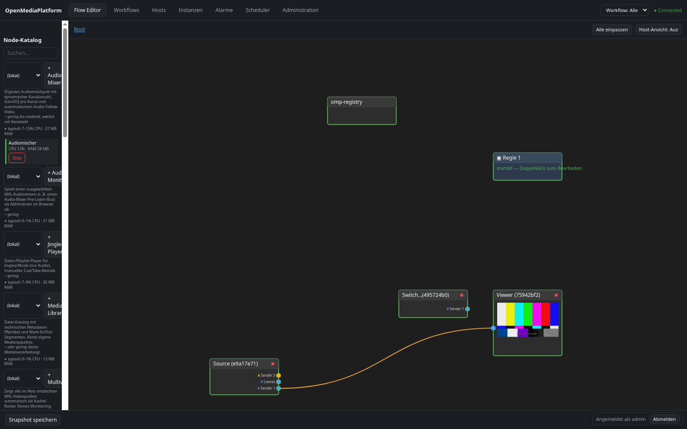

In diesem Beispiel sind auf der Arbeitsfläche sichtbar:

- **Source → Viewer** — eine Testquelle (Farbbalken + Testton), per
  Kante mit einem Viewer verbunden; das bunte Farbbalkenbild in der
  Viewer-Kachel ist eine **echte**, laufende MJPEG-Vorschau, kein
  Platzhalter.
- **Switcher** — noch unverbunden, zeigt aber bereits seinen
  verfügbaren Anschlusspunkt.
- **Regie 1** — ein laufender Workflow (Abschnitt 4): erscheint am
  Root immer als **eine** kollabierte Kachel, unabhängig vom Status;
  Doppelklick öffnet ihn zum Bearbeiten/Betrachten seiner Rollen.
- **omp-registry** — der Orchestrator selbst als NMOS-Node (Registry-
  Housekeeping, keine Medienfunktion).

### 2.0 Einen bestimmten Node suchen

In der Leiste oben im Flow Editor steht rechts das Feld **„Node suchen…“**. Sie tippen einen Teil des Namens (oder der ID); mehrere Wörter müssen alle passen, Groß-/Kleinschreibung ist egal. Die Trefferliste zeigt zu jedem Node, in welcher Gruppe er liegt. Mit **Pfeiltasten + Enter** oder per Klick springt der Editor in die passende Gruppe, wählt den Node aus und zentriert die Ansicht darauf. **Esc** leert die Suche. Gehört ein Node zu einem laufenden Workflow und ist auf der Hauptebene zu einer Kachel zusammengefasst, meldet ein Hinweis, dass er in dieser Ansicht ausgeblendet ist. (Das Suchfeld links in der Palette durchsucht dagegen die *Katalogeinträge*, die Sie neu starten können.)

### 2.1 Eine Instanz starten

Im Node-Katalog links steht jeder Node-Typ als Karte mit **Namen, Beschreibung und einem „Starten …"-Knopf**. Der Knopf öffnet den **Startdialog**:

- **Name (optional):** Wer einen Namen einträgt, bekommt die Instanz unter diesem Namen (statt „Typ (Kurz-ID)") — er erscheint auch als Quellen-/Senken-Name in Kreuzschienen und Mischer-Auswahllisten. Die Instanz-ID bleibt davon unberührt.
- **Zielhost** (nur, wenn es Host-Agents gibt), mit Online-Anzeige und der Profil-Ampel (typischer CPU-/RAM-Bedarf, freie Kapazität des gewählten Hosts).
- **I/O-Port** (nur DeckLink): Eingang oder Ausgang.
- **Einstellungen:** alle einstellbaren Optionen des Node-Typs (dieselben wie unter Administration → Einstellungen), nach Gruppen geordnet. Nur ausfüllen, was für **diese Instanz** abweichen soll; ein leeres Feld übernimmt den Wert des Node-Typs bzw. den Standard (steht im Feld). Ungültige Werte meldet der Dialog sofort und bleibt offen.

„Starten" startet die Instanz mit genau diesen Werten schon beim ersten Start (sie stehen danach als Instanz-Werte unter Administration → Einstellungen). Escape oder „Abbrechen" verwirft den Dialog. Die Instanz erscheint nach kurzer Zeit als neue Kachel auf der Arbeitsfläche und im Katalogeintrag mit CPU-/RAM-Werten und einem „Stop"-Knopf. Im Bearbeiten-Modus eines gestoppten Workflows heißt der Knopf stattdessen **„Als Rolle hinzufügen"** und fügt die Rolle ohne Dialog hinzu.

### 2.2 Verbinden (Routing)

Von einem Ausgangs-Anschlusspunkt (rechter Rand einer Kachel) auf einen
Eingangs-Anschlusspunkt (linker Rand einer anderen Kachel) ziehen. Das
erzeugt im Hintergrund eine echte NMOS-IS-05-Verbindung — die Zielnode
öffnet den entsprechenden MXL-Flow und beginnt sofort zu lesen. Eine
aktive Verbindung wird als farbige Linie zwischen den Kacheln
dargestellt (im Screenshot oben: Source → Viewer, orange/aktiv).

**Tags der Anschlüsse bearbeiten (🏷):** Der Knopf 🏷 im Kachelkopf öffnet
einen Editor für die Tags der Ports dieser Kachel. Oben wählst du den
Port aus (→ Ausgänge/Sender, ← Eingänge/Receiver). Darunter stehen deine
eigenen Tags als Chips (mit × entfernen); neue Tags tippst du ein und
bestätigst mit Enter oder „+“ (Format `domain.name`, z. B.
`role.commentator`, Kleinbuchstaben, höchstens 32 je Port). Grau stehen
die automatischen Tags: ⓘ aus Medientyp/Kanalzahl abgeleitet, ◌ vom Node
gemeldet — sie lassen sich nicht ändern. Erst **Speichern** schreibt die
Liste (ersetzt die bisherigen eigenen Tags des Ports); **Abbrechen**, Esc
oder ein Klick daneben verwirft. Solange Änderungen ungespeichert sind,
ist die Portwahl gesperrt. Benötigt das Recht *Konfigurieren*. Die Tags
steuern tag-basierte Schaltungen (X/Y-Panel, Playout-Quelle „Live nach
Tags“). Sie gelten pro Node und Port-Name: bei Workflow-Rollen bleiben
sie über Neustarts erhalten, bei ad hoc gestarteten Instanzen gehen sie
mit der Instanz verloren.

### 2.3 Layout

„Alle einpassen" (oben rechts) zentriert und skaliert die Ansicht auf
alle vorhandenen Kacheln. Kachel-Positionen werden pro Nutzer
gespeichert. Früher gab es unten links einen Knopf „Snapshot speichern";
er ist entfallen. Bereits vorhandene Szenen erscheinen weiterhin als
Knöpfe unten links und lassen sich per Klick anwenden — ohne gespeicherte
Szenen bleibt die Leiste ausgeblendet.

### 2.4 Gruppieren

Mehrere Kacheln lassen sich zu einem einklappbaren Makro-Block
zusammenfassen — praktisch für einen ganzen Regieplatz, der im Root-
Graphen dann nur noch als **eine** Kachel erscheint:

1. Erste Kachel anklicken, weitere mit **Umschalt+Klick** dazu wählen
   (mindestens zwei).
2. Taste **G** drücken, Namen der Gruppe eingeben.

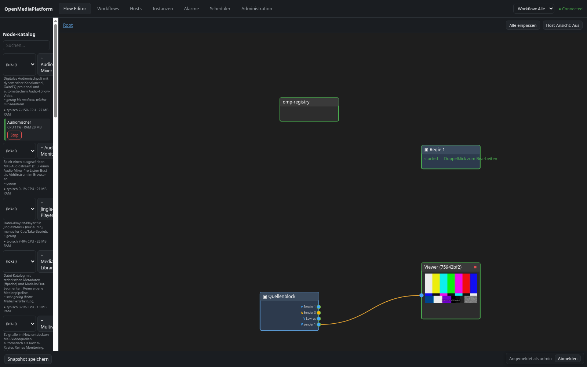

Im Beispiel wurden „Source" und „Switcher" zur Gruppe „Quellenblock"
zusammengefasst — deren Ein-/Ausgänge werden an der Gruppen-Kachel nach
außen durchgereicht (hier: die vier Ports der Source, unverändert
erreichbar), die übrigen, nicht gruppierten Kacheln (Viewer, Regie 1,
omp-registry) bleiben unverändert sichtbar.
Doppelklick auf eine Gruppen-Kachel „betritt" sie (Breadcrumb-Pfad oben
links); „Gruppe auflösen" dort macht die Gruppierung wieder rückgängig.
„Als Workflow speichern" innerhalb einer Gruppe legt aus ihr direkt ein
startbares Workflow-Objekt an (Abschnitt 4).

### 2.5 Host-Ansicht (Zonen für Mehr-Host-Betrieb)

Sobald mehr als ein Host registriert ist (Abschnitt 8), zeigt der Flow
Editor auf der Arbeitsfläche automatisch **Host-Zonen** an — je ein
Rechteck pro Host, mit Label, Online-Punkt und live CPU-/RAM-Anzeige im
Zonen-Kopf, dazu eine feste Zone „Orchestrator-Host (lokal)" für lokal
gestartete Instanzen und eine Zone „Unzugeordnet" für Nodes ohne
Instanz-Launcher-Zuordnung. Jede Node-Kachel liegt sichtbar in der Zone
des Hosts, auf dem sie tatsächlich läuft. Eine B5-Gruppe (Abschnitt 2.4)
bekommt ebenfalls eine Zone — eindeutig, wenn alle ihre Mitglieder auf
demselben Host laufen, sonst landet sie in einer eigenen Sammelzone
„Gruppen über mehrere Hosts":

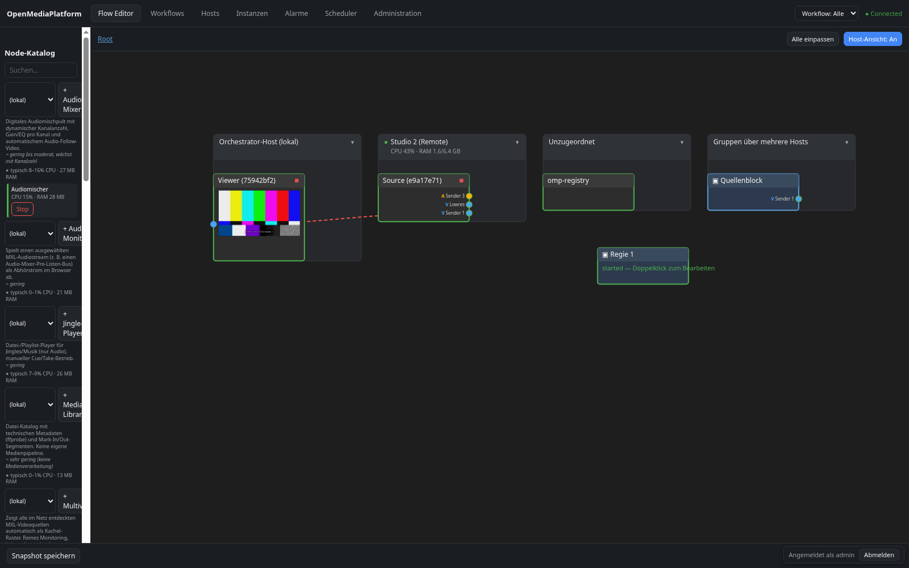

In diesem Beispiel läuft die Quelle „Source" auf dem entfernten Host
„Studio 2 (Remote)" (live CPU/RAM im Zonen-Kopf), während ihr Viewer
weiterhin lokal läuft. Die Gruppe „Quellenblock" aus Abschnitt 2.4
enthält Mitglieder auf unterschiedlichen Hosts und erscheint deshalb in
der Sammelzone rechts.

Der Knopf **„Host-Ansicht: An/Aus"** (oben rechts, nur im Root-Graphen
sichtbar) schaltet die Zonen manuell um; unterhalb von zwei
registrierten Hosts bleibt sie standardmäßig aus. Positionen innerhalb
einer Zone lassen sich frei verschieben — dieses Layout wird getrennt
vom normalen freien Layout gemerkt: Ausschalten stellt die Kachel-
Positionen von vor dem Einschalten unverändert wieder her. Ein ▾/▸-
Symbol im Zonen-Kopf klappt eine einzelne Zone samt ihrer Kacheln ein
(zeigt dann nur noch die Anzahl der enthaltenen Kacheln) — praktisch,
um bei vielen Hosts die Übersicht zu behalten.

**Kanten-Warnstil:** MXL ist host-lokal (gemeinsamer Shared Memory) —
eine Verbindung, deren Sender MXL-Transport nutzt und deren beide
Kacheln in unterschiedlichen Zonen liegen, funktioniert medienseitig
nicht und wird deshalb gestrichelt in Warnfarbe gezeichnet (im
Screenshot: die Verbindung zwischen „Source" auf „Studio 2" und dem
lokalen „Viewer"). Das ist ein Hinweis, keine Sperre — für echte
Hostgrenzen-Übertragung ST 2110, den SRT-Gateway oder MXL-Fabrics
(Abschnitt „Related project"/`HANDBUCH.md` §9.3) statt einer direkten
MXL-Kante verwenden.

**Begleiteter Host-Umzug per ⇄-Knopf:** an einer **eigenständigen** (nicht
zu einem Workflow gehörenden) Node-Kachel erscheint bei aktiver Host-
Ansicht der Knopf ⇄ im Kachelkopf. Er öffnet eine Liste der anderen
Hosts; nach der Wahl erscheint ein Bestätigungsdialog; nach Bestätigen wird die Instanz auf dem Zielhost
neu gestartet und ihre bestehenden Verbindungen werden automatisch neu
hergestellt (Zuordnung über Port-Rolle, nicht über die alte ID, die
sich beim Neustart ändert). Für Rollen innerhalb eines laufenden
Workflows gibt es diese Funktion in dieser Ansicht noch nicht — ein laufender
Workflow zeigt sich in der Host-Ansicht immer als eine kollabierte
Kachel (Abschnitt 2), einzelne Rollen erscheinen dort nicht individuell
zonierbar. Die kollabierte Kachel selbst liegt aber in der zu ihren
Rollen passenden Zone (bei uneinheitlichen Hosts in der Sammelzone
„Gruppen über mehrere Hosts" oben) — nur das Hineinziehen einer
einzelnen Rolle in eine andere Zone fehlt noch.

## 3. Instanzen-Übersicht

Der Reiter **Instanzen** zeigt alle laufenden Node-Prozesse tabellarisch
mit Status, **Workflow** (z. B. „Playout MXF · Tonmischer“; „–“ = von Hand gestartet, gehört zu keinem Workflow), Host, CPU-Auslastung, RAM-Verbrauch, PID und der Anzahl
automatischer Neustarts nach einem Absturz:

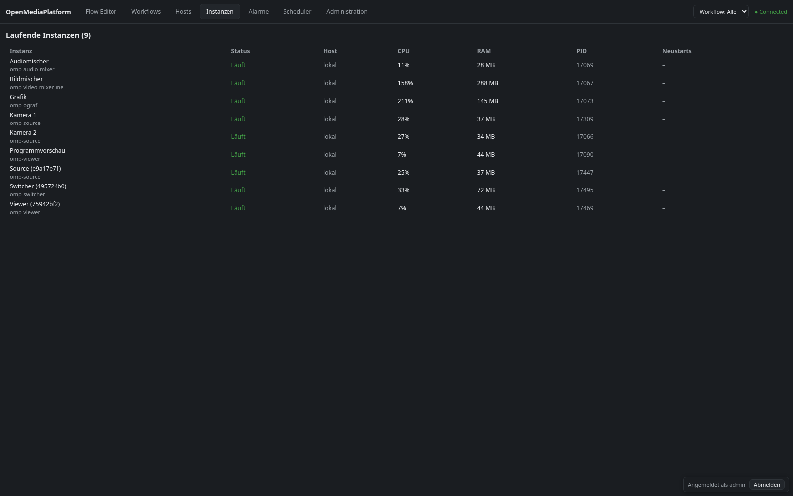

Ein Prozess, der abstürzt, wird automatisch neu gestartet (mit einer
Bremse gegen Neustart-Schleifen) — die Neustarts-Spalte macht das
sichtbar, ohne dass man die Logs durchsuchen muss.

In der Spalte **Aktionen** hat jede Zeile drei Knöpfe:

- **Umbenennen** ändert den Anzeigenamen der laufenden Instanz — ohne
  Neustart und bei gleicher Instanz-ID. Der Node meldet den neuen Namen
  (samt seinen Sendern/Empfängern) innerhalb weniger Sekunden neu an; der Name
  bleibt auch nach Neustarts erhalten. Läuft der Node noch mit einem
  älteren Programmstand ohne diese Funktion, gilt der Name erst ab dem
  nächsten Neustart (Hinweis erscheint).
- **Neustart** beendet den Node-Prozess und startet ihn neu (nach Sicherheitsabfrage;
  die Ausgabe dieser Instanz wird kurz unterbrochen). Rollen laufender Workflows
  behalten ihre IDs; von Hand gestartete Instanzen bekommen eine neue Instanz-ID,
  Name, Host und Einstellungen bleiben.
- **Verschieben …** zieht die Instanz auf einen anderen Host (oder zurück auf
  „lokal"), nach einer Rückfrage.

Beides ist Administratoren vorbehalten.

Nach einem **System-Update** (Abschnitt 7, „System-Update") trägt eine
Instanz das Kennzeichen **„veraltet"**, wenn ihr Programm durch das Update
ersetzt wurde, der laufende Prozess aber noch den alten Stand ausführt.
Das gilt für Instanzen auf dem Orchestrator-Host genauso wie für Instanzen
auf Remote-Hosts. Ein Update startet nie selbstständig laufende Sendungen
neu; die Instanzen werden erst mit ihrem nächsten Neustart aktuell —
gezielt über „Veraltete Instanzen jetzt neu starten" im Reiter
System-Update.

## 3a. Signalweg (Quelle → Ziel nachverfolgen)

Der Tab **Signalweg** beantwortet die Frage „Läuft Quelle X wirklich bei
Ziel Y an – und wo bricht es?". Er zeigt den **Ist-Zustand** (die aktuell
aktiven Verbindungen), ändert aber nichts.

**„Warum kommt hier nichts an?“ — Alle Ziele auf einen Blick:** über den
Suchfeldern steht für **jedes Ziel** (Viewer, Recorder, Gateway … — jede Node
mit Eingängen und ohne Ausgang) eine Karte mit Ampelrand: grün = in Ordnung,
gelb = Hinweis, rot = Fehler, grau = es ist keine Quelle angeschlossen. Bei
einem Problem steht dort die **erste Fehlerstelle stromaufwärts** — die
Ursache, alles dahinter ist Folge — und darunter **„Was tun?“** in einem
Satz. „Kette zeigen“ öffnet die Einzelansicht dieses Ziels. Geprüft wird
nicht nur die Verbindung, sondern auch der Laufzeitzustand: Node offline oder
abgestürzt, Node läuft aber **liefert kein Bild oder keinen Ton**, **Bildrate
eingebrochen** oder **keine Bilder mehr** (Raten-Kennzahlen, soweit der Node
sie meldet), **mehrfach automatisch neu gestartet**, der **Host antwortet nicht**,
ist stark ausgelastet oder hat eine **nicht synchrone Uhr**.

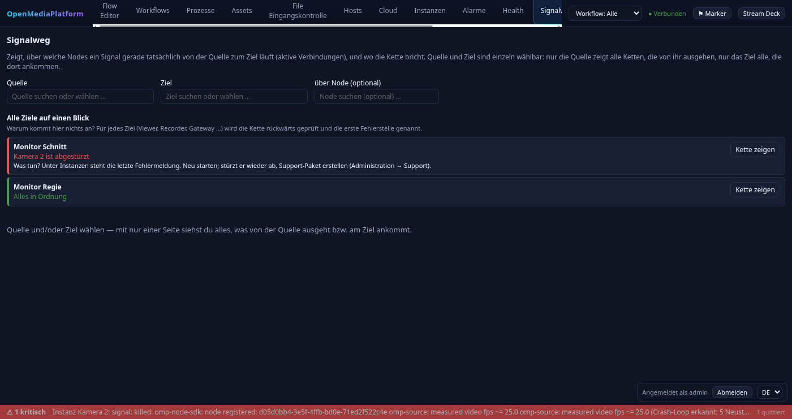

1. **Quelle** wählen (ein Ausgang einer Node) und/oder **Ziel** wählen (eine
   Node „jeder Eingang" oder ein bestimmter Eingang). Die drei Felder
   sind **Suchfelder**: Klick öffnet die ganze Liste, Tippen filtert (alle
   Suchwörter müssen im Namen vorkommen, z. B. „mixer pgm"), Pfeiltasten +
   Enter wählen, Esc bricht ab, × bzw. ein leeres Feld löscht die Auswahl. **Es genügt eine
   Seite:** nur die Quelle zeigt alle Ketten, die von ihr ausgehen (jede bis
   zu ihrem letzten Glied); nur das Ziel zeigt alle Ketten, die dort
   ankommen (jede zurück bis zu ihrem Ursprung). Sind beide gewählt, werden
   die Wege dazwischen gezeigt.
2. Optional **über Node**: nur Wege, die durch diese Node laufen (auch
   zusammen mit nur einer Seite).
3. Darunter erscheint jeder gefundene Weg als Kette aus Karten: Node mit
   Host und Online-Status, dazwischen die Verbindung mit Format und
   Transport (z. B. „Video · MXL").
   Bildmischer und Umschalter haben keine eigenen Eingangs-Verbindungen;
   ihre gerade geschaltete Programmquelle wird als Eingang ergänzt, die
   Kette läuft also bis zur eigentlichen Quelle weiter.

Die Kopfzeile jedes Wegs sagt „in Ordnung", „mit Hinweisen" oder nennt die
**erste Fehlerstelle** (rot umrandet): Node offline oder abgestürzt,
Formate passen nicht (z. B. Audio → Video), MXL über Hostgrenzen
(Gateway nötig). Orange sind Hinweise, z. B. unterschiedliche Transporte.
**Meldungen der Nodes (BCP-008):** zusätzlich liest der Signalweg den
Status jeder Node. Meldet sie „Unhealthy" (rot) oder „PartiallyHealthy"
(orange), steht ihre Begründung an dieser Stelle der Kette — z. B. beim
Handy-Gateway „keine Sendesitzung: das Handy ist nicht verbunden" bzw.
„Sitzung steht, aber es kommen keine Bilder an", beim Handy-Monitor
„Handy nicht verbunden" oder „keine Quelle verbunden". Dafür melden das
Kamera-Gateway (als Sender) und der Handy-Monitor (als Empfänger) jetzt
BCP-008; ein Gateway ohne Handy steht deshalb auch im Health-Dashboard
rot.

**Bandbreite:** Eine einzelne Verbindung wird nicht gemessen. Zwischen Nodes
auf demselben Host steht „lokal, kein Netz" (MXL läuft über Shared Memory).
Über das Netz laufen nur Gateways (2110, SRT, AES67, WebRTC): deren Karte
zeigt den **berechneten Netzbedarf** („Netz: Tx 871 Mbit/s", „~" = Annahme,
z. B. Standardformat) und die aktuelle Auslastung der Netzkarte des Hosts
(„Karte: 6 % von 10 Gbit/s"). Rot wird es, wenn der Bedarf die Karte
übersteigt oder die Karte über dem Grenzwert (Standard 85 %) belegt ist;
orange, wenn die Link-Geschwindigkeit unbekannt ist.

Grenzen: Innerhalb einer Node wird angenommen, dass jeder Ausgang aus jedem
Eingang entstehen kann (die tatsächliche Signalführung im Mischer ist nicht
sichtbar). Es werden höchstens 20 Wege gezeigt, die kürzesten zuerst. Ob
wirklich Bild/Ton fließt, prüfen die Health- und Scope-Ansichten.

## 4. Workflows

> **Sicherheitsabfrage:** Manuelles Starten, Stoppen und Löschen eines Workflows sowie das manuelle Starten eines neuen Nodes aus dem Katalog (Startdialog) fragen vor der Ausführung nach („Wirklich …?“ bzw. der Dialog). Erst „Starten“/„Stoppen“/„Löschen“ löst die Aktion aus; „Abbrechen“ oder Escape verwirft sie.

Der Reiter **Workflows** verwaltet benannte, wiederverwendbare
Kombinationen aus Node-Typen und Verbindungen — praktisch ein
Vorlagen-System für „diese Sendung braucht immer dieselben Nodes in
derselben Verkabelung":

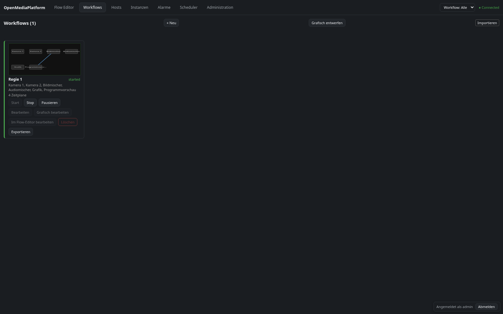

Jede Workflow-Kachel zeigt Namen, Status und — nach Hosts gruppiert — ihre
Rollen: je Host ein Block mit den Rollen, die dort laufen (bei einem
gestoppten Workflow: laufen würden), Node-Typ, ob der Host fest vorgegeben
oder automatisch gewählt wird, und dem erwarteten Bedarf (aus den gemessenen
Profilen). Neben dem Host steht seine aktuelle Auslastung und die Prognose
mit diesem Workflow („CPU 35 % → 96 %“). Oben in der Kachel warnt ein
gelber Kasten vor einem **Engpass beim Start** (CPU/RAM über der Grenze),
vor nicht erreichbaren Hosts und vor Node-Typen ohne Messprofil (Bedarf
unbekannt, nicht „null“). Die Plan-Vorschau startet nichts. „+ Neu" legt einen leeren Workflow
an, „Grafisch entwerfen" öffnet den Flow Editor in einem Workflow-
Entwurfsmodus, „Importieren" lädt eine zuvor exportierte Workflow-
Definition. Start/Stop/Pausieren wirken auf den ganzen Workflow;
„Bearbeiten" öffnet das Formular (Rollen, Verbindungen, Zeitpläne),
„Grafisch bearbeiten"/„Im Flow-Editor bearbeiten" den grafischen
Entwurfsmodus, „Exportieren" liefert eine importierbare
JSON-Definition. Die App-Bar-Auswahl „Workflow: Alle" (oben rechts, auf
jeder Seite sichtbar) filtert den Flow Editor auf die Instanzen eines
einzelnen Workflows.

**Rollenname = Quellen-Label:** der frei vergebbare „Rollenname" jeder
Rolle im Workflow-Formular ist zugleich das Label, unter dem diese
Quelle später überall erscheint, wo sie auswählbar ist — z. B. in den
Kreuzschienen-Dropdowns von Bild-/Audiomischer. Eine Rolle „Kamera 1"
zeigt sich dort als „Kamera 1", nicht als kryptische Instanz-ID. Direkt
über den Startdialog im Node-Katalog (Abschnitt 2.1) gestartete Instanzen
ohne Workflow-Zugehörigkeit bekommen dagegen weiterhin nur das
generische „`<Typ>` (`<Kurz-ID>`)"-Label — ein eigenes Namensfeld dafür
gibt es in der Oberfläche noch nicht.

**Nicht gestartete Workflows** erscheinen ebenfalls in den Zonen: Ein
gestoppter Workflow liegt als Kachel in der Zone des Hosts, auf dem er laufen
würde (voraussichtlicher Host je Rolle laut Plan-Vorschau, s. Abschnitt 4).
Verteilt er sich auf mehrere Hosts, liegt seine Kachel in „Gruppen über mehrere
Hosts“, und **jede beteiligte Host-Zone zeigt oben, direkt unter dem Zonenkopf,
einen gestrichelten Block „Geplant (nicht gestartet)“**. Jede Zeile steht für
einen Workflow (`▣ Workflow-Name: Rolle, Rolle`) und nennt nur die Rollen, die
auf diesem Host vorgesehen sind (fester Host der Rolle, sonst die automatische
Platzierung laut Plan-Vorschau). Es ist eine Vorschau: dort läuft noch nichts.
Der Block verschwindet, sobald der Workflow läuft und seine
echten Kacheln in den Zonen stehen.

### 4.0 Laufenden Workflow ändern und Startzustand speichern

Doppelklick auf einen laufenden Workflow öffnet ihn im Flow Editor. Dort
kannst du Nodes hinzufügen, verschieben und neu verbinden. **„Im Workflow
speichern"** (Breadcrumb-Leiste) wird aktiv, sobald sich etwas gegenüber
der gespeicherten Definition geändert hat — neue Nodes **oder** neue bzw.
entfernte Verbindungen. Beim Speichern gilt:

- Die Verkabelung wird als Definition übernommen und kommt bei jedem
  Neustart des Workflows wieder. Weitere Rolleneinstellungen (Format,
  Mischerebenen, Umgebung, Platzierung) bleiben erhalten.
- Der **aktuelle Bedienzustand aller Rollen** (z. B. das Testbild einer
  Quelle, Mischer-Einstellungen) wird als **Startzustand festgeschrieben**.
  Stellst du danach etwas um und stoppst den Workflow, startet er beim
  nächsten Mal trotzdem wieder mit dem **gespeicherten** Stand.
- Ein Workflow, den du nie so gespeichert hast, startet mit dem **letzten
  Stand vor dem Stoppen**.
- Wird eine einzelne Rolle neu gestartet, auf einen anderen Host verschoben
  oder übernimmt ihr Standby, geht der laufende Stand auf die neue Instanz
  über; die Festschreibung gilt für diese Rolle dann nicht mehr. Wer den
  Startzustand wieder festlegen will, speichert erneut.
- Wird ein **gestoppter** Workflow bearbeitet und gespeichert, wird der
  gemerkte Bedienzustand verworfen, weil sich die Verkabelung geändert
  haben kann.

Zusätzlich sichert der Orchestrator den Bedienzustand laufender Workflows
**alle 60 Sekunden** (nicht festgeschriebene Rollen), damit er auch nach
einem Absturz oder hartem Beenden der Nodes nicht verloren ist. Das
Intervall steuert die Umgebungsvariable `OMP_ROLE_STATE_BACKUP_INTERVAL`
(Go-Dauer, z. B. `30s`; `0` schaltet die Sicherung aus).

### 4.1 Hot-Standby (Redundanz für kritische Rollen)

Im Rollen-Designer bietet jede Rolle ein zusätzliches Dropdown „Standby
für: …", das alle anderen Rollen desselben Node-Typs im Workflow
auflistet. Wird eine Rolle als Standby für eine andere eingetragen,
läuft sie ab dem Workflow-Start dauerhaft mit, aber unverbunden — im
Flow Editor gestrichelt dargestellt, solange sie nicht aktiv ist.

Fällt die begleitete Rolle endgültig aus (Prozess-Absturz jenseits der
Neustart-Bremse, oder ihr Host wird als nicht mehr erreichbar erkannt),
übernimmt die Standby-Instanz automatisch: Verkabelung und
Bedienzustand (z. B. Kreuzschienen-Stellung, Kanalpegel) werden
übertragen, ihre Kachel wechselt von gestrichelt auf normal, und eine
Toast-Meldung „Failover: … → …" erscheint. Die Übernahme selbst ist ein
kurzer sichtbarer Schnitt (kein unterbrechungsfreier Genlock-Wechsel) —
für unkritische Regieplätze meist unnötig, für 24/7-Sendeplätze mit
einer einzelnen tragenden Rolle (z. B. dem Bildmischer) empfohlen.

### 4.2 Latenzbudget (Verzögerungsausgleich)

Das Workflow-Formular hat ein Feld „Ziel-Latenz (Frames)"
(`targetLatencyFrames`). Ist es gesetzt, muss jeder Signalpfad im
Workflow nach genau dieser Anzahl Frames beim jeweiligen Ausgang
ankommen:

- Ist das Ziel **zu knapp** für den kürzesten möglichen Pfad, lehnt
  „Start" den Workflow mit einer konkreten Fehlermeldung ab (welcher
  Pfad, wie viele Frames fehlen) — kein Teilstart.
- Ist ein Pfad **kürzer** als das Ziel, weist der Orchestrator die
  fehlende Verzögerung automatisch einem geeigneten Node entlang des
  Pfads zu (aktuell Bildmischer und Scaler) — ohne dass dafür etwas
  manuell verkabelt oder eingestellt werden muss. Steht auf einem zu
  kurzen Pfad kein geeigneter Node zur Verfügung, schlägt „Start"
  ebenso mit einer konkreten Fehlermeldung fehl.

Praktisch nützlich, um mehrere Kamerapfade unterschiedlicher Länge (z. B.
einer über einen Scaler, einer direkt) am Bildmischer wieder
bildsynchron ankommen zu lassen, ohne die Verzögerung von Hand
auszurechnen.

## 5. Scheduler

Der Reiter **Scheduler** zeigt für jeden Workflow eine eigene Zeile auf
einer horizontalen Zeitachse — Tag- (30-Minuten-Raster), Wochen- (7 Tage,
gleiche Auflösung, nur schmaler) und Monatsansicht (Tage-Überblick ohne
Uhrzeit, Klick springt in die Tagesansicht) über die drei Knöpfe oben
umschaltbar, `◀`/`Heute`/`▶` navigiert. Der blaue senkrechte Strich
markiert „jetzt".

Unter den Workflow-Zeilen zeigt der Scheduler, **welche Ressourcen zu
welcher Zeit belegt und wo noch frei sind** (Abschnitt 5.1). Das Wissen
um verfügbare Ressourcen ist beim Planen der wichtigste Punkt: ein Zeitplan
ist nur dann verlässlich, wenn der Host zur geplanten Zeit auch genug
Reserve hat.

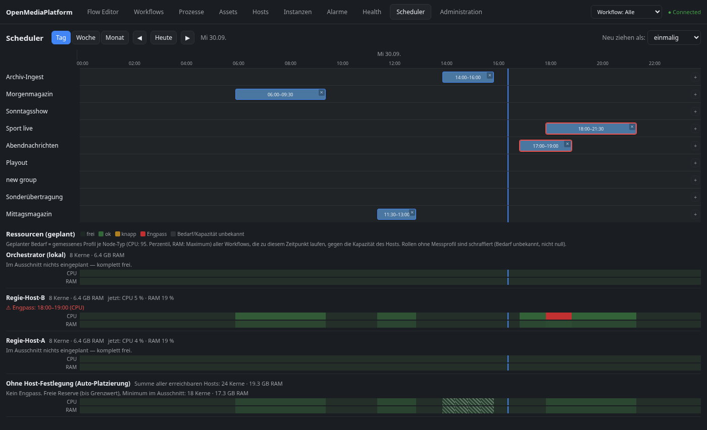

**Zeitpläne bearbeiten** — alles per Maus, Loslassen speichert sofort (kein
separater „Speichern"-Schritt, anders als das Workflow-Formular in
Abschnitt 4):

- **Verschieben:** einen Balken in der Mitte anfassen und ziehen.
- **Verlängern/Verkürzen:** den linken oder rechten Rand des Balkens
  ziehen (Start bzw. Stop ändern sich einzeln).
- **Neu anlegen:** auf eine **leere Stelle** einer Workflow-Zeile klicken,
  gedrückt halten und über die gewünschte Dauer ziehen — beim Loslassen
  entsteht ein Start-/Stop-Paar. Die Art (**einmalig**, **täglich**,
  **wöchentlich**) wählst du oben rechts unter „Neu ziehen als". Ein
  neuer Zeitplan gilt für den Tag, auf dem du gezogen hast (bei „täglich"
  jeden Tag, bei „wöchentlich" an diesem Wochentag).
- **„+"** am rechten Zeilenrand legt alternativ ein Paar mit
  Standardzeiten an (09:00–17:00).
- **Doppelklick** auf einen Balken öffnet exakte HH:MM-Eingabefelder
  (Ziehen rastet auf 30 Minuten ein).
- **„×"** an einem Balken löscht den Zeitplan.

Ein Zeitplan löst je nach Balkenende **Start** oder **Stop** des ganzen
Workflows aus — technisch dieselbe Aktion wie ein Klick auf „Start"/„Stop"
im Workflows-Tab.

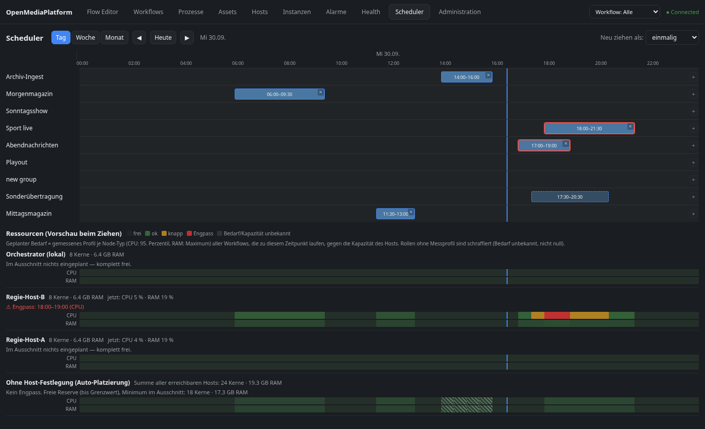

Während du ziehst, aktualisiert sich der Ressourcen-Block live
(„Vorschau beim Ziehen") — du siehst sofort, ob die neue Lage einen Host
überlastet. Erzeugt die Änderung beim Loslassen einen **neuen** Engpass,
erscheint zusätzlich eine Warnung mit Host, Zeit und Ressource. Gespeichert
wird trotzdem: der Scheduler informiert, entscheidet aber nicht für dich.

### 5.1 Ressourcen: Engpässe und freie Kapazität

Für jeden Host (und einen Streifen für Workflows **ohne Host-Festlegung**,
die der Orchestrator zum Startzeitpunkt selbst platziert) zeigt der
Ressourcen-Block:

- **CPU** und **RAM** als Streifen über die Zeit, dazu je **I/O-Kartentyp**
  (z. B. SDI-Eingänge) ein eigener Streifen — Bedarf gegen die Anzahl
  vorhandener Ports.
- **Farben:** dunkel = frei, grün = in Ordnung, gelb = knapp (ab 80 % des
  Grenzwerts), **rot = Engpass** (über dem Grenzwert, standardmäßig 85 % CPU
  und 90 % RAM — dieselben Werte, mit denen die Platzierung entscheidet).
  Schraffiert = **Bedarf unbekannt**: für einen Node-Typ liegt noch kein
  Messprofil vor. Das ist ausdrücklich nicht „null", sondern „nicht
  bekannt" — solche Zeiträume können mehr Last bedeuten, als angezeigt.
- Pro Host eine **Zusammenfassung**: entweder die Engpass-Zeiträume
  („⚠ Engpass: 18:00–19:00 (CPU)") oder die **freie Reserve** bis zum
  Grenzwert (Minimum im sichtbaren Ausschnitt, in Kernen und GB), oder
  „komplett frei".
- Neben dem Hostnamen die **aktuelle Auslastung** („jetzt: CPU 5 % · RAM
  19 %") — eine Momentaufnahme, nicht die Planung.
- Ein **Tooltip** an jeder Zelle nennt Zeit, Bedarf, Kapazität, die freie
  Reserve und welche Workflows/Rollen wie viel beitragen.
- Ein **Balken bekommt einen roten Rand**, wenn während seiner Laufzeit auf
  einem seiner Hosts ein Engpass liegt (Grund im Tooltip).

Wie der Bedarf entsteht: für jede Rolle eines Workflows, der zu dem
Zeitpunkt läuft, zählt das **gemessene Profil ihres Node-Typs** auf dem
festgelegten Host (fehlt es dort, das typweite Profil) — CPU als 95.
Perzentil (in Kernen), RAM als Maximum. Ein Workflow zählt als laufend,
wenn der Zeitplan ihn zu diesem Zeitpunkt gestartet hat; ein gerade von
Hand gestarteter Workflow zählt bis zu seinem nächsten geplanten Stop.
Grundlage sind die Messungen der Host-Agents; je länger ein Node-Typ schon
gelaufen ist, desto belastbarer die Werte.

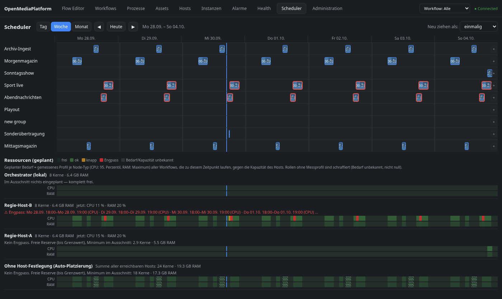

In der **Wochenansicht** wiederholen sich tägliche Zeitpläne erkennbar; in
der **Monatsansicht** zeigt jede Tageszelle den **ungünstigsten Zeitpunkt
des Tages** — ein schneller Blick, an welchen Tagen Engpässe drohen.

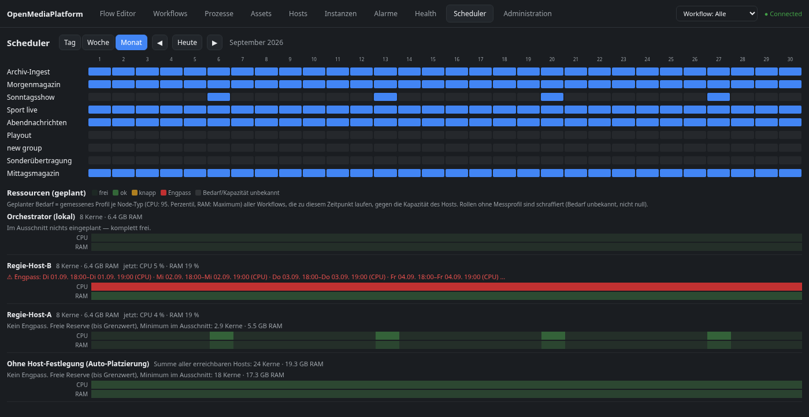

**Grenzen, die man kennen sollte:**

- Geplant wird nur, was **in Zeitplänen** steht. Von Hand zusätzlich
  gestartete Instanzen sieht man nur in der „jetzt"-Angabe des Hosts.
- Netz- und GPU-Auslastung erscheinen nur live, nicht in der Planung (für
  sie gibt es keine Messprofile je Node-Typ).
- Für den Streifen „ohne Host-Festlegung" gilt die Summe aller erreichbaren
  Hosts als Kapazität; ob eine einzelne Rolle dort noch auf einen Host
  passt, prüft die Anzeige nicht.
- Zeitpläne, die über Mitternacht laufen (Start 22:00, Stop 06:00), werden
  in der Ressourcenrechnung korrekt berücksichtigt; als Balken zeigt die
  Tagesansicht sie heute nur, wenn Start und Stop am selben Tag liegen.

Der Tab ist für alle Nutzer mit Lesezugriff sichtbar; Änderungen
verlangen (wie das Workflow-Formular selbst) das Konfigurationsrecht auf
den betroffenen Workflow — ohne dieses Recht schlägt das Speichern mit
einer Fehlermeldung fehl, statt die Änderung still zu verwerfen.

**Vorsicht bei eigenen Tests:** ein hier eingetragener Zeitplan startet/
stoppt den echten Workflow zur eingetragenen Uhrzeit, auch unbeaufsichtigt
— zum Ausprobieren einen eigens dafür angelegten, unwichtigen Workflow
verwenden, nicht einen produktiv genutzten Regieplatz.

## 5a. Prozesse

Der Reiter **Prozesse** ist die Business-Prozess-Engine (Ablaufgraph aus
Schritten wie Genehmigung, Service-Aufruf, ffmpeg-Skript, Bedingung) —
bewusst ein anderes Konzept als die **Workflows** aus Abschnitt 4 (dort:
Node-Verkabelung eines Regieplatzes). Links die Prozess-Definitionen,
rechts deren Versionen, Ausführungen und offene Aufgaben.

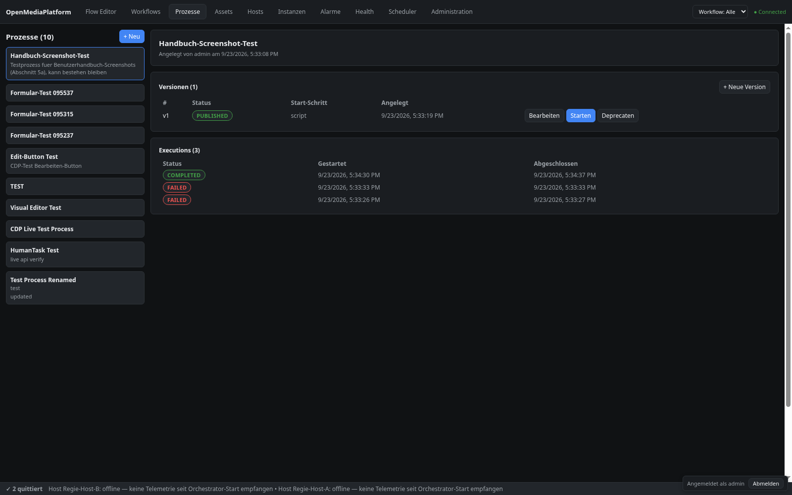

- **„+ Neu"** legt eine Definition an (nur Name/Beschreibung).
- **„Prozess löschen"** (oben im Detailbereich der gewählten Definition)
  entfernt den Prozess samt allen Versionen und der Ausführungs-Historie —
  nach einer Sicherheitsabfrage und endgültig. Solange noch Ausführungen
  laufen (auch wartende oder pausierte), lehnt der Server das Löschen ab;
  dann zuerst die Ausführungen abbrechen.
- **„+ Neue Version"** öffnet den grafischen Editor. Links stehen die
  **Bausteine**, gruppiert nach Aktionen (Node-Funktion, Web-Aufruf,
  Datei-Werkzeug ffmpeg/ffprobe, Benachrichtigung, Unterprozess),
  Menschen (Aufgabe für Person, Freigabe) und Ablauf (Wenn … dann,
  Verteiler, Parallel aufteilen/Zusammenführen, Warten, Timer).
  Bausteine, die dieser Server nicht ausführen kann, stehen eingeklappt
  unter „Nicht verfügbar“. Ein Baustein wird per Klick oder Ziehen
  hinzugefügt.

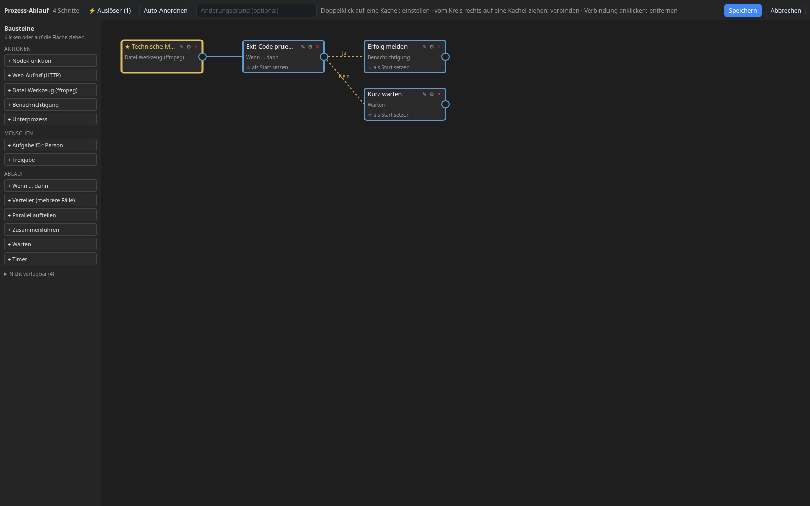

- **Doppelklick auf eine Kachel** öffnet ein Formular für genau diesen
  Schritt-Typ, ohne JSON: bei „Wenn … dann“ eine Regel aus
  *Wert · Vergleich · Wert*, bei der Node-Funktion die laufenden
  Microservices und ihre Funktionen als Auswahl. Fehlt eine
  Pflichtangabe, zeigt die Kachel „⚠ … fehlt“.
- **„{x} Variable“** neben Textfeldern setzt Werte aus dem Prozesslauf
  ein: Felder der Start-Eingabe/des auslösenden Ereignisses (z. B.
  Asset-ID), Ergebnisse vorheriger Schritte (z. B. „Ausgabe (stdout)“
  von „Metadaten lesen“) und Angaben zum Prozesslauf. Angeboten werden
  nur Schritte, die vor diesem Schritt garantiert gelaufen sind.
  Folgt ein Schritt auf **„Technische Metadaten auslesen“** (ffprobe),
  stehen dessen Messwerte einzeln zur Wahl — Dauer, Dateigröße,
  Container, Start-Timecode, Bildbreite/-höhe, Bildrate, Halbbild-
  Reihenfolge, Pixelformat, Video-/Audio-Codec, Abtastrate, Anzahl
  Tonspuren und Streams — ohne dass das Ergebnis von Hand zerlegt
  werden muss (technisch: `outputs.<Schritt>.json…`).
  **Dropdowns, Regler und Ja/Nein-Felder** haben denselben Knopf: ein
  Klick ersetzt die Auswahl durch eine Variable (z. B. Breite des
  Vorschaubilds = Breite aus der Probe); „↺ Wert wählen“ kehrt zur
  Auswahl zurück. Das gilt auch für die Argumente von Node-Funktionen.
  Im Experten-Modus (Rohargumente) erscheint unter dem Wert eines
  bekannten Flags automatisch eine Auswahlliste, ein Ja/Nein-Feld oder
  ein Regler (Bereich aus ffmpeg), die mit der Textzeile
  synchron bleiben.
- **Verbinden:** vom Kreis rechts an einer Kachel auf die nächste Kachel
  ziehen. Bei „Wenn … dann“, „Verteiler“ und „Freigabe“ fragt der
  Editor, welcher Weg dorthin führt (z. B. „Ja“/„Nein“ oder
  „freigegeben“/„abgelehnt“/„Änderungen angefordert“).
- **„Wenn etwas schiefgeht“** (im selben Formular): automatisch
  wiederholen (Anzahl, Pause, zunehmender Abstand), maximale Laufzeit und
  ein Schritt, der die Wirkung bei einem späteren Fehler rückgängig macht.
- **„⚡ Auslöser“** (Werkzeugleiste): den Prozess automatisch starten,
  z. B. wenn ein Asset angelegt wird oder auf „Bereit“ wechselt. Die
  Daten des Ereignisses stehen dann als Start-Eingabe zur Verfügung.
  Auslöser wirken erst ab dem Veröffentlichen der Version.
- **„Erweitert: Einstellungen als JSON“** am Ende jedes Formulars ist
  nur noch für Sonderfälle gedacht.
- **Speichern** legt die Version als Entwurf an.
- **Einen bestehenden Prozess bearbeiten:** in der Versionstabelle
  **„Bearbeiten"** an der gewünschten Version — der Editor öffnet mit
  genau diesem Graphen, **Speichern** legt daraus eine **neue**
  Entwurfs-Version an. Eine Version selbst wird nie überschrieben:
  veröffentlichte Versionen sind unveränderlich, laufende und frühere
  Ausführungen bleiben so nachvollziehbar.
- **„Veröffentlichen"** macht einen Entwurf startbar, **„Starten"** an
  einer veröffentlichten Version startet eine Ausführung (optional mit
  JSON-Eingabe). Ausführungen lassen sich pausieren, fortsetzen und
  abbrechen; ihre Schritte und Genehmigungs-Aufgaben erscheinen darunter
  („Für mich beanspruchen" → „Genehmigen"/„Ablehnen"/„Änderungen
  anfordern").

### 5a.1 Datei-Werkzeug (ffmpeg/ffprobe): der Assistent

Oben schaltet ein Umschalter zwischen **Assistent** und **Experte (Argumente)** — beide gleichwertig. Der Assistent ist in
Abschnitte gegliedert (1 Aufgabe · 2 Einstellungen · 3 Befehl als lesbare Vorschau, ein Flag samt Wert je Zeile); das Zeitlimit liegt
unter „Weitere Einstellungen“. Im **Experten-Modus** öffnet „+ Argument“ sofort die Auswahl aller Flags und Optionen (durchsuchbar,
auch Encoder-/Format-/Filter-Optionen, mit Beschreibung); ein Klick erzeugt eine **Karte aus Flag und Wert** mit passendem Eingabefeld
(Auswahlliste, Ja/Nein, Regler oder Text mit „{x} Variable“). „Freitext-Argument“ bleibt für alles, was in der Liste fehlt.
Gespeichert wird weiterhin die flache Argumentliste.

Beim Datei-Werkzeug öffnet der Doppelklick standardmäßig den
**Assistenten** — ein Formular mit echten, von diesem Server
tatsächlich unterstützten Werten (Container, Codecs, Filter samt
Hilfetext), keine Rohargumente. Über **„Aufgabe"** stehen folgende
geführte Abläufe zur Wahl:

- **Technische Metadaten auslesen** — nur die Eingabedatei angeben,
  liefert Codec/Auflösung/Dauer als JSON im Ergebnisfeld „Ausgabe
  (stdout)“.
- **Vorschaubild erzeugen** — Eingabe-/Ausgabedatei, Zeitpunkt und
  Breite in Pixeln.
- **Format/Codec konvertieren** — Container optional erzwingen,
  Video-/Audio-Codec aus der echten Liste dieses Servers wählen; wird
  ein Codec gewählt, erscheinen seine tatsächlichen Einstellungen
  darunter — Auswahlliste bei festen Werten, Schieberegler bei
  Zahlenwerten mit bekannter Ober-/Untergrenze (z. B. `-crf`),
  Kontrollkästchen bei Ja/Nein, sonst ein Textfeld — jeweils samt
  Hilfetext, erlaubtem Wertebereich und Standardwert. Wer mehr als
  eine unabhängige Ausgabespur braucht (siehe „Ausgabespuren“ unten)
  lässt diese beiden Felder einfach leer.
- **Tonspur extrahieren** — wie Konvertieren, nur ohne Bild.
- **Clips aneinanderhängen (Schnittliste)** — mehrere Dateien in einer
  festgelegten Reihenfolge zu einer Ausgabedatei zusammenfügen, mit
  ↑/↓ umsortierbar, je Clip optional mit Start-/End-Beschnitt. Das
  Häkchen **„Verlustfrei (Stream-Copy, kein Neukodieren)“** schaltet
  auf reinen Stream-Copy um (blendet dabei Beschnitt- und Codec-Felder
  aus, da beides in diesem Modus wirkungslos wäre) — zuverlässig vor
  allem für Container wie MPEG-TS/-PS, nicht generell für MP4/MOV/MKV
  (siehe Hinweistext im Formular).
- **Overlay/Senderkennung/Abspann zeitgesteuert einblenden** — beliebig
  viele Text- (z. B. Bauchbinde, Abspann-Credits) oder Bild-Ereignisse
  (z. B. Senderlogo), jedes mit eigenem Start-/Endzeitpunkt in Sekunden
  und optionaler Position; eine schlichte Zeitleiste darüber zeigt zur
  Orientierung, wie die Ereignisse zeitlich verteilt sind (nicht
  ziehbar, nur zur Übersicht).
- **Lautheit normalisieren (EBU R128)** — Ziel-Lautheit (LUFS),
  maximaler True Peak (dBTP) und Lautheits-Schwankungsbreite (LRA)
  einstellbar, Standardwerte entsprechen EBU R128 (-23 LUFS/-2 dBTP/7
  LU); Bild wird immer unverändert übernommen. Einpass-Verfahren — für
  eine noch präzisere Zweipass-Messung den Experten-Modus nutzen.
- **Verlustfreier Passthrough/Remux (Container wechseln)** — reiner
  Container-Wechsel ohne Neukodierung, optional einen Container
  erzwingen (sonst aus der Dateiendung abgeleitet).
- **Streaming-Ausgabeleiter (Multi-Bitrate HLS)** — beliebig viele
  Renditionen (Name, Auflösung, Video-/Audio-Bitrate, per „+ weitere
  Rendition“ hinzufügbar/entfernbar), erzeugt eine Master-Playlist
  (`master.m3u8`) im gewählten Ausgabeverzeichnis plus je Rendition
  einen Unterordner mit Segmenten — für adaptives Streaming in Web-/
  App-Playern. Rendition-Namen dürfen nur Buchstaben, Zahlen und
  Bindestrich enthalten (werden als Verzeichnisnamen verwendet).

  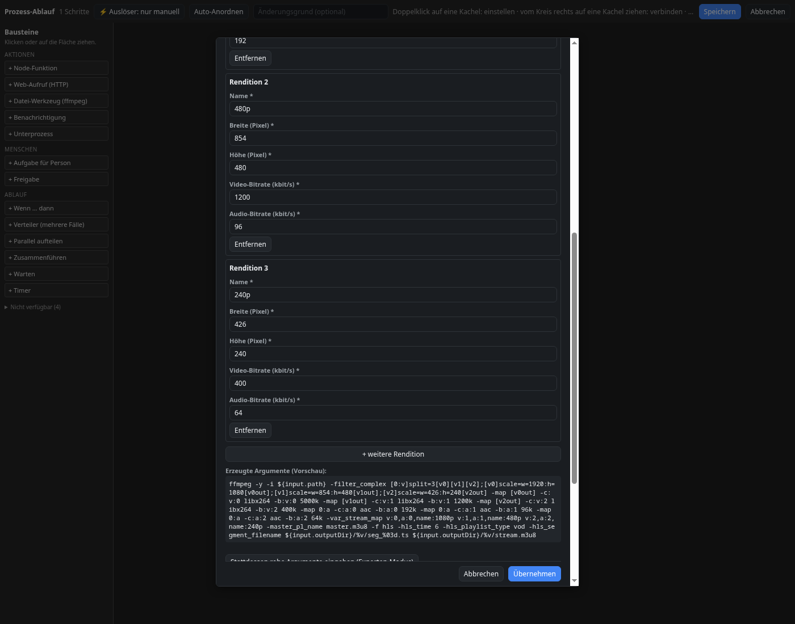

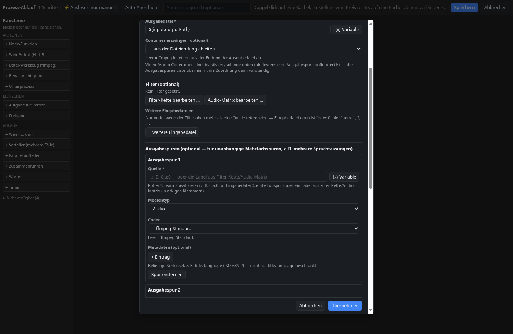

Innerhalb von „Format/Codec konvertieren“ gibt es zwei weitere
Bausteine, die zusammen abdecken, was früher eine eigene, inzwischen
wieder ausgebaute „Mehrspur-Container bauen“-Sonderfunktion war:

- **„Audio-Matrix bearbeiten …“** öffnet ein Kreuzschienen-Raster:
  Zeilen sind die Tonkanäle aller angegebenen Quelldateien (Haupt-
  Eingabedatei plus beliebig viele Zusatzquellen). Jede Zusatzquelle
  bekommt einen eigenen, benennbaren **„Auxinput“**-Abschnitt (z. B.
  „SW8-Trailer“ statt nur „Quelle 2“) — per Klick auf die Kopfzeile
  ein-/ausklappbar, damit die Liste bei vielen Zusatzquellen
  übersichtlich bleibt; der gewählte Name erscheint direkt als
  Zeilen-Beschriftung im Raster darunter.

  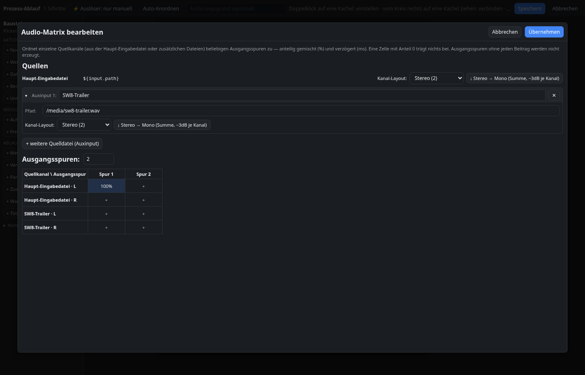

  Spalten sind frei wählbare Ausgangsspuren. Je Quelldatei wählt man ein
  **Kanal-Layout** (Mono/Stereo/5.1/7.1 oder „Eigene Anzahl“ für alles
  andere) — die Zeilen zeigen dann echte Kanal-Namen (L/R/C/LFE/Ls/Rs
  statt nur „Kanal 1/2/3“). Ein Klick auf eine Zelle öffnet einen
  **Downmixer**-Dialog mit Gain-Regler (%, inklusive live berechneter
  dB-Anzeige) und Verzögerung (ms) — eine Zelle ohne Anteil trägt
  nichts bei, eine Ausgangsspur ganz ohne Beitrag wird gar nicht erst
  erzeugt. So lassen sich Kanäle beliebig routen, anteilig mischen und
  zueinander verzögern, ohne Filtersyntax zu kennen.

  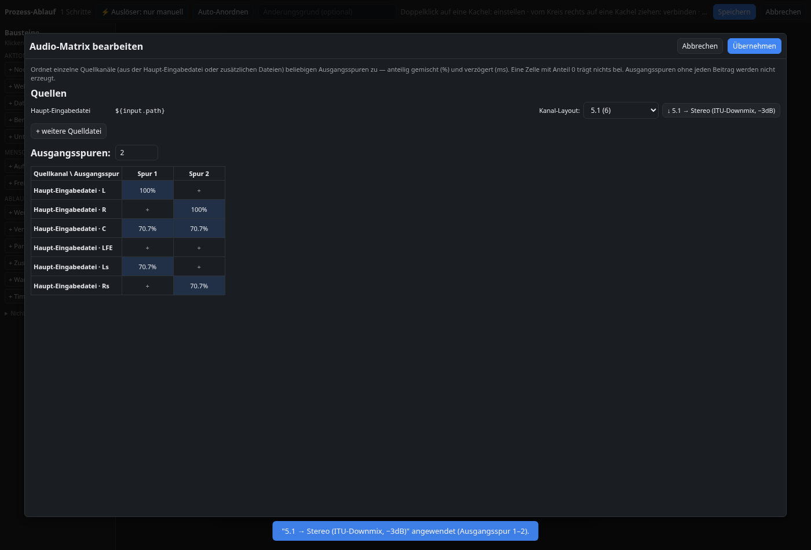

  Für gängige Layout-Kombinationen bietet die Matrix eine
  **Downmix-Vorlage** als Ein-Klick-Knopf neben dem Kanal-Layout an
  (z. B. „5.1 → Stereo (ITU-Downmix, −3dB)“, „Stereo → Mono“, „Mono →
  Stereo“) — sie füllt die passenden Zellen sofort mit sinnvollen
  Vorgaben, die man danach wie jede andere Zelle per Klick nachjustieren
  kann. Der Downmixer-Dialog einer einzelnen Zelle sieht so aus:

  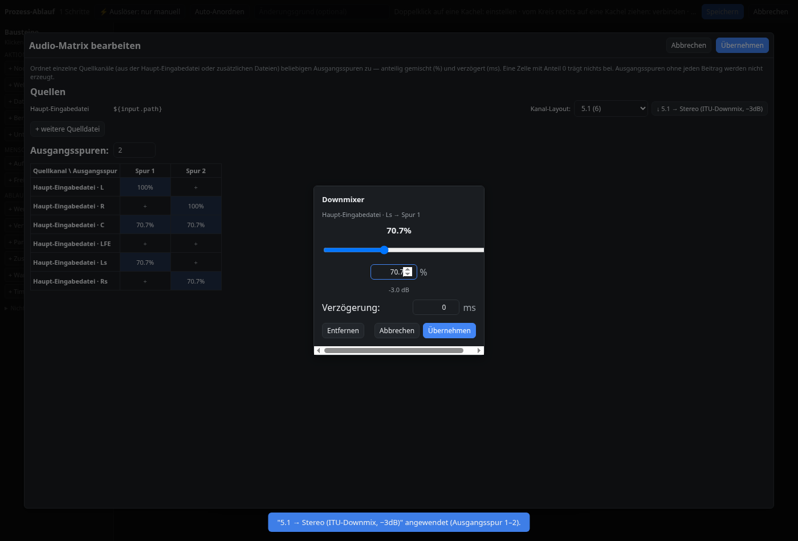

- **„+ Ausgabespur“** (weiter unten im Formular) legt beliebig viele
  unabhängige, einzeln kodierte Ausgangsspuren an — Quelle (roher
  Stream-Spezifizierer wie `0:a:0`, oder per Knopf ein Label aus der
  Audio-Matrix/Filter-Kette wie `[mxout0]` übernehmen), Medientyp,
  Codec samt Optionen und beliebige Metadaten-Schlüssel (nicht nur
  Titel/Sprache — jeder Schlüssel, den ffmpeg versteht). Sobald
  mindestens eine Ausgabespur angelegt ist, übernimmt diese Liste die
  komplette Spurzuordnung; die einfachen Video-/Audio-Codec-Felder
  weiter oben blenden sich dafür aus, damit nie zwei widersprüchliche
  Angaben gleichzeitig sichtbar sind.

Ebenfalls bei „Format/Codec konvertieren“ öffnet **„Filter-Kette
bearbeiten …“** einen eigenen, größeren Dialog: Filter aus der echten
Filterliste dieses Servers suchen und als Kachel hinzufügen, per
Ziehen vom farbigen Punkt einer Kachel auf den Eingang der nächsten
verbinden. Ein „Eingang“-Baustein steht für eine Quelldatei (Kennung
z. B. `0:v`), ein „Ausgang“-Baustein für das Ergebnis. Filter mit
einstellbarer Eingangs-/Ausgangszahl (z. B. zum Mischen mehrerer
Tonspuren) zeigen ein Zahlenfeld dafür, Zahlenwerte mit bekannter
Ober-/Untergrenze erscheinen als Schieberegler. „Automatisch anordnen“
räumt die Kacheln auf, „Übernehmen“ baut daraus die tatsächliche
Filterkette. Referenziert die Filterkette mehr als eine Quelle,
erscheint im Hauptformular darunter „Weitere Eingabedateien“ — die
erste Datei bleibt Kennung `0`, jede weitere zählt hoch. Audio-Matrix
und Filter-Kette teilen sich dasselbe Ergebnis (die Filterkette hinter
den Kulissen) und ersetzen sich daher gegenseitig, statt sich zu
ergänzen — wer beides braucht, baut die Audio-Matrix-Logik von Hand als
Filterkette nach.

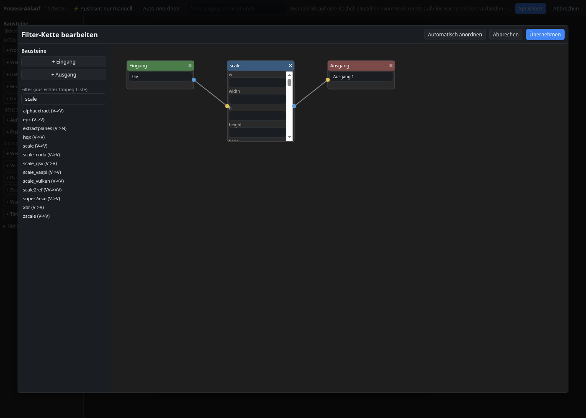

Wer die rohe ffmpeg-Befehlszeile kennt, kann jederzeit auf
**„Stattdessen rohe Argumente eingeben (Experten-Modus)"** umschalten.
Auch hier muss niemand mehr Parameter auswendig kennen: bekannte Flags
werden beim Tippen eines „-“ automatisch vorgeschlagen (Name +
Hilfetext), und der eingegebene Wert wird sofort gegen die bekannte
Definition geprüft (Zahlenbereich, Auswahlliste, Ja/Nein) — ein
falscher Wert erscheint direkt als Warnung unter dem Feld. Der Knopf
**„Parameter suchen …“** öffnet einen durchsuchbaren Katalog, der
buchstäblich jeden Parameter dieses Servers umfasst: alle globalen
ffmpeg-Flags (aus `ffmpeg -h full`) plus alle AVOptions aller
installierten Encoder/Decoder/Muxer/Demuxer/Filter (typischerweise über
1.000 Parameter insgesamt) — eine Suche nach z. B. „crf“ findet direkt
`-crf` in jedem Encoder, der es kennt, ganz ohne diesen Encoder vorher
von Hand aufzuklappen. Jeder Treffer zeigt seine Kategorie als
Beschriftung (z. B. „libx264 (Encoder)“, „Filter“, „globales Flag“).
Ein Tippfehler im gesuchten Namen (z. B. „sacle“ statt „scale“, ein
Zahlendreher wie „libx265“ statt „libx264“) findet den gemeinten
Parameter trotzdem — solche Treffer sind zusätzlich mit **„≈
Tippfehler?“** markiert, damit klar bleibt, dass der eingegebene Text
nicht wörtlich vorkommt. Die Trefferliste lässt sich komplett über die
Tastatur bedienen: **Pfeiltasten** wechseln den markierten Treffer,
**Eingabetaste** fügt ihn ein (bei einem Flag mit Wert direkt gefolgt
von einer leeren, fokussierten Wertzeile), **Esc** leert die Suche.
Klick auf einen Treffer fügt ihn ebenso als neues Argument ein.

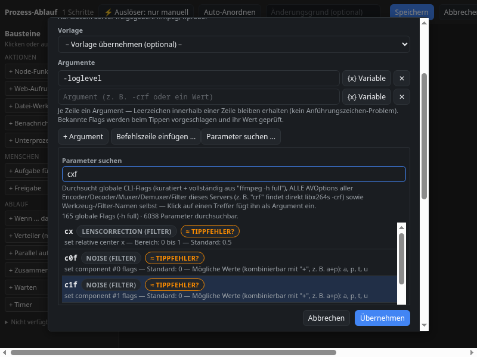

## 5b. Assets

Der Reiter **Assets** verwaltet Medien-Assets samt Metadaten,
Versionen und technischen Dateien (Representations):

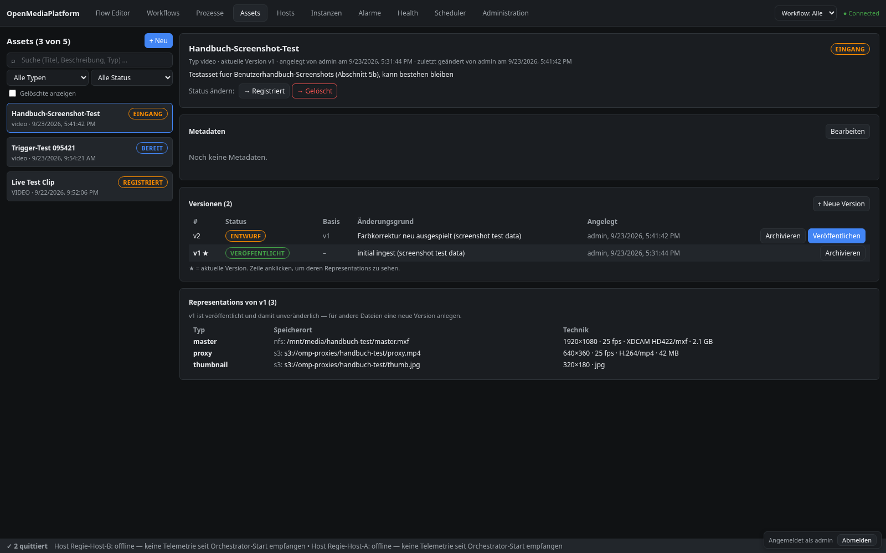

- Links die Asset-Liste mit Suche (Titel/Beschreibung/Typ) und Filtern
  nach Typ und Status; gelöschte Assets sind ausgeblendet, bis
  „Gelöschte anzeigen" aktiv ist. **„+ Neu"** legt ein Asset an (Titel,
  frei wählbarer Typ wie `video`/`audio`, Beschreibung) — es startet im
  Status „Eingang".
- **Status ändern:** die Knöpfe unter dem Titel bieten nur die Übergänge
  an, die der Lebenszyklus vom aktuellen Status aus erlaubt (Eingang →
  Registriert → In Verarbeitung → Bereit → In Prüfung → Freigegeben →
  Veröffentlicht → Archiviert, plus Rückwege, „Abgelaufen" und
  „Gelöscht"). „Gelöscht" ist ein Endzustand und fragt vorher nach.
- **Metadaten → „Bearbeiten"** öffnet ein Formular mit Feldname/Wert je
  Kategorie (Beschreibend, Redaktionell, Technisch, Eigene Felder,
  KI-generiert, System). Strukturierte Werte (Zahlen, Listen) erscheinen
  als JSON in Monospace-Schrift und bleiben beim Speichern Zahl bzw.
  Liste. Hat jemand anderes das Asset währenddessen geändert, lehnt der
  Server das Speichern ab, das Formular schließt sich mit Hinweis — neu
  öffnen, damit nichts Fremdes überschrieben wird.
- **Versionen:** „+ Neue Version" legt einen Entwurf an (optional auf
  Basis einer früheren Version, mit Änderungsgrund). Eine Zeile anklicken
  zeigt deren **Representations** (z. B. Master, Proxy, Thumbnail mit
  Speicherort und Technik wie 1920×1080 · 25 fps). Representations lassen
  sich nur an einem **Entwurf** hinzufügen oder entfernen;
  **„Veröffentlichen"** macht die Version unveränderlich und zur
  aktuellen Version des Assets (★, „veröffentlicht und damit
  unveränderlich" im Representations-Panel, ohne „Entfernen"-Knöpfe).
  Für geänderte Dateien danach eine
  neue Version anlegen.

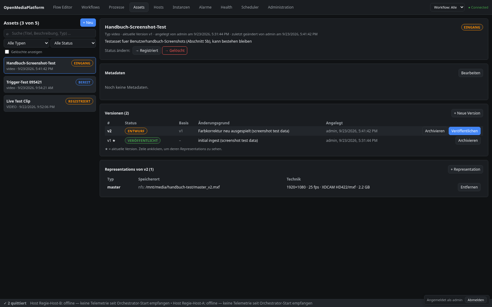

### 5b.1 Dateien von lokalen Hosts oder einem Netzlaufwerk (z. B. Isilon) hinzufügen

„+ Representation" trägt **keine Datei hoch** — Feld „Speicher"
(`filesystem`/`s3`/`http`, frei wählbar) plus „Pfad/URI" registrieren
nur einen **Verweis** darauf, wo die Datei bereits liegt (reine
Katalog-/Such-Metadaten, es werden keine Bytes bewegt). Ein echter
Browser-Datei-Upload über die konfigurierten S3-Speicher-Backends (Entwicklung: `make s3-up`, SeaweedFS)
(Administration → Storage) ist backend-seitig vorbereitet, aber noch
nicht an dieses Formular angebunden.

Was eine Mediendatei tatsächlich **abspielbar** macht, ist davon
unabhängig: Playout-Nodes (Kanal-Player, MXF-Player, …) lesen ihre
Datei direkt vom Dateisystem des Hosts, auf dem ihr Prozess läuft —
über `OMP_MEDIA_DIR` (Vorgabe `data/media`, relative Pfade bleiben
darauf beschränkt) oder einen absoluten Pfad ohne Einschränkung.
Daraus ergibt sich:

- **Datei liegt auf demselben Rechner wie dieser Node** (z. B. euer
  Laptop, wenn Node und Browser dort laufen): ein ganz normaler
  absoluter Pfad reicht, auch außerhalb des Projektverzeichnisses.
- **Netzlaufwerk/NAS wie eine Isilon:** muss auf dem Host, der den
  Node-Prozess ausführt, selbst gemountet sein (NFS/SMB, außerhalb von
  OMPs Verantwortung) — danach ist es für den Node ein ganz normaler
  lokaler Pfad.
- Der Node-Typ `omp-media-library` scannt ein Verzeichnis
  (`OMP_MEDIA_DIR`) automatisch, liest technische Metadaten per
  `ffprobe` aus (Dauer, Codec, Auflösung, Mark-In/Out) und ist der
  vorgesehene Weg, ein Verzeichnis oder Netzlaufwerk als durchsuchbare
  Bibliothek einzubinden — unabhängig vom Asset-Katalog oben.
- Bietet eure Isilon (neuere OneFS-Versionen) ein S3-kompatibles
  Protokoll an, lässt sie sich wie MinIO im Administration-Tab unter
  „Storage" als eigenes Backend eintragen — auch das aktuell nur als
  Backend, noch ohne Browser-Upload-Knopf im Assets-Tab.

## 5c. File Eingangskontrolle (Datei-QC, Review, Conform, Metadaten)

Der Tab **File Eingangskontrolle** ist die Arbeitsliste für neu eingegangene Medien-Assets. Jede Datei durchläuft automatisch eine technische **QC-Analyse**;
danach übernimmt eine Person sie, prüft sie im Player, legt **Segmente** an, erfasst **Metadaten** und reicht sie zur **Freigabe** ein. Die
Originaldatei wird dabei nie verändert.

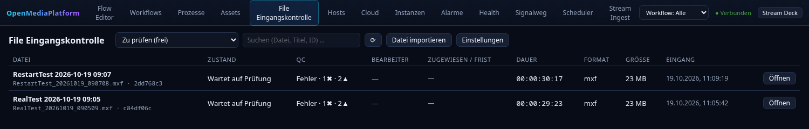

- **Liste:** Ansichten „Zu prüfen (frei)“, „Meine“, „QC wartet/läuft/fehlgeschlagen“, „In Bearbeitung“, „Zur Freigabe“, „Freigegeben“, „Archiviert“.
  Doppelklick oder „Öffnen“ zeigt die Detailansicht. Mit dem Funktionsrecht *Dateien importieren* gibt es **Datei importieren** (Dateien aus dem Importverzeichnis
  der Einstellungen); neu eingehende Assets mit lokaler Datei erscheinen automatisch. „Meine Aufgaben“ zeigt, was einem selbst oder der eigenen Gruppe zugewiesen ist.
  Wer das Recht *Alle Dateien sehen* nicht hat, sieht in der Liste nur Dateien, die ihm oder seiner Gruppe zugewiesen sind oder die er bearbeitet (bei *Freigeben und ablehnen* zusätzlich die zur Freigabe eingereichten).
- **QC-Bericht:** Gesamtstatus (Bestanden / Warnungen / Fehler / **Unvollständig**), Zähler, Regelsatz, Werkzeugversionen. Befunde lassen sich nach
  Kategorie, Ergebnis, Schwere und Text filtern und aufklappen (Messwert gegen Grenzwert, Werkzeug, Zeitpunkt). „▶ Timecode“ springt im Player an die Stelle.
  „QC wiederholen“ (optional mit anderem Profil) erzeugt einen neuen Bericht — die früheren bleiben im Auswahlfeld „Berichte“. Export als JSON (vollständig) oder CSV.
  Technische Stream-Metadaten stehen unten aufklappbar.

  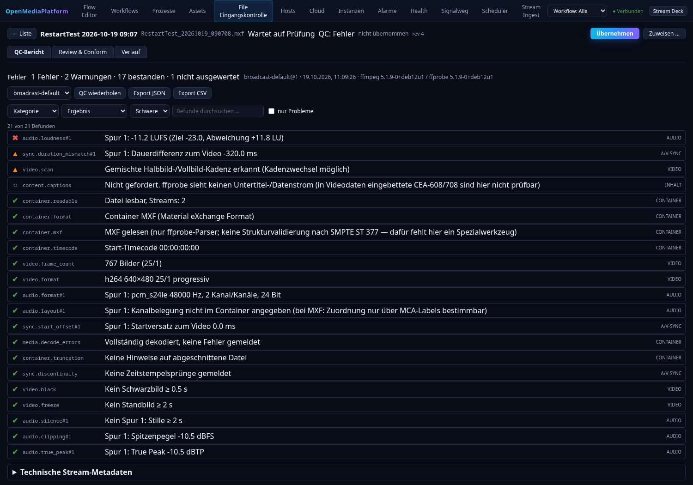

- **Wichtig zu verstehen:** „**QC nicht ausführbar**“ (rot, mit Grund) heißt, dass die Analyse nicht laufen konnte — es gibt dann *kein* Urteil über die Datei.
  Ein Befund „Fehler“ dagegen heißt, dass die Analyse lief und ein Problem in der Datei fand. Die Analyse ist eine Probe plus Inhaltsprüfung mit ffmpeg/ffprobe,
  **keine** Strukturvalidierung nach MXF-Standards.
- **Übernehmen:** schließt gleichzeitige Bearbeitung aus (wer zuerst kommt). „Zurückgeben“ gibt frei (der Entwurf bleibt), mit dem Recht *Aufgaben zuweisen* auch
  „Zuweisen …“ (Person und/oder Gruppe, mit **Frist**), „Neu zuweisen“ und „Zwangsfreigabe“. Eine einer Person zugewiesene Datei übernimmt nur diese Person, eine einer Gruppe
  zugewiesene jedes Mitglied (nach „Zurückgeben“ liegt sie wieder im Pool der Gruppe); *Aufgaben zuweisen* darf immer übernehmen. Ist die QC noch nicht fertig, kann je nach Einstellung nicht übernommen werden.
- **Review & Conform:** Links der Player mit dem **Review-Proxy** (Kennzeichnung „PROXY“ — nicht die Originaldatei; Bild n des Proxys ist Bild n der Datei).
  Bedienung: ←/→ ein Bild (Umschalt ±10, Strg ±1 s), Leertaste Wiedergabe/Pause, **Stopp** = anhalten und zum Startpunkt zurück, **Jog** (Ziehen oder Mausrad:
  Einzelbilder) und **Shuttle** (Regler oder J/K/L: −8× … +8×; rückwärts über Einzelbild-Sprünge, nicht jedes Bild wird gezeigt), Timecode-Feld (Taste G),
  I/O setzen In/Out (**Out ist exklusiv**: das aktuelle Bild ist das letzte enthaltene), Alt+I/Alt+O springen hin, `[` `]` springen zu Segmentgrenzen, N legt ein Segment aus
  den Marken an. Befunde der QC erscheinen als rote/orange Marker auf der Zeitleiste.
  Rechts: **Nutzbarer Bereich**, **Segmente** (Name, In, Out exklusiv, Reihenfolge, Beschreibung; „▶“ spielt den Bereich), danach die **Metadaten** (Pflichtfelder mit *;
  Felder und Auswahllisten stellt der Administrator ein). Überlappungen/Lücken meldet die Oberfläche sofort, wenn die Einstellungen sie verbieten.
- **Speichern/Einreichen:** „Entwurf speichern“ sichert den Stand jederzeit (auch unvollständig). „Einreichen“ prüft vollständig (Pflichtfelder, mindestens ein Segment).
  Je nach Freigabemodus (Einstellung: keiner / eine Person / Vier-Augen) entscheidet danach jemand mit dem Recht *Freigeben und ablehnen* mit **Freigeben** oder **Ablehnen** (Begründung Pflicht).
  Erst mit der Freigabe gehen die redaktionellen Metadaten ins Asset. Abgelehnte oder freigegebene Assets lassen sich mit „Neue Revision“ erneut bearbeiten.
- **Änderungen anderer:** Hat jemand anderes zwischenzeitlich gespeichert oder ist die Quelldatei neu, erscheint ein Hinweis: „Aktuellen Stand laden“ oder
  „trotzdem speichern“ (überschreibt ausdrücklich). Ungespeicherte Änderungen werden beim Verlassen nachgefragt.
- **Verlauf:** Alle Aktionen (wer, was, wann, Zustand von → nach) und die Conform-Revisionen.
- **Einstellungen** (Administratoren): Formular mit den Abschnitten *Freigabe und Prüfung* (Modus, Selbstfreigabe), *Segmentregeln*, *Qualitätskontrolle* (Standardprofil, parallele Prüfungen, Profile mit Schwellen für Schwarzbild, Standbild, Stille, Lautheit, Übersteuerung, Bild/Ton-Versatz und Erwartungen an die Datei; Profile duplizieren/entfernen), *Prüfkopie*, *Metadatenformular* (Felder anlegen, sortieren, Typ, Pflicht, erlaubte Werte) und *Import*. Eingaben werden vor dem Speichern geprüft; der Server prüft zusätzlich.
  Das Modul lässt sich mit `OMP_MODULES_DISABLE=review` abschalten; Proxys liegen unter `OMP_REVIEW_DIR` (Standard `data/review`).

## 5d. Stream Ingest (geplante Live-Aufnahme)

Der Tab **Stream Ingest** plant Aufnahmen von Live-Quellen (MXL-Sender): einmalig oder wiederkehrend, mit Zeitzone, Priorität und Richtlinien. Eine fertige Aufnahme wird als Asset registriert und erscheint im Tab
**File Eingangskontrolle** (QC, Review). Das System prüft **vorher**, ob die Aufnahme machbar ist — nicht erst beim Start.

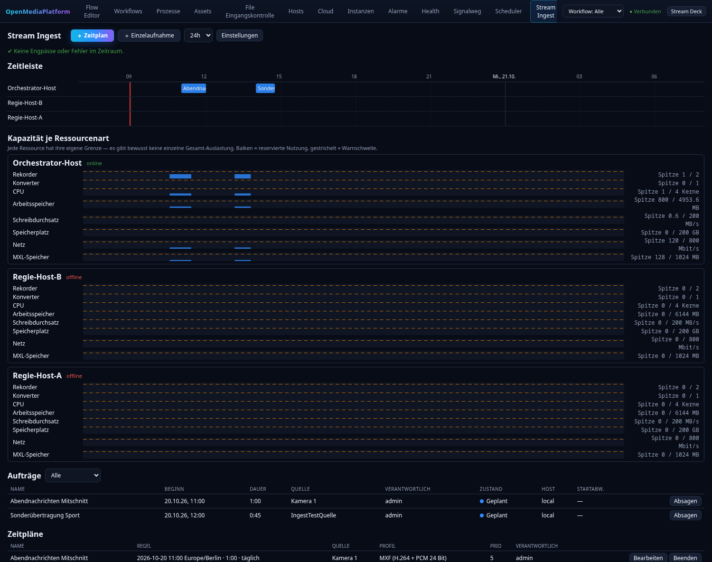

- **＋ Zeitplan / ＋ Einzelaufnahme:** Name, Quelle (Node mit Sendern), Aufnahmeprofil, **Zeitzone** und Beginn als Ortszeit, Dauer (h:mm), Wiederholung (täglich/wöchentlich mit Wochentagen/monatlich, bis/Anzahl),
  Priorität 0–9, „Wenn die Quelle fehlt“ (warten / begrenzt warten / sofort fehlschlagen — die Aufnahme endet immer zur geplanten Zeit), Versuche bei Abbruch, bevorzugter Host, Zielordner und Dateiname.
  Unter dem Formular zeigt die **Live-Prüfung** bei jeder Eingabe, ob die Aufnahme zugelassen würde — samt Gründen und frühestem möglichem Start, ohne etwas zu speichern.

  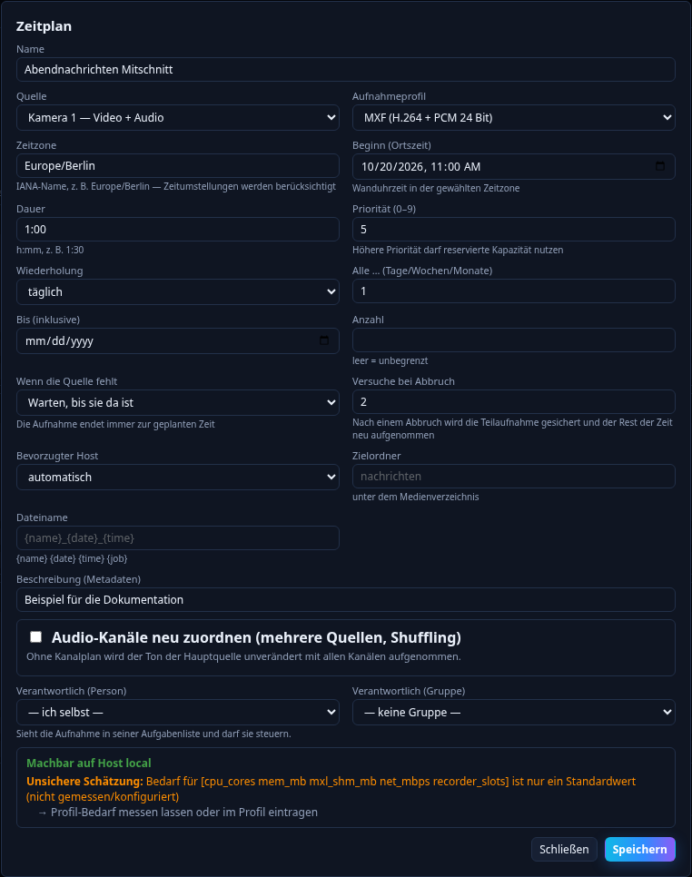
- **Verantwortliche:** Jeder Zeitplan und jede Einzelaufnahme hat eine verantwortliche Person und/oder Gruppe (Standard: wer sie anlegt; ändern darf nur, wer das Recht *Verantwortliche
  festlegen* hat). Aufträge erben sie. Verantwortliche sehen die Aufnahme in ihrer Aufgabenliste und dürfen sie bearbeiten bzw. steuern; Fremde nur mit *Fremde Aufnahmen bearbeiten*.
  Wer *Alle Aufnahmen sehen* nicht hat, sieht in Listen, Zeitleiste und Problemen nur die eigenen (die Auslastung der Hosts bleibt sichtbar). Filter „Meine“ in der Auftragsliste.
- **Probleme** (oben): *VORHERGESAGT* = ein Engpass, der noch nicht eingetreten ist (mit Ursache, Zeitraum, beteiligten Aufträgen und empfohlener Maßnahme); *AKTUELL* = wartet gerade auf Quelle/Host;
  *FEHLGESCHLAGEN* = tatsächlich gescheitert (Stufe und Grund; „Aufnahme gesichert“, wenn eine Datei erhalten blieb). Gründe: Quellenkonflikt, harter Ressourcenmangel, vorübergehend belegt, Funktion fehlt,
  Speicher/Durchsatz reicht nicht, Kapazitätswarnung, unsichere Schätzung.
- **Zeitleiste:** je Host eine Spur, Aufträge nach Zustand gefärbt, überlappende gestapelt; nicht zugelassene in der gestreiften Spur „Nicht zugelassen“. Klick öffnet Verlauf und Gründe; ⏱ in der Liste kennzeichnet eine
  Zeitumstellung (Uhrzeit existiert nicht → Start danach; Uhrzeit doppelt → die erste zählt).
- **Kapazität je Ressourcenart:** Rekorder, Konverter, CPU, Speicher, Schreibdurchsatz, Speicherplatz, Netz, MXL-Speicher — jede mit eigener Grenze (bewusst keine Gesamtprozentzahl). Balken = bereits reservierte Nutzung im Zeitraum,
  gestrichelt = Warnschwelle, rechts Spitze/Grenze.
- **Laufende Aufnahmen werden nie automatisch unterbrochen.** Eine Zeitplanänderung ersetzt nur künftige Aufträge. „Abbrechen (laufend)“ beendet bewusst; die bisherige Aufnahme wird gesichert und als Asset registriert.
  Stürzt ein Rekorder ab, wird die Teilaufnahme gesichert und (je nach Versuchen) der Rest der Zeit neu aufgenommen. Der Orchestrator darf währenddessen neu starten — die Aufnahme läuft weiter und wird übernommen.
- **Audio-Kanäle neu zuordnen (Kanalplan):** Im Formular unten schaltet „Audio-Kanäle neu zuordnen“ den Plan ein. Jede Zeile ist ein **Ausgabekanal** der Datei und nimmt einen **Kanal einer Quelle** auf — beliebige Reihenfolge
  (↑/↓), mit Gain (−96…+24 dB), Bezeichnung oder **Stille**. „Weitere Quelle“ fügt bis zu sieben Quellen hinzu, von denen **nur der Ton** aufgenommen wird (Bild und Standardton kommen von der Hauptquelle); die Kanalzahl
  jeder Quelle steht dabei. „Hauptquelle 1:1“ setzt alle Kanäle der Hauptquelle als Ausgangspunkt. Grenzen: MXF bis 32 Kanäle (PCM 24 Bit), andere Formate bis 8. Die Zulassung behandelt jede weitere Quelle wie die
  Hauptquelle (Quellenkonflikt und Limit gelten auch für sie); fehlt eine beim Start, wartet die Aufnahme nach der Verspätungsrichtlinie. Die Kanalbelegung steht danach in den Asset-Metadaten (`audioChannels`). Ohne Plan wird der Ton der
  Hauptquelle unverändert aufgenommen. Hinweis: Die Quellen werden über die gemeinsame MXL-Zeitbasis zusammengeführt; Latenzunterschiede zwischen verschiedenen Quellen werden nicht ausgeglichen.
- **Grenzen:** MCA-Labels (Profil `mcaPlan`) beziehen sich auf die Ausgabekanäle der Datei; ein Kanalplan erzeugt sie nicht selbst. Eine Aufnahme hat genau ein Bild.
- **Einstellungen** (Administratoren): Formular mit fünf Abschnitten — *Allgemein* (Vorwärmzeit, Ziel der Startabweichung, Planungshorizont, Zielordner), *Standard-Richtlinien* (Verhalten bei fehlender Quelle, Versuche, Pausen), *Zulassungsregeln* (Quellenlimit, Reserve je Ressource ab Priorität, Verdrängungsvorschlag), *Grenzen je Rechner* (Standard und Abweichungen je Rechner, Warnschwelle, Funktionen) und *Aufnahmeprofile* (Dateiformat per Auswahl, erwarteter Bedarf je Ressource — leer = gemessen/Standard —, optionale Konvertierung mit ffmpeg-Argumenten). Eingaben werden vor dem Speichern geprüft; der Server prüft zusätzlich.
  Messwerte aus abgeschlossenen Aufnahmen ersetzen Standardwerte automatisch („gemessen“ vor „konfiguriert“ vor „Standard“).

## 5e. Fremdplaylist, Mitlauf (Havarie) und Sendefreigabe

**Aufbau des Panels.** Die Playout-Automation hat Reiter: **Sendung** (Steuerung und Playlist — das Wichtigste, öffnet immer zuerst), **Carts**, **Trigger & Werbung** und **Konfiguration** (Ziele, Preflight-Vorlauf, Standard-Filler, Sendefreigabe, Fremdliste). Der zuletzt gewählte Reiter wird im Browser gemerkt.

Diese Funktionen gehören zum Node **Playout-Automation** (Panel-Abschnitt **Fremdliste / Mitlauf**, Einstellung **Sendefreigabe** unter *Ziele*).

**Fremdlisten importieren.** *Liste importieren …* öffnet eine Sendeliste eines anderen Automationssystems (Adapter `mpl3`, XML-Sendeliste). Vor dem Übernehmen zeigt eine **Vorschau**, wie viele Sendeevents entstehen, wie viele schon gelaufen sind (werden ausgelassen), was nur *angenähert* (z. B. Überblendung „Fade Cut“ wird zu „Mix“) und was *nicht übernommen* wird (z. B. Logo-/Grafik-Kinder ohne Zuordnung). Dann: **Anhängen** oder **Playlist ersetzen**. Zuordnungen stehen in der Plugin-Konfiguration `foreign-mpl3` (`mediaTemplate`, `liveMap`, `childMap`, `skipDone`, `requireRelease`). Die Liste wird nur gelesen — das Fremdformat ist kein internes Format.

**Mitlauf als Havarie-Playout.** Im Abschnitt *Fremdliste / Mitlauf* Ordner (Watchfolder mit den automatisch gesicherten Listen) und Kanalkennung (z. B. `5000`) eintragen und **Speichern & aktivieren**. OMP liest die jeweils **neueste vollständige** Datei (halb geschriebene werden nie geladen), gleicht sie mit dem letzten Stand ab (neu/entfallen/geändert) und zeigt, welches Event laut Liste läuft. Die Player werden dabei **nicht angefasst**. Kommt länger als `maxAgeSec` (Standard 120 s) keine neue gültige Datei, erscheint **⚠ VERALTET** — das Fremdsystem liefert nicht mehr. **Havarie ziehen …** ersetzt die Playlist durch die Schattenliste ab dem Event nach dem laufenden; das erste Event bekommt seine geplante Fixzeit. Das laufende Event selbst wird nicht mitgenommen (kein Einsprung mitten in eine Datei).

**Sendefreigabe.** *Sendefreigabe verlangen* (Ziele; Node-Option `OMP_REQUIRE_RELEASE`) bzw. je Event *Sendefreigabe* (Event-Editor, Datei): Das Event geht nur auf Sendung, wenn die Datei im Eingang (5c) **QC grün** hat **oder manuell freigegeben** wurde; eine Ablehnung im Eingang gilt immer. Gesperrte Events zeigen 🔒 mit Begründung, werden nicht gecued/getaket, und es greift die Ausfallrichtlinie des Events (halten, überspringen, Ersatzdatei …). Ist der Eingang nicht erreichbar, gilt die Datei als **nicht freigegeben**. Eine Datei, die noch nicht angekommen ist, bleibt als nicht verfügbar markiert, bis sie im Medienverzeichnis liegt.

**Mitlauf (Havarie).** Der Mitlauf ist vorbereitet, aber vertagt: er wird erst eingesetzt, wenn das POC dafür groß genug ist (Plugin standardmäßig aus).

**Secondary Record und Überschreibschutz.** `record.start` des Recorders hat das Argument `overwrite` (Standard **aus**): Liegt die Medien-ID schon als Clip vor (im Aufnahmeverzeichnis oder im Verzeichnis der Option *Clip-Verzeichnis*), wird die Aufnahme abgelehnt. Mit `overwrite=true` wird bewusst überschrieben.

**Durchlauf-Test.** `python3 tools/durchlauf-e2e/e2e.py` legt dauerhaft den Workflow „Durchlauf Playout“, den Channel „Durchlauf“ und den Prozess „Durchlauf Eingang“ an (nichts wird aufgeräumt, zum Weitertesten im Reiter *Workflows* starten) und fährt den ganzen Weg von der neuen Datei bis zum Vergleich.

**Aufnahme gegen Original vergleichen.** Im Eingang gibt es im Detail den Reiter **Aufnahme-Vergleich**: Aufnahme wählen (zweiter Eintrag im Eingang), dann *Vergleichen*. Geprüft werden Dauer (±1 Bild, einstellbar), Bildrate (exakt), Auflösung/Codec (Hinweis), Ton und Bildqualität (SSIM ≥ 0,98 auf einer 10-s-Stichprobe, einstellbar). Der **Vorlauf der Aufnahme** wird standardmäßig aus den Bildern bestimmt (die Aufnahme beginnt meist etwas vor oder nach dem Event); ist das Bild dafür zu ruhig, gilt der eingetragene Wert. Dieselbe Funktion gibt es als `POST /api/v1/review/items/{id}/compare`.

## 5g. Automatische Untertitel

Der Node **Auto-Untertitel** erkennt gesprochene Sprache aus einem Audiostream und erzeugt daraus Untertitel: live in der Untertitel-Ebene eines Grafik-Nodes und als fortlaufende SRT-Spur. Quelle, Sprache, Grafik-Node und Spurname stellst du in der Kachel ein; „Spur starten“ beginnt eine neue Datei in `data/subtitles`. Der Text erscheint mit einigen Sekunden Verzug nach dem Sprechen, die Spur enthält die echten Sprechzeiten. Die Erkennung läuft lokal (whisper.cpp) und braucht mehrere Rechenkerne. Einrichtung, Grenzen und Zeitverhalten: `docs/ASR-UNTERTITEL.md`.

## 5f. Kernbindung, Temperatur und Leistungsaufnahme

**Grafik- und Child-Editoren ohne JSON.** Im Event-Editor der Playout-Automation (Reiter *Child Events*) und im Panel des Grafik-Nodes (ograf) gibt es keine JSON-Textfelder mehr: Grafikvorlagen zeigen ihre Felder samt Listen und Gruppen als Formular, Vorlagen ohne Schema und Webhooks nutzen freie Felder (Name, Typ Text/Zahl/Ja-Nein/Liste/Gruppe, Wert), und bei Node-Befehlen schlägt der Editor Methoden und Argumente des Ziel-Nodes vor.

**Kernbindung (CPU-Pinning).** Jede Instanz hat die Option **CPU-Kerne (Bindung)** (Gruppe *Leistung*, `OMP_CPU_AFFINITY`; je Instanz oder je Typ setzbar). Leer = keine Bindung (Standard). Eintrag als Liste, z. B. `2-3` oder `0,2,4`: der Node läuft dann nur auf diesen Kernen (`taskset`, auch auf entfernten Hosts über den Host-Agent). Sinnvoll nur auf Produktions-Hosts, um zeitkritische Nodes (Ausgang, Playout, Geräte-Gateways) vor Batch-Arbeit wie QC oder Transcodes zu schützen; eine falsche Liste kostet nur Leistung. Ungültige oder auf dem Host nicht vorhandene Kerne werden mit einer Warnung im Log ignoriert, der Node startet dann ungebunden. Die Option überlagert eine im Katalog festgelegte Bindung (`realtime.cpus`).

**Laststeuerung (Playout).** Ein gecuetes Event hält den Standby-Player am ersten Bild an (Option *Gecuetes Event am Preroll anhalten*, Standard an) und dekodiert erst beim Take. Der Bildmischer rechnet seine Programm-/Preset-Ebenen in einem YUV-Format mit Alpha (AYUV) statt RGBA und braucht dadurch im Sendebetrieb rund ein Fünftel weniger CPU.

**Wie die CPU-Werte zu lesen sind.** Es gibt drei verschiedene Zahlen: (1) die **Host-CPU** im Hosts-Reiter (aus dem Gast-Betriebssystem, Prozent *aller* Kerne), (2) die **Instanz-CPU** (nur die vom System gestarteten Nodes, Prozent *eines* Kerns, daneben der Anteil am Host) und (3) bei virtuellen Maschinen (z. B. Crostini) die Anzeige des **Gastgebers** (Task-Manager des Browsers). Die Instanz-Summe enthält *nicht* die Infrastruktur (Datenbank, etcd, NATS, Registry, den Orchestrator selbst, Browser, Compiler). In einer VM kann die Gast-Gesamtauslastung zu niedrig ausfallen, weil sie die Zeit des Hypervisors nicht sieht; die Summe der Prozesszeiten und die Anzeige des Gastgebers liegen dann näher an der Wahrheit.

**Temperatur und Leistung.** Im Reiter *Hosts* zeigt die Spalte **Temp. / Leistung** die CPU-/Plattformtemperatur (gelb ab 75 °C, rot ab 85 °C; der Tooltip listet alle Sensoren) und die Leistungsaufnahme: das CPU-Paket aus dem RAPL-Energiezähler oder — bei Geräten mit Akku — die Gesamtleistung. **Ohne Sensor steht „–“, nie 0**: virtuelle Maschinen und Container liefern oft keine Werte, RAPL ist auf neueren Kerneln nur mit Rechten lesbar. Der externe Alarm meldet einen Host, dessen Temperatur länger als `OMP_ALERT_LOAD_SECONDS` über `OMP_ALERT_TEMP_C` liegt (Standard 85 °C, 0 = aus), und die Erholung. Im Verlauf der Hosts (Reiter *Hosts → Verlauf*) gibt es die Reihen **Temperatur** (°C) und **Leistung** (W) für 1 h bis 30 Tage (Stundenwerte in der Datenbank); ohne Sensor bleibt die Reihe leer (*nicht gemessen*). Für Prometheus liefert `/metrics` `omp_host_temperature_celsius{host=…}` und `omp_host_power_watts{host=…,source=rapl|battery}` — nur für Hosts mit frischer Telemetrie und gemessenem Wert. Die Werte stammen aus `/sys` (hwmon, thermal, powercap, power_supply) und kosten nur wenige kleine Dateilesungen je Messung.

## 6. Alarme

Der Reiter **Alarme** sammelt an einer Stelle, was operative
Aufmerksamkeit braucht: abgestürzte oder instabile (flappende)
Instanzen, überlastete Hosts und fehlgeschlagene Workflow-Starts. Im
Normalbetrieb bleibt er leer:

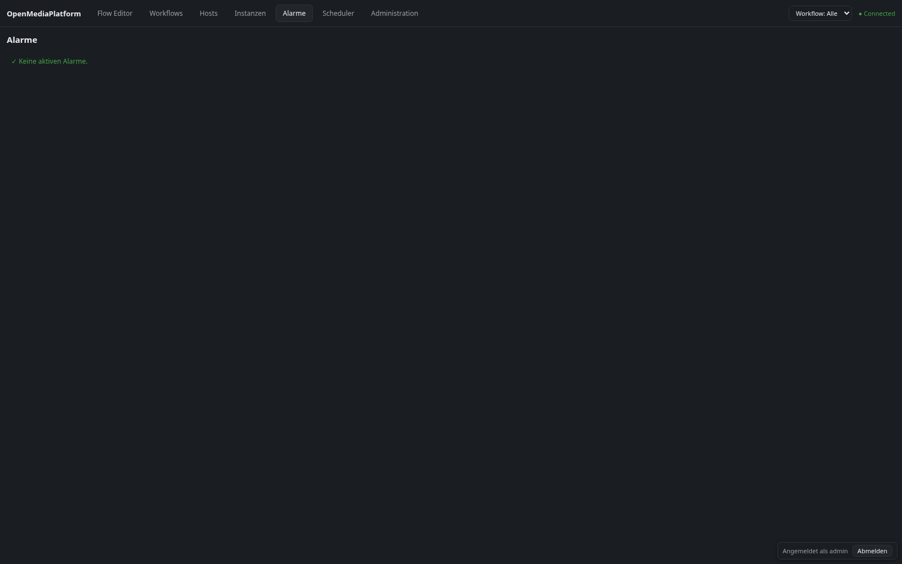

## 7. Administration

Der Reiter **Administration** (nur sichtbar für Nutzer mit
Administrationsrecht) verwaltet Nutzerkonten, Organisationen, Gruppen,
Rollenbindungen, den Node-Katalog-Import/Export, Storage-Backends, zeigt
ein Audit-Log aller schreibenden API-Zugriffe und Diagnose-Angaben,
erstellt/restauriert Datenbank-Sicherungen, spielt **System-Updates** ein
und verwaltet den Orchestrator-Cluster selbst. Die Bereiche liegen als
eigene Unter-Reiter nebeneinander (Nutzer, Organisationen, Gruppen,
Rollenbindungen, Node-Katalog, Storage, Audit-Log, Diagnose,
Backup/Restore, System-Update, Cluster, ffmpeg-Jobs) statt untereinander.
Innerhalb von **Plattform** sind die Unter-Reiter in **umrahmten Gruppen mit
Überschrift** zusammengefasst („Zugang & Rechte“, „Betrieb“, „Wartung“); die
Überschrift ist kein Knopf, die Reiter darin sind es. (Der
Screenshot unten zeigt noch den älteren Stand, die ersten vier Abschnitte
untereinander):

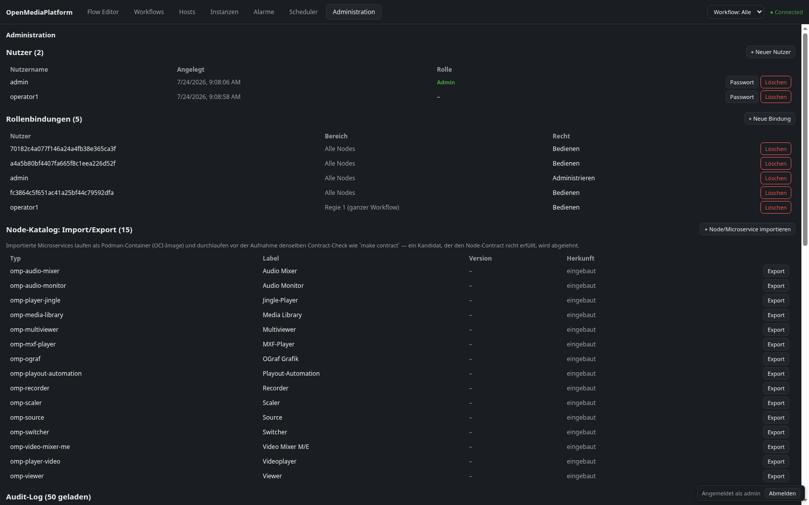

- **Nutzer** — anlegen, Passwort zurücksetzen, löschen.
- **Rechte** (früher „Rollenbindungen") — ein Editor mit Suche, in zwei
  Blickrichtungen:
  - **Wer?** — links Nutzer und Gruppen wählen, rechts steht, worauf sie
    dürfen (nach Art gruppiert), mit den über Gruppen geerbten Rechten.
  - **Worauf?** — links einen Bereich wählen (global, Workflow, einzelne
    Workflow-Rolle, Node, Prozess), rechts steht, wer darauf darf.
  Das Suchfeld oben findet Nutzer, Gruppen, Nodes, Workflows, Rollen und
  Prozesse; ein Nutzer taucht auch dann auf, wenn der Suchbegriff nur in
  einem seiner Bereiche vorkommt. Unten „Recht hinzufügen": Art filtern,
  im Suchfeld wählen, Recht (`Ansehen` < `Bedienen` < `Konfigurieren` <
  `Administrieren`) einstellen, „Hinzufügen". Pro Nutzer/Gruppe und
  Bereich gibt es genau ein Recht; Ändern, Hinzufügen und Entfernen
  wirken sofort. Darunter stehen die **Funktionsrechte**: je Modul einzelne Funktionen
  (z. B. *Zeitpläne anlegen*, *QC durchführen*, *Freigeben und ablehnen*) als Schalter für Nutzer **und** Gruppen; „Alle Rechte des Moduls“ vergibt sie gebündelt,
  über Gruppen geerbte stehen ausgegraut. Wer global *Konfigurieren* hat, darf alle Funktionen ohnehin. Ohne Vergabe darf ein Operator
  weder Aufnahmen anlegen noch Dateien prüfen — auch nicht mit dem Recht *Bedienen*. Ein Prozess-Recht erlaubt Start, Abbruch, Pause und
  Veröffentlichung nur dieses einen Prozesses (bzw. dessen Bearbeiten
  mit `Konfigurieren`), ohne globale Rechte. Die kryptischen
  Nutzernamen in den Service-Token-Bindungen legt der Orchestrator
  automatisch für Control-Plane-Nodes wie `omp-playout-automation` an
  (dessen Instanz-ID als Subject) — keine echten Personenkonten.
- **Node-Katalog: Import/Export** — jeder eingebaute Node-Typ ist hier
  als Referenz exportierbar; „+ Node/Microservice importieren"
  (Abschnitt „Related project"/`HANDBUCH.md`) nimmt zusätzlich
  containerisierte Drittanbieter-Microservices auf, nach demselben
  Contract-Check wie eingebaute Nodes.
- **Audit-Log** — zeigt in Klartext, wer wann was geändert hat („anna
  Workflow Studio gestartet“, „admin Recht vergeben“), nach Tagen
  gruppiert. Protokolliert wird jede schreibende Anfrage, auch
  fehlgeschlagene (rotes Etikett mit Grund, z. B. „keine Berechtigung“);
  ein Klick auf eine Zeile zeigt Methode, Pfad und Status. Filter, die der
  Server anwendet: Suche (findet Nutzer sowie Namen von Nodes, Workflows,
  Prozessen und Gruppen), Nutzer, Ergebnis (alle/erfolgreich/Fehlschläge),
  Zeitraum (Stunde bis Alles) und Bereiche als Schaltflächen (Anmeldungen,
  Nutzer, Rechte & Gruppen, Workflows, Instanzen & Hosts, Verbindungen,
  Prozesse, Medien, System). „Bedienung“ (Schnitte, Fader, Parameter) und
  das automatische Speichern des Ansichts-Layouts sind standardmäßig
  ausgeblendet, weil sie das Log sonst fluten; „Alle“ blendet sie ein.
  „Ältere laden“ blättert innerhalb des Filters, „Als CSV exportieren“
  speichert die geladenen Zeilen.
- **Diagnose** — „Was läuft schief, und wo?“ in zwei Ansichten.
  *Probleme* fasst gleichartige Meldungen zusammen (Anzahl, zuletzt,
  betroffene Nodes); bekannte Meldungen tragen eine Erklärung und einen
  Hinweis, ob sie harmlos sind (z. B. „Sender-Seite nicht ansprechbar
  (404)“). „Einzelmeldungen anzeigen“ springt mit dem passenden Filter in
  die Ansicht *Meldungen* (jede Zeile, ein Klick zeigt Quelle, Host und
  „Alle Schritte dieses Vorgangs“). Filter: Suche im Meldungstext, Stufe
  (Fehler/Warnungen/Info), Node, Zeitraum; aktive Eingrenzungen stehen
  als Chips zum Entfernen unter der Leiste. Aus dem Flow Editor führt ein
  fehlgeschlagener Verbindungsversuch direkt auf die Schritte seines
  Vorgangs.
- **Support** — „Ist mein System gesund?“ als Ampel und das
  Support-Paket. Oben steht der Gesamtstatus in einem Satz (grün, gelb,
  rot) und aktualisiert sich alle 30 Sekunden. Darunter stehen nur die
  Punkte, die Aufmerksamkeit brauchen, jeweils mit Befund und einem
  Absatz **„Was tun?“**; alles, was in Ordnung ist, ist eingeklappt.
  Geprüft werden Speicherplatz, Arbeitsspeicher, `/dev/shm` (der Platz,
  über den die Nodes Videobilder austauschen), offene Dateien, Last,
  Datenbank, Cluster-Mehrheit, jeder Host (meldet er sich, CPU/RAM, Uhr),
  nicht erreichbare Nodes, abgestürzte oder dauernd neu startende
  Instanzen und die Befunde des Betriebsprofils. „Support-Paket
  erstellen“ lädt eine ZIP-Datei mit Zustand, Fehlermeldungen des
  gewählten Zeitraums (30 Minuten, 2 oder 24 Stunden) und Systemdaten
  herunter, die unverändert an den Support geht. Sie enthält keine
  Medien, keine Passwörter, Tokens oder Schlüssel (Werte werden durch
  `[entfernt]` ersetzt) und kein Audit-Log. Teile, die sich nicht
  einsammeln ließen, stehen in der `manifest.json` im Paket. Beide
  Funktionen verlangen das Admin-Recht (`GET /api/v1/admin/selftest`,
  `GET /api/v1/admin/support-bundle?minutes=N`).

  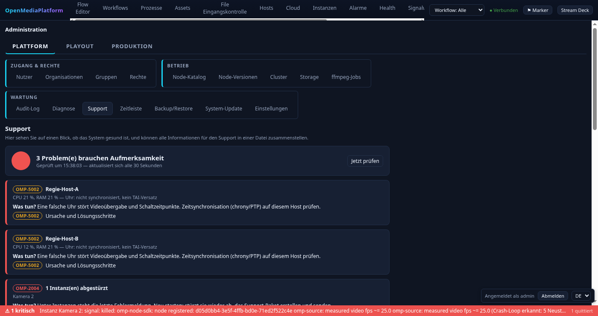
- **Support-Zugang (befristet, nur lesen)** — wenn der Support selbst ins
  System sehen soll, ohne dass Sie ein Konto anlegen oder ein Passwort
  weitergeben: im Support-Tab unter **„Support-Zugang für externe Hilfe“**
  Gültigkeit (1 Stunde bis 3 Tage) und eine Notiz (z. B. Ticket-Nummer)
  wählen und **„Support-Zugang erzeugen“**. Der **Link** erscheint **nur
  jetzt** — das Token wird nirgends gespeichert, nur sein Fingerabdruck —
  und geht per Mail oder Chat an den Support. Wer ihn öffnet, ist ohne
  Anmeldung als „support:…“ eingeloggt und sieht oben einen gelben Streifen
  („Support-Zugang — nur lesen, gültig bis …“). Er sieht Diagnose, Support,
  Zeitleiste, Instanzen, Hosts, Graph, Workflows und kann das Support-Paket
  herunterladen — er **kann nichts ändern**, und er sieht keine Nutzer,
  Rechte, Einstellungen, Sicherungen und keine Audit-Daten; jeder Versuch
  zu schreiben wird mit OMP-6003 abgewiesen und im Audit-Log vermerkt. Die
  Liste darunter zeigt alle Zugänge (aktiv, abgelaufen, widerrufen), wie
  oft und wann zuletzt sich jemand angemeldet hat, und **„Widerrufen“**
  beendet einen Zugang **sofort**. Erzeugen, Anmeldung und Widerruf stehen
  im Domänen-Audit, höchstens 10 Zugänge sind gleichzeitig aktiv.

  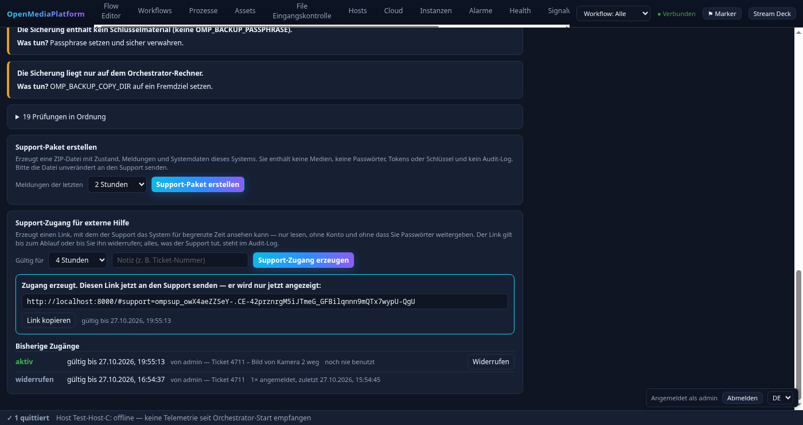

  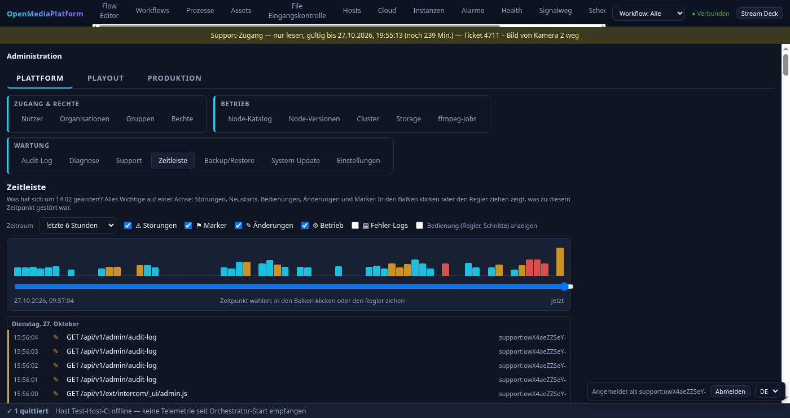

- **Baseline und Trends** — „Das ist nicht normal für dieses System.“ Das
  System lernt, was bei Ihnen üblich ist, und meldet Abweichungen, bevor
  daraus ein Ausfall wird. Zwei Dinge werden geprüft: **(1) Abweichung vom
  Üblichen** — Prozessor-, Speicher- und Netzlast der Hosts und die
  Prozessorlast langlaufender Prozesse werden mit dem verglichen, was zur
  **selben Tageszeit** an den Tagen davor üblich war (Werktage und
  Wochenende getrennt); liegen die letzten beiden Stunden deutlich darüber,
  steht im Support-Tab ein Befund „… ungewöhnlich hoch — jetzt 92 %, zu
  dieser Tageszeit üblich sind 20 %“ (OMP-1013). Das braucht mindestens
  **3 Tage Verlauf**; bis dahin sagt der Hinweis „Baseline und Trends“, wie
  weit der Aufbau ist. **(2) Stetiges Wachstum** — Speicher, offene Dateien
  und Threads von Instanzen und des Orchestrators selbst: steigt ein Wert
  seit Stunden gleichmäßig an, ohne zu fallen, ist das ein Leck (OMP-1014).
  Der Befund nennt den Anstieg je Stunde und **rechnet hoch, wann die Grenze
  erreicht wäre**; das genügt schon nach 8 Stunden. Jeder Befund hat ein
  kleines Diagramm (der Verlauf, gestrichelt das Übliche bzw. der
  Anfangswert) und erscheint in der Zeitleiste (📈, einmal je Auffälligkeit,
  nach 6 Stunden erneut). Stundenwerte werden 35 Tage aufbewahrt und
  überstehen einen Neustart; Instanzen werden nach Typ und Name geführt,
  damit der Verlauf einen Neustart der Instanz überlebt. Die Erkennung
  nimmt bewusst nur auffällig hohe Werte und stetigen Anstieg ernst —
  einzelne Spitzen und kleine Änderungen lösen nichts aus.

  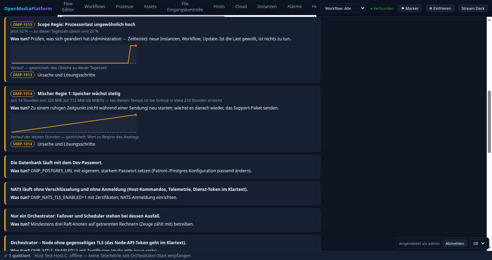

- **Letzte Minuten einfrieren (❄)** — der „Flugschreiber“. Das System hält
  die letzten 15 Minuten der **Kennzahlen je Node** (Medien bereit, Bildrate)
  und der **Prozesswerte** (CPU, Speicher je Instanz) alle ca. 5 Sekunden im
  Arbeitsspeicher. Der Knopf **❄ Einfrieren** in der oberen Leiste (oder im
  Fenster der Node-Diagnose nur für diesen Node, im Support-Tab mit
  Notiz) sichert die letzten 10 Minuten als **Paket**: Zeitleiste und
  Meldungen des Fensters, die Messreihen, CPU/RAM je Host, den Zustand von
  Nodes, Instanzen, Hosts und Graph und den **Pipeline-Zustand** der
  Nodes. Das Paket bleibt **30 Tage** erhalten (höchstens 30, davon 10
  automatische) — lange nachdem Puffer und Log-Aufbewahrung die Daten
  überschrieben haben. Es wird auch **automatisch** angelegt, wenn etwas
  ausfällt: ein Prozess stürzt ab und startet neu oder gibt auf, Medien
  fallen weg, ein Host verstummt, eine Ausfallumschaltung läuft (höchstens
  alle 5 Minuten, 10 Sekunden nach der Störung, damit der Auslöser selbst
  mit drin ist; abschaltbar mit `OMP_AUTO_FREEZE=0`). Jede Momentaufnahme
  steht in der Zeitleiste (❄). Im Support-Tab unter „Eingefrorene
  Momentaufnahmen“ lassen sich die Pakete **herunterladen** und löschen;
  ein Support-Zugang darf sie laden. Wie das Support-Paket enthält es
  keine Medien, Passwörter, Tokens oder Schlüssel. Grenze: der Flugschreiber
  liegt im Arbeitsspeicher — nach einem Neustart des Orchestrators beginnt er
  neu.

  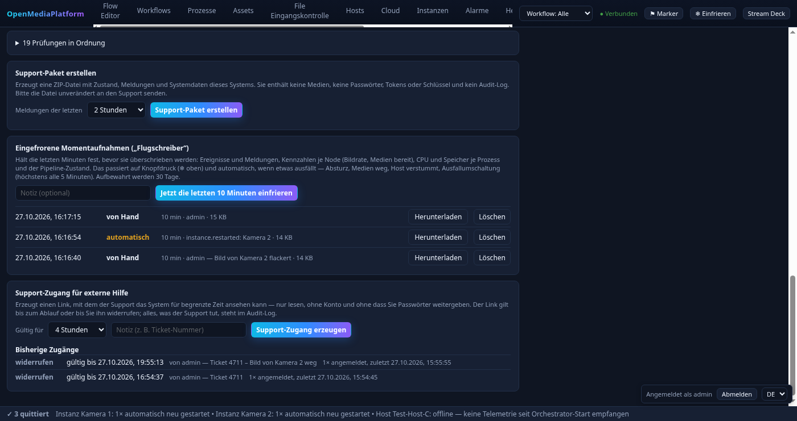

- **Paket auswerten** — Support-Paket oder Momentaufnahme (ZIP) lassen sich im
  Support-Tab direkt lesen: unter „Paket auswerten“ die ZIP wählen, oder bei
  einer gespeicherten Momentaufnahme **„Analyse“** drücken. Oben steht ein
  Satz („2 Fehler und 3 Warnungen gefunden“), darunter die **Befunde** mit
  „Nächster Schritt“, die **Ausfälle** (Zeiträume ohne bereite Medien), die
  **Zeitleiste**, **auffällige Messreihen** als Kurven (Host dauerhaft über
  90 %, Speicher wächst, Kennzahl auf 0 gefallen) und gleichartige
  Meldungen gruppiert mit Anzahl. **„Bericht für KI kopieren“** legt dieselbe
  Auswertung als Text in die Zwischenablage — in ein Gespräch mit einer KI
  einfügen; die Anleitung dafür steht in `docs/PAKET-AUSWERTUNG-KI.md`.
  Die Datei wird nur ausgewertet, nicht gespeichert.

- **Zeitleiste** — „Was hat sich um 14:02 geändert?“ auf einer einzigen
  Achse. Oben ein Balkenbild des gewählten Zeitraums (letzte Stunde bis 7
  Tage): rot = Störung, gelb = Hinweis, blau = Information. **In die Balken
  klicken oder den Regler ziehen** (oder eine Zeile anklicken) wählt einen
  Zeitpunkt; darunter steht dann **„Zustand um …“** — was zu diesem
  Zeitpunkt gestört war (z. B. „Host Regie-A meldet sich nicht mehr, seit
  14:02“) — und **„Das hat sich in den 5 Minuten davor geändert“**. Die Liste
  darunter zeigt chronologisch: *Störungen* (Absturz, Medien weg, Host
  verstummt, Ausfallumschaltung), *Marker*, *Änderungen* (Bedienungen aus
  dem Audit-Log, Workflow gestartet/gestoppt, Verbindungen, Hosts),
  *Betrieb* (automatische Neustarts, Uhr, Orchestrator gestartet) und
  optional *Fehler-Logs* und die *Bedienung* mit Reglern und Schnitten
  (standardmäßig aus, sie wären tausende Zeilen). Aufgezeichnet wird ab dem
  Start dieser Version (14 Tage, wie das Audit-Log); der Zustand vor dem
  letzten Neustart des Orchestrators ist nicht bekannt.
  **Marker „Problem jetzt“:** der Knopf **⚑ Marker** in der oberen Leiste
  (auf jedem Tab) setzt mit einem Klick, ohne Tippen, einen Marker auf die
  Zeitleiste — der Support findet später genau diese Minute. Ein Doppelklick
  zählt einmal. Lesen der Zeitleiste verlangt das Admin-Recht, der Marker
  das Bedienrecht (`GET /api/v1/timeline`, `POST /api/v1/timeline/marker`).

  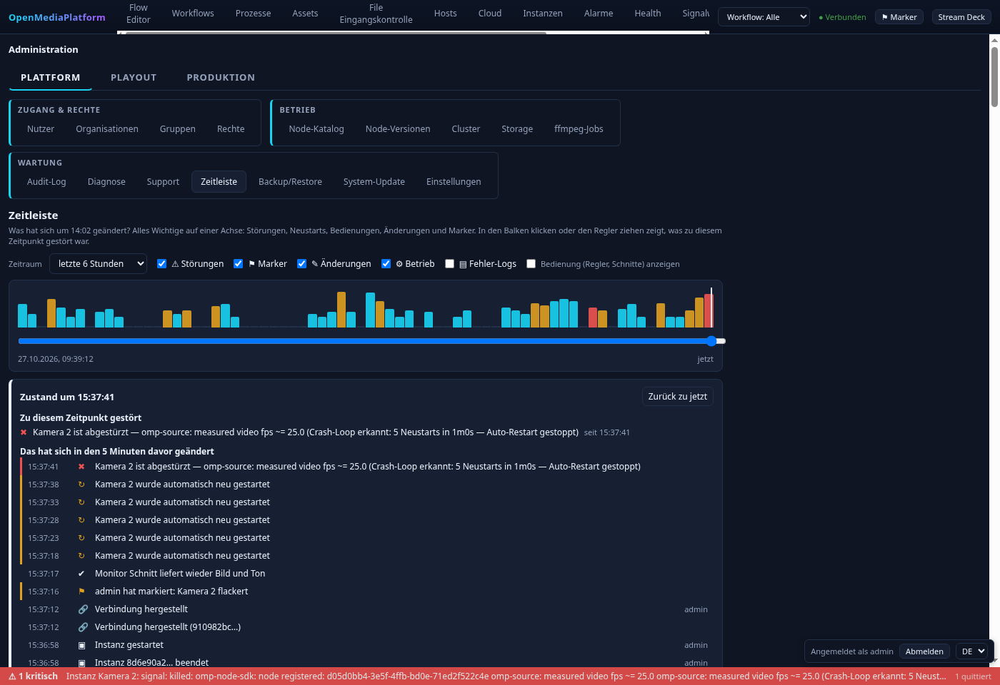
- **Diagnose an der Kachel (🩺)** — „Was ist mit diesem Node los?“ Der
  Knopf **🩺** im Kopf jeder Node-Kachel im Flow Editor (oder ein
  **Rechtsklick** auf die Kachel) öffnet ein Fenster nur für diesen einen
  Node: oben die **Ampel** mit einem Satz, darunter die **Befunde** mit
  **„Was tun?“** (Node meldet sich nicht, Prozess abgestürzt, automatisch
  neu gestartet, läuft mit alter Version, liefert kein Bild/keine Bilder
  mehr, Bildrate eingebrochen, Prozessor voll ausgelastet, viel Speicher,
  fast alle erlaubten Dateien offen, Fehlermeldungen der letzten 15
  Minuten). Dann **Prozess und Medien** (Neustarts, Prozessor, Speicher,
  Threads, offene Dateien, Bild und Ton, Bilder pro Sekunde) und die
  **Pipeline als Bild**: von der Quelle (links) zum Ausgang (rechts) jeder
  Baustein mit Zustand; **rot umrandet** = Baustein im falschen Zustand,
  **gelb** = Puffer voll (der Baustein dahinter nimmt zu langsam ab), ein
  Balken zeigt den Füllstand; ein Zeiger auf eine Verbindung zeigt das
  ausgehandelte Format. Zum Schluss die **Ereignisse** (Abstürze,
  Neustarts, Bedienungen an diesem Node, 24 Stunden) und die **Meldungen**
  (Fehler und Warnungen). Das Fenster aktualisiert sich alle 8 Sekunden;
  Scrollstand und aufgeklappte Bereiche bleiben dabei erhalten. Die
  Pipeline melden die Nodes mit GStreamer-Pipeline (Quelle, Switcher,
  Viewer, Mischer, Player, Audio-Monitor, Multiviewer, Recorder, Scaler);
  andere Typen zeigen dort eine Erklärung statt eines Bildes. Das Fenster
  verlangt das Recht, den Node zu sehen (`GET /api/v1/nodes/{id}/diagnosis`).

  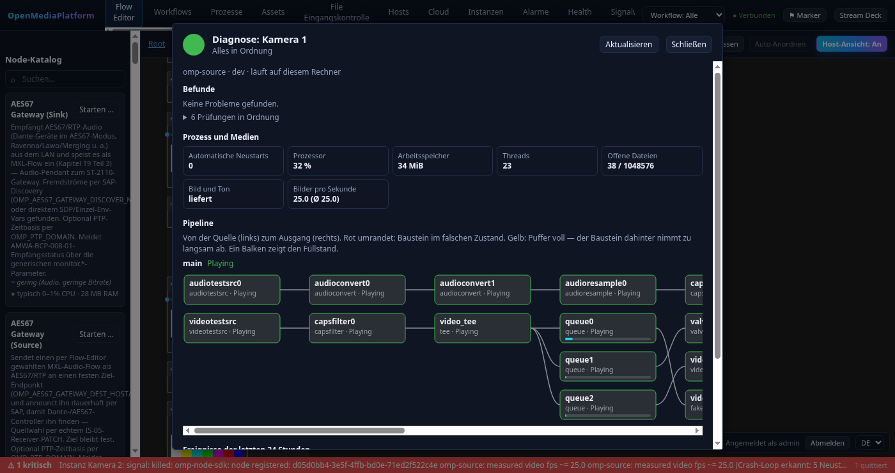
- **Fehlercodes (OMP-nnnn)** — jeder bekannte Fehler hat einen stabilen
  Code mit **Ursache** und nummerierten **Lösungsschritten**. Die
  Oberfläche zeigt ihn dort, wo Fehler auftauchen: im Diagnose-Tab (je
  Problemgruppe und Meldung), im Support-Tab und in der Node-Diagnose 🩺
  (Plakette am Befund, aufklappbar „Ursache und Lösungsschritte“) und im
  Startdialog, wenn ein Start scheitert (z. B. **OMP-2002**, Container-Image
  fehlt). Die vollständige Liste steht in `docs/FEHLERCODES.md` (aus dem
  Katalog erzeugt, mit Anker je Code), dieselbe Liste liegt im Support-Paket
  (`api/errorcodes.json`). Nummernkreise: 1xxx Plattform und Rechner, 2xxx
  Nodes und Instanzen, 3xxx Medien und Pipeline, 4xxx Verbindungen, 5xxx
  Hosts, 6xxx Zugriff, 7xxx Update. Meldungen werden am Wortlaut erkannt;
  trägt eine Meldung selbst einen Code (`[OMP-3001] …`), gilt dieser —
  die Nodes setzen ihn bei Pipeline-Fehlern (fehlendes GStreamer-Plugin,
  Format nicht aushandelbar, Gerät nicht verfügbar …) selbst davor.
  Fehlerantworten der API tragen den Code im Header `X-Omp-Error-Code`,
  Fehlermeldungen (Toasts) hängen ihn als „(OMP-nnnn)“ an.

  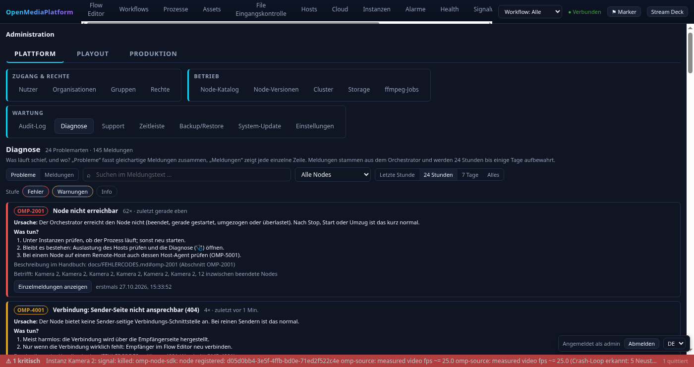
- **Backup/Restore** — „Backup jetzt erstellen“ erstellt sofort einen
  Download; Restore verlangt, den gewählten Dateinamen exakt
  einzutippen (Bestätigung), ersetzt danach den kompletten
  Datenbankinhalt und lädt die Seite nach einigen Sekunden automatisch
  neu, sobald der Orchestrator wieder erreichbar ist (Details:
  `docs/HANDBUCH.md` §5, inkl. des dafür nötigen Supervisor-Prozesses).
- **System-Update** — spielt eine neue Version des Servers per
  Browser-Upload ein (Firmware-artig, ohne Zugriff auf die Maschine):

  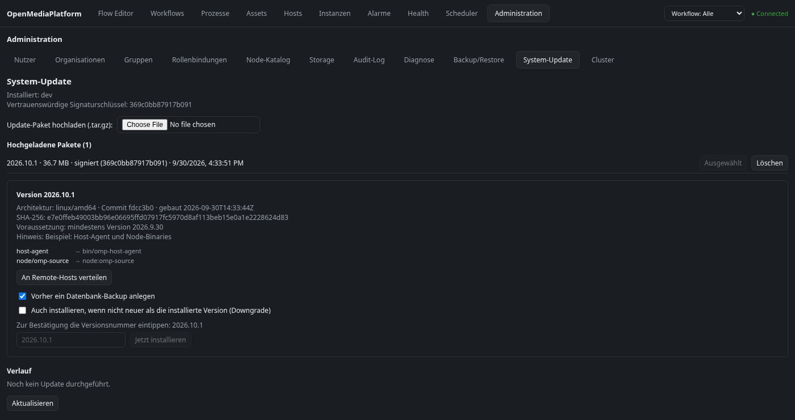

  1. Ein **Update-Paket** (`.tar.gz`, vom Betreiber mit `make update-bundle`
     gebaut und **signiert**) über „Update-Paket hochladen" auswählen. Der
     Server prüft sofort Aufbau, Prüfsummen und die Signatur gegen die
     hinterlegten Schlüssel (oben unter „Vertrauenswürdige
     Signaturschlüssel" angezeigt). Ein unsigniertes, verändertes oder
     beschädigtes Paket wird abgelehnt und nicht abgelegt.
  2. Das Paket erscheint in der Liste; „Auswählen" zeigt Version,
     Architektur, Commit, Prüfsumme, Hinweistext, **Voraussetzung**
     (Mindestversion), die enthaltenen Komponenten (Orchestrator,
     Supervisor, Host-Agent, Oberfläche, Node-Programme) und ob das Update
     die **Datenbank ändert**.
  3. **„Jetzt installieren"** wird erst aktiv, wenn du die Versionsnummer
     exakt eintippst. Ein Datenbank-Backup vorher ist voreingestellt (bei
     Datenbank-Änderungen Pflicht). „Downgrade" erlaubt ausdrücklich eine
     ältere oder gleiche Version.
  4. Der Server sichert, wird angehalten, aktualisiert und neu gestartet
     (Sekunden bis wenige Minuten; die Seite lädt danach von selbst neu).
     **Kommt die neue Version nicht gesund hoch, stellt der Supervisor den
     vorherigen Stand automatisch wieder her.** Das Ergebnis steht unter
     „Verlauf" (erfolgreich / fehlgeschlagen, zurückgerollt, mit Grund).
  5. **Laufende Nodes bleiben in Betrieb.** Instanzen, deren Programm
     ersetzt wurde, sind als **„veraltet"** gekennzeichnet (Reiter
     Instanzen); oben im Update-Reiter zeigt eine Warnung ihre Anzahl mit
     dem Knopf **„Veraltete Instanzen jetzt neu starten"** (mit
     Sicherheitsabfrage; Workflow-Rollen behalten dabei Node-IDs und
     Bedienzustand).
  6. **„An Remote-Hosts verteilen"** schickt das Paket an alle
     erreichbaren Host-Agents; jeder prüft es mit seinem eigenen
     Schlüssel und ersetzt sein Agent-Programm und die Node-Programme aus
     seinem lokalen Katalog. Das Ergebnis je Host erscheint live in der
     Liste (ok / fehlgeschlagen / offline). Ein neues Host-Agent-Programm
     wird erst nach dem Neustart des Agents aktiv.

  Wichtig: Ein Update-Paket ist ausführbarer Code. Deshalb ist der Reiter
  nur für Administratoren, jedes Hochladen/Installieren steht im Audit-Log,
  und ohne hinterlegten Signaturschlüssel wird **jedes** Paket abgelehnt.
  Einrichtung, Paket bauen und Fehlerbehebung: `docs/HANDBUCH.md` §5b.
- **Cluster** — Redundanz des Orchestrators selbst (Raft-Konsens,
  `ARCHITECTURE.md` §19.3): eine Statuskarte zeigt die eigene Node-ID,
  Zustand (Leader/Follower), Term und angewandten Log-Index dieser
  Instanz sowie den aktuellen Leader; darunter die Mitgliederliste mit
  Leader-Kennzeichnung und „Entfernen“ (mit Sicherheitsabfrage) je
  Mitglied. „+ Weiteren Orchestrator hinzufügen“ öffnet ein Formular
  (Node-ID, Raft-Adresse, optional die HTTP-Adresse der neuen Instanz),
  das darunter live ein fertiges Start-Skript mit allen nötigen
  Umgebungsvariablen erzeugt — auf der neuen Maschine ausführen, warten
  bis sie läuft, dann hier „Jetzt beitreten lassen“ klicken:

  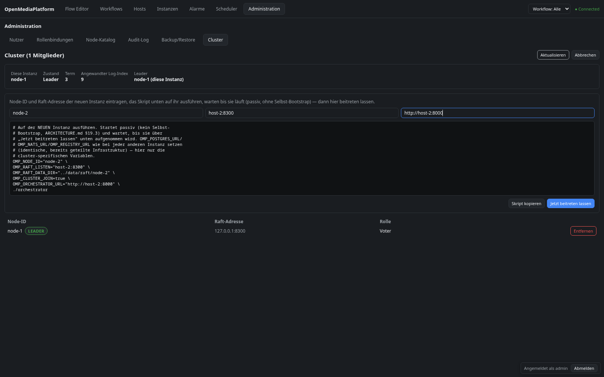

  Beitritt/Entfernen laufen serverseitig immer auf dem tatsächlichen
  Leader (eine Anfrage an eine Follower-Instanz wird automatisch
  dorthin weitergeleitet) — welcher Orchestrator gerade befragt wird,
  spielt für die Bedienung keine Rolle.

## 8. Hosts (Remote-Betrieb)

Der Reiter **Hosts** zeigt entfernte Maschinen, auf denen ein
Host-Agent läuft und die sich beim Orchestrator registriert haben —
Instanzen lassen sich dann auch auf diesen entfernten Hosts starten,
nicht nur lokal:

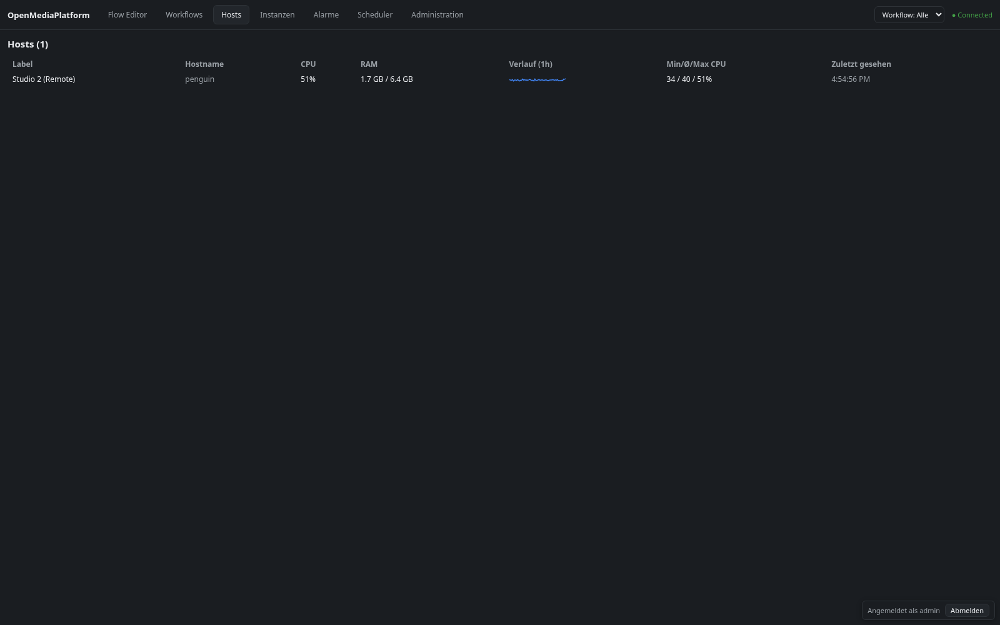

Neben dem aktuellen CPU-/RAM-Stand zeigt die Tabelle eine Ein-Stunden-
Verlaufs-Sparkline sowie Minimum/Durchschnitt/Maximum CPU — hilfreich,
um vor dem Start einer weiteren Instanz abzuschätzen, ob auf diesem
Host noch Luft ist.

Ein Host-Agent führt ausschließlich Node-Typen aus seinem eigenen,
lokal konfigurierten Katalog aus — der Orchestrator kann keinen
beliebigen Befehl auf einem entfernten Host ausführen, das ist eine
bewusste Sicherheitsgrenze.

### 8.1 Neuen Host hinzufügen (Wizard)

„+ Neuen Host hinzufügen“ (nur für Admins sichtbar) führt durch vier
Schritte statt den Bootstrap-Token-Flow von Hand per API zu bedienen:
Zielumgebung (Bare-Metal, VM im lokalen Cluster, oder Cloud/AWS EC2)
plus ein Label wählen; ein einmaliges, eine Stunde gültiges
Bootstrap-Token wird automatisch erzeugt; ein fertiges,
kopierbares Provisionierungs-Skript erscheint — je nach gewählter
Zielumgebung ein einfacher Shell-Befehl oder ein EC2-User-Data-Skript,
mit editierbaren Feldern für Orchestrator-/Registry-/NATS-Adresse
(vorbelegt, aber Vermutungen, die auf einer anderen Maschine ggf.
angepasst werden müssen):

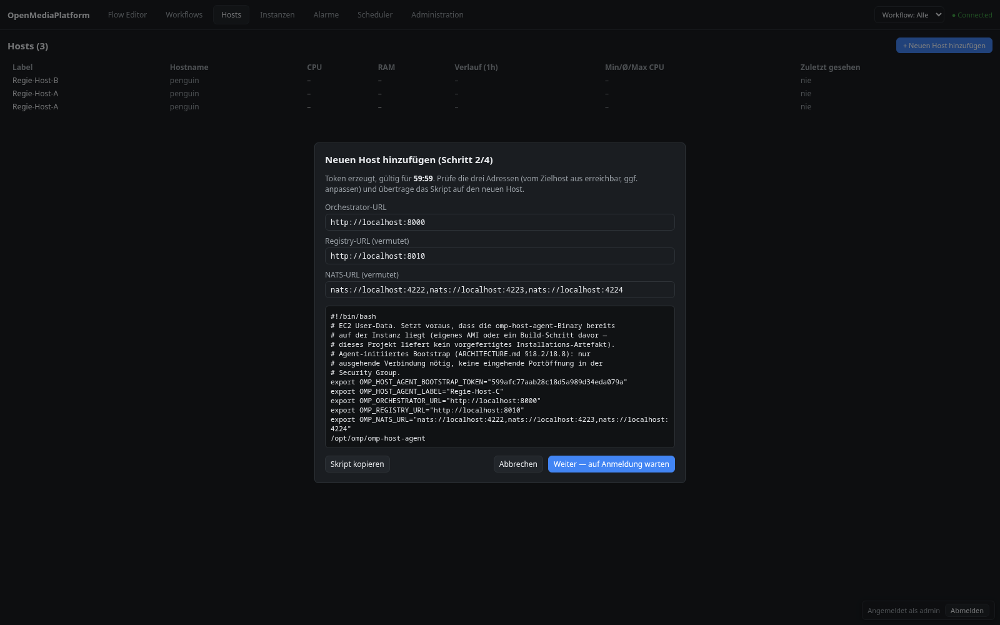

Nach dem Übertragen des Skripts auf den neuen Host wartet der Wizard
live (per SSE, mit Poll als Fallback) auf die Anmeldung des Host-Agents
und zeigt seine gemeldeten Capabilities (Betriebssystem, Architektur,
CPU-Zahl), sobald sie eintrifft — kein manuelles Nachschauen im
Hosts-Tab nötig. Der Wizard kann jederzeit im Hintergrund
weiterlaufen gelassen und geschlossen werden: das Token bleibt bis zum
Ablauf gültig, der Host erscheint bei erfolgreicher Anmeldung ohnehin
in der Tabelle oben. Bare-Metal, VM und Cloud unterscheiden sich für
den Host-Agent selbst nicht — die Auswahl bestimmt nur den Wortlaut des
erzeugten Skripts (`ARCHITECTURE.md` §18.8). Ein tatsächliches
automatisches Hochfahren einer Cloud-Instanz gehört bewusst nicht dazu
(kein Cloud-SDK im Orchestrator-Kern, `ARCHITECTURE.md` §18.9 Punkt 5)
— das Anlegen der Maschine selbst bleibt Sache des Betreibers.

Sobald mindestens zwei Hosts registriert sind, zeigt der Flow Editor
zusätzlich eine **Host-Ansicht** mit Zonen pro Host direkt auf der
Arbeitsfläche (Abschnitt 2.5) — die Hosts-Tabelle hier bleibt die
Detailsicht (Registrierung, Ressourcenverlauf), die Zonen im Flow
Editor zeigen, welche laufende Instanz auf welchem Host sitzt, und
warnen vor host-lokalen MXL-Kanten über eine Zonengrenze hinweg.

## 9. Operator-Konsole (Regieplatz)

Ein Nutzer ohne Konfigurationsrecht, aber mit `Bedienen`-Rechten auf
einen Workflow oder einzelne seiner Rollen (Abschnitt 7:
Rollenbindungen), landet nach dem Anmelden nicht im Flow Editor,
sondern direkt auf einer **Operator-Konsole** — einer reinen
Bedienoberfläche ohne Graph, Katalog oder Verkabelungsmöglichkeit. Sind
einem Nutzer mehrere Workflows zugewiesen, wählt er zunächst aus einer
Kachel-Liste den gewünschten Workflow — jede Kachel nennt den
Workflow-Namen und die Anzahl der darin zugewiesenen Rollen:

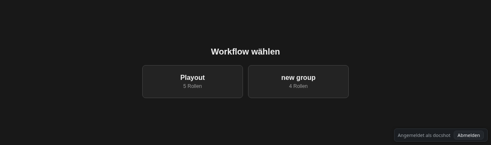

**Arbeitsplatz:** Hat ein Operator (ohne Konfigurationsrecht) Funktionsrechte der Module *Stream Ingest* oder *File Eingangskontrolle*, ist seine Startseite der **Arbeitsplatz**: oben die
Workflows zum Wechseln bzw. der Countdown bis zum nächsten Start, darunter die **Werkzeuge** (Kacheln „Stream Ingest“ und „File Eingangskontrolle“ — jede nur mit passendem Recht;
je Kachel die Zahl offener Aufgaben und Probleme) und die **Aufgabenliste**: zugewiesene QC-Dateien, eigene und Gruppen-Aufgaben („übernehmbar“) sowie die eigenen Aufnahmen mit
Stand, Zuständigen und Frist; Überfälliges und Fehlgeschlagenes steht oben in Rot. Ein Klick auf eine Aufgabe öffnet die Datei bzw. Aufnahme direkt. Im Benutzer-Widget unten rechts
zeigt ein rotes „⚠ n Aufgaben“, solange etwas Aufmerksamkeit braucht — in jeder Ansicht, auch in der Konsole; „🏠 Arbeitsplatz“ führt zurück. Auch ein Operator
ohne jeden Workflow (nur mit solchen Rechten) landet hier statt im Flow Editor.

Sobald einem Operator **mehr als eine** Rolle in einem Workflow zusteht,
zeigt die Konsole alle zugewiesenen Node-Oberflächen gleichzeitig als
frei verschieb- und skalierbare Kacheln (bei genau einer Rolle erscheint
stattdessen deren Oberfläche vollflächig, ohne Kachel-Rahmen):

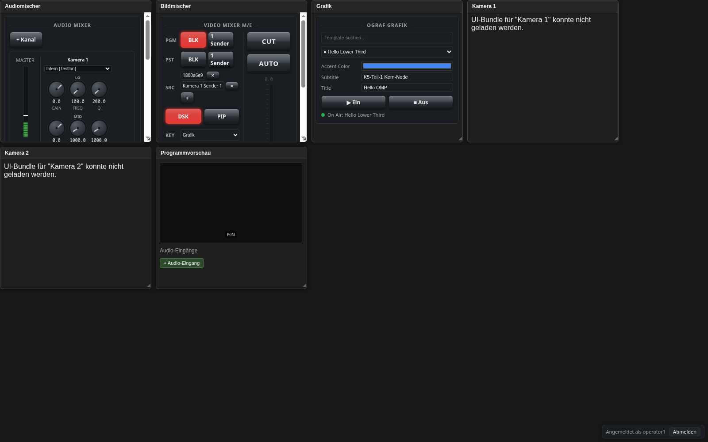

In diesem Beispiel ist der Operator per Workflow-weiter Bindung
(„Regie 1 (ganzer Workflow)", Abschnitt 7) auf allen sechs Rollen
bedienberechtigt:

- **Audiomischer** (oben links) — Kanalzüge mit Gain/EQ (LO/MID/HIGH);
  „+ Kanal" legt einen neuen Eingang an.
- **Bildmischer** — echtes M/E-Bedienpult: PGM-/PST-Kreuzschienen-
  Tasten, CUT/AUTO für harte bzw. weiche Umschaltung, DSK
  (Downstream-Keyer, hier aktiv/rot, mit der Grafik als Fill+Key-Quelle
  über das KEY-Dropdown) und PIP (Bild-im-Bild als eigener Layer).
  Die Anzahl der Mischerebenen (M/E-Bänke, 1–8, Standard 1) stellt man
  im Workflow-Editor an der Rolle ein („Mischerebenen“) oder als
  Node-Option „Mix/Effekt-Ebenen“ (`OMP_ME_LEVELS`). Jede Ebene hat
  eigenen Programm-/Preset-Bus und eigenen Ausgang; alle Ebenen teilen
  sich einen Quellen-Pool, und die Ausgänge der anderen Ebenen stehen
  als feste Quellen-Tasten zur Verfügung. Die Änderung wirkt beim
  (Neu-)Start des Nodes.
  Die Hauptebene (Ebene 1) steht unten, weitere Ebenen aufsteigend
  darüber. Der Schalter **⇄ PGM/PST** im Übergangsblock (je Ebene,
  Parameter `crosspoint.swapOnTransition`) tauscht nach CUT, AUTO und
  abgeschlossenem T-Bar-Zug PGM und PST: das bisherige Programm wird
  zum Preset. Ein Hot-Take auf dem PGM-Bus und zeitgeplante Wechsel
  (`takeAt`) lassen das Preset unverändert.
  **Aufbau einer Ebene:** links die Busse PGM und PST (BLK zuerst, dann
  die angehefteten Quellen); darunter eine Leiste in drei Gruppen —
  **Quellen** (Dialog „Quellen & DSK" zum Anheften/Verwalten), **DSK**
  und **PIP-Szenen**. DSK und jede PIP-Szene sehen aus wie
  Quellentasten (mit „Thumbnails“ als Karte, sonst als Pille); bei einer
  PIP-Szene zeigt die Karte eine Miniatur: Rahmen = Bild, grüne Fläche =
  Haltposition, gestrichelt = Start/Ende der Fahrt. „Neue Szene" legt
  eine weitere an, ✎ bearbeitet. Rechts die Übergangseinheit: CUT/AUTO,
  darunter die **Rampendauer** (6/12/25/50 Bilder), T-Bar,
  Übergangsart, ⇄ PGM/PST und ❄ FREEZE.
  **Quellen mit Problem:** meldet die Node einer Quelle über ihren
  Status (BCP-008) „Unhealthy", trägt ihre Taste ein ⛔ und einen roten
  Rand (PartiallyHealthy: ⚠, gelb); der Tooltip nennt den Grund (z. B.
  „keine Sendesitzung: das Handy ist nicht verbunden"). Ein Take einer
  solchen Quelle auf PGM fragt per Dialog nach.
  **Freeze:** „❄ FREEZE" nimmt das aktuelle Programmbild der Ebene als
  Standbild auf. Beliebig viele Freezes sind möglich; jeder erscheint
  sofort als angeheftete Quelle („Freeze: Freeze 1") auf PGM/PST und in
  der PIP-/Keyer-Auswahl und bleibt über einen Neustart erhalten
  (Ablage unter `~/.local/share/omp/mixer-freezes/<Label>/`, anderes
  Verzeichnis per `OMP_FREEZE_DIR`). Umbenennen und Löschen im Dialog
  „Quellen & DSK" unter „Freezes". Ändert sich die Mischer-Auflösung,
  werden alte Freezes übersprungen (bleiben aber auf der Platte).
  **PIP-Quelle:** wird live umgeschaltet (kein Neuaufbau, das
  Programmbild läuft ungestört weiter). Neben den Quellen und den
  PGM-Ausgängen der *anderen* Ebenen steht der Preset-Bus jeder Ebene
  (auch der eigenen) als „PST Ebene N" zur Verfügung — das PIP folgt
  dann dem, was dort gerade vorgewählt ist. Schleifen (eine Quelle, die
  direkt oder über andere Ebenen das eigene Ausgangsbild enthält)
  schaltet der Mischer im PIP auf Schwarz.
- **Grafik** — Vorlage auswählen (Suchfeld + Dropdown), Formularfelder
  befüllen, „▶ Ein"/„■ Aus" schaltet die Grafik auf Sendung (im
  Screenshot bereits aktiv: „On Air: Hello Lower Third").
- **Kamera 1** / **Kamera 2** — beide zeigen hier bewusst „UI-Bundle …
  konnte nicht geladen werden": nicht jeder Node-Typ bringt eine eigene
  Bedienoberfläche mit (`omp-source` hat keine, außer den generischen
  Parametern nichts zu bedienen) — die Konsole meldet das ehrlich statt
  eine leere Kachel ohne Erklärung zu zeigen. Welche Quelle welches
  Testmuster zeigt, stellt man über deren `pattern`-Parameter im
  Flow-Editor ein (Parameter-Panel bei Doppelklick auf die Kachel).
- **Programmvorschau** — zeigt das tatsächliche PGM-Ausgangsbild des
  Bildmischers als Live-Vorschau.

Läuft mehr als ein Host (Abschnitt 8), zeigt die Titelleiste jeder
Kachel zusätzlich ein kleines Host-Label (z. B. „Studio 2 (Remote)")
— welcher Host eine Rolle gerade ausführt, ist damit auch im
Regieplatz sichtbar, nicht nur im Flow Editor (Abschnitt 2.5). Der
Screenshot oben stammt aus einem Single-Host-Setup und zeigt deshalb
kein Host-Label.

Jede Kachel verhält sich wie ein echtes Fenster: Titelleiste zum
Verschieben (Ziehen), ein Anfasser unten rechts zum Skalieren, sowie in
der Titelleiste zwei Knöpfe zum **Minimieren** (die Kachel verschwindet und
liegt als Chip in der **Taskleiste** am unteren Rand der Konsole — Klick
auf den Chip stellt sie wieder her; die Leiste lässt rechts Platz für
Abmelden/Sprache) und **Maximieren** (füllt den
gesamten sichtbaren Konsolenbereich; Maximieren einer anderen Kachel
stellt die vorherige automatisch wieder her, es ist stets höchstens eine
Kachel gleichzeitig maximiert). Ein Klick auf eine Kachel holt sie vor
alle anderen. In einem eigenen **Knopfstreifen** oberhalb der Kacheln (er
überdeckt keine Fensterknöpfe) sorgt **„⊞ Alle anordnen"** dafür, dass alle
Kacheln wieder in einem übersichtlichen Raster erscheinen und
minimierte Kacheln dabei wieder aufklappen; daneben öffnet **„Stream Deck"**
das Stream-Deck-Panel (Abschnitt 10g). Position, Größe,
Minimiert-Zustand und Reihenfolge werden pro Regieplatz im Browser
gespeichert und bleiben über einen Seiten-Reload hinweg erhalten —
passend zu einem fest installierten Regieplatz-Bildschirm, an dem stets
derselbe Browser läuft (maximiert startet dagegen nie automatisch wieder
— das ist eine vorübergehende Fokus-Aktion, keine dauerhafte
Layout-Entscheidung).

**Vorschau (👁):** Nodes mit Vorschaubild (z. B. Quelle) zeigen es in der
Kachel nur auf Wunsch — der Schalter 👁 in der Titelleiste blendet die
Live-Vorschau ein oder aus (Standard: aus, wird je Kachel gespeichert).
Nodes ohne eigene Bedienoberfläche (z. B. Quelle) zeigen den Hinweis
„Dieser Node hat keine eigene Bedienoberfläche."

**Layouts speichern:** Im Knopfstreifen speichert **💾** die aktuelle
Fensteranordnung (Position, Größe, offen/minimiert, Vorschau) unter einem
Namen; das Auswahlfeld **„Layouts …"** wendet ein gespeichertes Layout an,
**🗑** löscht eines (Namensabfrage). Layouts gelten je Benutzer und
Workflow und liegen im Browser (nicht auf dem Server).

Ohne eine zugewiesene Playout-Automation-Rolle steuert ein Operator rein
manuell (Cut/Auto, Kreuzschiene, DSK/PIP) statt über eine Playlist —
passend für einen reinen Live-Schaltplatz ohne Bandmaterial; ist eine
`omp-playout-automation`-Rolle Teil des Workflows und dem Operator
zugewiesen, erscheint zusätzlich deren Playlist-Oberfläche als eigene
Kachel.

**Uhr-Hinweis.** Zeigt die Hosts-Tabelle neben dem Status ein **⏱ Uhr**, ist die Systemuhr dieses Hosts nicht synchronisiert und/oder sein TAI-Versatz nicht gesetzt — MXL-Zeitstempel und Schaltzeitpunkte (Playout-Automation) weichen dann von anderen Hosts ab. Der Tooltip nennt die Ursache; Abhilfe steht im Handbuch (Abschnitt 8, Troubleshooting).

**Sicherer Kommandokanal.** Der Orchestrator signiert jedes Kommando an einen Host (Start, Stopp, Update, ffmpeg-Auftrag); der Host führt nur Kommandos mit gültiger Signatur aus. Den Schlüssel bekommt der Host bei der Registrierung, ältere Hosts erhalten ihn automatisch, sobald sie online sind. Für den Betrieb heißt das: nichts einrichten — und nach einem neu aufgesetzten Orchestrator-Datenbestand notfalls `cmdKey` in der `state.json` des Hosts entfernen und den Agent neu starten (Handbuch, Abschnitt 8 „Befehle an einen Host scheitern“). Ein Administrator kann den Schlüssel eines Hosts wechseln (`POST /api/v1/admin/hosts/<id>/rotate-key`).

### 8.2 ffmpeg-Jobs auf einem Host erlauben (`tools.json`)

Ein Host führt ffmpeg-/ffprobe-Jobs der Plattform nur aus, wenn **sein Betreiber es am Host erlaubt** — der Orchestrator kann das nicht von außen einschalten. Dazu legt man neben dem Katalog des Host-Agents (`catalog.json`) eine Datei `tools.json` an (Vorlage: `deploy/tools.example.json`; anderer Ort über `OMP_HOST_AGENT_TOOLS`):

| Feld | Bedeutung |
|---|---|
| `tools` | erlaubte Programme (`ffmpeg`, `ffprobe`) mit absolutem `path`, optional `maxJobs`, `nice` (Standard 10), `threads` |
| `jobRoots` | Verzeichnisse, in denen Ein- und Ausgaben liegen dürfen. Pfade außerhalb (auch über Symlinks) werden abgelehnt |
| `allowNet` | `true` erlaubt Netz-Ein-/Ausgänge (RTMP, SRT, HTTP …). Standard aus: nur Dateien |
| `maxJobs` | gleichzeitige Jobs auf diesem Host insgesamt (Standard 2) |
| `cpuQuota` | optional, z. B. `"200%"`: Jobs laufen in einem systemd-Scope mit dieser CPU-Grenze (wenn `systemd-run` vorhanden ist) |

Nach dem Neustart des Host-Agents meldet er Version, Encoder und Hardware-Beschleuniger seines ffmpeg an den Orchestrator. Jobs laufen immer mit niedriger CPU- und Platten-Priorität (`nice`, `ionice`) und werden bei Speichermangel zuerst beendet. **Pfadprüfung:** Argumente mit `..` werden immer abgelehnt (auch lokal). Lokal lassen sich absolute Pfade zusätzlich mit `local.roots` in den Job-Einstellungen auf Wurzelverzeichnisse beschränken (leer = keine Einschränkung). **Medien müssen auf dem Host sichtbar sein:** entweder unter demselben Pfad (gemeinsamer Speicher) oder über die *Pfadzuordnung* in den Job-Einstellungen (Abschnitt 10h).

**Platzierung von Verbünden.** Rollen eines Workflows, die direkt über MXL verbunden sind, werden bevorzugt gemeinsam auf **einem** Host gestartet (MXL ist host-lokal, Verkehr über Hosts braucht Fabrics/RDMA). Passt der Verbund unter den Schwellen auf keinen Host, wird er so aufgeteilt, dass möglichst wenig Verbindungen Hosts überqueren; die Begründung nennt diese Verbindungen, und die Start-Vorschau warnt dann, dass dafür ein Fabrics/RDMA-Gateway-Paar im Workflow nötig ist. Passt auch keine Aufteilung, läuft er ungeteilt auf dem am wenigsten belasteten Host (Überlast steht in der Begründung). Dieselbe Bewertung gilt beim Umzug: Wartungsmodus und Überlast-Umzug planen den ganzen Verbund neu, ziehen aber nie in die Überlast; bleibt der aktuelle Host der beste Platz, passiert nichts.

### 8.3 Topologie und Verlauf (grafische Ansicht der Hosts)

Im Reiter **Hosts** zeigt oberhalb der Tabelle ein Diagramm die **Topologie**: jeder Host ist ein Kasten mit Statuspunkt (grün online, gelb Wartung, rot offline), Auslastungsbalken (CPU, RAM, GPU, Netz — nur gemessene Größen), der Zahl laufender ffmpeg-Jobs und seinen Nodes. Der senkrechte Strich im CPU-Balken ist die **Live-Reserve-Grenze**: darüber starten keine Jobs mehr. Pfeile zeigen die **Verbindungen zwischen Hosts** (Zahl = Anzahl der Verbindungen, Dicke wächst mit ihr, gegenläufige Verbindungen laufen getrennt). Liegt ein anderer Kasten zwischen zwei Hosts, läuft die Linie **um ihn herum** (rechtwinklig durch die Gassen oder außen um das Raster) statt durch ihn hindurch; Verbindungen innerhalb eines Hosts stehen als Zahl im Kasten. Nodes ohne Instanz (z. B. eine Handy-Kamera, die sich selbst anmeldet) liegen im Kasten „Ohne Instanz (extern)“. Ein Klick auf einen Kasten wählt ihn für das Verlaufsdiagramm darunter.

Das **Verlaufsdiagramm** zeigt für den gewählten Host **CPU, RAM, den CPU-Anteil der Live-Nodes (ohne ffmpeg-Jobs), GPU und Netz** über 1 h, 6 h, 24 h, 7 Tage oder 30 Tage (Linie = Mittelwert, Band = bis zur Spitze, Mausover zeigt die Werte). Bei CPU ist die Job-Grenze eingezeichnet. Die Rohwerte der letzten Stunde und die Minutenwerte der letzten 24 Stunden liegen im Speicher des Orchestrators; **Stundenwerte werden 30 Tage lang in der Datenbank gehalten** und überstehen Neustarts. Größen, die ein Host nicht misst (GPU ohne `OMP_HOST_AGENT_GPU_INDEX`, Netz ohne bekannte Link-Geschwindigkeit), erscheinen als „nicht gemessen“, nicht als flache Linie. Für langfristige Auswertung außerhalb der Plattform steht weiterhin `/metrics` (Prometheus) bereit.

### 8.4 Vorwarnung aus dem Trend (rechtzeitig umziehen)

Bisher warnt die Plattform erst, wenn ein Host die Schwelle **schon überschritten** hat (CPU 85 %, RAM 90 %, …). Zusätzlich beobachtet sie jetzt die **Tendenz**: Aus den Messwerten der letzten 45 Minuten legt sie eine Gerade durch CPU und RAM jedes Hosts mit laufenden Instanzen. Steigt die Last deutlich (mindestens 4 Prozentpunkte je Stunde), liegt sie schon bei mindestens 60 % der Schwelle, ist der Verlauf belastbar (kein Rauschen, mindestens 20 Minuten Daten) und trifft die Gerade die Schwelle voraussichtlich innerhalb der nächsten **60 Minuten**, entsteht eine **Vorwarnung**: im Reiter *Alarme* und als orangefarbener Block im Reiter *Hosts* mit der geschätzten Restzeit („erreicht voraussichtlich in ca. 25 min die Grenze“) und dem Vorschlag, wohin die Instanzen ziehen könnten. Ein echter Alarm ersetzt die Vorwarnung, sobald die Schwelle erreicht ist.

Ob die Plattform auf eine Vorwarnung auch **handelt**, steuert `OMP_PLACEMENT_PREDICT`: `off` (keine Vorwarnung), `warn` (**Standard**: nur Alarm und Vorschlag — niemand zieht ungefragt eine Live-Instanz um) oder `act` (die Vorwarnung wird wie ein echter Alarm behandelt, also greift die eingestellte Eskalation der Rolle — nur melden oder Umzug mit Bestätigungsfenster — schon *vor* dem Überschreiten). `OMP_PLACEMENT_PREDICT_HORIZON_MIN` stellt den Vorlauf ein (5–480 Minuten, Standard 60). Auto-Umzüge bleiben dadurch eine bewusste Entscheidung; der Orchestrator-Rechner selbst ist ausgenommen (er hat kein Ziel, auf das er ausweichen könnte).

### 8.x Host entfernen und Wartungsmodus

**Entfernen:** Ein nicht mehr erreichbarer Host (rote Zeile) lässt sich als Admin mit „Entfernen“ aus der Registry löschen. Ein Host mit laufender Telemetrie wird abgelehnt (409). Der Host-Agent muss sich danach mit einem neuen Token registrieren.

**Wartung:** „Wartung“ (nur Admin) sperrt den Host für neue Platzierungen und zieht alle Workflow-Rollen nacheinander per Make-before-break auf andere Hosts um: Die neue Instanz startet und wird verkabelt; die alte stoppt erst, wenn Viewer, Bildmischer und der umgezogene Node selbst nachweislich auf die neue Quelle umgeschaltet haben (Parameter `handoverPending`, Wartezeit höchstens 25 s). Der Bildmischer fügt die neue Quelle als zusätzlichen Zweig in die laufende Pipeline ein (kein Neuaufbau) und übernimmt Programm und Preset der alten Quelle, sobald die neue Bilder liefert.
Der Status steht neben dem Host: „wird geleert (n/m)“, „leer“ oder „n nicht verschiebbar“ (Mouseover nennt die Reste). **Nicht ausfallfrei verschiebbar** und deshalb nur gemeldet, nie angefasst: eigenständige Instanzen ohne Workflow, Rollen ohne Zielhost oder ohne freien I/O-Port. Ein Wartungshost nimmt keine neuen Instanzen und keine Umzüge an (409).
**Eigenständige Instanzen verschieben:** Unter dem Status listet die Hosts-Ansicht jede verbleibende eigenständige Instanz mit Grund („eigenständige Instanz, kein unterbrechungsfreier Umzug möglich“) und dem Knopf **„Verschieben …“** (nur Admin). Ein Popup lässt dich den Zielhost wählen (andere Hosts, die online und nicht in Wartung sind, sowie den Orchestrator-Host). Die Instanz wird gestoppt und dort neu gestartet — das Signal fällt kurz aus; Verbindungen, Einstellungen (z. B. Testbild) und die Quellenbezüge der Mischer werden übernommen.
**Hardware-gebundene Nodes:** Nodes, die besondere Hardware ihres Hosts brauchen (DeckLink-Karte, USB-Geräte), dürfen nie automatisch umziehen. Sie werden im Wartungsmodus und bei der Überlast-Eskalation übersprungen; es bleibt der Hinweis „an Hardware dieses Hosts gebunden, wird nie automatisch umgezogen“, und es gibt keinen „Verschieben …“-Knopf. Festlegen kannst du das auf zwei Wegen: (1) **je Rolle** im Rollen-Designer im Placement-Dropdown mit „Placement: an Host gebunden (nie automatisch umziehen)“; (2) **je Node-Typ** im Katalog (`deploy/catalog.json`) mit `"hostBound": true` — gesetzt bei `omp-decklink` und `omp-device-hub`. Rollen mit exklusivem I/O-Port (`requiredIoPort`) gelten immer als gebunden. Bewusst nicht gesperrt bleiben das manuelle Verschieben (Ziehen im Flow-Editor, API) und der Wechsel auf eine ausdrücklich eingerichtete Standby-Rolle.
**Flow-Editor:** Ein Host im Wartungsmodus hat in seiner Zone einen gestrichelten gelben Rahmen, den Status im Kopf (Tooltip mit den Resten und Gründen) und das Banner „WARTUNG“. Die Sperre überlebt einen Orchestrator-Neustart; die Evakuierung muss dann mit erneutem Klick auf „Wartung“ angestoßen werden. „Wartung beenden“ hebt die Sperre auf.
Der Tonmischer überblendet beim Quell-Umzug (120 ms, linear): Die neue Quelle läuft zuerst an einer Haltesenke mit; dann wird sie zusammen mit der alten in einen kleinen Überblend-Mischer am Kanaleingang geführt und die alte ausgeblendet (Verarbeitung, Fader, PFL, Sends bleiben unberührt). Der Überblend-Mischer bleibt danach im Kanal (15 ms Latenz, Zeitstempel bleiben erhalten). Mehrkanal-Quellen (z. B. 5.1) werden ebenso umgehängt, solange alte und neue Quelle dieselbe Kanalzahl haben; sonst und bei internen Testtönen wird der Kanal klassisch neu aufgebaut (kurze Lücke statt Dauerstille). Grenze: weitere Empfänger-Nodes haben noch keinen weichen Quellenwechsel. Der Host „Orchestrator (lokal)“ kennt keinen Wartungsmodus.

### 9.1 Workflow wechseln (Home-Button)

Ist ein Operator mehreren Workflows zugewiesen, zeigt das
Nutzer-Widget unten rechts (neben „Abmelden") zusätzlich einen
**„🏠 Workflow wechseln"**-Button, solange man sich innerhalb einer
einzelnen Konsole befindet — ein Klick führt zurück zur Kachel-Auswahl
von oben, ohne sich neu anmelden zu müssen. Bewusst „Workflow" statt
„Regieplatz" im Button: das trifft auch dann, wenn ein zugewiesener
Workflow kein klassischer Live-Schaltplatz ist.

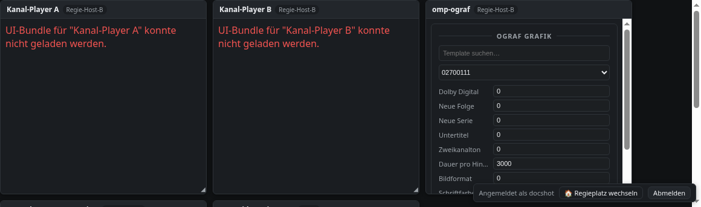

Der Button erscheint gezielt nur dort, wo es tatsächlich etwas zum
Zurückspringen gibt: ein Operator mit nur einem zugewiesenen Workflow
bekommt ihn nicht (es gäbe keine Kachel-Auswahl, zu der man wechseln
könnte), ein Nutzer mit Konfigurations-/Admin-Recht ebenfalls nicht (er
arbeitet im Flow Editor, nicht auf einem Regieplatz).

## 10. Messgerät (Scope)

Der Node-Typ **Messgerät (Scope)** (`omp-scope`) ist ein passives
Messgerät: er hängt sich an einen Video- und/oder einen Audio-Flow, ohne
selbst etwas zu senden. Sie starten ihn wie jeden anderen Node aus dem
Katalog und ziehen im Flow Editor eine Verbindung von der Quelle auf
seinen Video- bzw. Audio-Eingang — beide Eingänge sind unabhängig, einer
allein reicht. Ein Klick auf die Kachel öffnet das Messpanel.

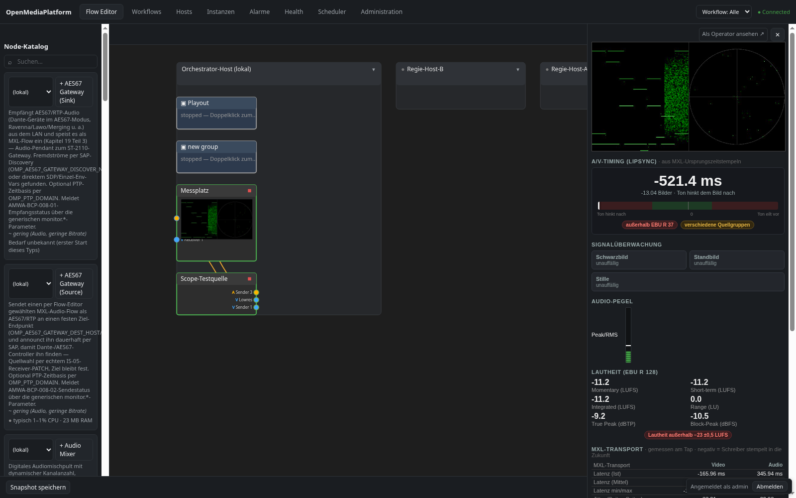

Von oben nach unten:

- **Messbild** — Luma-Waveform (links) und Cb/Cr-Vektorskop (rechts).
- **A/V-Timing (Lipsync)** — der Versatz zwischen Bild und Ton in
  Millisekunden und in Bildern, gerechnet aus den Ursprungszeitstempeln,
  die die Quelle den MXL-Grains mitgibt (nicht aus Ankunftszeiten). Der
  grüne Bereich der Skala ist das nach **EBU R 37** zulässige Fenster:
  der Ton darf dem Bild höchstens 40 ms vorauseilen und höchstens 60 ms
  nachhinken. Ein positiver Wert heißt „Ton eilt vor", ein negativer
  „Ton hinkt nach".
- **Signalüberwachung** — Schwarzbild, Standbild und Stille. Alle drei
  schlagen erst an, wenn der Zustand ununterbrochen anhält (1 s bzw.
  2 s); ein einzelnes schwarzes Bild zwischen zwei Schnitten ist kein
  Alarm. Die Kachel zeigt zusätzlich, seit wann der Zustand anliegt.
- **Audio-Pegel und Lautheit** — Peak/RMS sowie EBU R 128
  (Momentary/Short-term/Integrated/Range), True Peak in dBTP nach
  ITU-R BS.1770 und eine Ampel, ob das Programm die R-128-Vorgaben
  einhält (−23 ±0,5 LUFS, True Peak höchstens −1 dBTP).

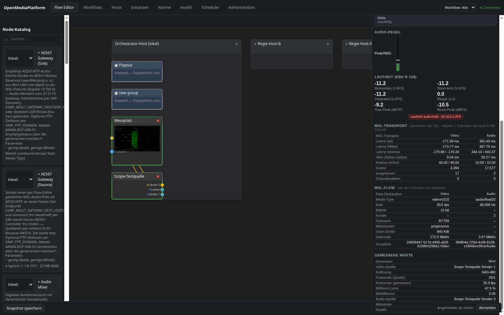

- **MXL-Transport** — je Flow die gemessene Latenz (aktuell, Mittel,
  Min/Max), der Jitter als Spitze-zu-Spitze-Schwankung dieser Latenz,
  die gemessene Kadenz gegen den Sollwert sowie Zähler für ausgelassene
  Grains und für Neuaufsetzer des Lesers. **Ein negativer Latenzwert ist
  kein Anzeigefehler:** er bedeutet, dass die Quelle ihre Grains mit
  einem Zeitstempel in der Zukunft versieht.
- **MXL-Flow** — was der Schreiber über seinen Flow *deklariert*
  (Media-Type, Rate, Bittiefe, Farbraum, Abtastraster, Grain-Größe,
  Datenrate, NMOS-Grouphint). Bewusst getrennt von den gemessenen
  Werten darunter: erst der Vergleich beider deckt einen falsch
  deklarierten Flow auf.
- **Gemessene Werte** — Quelle, Auflösung, Soll- und Ist-Bildrate,
  mittleres Luma, Bilddifferenz, Abtastrate, Kanalzahl.

Schlägt die Signalüberwachung an, färbt sich die betroffene Kachel rot
und nennt die Dauer:

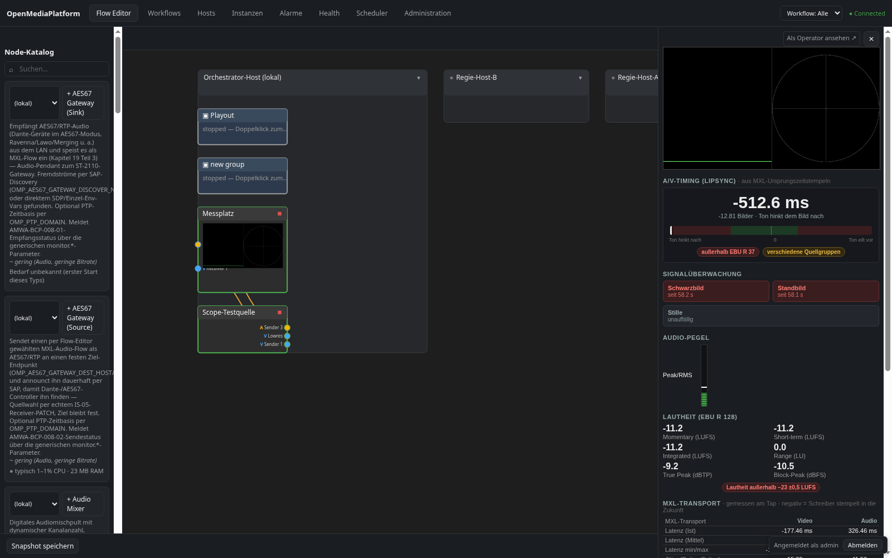

## 10a. Audiomischer-Konsole

Die Konsole des Audiomischers zeigt Kanäle als **Kanalzüge** (Name, Pegel,
ON AIR / MUTED / OFF AIR, Mute, Solo, Select, Status-Badges) und die Details
des gewählten Kanals im **Center Control** (Tabs IN, EQ, COMP, GATE, DELAY,
PAN, AUX, AUTOMIX, DUCK, AUTOMATION). Alles, was nicht an einen Kanal gebunden ist, liegt
global im Dialog **⚙ Szenen & Automation** der Kopfleiste.

- **Ansicht** (Auto, Desktop, Compact, Dicht, Grid, Touch), **Operate** (Übersicht,
  Fader ausgeblendet) und **Mix** (Fader + Center Control), **Fader** ein/aus,
  Spalten, Metergröße. Das sind reine Darstellungs-Einstellungen: sie ändern nie
  Pegel oder Routing; ein ausgeblendeter Fader behält seinen Wert.
- **ON AIR** heißt: wirklich hörbar im Programm (nicht stumm, auf Programm
  geroutet, nicht weggeregelt) — nicht bloß „nicht stumm“.
- **AUTO −x dB** = Absenkung durch AutoMix, **DUCK −x dB** = durch Ducking,
  **MANUAL** = Automation wirkt nicht auf diesen Kanal. Der eigene Fader bleibt
  davon getrennt und wird nie von der Automation überschrieben.
- **Fader**: ziehen (Touch: horizontal/vertikal je nach Layout, Wisch quer scrollt
  die Liste), seitlich wegziehen oder Shift = Feinmodus, Doppeltipp = 0 dB,
  Tastatur Pfeile/Bild/Pos1.
- **Tastatur**: Pfeile wechseln den Kanal, M = Mute, S = Solo, Esc schließt.
- **Gruppen-Busse**: Unter AUX → „Busse verwalten“ legt **+ Gruppen-Bus** einen
  eigenen Ausgangsbus an: Gruppenname (z. B. `pt`, `ad`) und Layout
  (mono, stereo, 5.1, 7.1 oder custom mit 1–16 Kanälen) sind frei wählbar. Jeder Bus ist ein eigener
  MXL-Audio-Sender mit der passenden Kanalzahl und den Tags `role.<Gruppe>` /
  `layout.<Layout>` (im Audio-Monitor als Quelle wählbar). Stereo-Kanäle werden
  per Send auf den Bus abgebildet (Mono: Mischung, 5.1/7.1 und custom: L/R auf Kanal 1/2, der Rest bleibt still). **Aus
  Ausgabeprofil** übernimmt die Gruppen der Audio-Regeln als Vorlage (Layouts
  Dolby E wird übersprungen) — nie automatisch. Je Gruppe nur ein
  Bus; ein einmal gebauter Slot behält seine Kanalzahl.
- **Quellen-Streifen → Gruppen-Bus (Tag-Zuordnung)**: Hat ein Kanal die Erwartung
  `role.<Gruppe>` (Routing), speist er den Gruppen-Bus dieser Gruppe automatisch
  (Post-Fader, 0 dB; ein ausdrücklich gesetzter Send hat Vorrang). Liefert die Quelle
  mehr als 2 Kanäle (z. B. ein 5.1-Gruppen-Sender eines Players) und hat der Bus
  dieselbe Kanalzahl, läuft das Signal **nativ** (alle Kanäle, unverändert) auf den
  Bus; Fader, Mute, AFV und AutoMix wirken auf alle Kanäle. Der Kanalzug selbst
  (Pegel, EQ, Programm) arbeitet weiter in Stereo (Mehrkanal wird heruntergemischt).
  Die Regel-Engine (Ersatzspur, Up-/Downmix) bleibt in den Playern.
- **Audio folgt Video (Tor)**: Ein Kanal mit Folge-Modus Cut/Crossfade öffnet und schließt
  sein Tor, wenn seine Videoquelle ins Programm geht bzw. verschwindet. Ohne festes Ziel ist
  das Ziel automatisch die Node der gewählten Audioquelle. Das Tor ist eine eigene Stufe im
  Audio-Thread: Rampe sample-genau und linear (Crossfade 500 ms, Cut hart), unabhängig von
  Fader, Mute, AutoMix; Kanäle im Manual-Override bleiben unberührt. Es wirkt auf Programm
  und auf Post-Fader-Sends (Gruppen-Busse, auch Mehrkanal), nicht auf PFL und Pre-Sends.
  Die Methode `setVideoContext` löst dasselbe aus wie eine Tally-Meldung (Probe/Notfall).
- **AUX**: Aux- und N-1-Busse (max. 10) anlegen; N-1 enthält alle Kanäle außer
  dem ausgeschlossenen — dessen Signal ist technisch nicht enthalten. Sends
  Pre- oder Post-Fader.
- **⚙ Szenen & Automation** (Kopfleiste, unabhängig vom gewählten Kanal): Reiter **Szenen**
  (speichern, abrufen, umbenennen ✎, aktualisieren, löschen, Auslöser „Videoquelle → Szene“, Presets des
  ganzen Mixers), **Ducking** (alle Regeln), **Video → Audio** (freie Zuordnungen) und **Ton folgt Bild**.
  Im Center Control bleibt bei DUCK nur der Kanalbezug (duckbar, Live-Wert, „als Auslöser“).
- **Bereiche der Konsole (Kap. 32)**: Die Oberfläche ist in zwei klar getrennte Bereiche gegliedert —
  **EINGÄNGE** (Kanäle, bei Bedarf je Mischgruppe oder „Nach Quelle“ gruppiert; Knöpfe „Nach Quelle“,
  „Ausgabegruppen“, „+ Kanal“ in der Kopfzeile des Bereichs) und darunter **AUSGÄNGE** mit einem
  Streifen je Ausgang (zwischen beiden liegt, sobald Mischgruppen existieren, der Bereich **GRUPPEN** in Violett
  mit Gruppen-Fader, Mute und AutoMix-Hinweis je Mischgruppe): **Programm** (Pegelanzeige, Limiter oben rechts), **Gruppen-Busse** (orange,
  z. B. „5.1 · Gruppe“), **Aux** (blau) und **N-1** (violett), jeweils mit Pegelanzeige, Ausgangs-Fader,
  Mute und Entfernen. Klick auf den Namen öffnet die Routing-Matrix, Doppelklick benennt um.
- **Routing am Kanalzug (wie am Hardware-Pult)**: Jeder Kanalzug trägt unter den Statusanzeigen eine
  Schalterreihe: **PGM** (Programm) und je ein Schalter pro Ausgang (Gruppen-Bus orange, Aux blau,
  N-1 violett). Ein Klick schaltet den Weg an/aus, **Mehrfachwahl** ist möglich — z. B. PGM aus und nur
  „5.1-TEST“ an, oder beides. Automatisch per Tag zugeordnete Wege sind gesperrt (Tooltip). Ein neuer
  Kanal läuft zunächst auf PGM; neue Ausgänge erscheinen sofort als Schalter in allen Kanalzügen.
- **Reihenfolge der Kanalzüge ändern**: Am Griff **⠿** im Kopf des Kanalzugs ziehen und auf einen anderen
  Kanalzug fallen lassen, oder den Kanal wählen und **Alt+◀ / Alt+▶** drücken; im Kanal-Editor (Reiter IN,
  Bereich „Reihenfolge“) gibt es dieselbe Funktion als Knöpfe. Die Reihenfolge gilt für alle Bediener und
  steckt in Presets und Szenen-Sicherungen.
- **Neuen Ausgang anlegen**: Am Ende des Bereichs AUSGÄNGE steht die Karte **+ Neuer Ausgang**: Namen
  eingeben, Vorlage wählen (Stereo, 5.1, 7.1, Mono, Eigene Kanalzahl), **Anlegen**. Der Gruppen-Tag
  (`role.<name>`) wird aus dem Namen gebildet.
- **Routing-Matrix**: Der Knopf **Routing-Matrix** (Kopfzeile AUSGÄNGE) zeigt jeden Kanal gegen „Programm“ und
  alle Ausgänge; ein Klick schaltet den Send an/aus, ein Kanal kann beliebig viele Ausgänge speisen.
  Automatisch (per Tag) zugeordnete Zellen sind gesperrt, das ✕ in der Spaltenüberschrift entfernt einen
  Ausgang.
- **Surround-Panner (Kap. 32)**: Geht ein Kanal auf einen 5.1- oder 7.1-Ausgang, erscheint neben der
  aktiven Zelle ein **⌖**-Knopf. Er öffnet den Joystick (vorn oben, hinten unten; Doppelklick oder Pos1 =
  vorn Mitte; Pfeiltasten feinfühlig, Umschalt = grob) sowie **Center-Anteil** und **LFE-Pegel**
  (Standard aus). Links/Rechts ist eine Balance des Stereobilds, vorn/hinten verteilt mit konstanter
  Leistung (bei 7.1 auf Rear und Side). Ohne Eingriff bleibt die frühere Abbildung (L→Front links,
  R→Front rechts). Der Panner wirkt nur auf Sends zu Surround-Bussen und wird mit Szenen/Presets gesichert.
- **AFV-Anzeige und Gruppierung (Kap. 31.6)**: Folgt ein Kanal dem Bild, zeigt sein Kanalzug die
  Plakette **AFV ●** (Quelle im Programm, Tor offen) bzw. **AFV ○** (gestrichelt, Tor zu). Die
  Schaltfläche **Nach Quelle** in der Werkzeugleiste gruppiert die Kanäle je Quelle (Sender-Name als
  Gruppenkopf) statt je Mischgruppe; die Wahl wird im Browser gemerkt.
- **Ton folgt Bild – einfach (Kap. 46.5)**: Der Knopf **Ton folgt Bild** über den Kanälen öffnet
  eine Karte je Videoquelle: „Wenn **Kamera A** im Bild ist, sind offen: …“. Die Kanäle der Quelle
  sind als Schaltflächen aufgeführt (✓ = gehört dazu); ein Klick fügt hinzu oder nimmt weg. **Hart**
  oder **Weich** (Crossfade) gilt für die ganze Karte, der Punkt vor „Wenn“ leuchtet, solange die
  Quelle im Programm des Bildmischers ist. **Automatisch aus den Quellen** ordnet in einem Klick
  jeden Kanal der Videoquelle zu, aus der sein Ton kommt; weitere Quellen kommen über **Videoquelle
  hinzufügen …**. Pegel, Stumm-Variante und Override bleiben unter **Center Control → AUTOMATION →
  Audio folgt Video (AFV)** (eingeklappt) einstellbar. Ein Kanal gehört zu genau einer Karte.
  **Folgt Bildmischer:** Oben im Dialog legst du fest, welchen Bildmischern/Switchern der Tonmischer folgt
  (**Alle** = jeder, wie bisher; sonst nur die angehakten). Angeboten werden die Geber, die schon Tally
  gesendet haben. Jede Karte kann das überschreiben (**wie oben** / **Alle** / bestimmte Geber) — wichtig,
  sobald mehrere Workflows mit eigenen Bildmischern laufen. Die Auswahl wird mit dem Mischer-Zustand
  (Presets) gesichert. Der Filter gilt auch für den gemeinsamen Schaltzeitpunkt (`setVideoContext`/`takeAt`): die Playout-Automation meldet dabei den Bildmischer, den sie bedient, als `giver`; ein nicht gewählter Geber wird ignoriert. Manuelle Aufrufe ohne `giver` (Probe-Knopf, Bediener) werden nie gefiltert.
- **Gemeinsamer Schaltzeitpunkt (`takeAt`, Kap. 31.4/31.5)**: Die Playout-Automation gibt bei jedem
  Take einen absoluten TAI-Zeitpunkt (ns, auf das Bildraster gerundet) an Bildmischer
  (`crosspoint.cut/take/autoTrans`), Tonmischer (`setVideoContext`) und Kanal-Player (`playAt`) weiter.
  Bild schaltet auf genau dem Frame, Ton am Sample; der Kanal-Player gibt das vorgeladene Datei-Item
  (`load` mit `hold`) so frei, dass erstes Bild und erster Ton exakt dort anliegen. `somMs`/`eomMs`
  im `load` begrenzen die Wiedergabe auf Start-/Endmarke. Einstellungen der Automation:
  `OMP_PLAYOUT_TAKE_LEAD_MS` (Vorlauf, Standard 300, 0 = aus; unter 250 ms kommt das erste Bild einer frisch gestarteten Quelle zu spät), `OMP_PLAYOUT_FRAMERATE` (Bildrate des Schaltrasters als `30000/1001`, `29.97`, `59.94` oder ganze Rate; Standard: Format des Workflows, sonst 25 — bei NTSC-Raten bildgenau).

## 10b. Handy-Kamera (WebRTC-Gateway)

Mit dem Node **WebRTC-Gateway (Handy-Kamera)** kann ein gewöhnliches Handy
per Browser als Kamera in OMP einspeisen — ohne App-Installation. Der
Node liefert die Sendeseite selbst aus (eigener Port, nicht über den
Orchestrator). Ein zweiter Node-Typ, **WebRTC-Gateway (Monitor)**, schickt
ein beliebiges Bild aus dem Flow Editor als **Retourbild** zurück aufs Handy.

**Einrichten**

1. Instanz „WebRTC-Gateway (Handy-Kamera)“ starten (Flow Editor, Abschnitt 2.1).
2. In der Bedienoberfläche des Nodes eine **Einladung** erzeugen: Das ergibt
   einen Link und einen QR-Code. Ohne gültige Einladung nimmt der Node
   keine Verbindung an; Einladungen lassen sich einzeln widerrufen
   (laufende Verbindung optional gleich trennen).
3. Optional im Feld **Retourbild-Node** einen Monitor-Node wählen: Dann
   enthält derselbe Link/QR-Code auch das Retourbild, und die Quelle wird per
   Drag & Drop im Flow Editor am Monitor-Node ausgewählt.
4. Das Handy öffnet den Link, erlaubt Kamera/Mikrofon und tippt
   **Verbinden**.

**HTTPS:** Handy-Browser erlauben Kamera und Mikrofon nur über HTTPS. Die
Gateway-Nodes starten deshalb zusätzlich einen HTTPS-Port mit einem selbst
signierten Zertifikat (`OMP_HTTPS=1`, im Katalog gesetzt; das Zertifikat liegt
unter `.run/https/` und wird wiederverwendet). Das Feld **Basis-URL** im
Einladungs-Panel ist automatisch auf diese `https://…`-Adresse vorbelegt,
Link und QR-Code zeigen darauf. Das Handy zeigt **einmal** eine
Zertifikatswarnung (bestätigen). Die TCP-Ports der Instanz müssen im LAN
erreichbar sein; bei einem Retourbild nutzt der Link ebenfalls die HTTPS-Adresse
des Monitor-Nodes.

**Die Handy-Seite**

- Im Look der Anmeldeseite (dunkles Navy, Cyan→Violett-Verlauf, Glas-Karte),
  für Hoch- und Querformat ausgelegt.
- **Vorausgewählte Auflösung und Bildrate:** Die Auswahlfelder sind schon auf
  die Werte eingestellt, mit denen das Gateway betrieben wird (Workflow-
  Format bzw. `OMP_WIDTH`, `OMP_HEIGHT`, `OMP_FRAMERATE_NUM/DEN`; ohne
  Angabe 1280×720 bei 25 fps). Der Nutzer kann abweichen, muss es aber nicht.
  Die Vorauswahl wird beim Laden der Seite gesetzt; eine bereits offene Seite
  muss nach geänderten Gateway-Werten neu geladen werden.
- Nach dem Verbinden: Kamerabild (und ggf. Retourbild; Antippen vergrößert),
  Anzeige „Live“, **Verbindung trennen** und ein aufklappbares **Status**-Feld
  mit Verbindungszustand und Latenz. Reißt die Verbindung ab, wechselt der
  Knopf sofort auf **Verbindung wiederherstellen** (ein Tipp verbindet mit
  denselben Einstellungen neu; heilt ein kurzer WLAN-Hänger von selbst, steht
  wieder „Verbindung trennen“). Ist der Einladungslink mit einer Sprechstelle
  gepaart (Intercom, Abschnitt 10c-5), steht unter dem Bild das kompakte
  Intercom-Panel; die Seite passt dann genau in den Bildschirm, das Bild wird
  entsprechend kleiner, und die Seite scrollt nicht.

  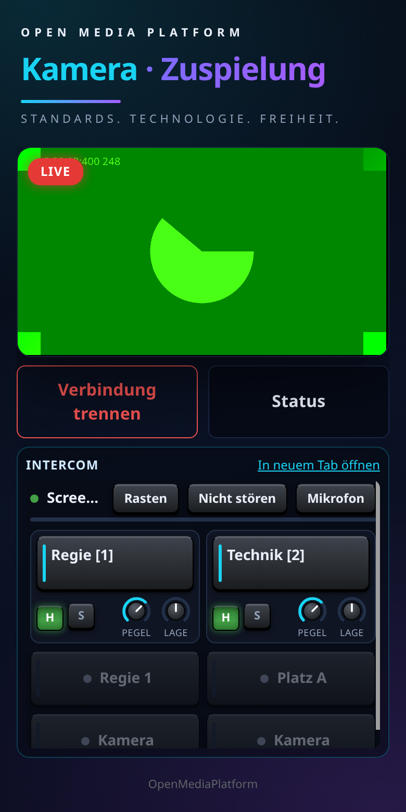 Die optionale **Latenzmessung**
  blendet einen Zeitstempel-Streifen ins Bild ein.
- **Monitor-Seite (Retourbild einzeln):** Ein Tipp auf das Videobild schaltet
  **Vollbild** um — nur das Video, randlos, ohne Overlays, Badge oder Texte
  (Seitenverhältnis bleibt erhalten, ggf. schwarze Balken). Erneuter Tipp oder
  die Zurück-Geste beendet das Vollbild. Auf Geräten ohne Fullscreen-API
  (z. B. iOS) füllt das Bild die ganze Seite; die Browserleiste kann dort
  sichtbar bleiben.
- Fehler beim Verbinden (Kamera nicht erlaubt, Einladung ungültig, Server
  nicht erreichbar) erscheinen als gut sichtbarer Hinweis im Startbildschirm.

**Feste HTTPS-Ports (Portweiterleitung, z. B. Crostini/ChromeOS):** Im Katalog
ist der HTTPS-Port fest auf **9443** (Handy-Kamera) bzw. **9444** (Handy-Monitor)
gesetzt (`OMP_HTTPS_PORT`). So bleibt eine einmal eingerichtete Weiterleitung
gültig. Ist der Port belegt (zweite Instanz), nimmt der Node einen freien Port
und schreibt das ins Log. Zusätzlich muss der WebRTC-UDP-Port erreichbar sein
(`OMP_WEBRTC_ICE_PORT`, `OMP_WEBRTC_PUBLIC_IP`).

**Tally (ON AIR):** Wird die Kamera von einem Auslöser auf Sendung geschaltet,
zeigt die Handy-Seite einen roten Rahmen mit „ON AIR“ und dem Namen des
Auslösers; das Handy vibriert beim Wechsel. Auslöser sind Bildmischer
(Programm), Switcher (aktiver Eingang) und Nodes mit Receivern, die als
**Tally-Geber** arbeiten (Option „Als Tally-Geber arbeiten“,
`OMP_TALLY_GIVER=1`, derzeit ST-2110-Ausgangs-Gateway): jede darauf
aufgeschaltete Quelle gilt als „auf Sendung“, solange die Verbindung besteht.
An der Kamera lässt sich mit der Option **Tally-Auslöser**
(`OMP_TALLY_SOURCES`, Node-Namen oder -IDs, kommagetrennt) einschränken,
wessen Tally zählt; leer = jeder. Das Tally bleibt an, solange mindestens ein
zugelassener Auslöser „an“ meldet. Die Seite fragt es per `GET /tally`
(mit Einladungstoken) ab; im Flow-Editor färbt dasselbe Ereignis die Kachel.

**CPU-Last und Empfehlung:** Das Gateway dekodiert das Handy-Bild in
Software. Wähle deshalb nach Möglichkeit **1280×720 bei 25–30 fps**;
1080p oder 50/60 fps verdoppeln den Aufwand. Der Viewer rechnet seine
Vorschau nur mit der eingestellten Vorschau-Bildrate (`previewFps`) und
legt die Quellenbezeichnung als HTML-Overlay über das Bild.

**Betriebshinweise:** Läuft das Handy übers Internet hinter NAT, die
Startumgebung `OMP_WEBRTC_PUBLIC_IP` und `OMP_WEBRTC_ICE_PORT` setzen.
`OMP_WEBRTC_LATENCY_MS` (Standard 40) steuert den Jitterbuffer,
`OMP_WEBRTC_BITRATE_KBPS` (Standard 4000) die Bitrate des Retourbilds.

## 10c. Audio-Ausgabe (Ausgabegruppen, Zuordnung, Ersatzregeln)

Unter **Administration → Playout → Audio-Ausgabe** legst du fest, wie die Kanal-Player ihren Ton ausgeben.
Gilt für den Kanal-Player, den MXF-Player und den MXF-Player direkt (deren frühere eigene Editoren für Programmgruppen und Presets entfallen; der MXF-Player direkt übernimmt Änderungen live per „Einstellungen neu laden“). Alles ist Konfiguration, nichts ist fest im Programm — andere Gruppen, mehr Spuren (z. B. 16 bei
XAVC) oder neue Ersatzregeln brauchen keine Programmänderung. Gespeichert wird das ganze Dokument
mit **Speichern**; **Auf Standard zurücksetzen** lädt die mitgelieferten ORF-Werte in den Editor
(erst Speichern übernimmt sie).

**MXF-Audiolabels (MCA):** Trägt eine MXF-Datei Labels nach SMPTE ST 377-4/-41 (Sprache, Inhalt wie PRM/DV, Soundfield-Gruppe), übernehmen die Player sie automatisch als Tags (`lang:`, `role:pt`/`role:ad`, `ch:`); im MXF-Player zeigt das Panel „MXF-Audiolabels“ sie je Playlist-Datei an.

**MXF-Aufnahme mit Labels:** Der Recorder schreibt MXF (H.264 + PCM 24 Bit), wenn der Dateiname auf `.mxf` endet. Setzt man vor `record.start` den Parameter `record.mcaPlan` (JSON: `channels` mit `index`/`label`/`soundfieldGroup`, `soundfieldGroups` und `groups` mit `items` wie `content`, `useClass`, `spokenLanguage`), trägt der Recorder die Labels nach dem Stopp in die Datei ein; ein fehlerhafter Plan wird beim Start abgelehnt. Prüfen lässt sich das Ergebnis mit `mxf-mca dump <datei>`.

1. **Ausgabegruppen** — jede Gruppe wird ein eigener Audio-Sender der Player (Standard:
   Programmton, Hörfilm/AD, Originalton, Dolby E, 5.1). Je Gruppe: ID, Name, Layout (Mono, Stereo,
   5.1, 7.1 oder eigene Kanalnamen), Tags (z. B. `role:pt`), „bit-exakt“ (nur reine 1:1-Auswahl,
   für Dolby E) und eine Vorgabe, falls ein Event nichts anderes sagt. Die erste Gruppe behält den
   Sendernamen „… Audio“. Änderungen an den Gruppen wirken nach einem Neustart der Player-Instanz.
2. **Spurschemata** — was die Spuren einer Quelle bedeuten (Spurnummer, Layout, Tags). Das passende
   Schema wird je Datei automatisch nach Format, Spurzahl und Pfadmuster gewählt. Mit „Als
   Mono-Spuren“ entsteht schnell ein Schema für N Spuren. Ein Tag `ch:L`, `ch:R`, … weist einer
   Spur einen Zielkanal zu.
3. **Zuordnungsvorlagen** — pro Vorlage und Gruppe eine **Klick-Matrix**: Zeilen sind die
   Quellspuren, Spalten die Kanäle der Gruppe. Ein Klick weist die Spur dem Kanal zu, ein zweiter
   macht ihn still. Alternativ „Tags statt Spuren“ (Tag-Ausdruck wie `role:ad AND layout:stereo`)
   und ein Prozessor (z. B. Upmix Stereo → 5.1). Je Zuordnung lassen sich **Gain (dB)**,
   **Verzögerung (ms)** (z. B. Laufzeitausgleich für den Hörfilmton) und ein **Loudness-Ziel (LUFS)** einstellen.
   Das Loudness-Ziel schaltet einen dynamischen EBU-R128-Normalizer ein (z. B. −23 LUFS); leer = aus.
   Verarbeitung führt bisher nur der Kanal-Player aus. Die 13 ORF-Presets sind als Vorlagen enthalten.
4. **Ersatzregeln** — greifen, wenn die Zuordnung einer Gruppe nicht erfüllbar ist. Von oben nach
   unten gewinnt die erste Regel, die eine Quelle findet; in einer Regel die erste Aktion, die
   klappt: *Quelle nehmen* (Tag-Ausdruck, optional über Upmix/Downmix), *Stille* oder *Event nicht
   senden (Alarm)*, jeweils mit optionalem Hinweistext. Beispiel: 5.1 → „nimm `role:pt AND
   layout:stereo` über Upmix, sonst Stille“.

5. **Testen** — unten im Editor beschreibst du eine Quelle (Datei laut Spurschema, N Mono-Spuren oder
   Live mit Stereo/Mono/5.1), wählst optional eine Zuordnung und klickst **Berechnen**: Du siehst je
   Gruppe, aus welchen Spuren sie entsteht, welche Ersatzregel greift oder ob sie still bleibt —
   ohne Medien und mit dem aktuellen, auch ungespeicherten Stand des Editors. (Der Orchestrator
   ruft dafür das Programm `audio-sim` auf; es entsteht mit `make nodes`.)

**Pro Event:** Im Event-Editor der Playout-Automation wählst du im Reiter **Audio** die Zuordnung.
Ohne Wahl gilt für MXF-Dateien die Vorlage „Stereo“, sonst der Programmton der Quelle. Sobald das
Event gecued oder auf Sendung ist, zeigt der Reiter den aufgelösten Plan (je Gruppe: welche Spuren,
oder Ersatzregel, oder still); die Playlist-Spalte „Audio“ markiert Ersatz und Warnungen mit ⚠.

## 10c-2. Lokale Geräte als Quelle anbieten (Geräte-Hub)

Der Node **Geräte-Hub** (Katalog: „Geräte-Hub“) erkennt die Kameras, Capture-Sticks und Audio-Schnittstellen, die direkt an diesem Rechner hängen (USB, aber auch eingebaute). Starte je Host eine Instanz; das Panel zeigt jedes Gerät mit Art, Anschluss, Fähigkeiten (z. B. „1920×1080 @ 30 YUY2“ oder „2 Kanäle, 48 kHz“) und einem Schalter **Anbieten**.

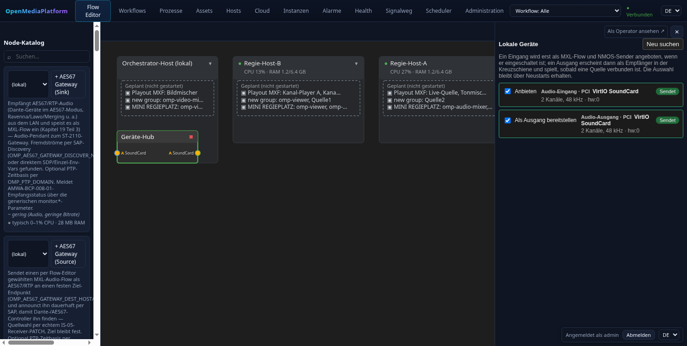

- **Anbieten einschalten:** Das Gerät erscheint als Quelle (MXL-Flow + NMOS-Sender) in der Kreuzschiene und kann wie jede andere Quelle verbunden werden. Der Status wechselt von *Aus* über *Startet …* auf *Sendet*.
- **Standard ist aus.** Nichts wird ohne dein Zutun angeboten. Die Auswahl bleibt nach einem Neustart erhalten.
- **Gerät abziehen:** Der Eintrag bleibt als *Nicht angesteckt* stehen; beim Wiederanstecken wird es automatisch wieder angeboten, mit derselben Sender-ID — Verbindungen in der Kreuzschiene bleiben gültig.
- **Fehler:** Fällt eine Quelle aus (z. B. von einer anderen Anwendung belegt), steht *Fehler* mit der Meldung als Tooltip. Mit erneutem Schalten oder **Neu suchen** gibt es einen frischen Versuch.
- **Audio-Ausgänge:** Hat eine Soundkarte einen Wiedergabeausgang (Kopfhörer, Lautsprecher, USB-Headset), steht sie zusätzlich als **Audio-Ausgang** in der Liste. Mit „Als Ausgang bereitstellen“ erscheint ein Empfänger in der Kreuzschiene; verbindest du eine Audioquelle damit, spielt sie über die Karte (Status *Wartet auf Verbindung* → *Sendet*). Trennst du die Verbindung, endet die Wiedergabe. Hat die Quelle mehr Kanäle als die Karte, wird heruntergemischt.
- **Format:** Video bis höchstens 1080p mit 25 Bildern/s (wenn das Gerät es kann), Audio mit der höchsten Kanalzahl des Geräts (bis 8) bei 48 kHz.

## 10c-3. X/Y-Panel (jede Quelle auf jede Senke schalten)

Der Node **X/Y-Panel (Kreuzschiene)** ist ein Bedienpanel ohne eigene Ports: Er zeigt links alle **Quellen** (Sender), rechts alle **Ziele** (Empfänger) und schaltet zwischen beliebigen kompatiblen Punkten. Starte eine Instanz und öffne ihre Kachel bzw. weise sie einer Operator-Rolle zu. Auf dem Smartphone und Tablet ordnet sich das Panel nach der Breite der Kachel an: Quellen und Ziele wechseln über zwei große Reiter, die Take-Leiste bleibt unten sichtbar.

- **Navigation (je Seite getrennt):** Die **Home**-Taste (⌂) zeigt Menütasten für alle **Workflows**, **Gruppen** (wie im Flow-Editor angelegt) und **Nicht zugewiesen** (Nodes ohne Workflow und Gruppe). Ein Klick öffnet die Ebene: darin Untergruppen als Tasten und die Punkte der Nodes dieser Ebene. **↑** geht eine Ebene hoch; die Brotkrumen zeigen den Pfad. Leere Ebenen werden ausgeblendet.
- **Filter:** Reiter *Alle/Video/Audio/Daten* und ein Suchfeld (Name, Node, Tag).
- **Schalten:** Quelle antippen, Ziel antippen — fertig (Standard **Sofort schalten**). Ist die Option aus, schaltet erst **Take**. Die Quelle bleibt gewählt, so lässt sich eine Quelle schnell auf mehrere Ziele schalten. Nicht passende Ziele (anderer Medientyp) sind abgedunkelt. Ein geschaltetes Ziel zeigt „von …“; **Trennen** löst die Verbindung.
- **Ganzer Node (Video + Audio zusammen):** Bei Nodes mit mehreren Ports steht in der Kopfzeile der Taste **⇉ Alle Ports**. Wähle sie bei einer Quelle und bei einem Ziel (z. B. Quelle mit Video- und Audio-Sender auf Viewer mit Video- und Audio-Empfänger): Das Panel schaltet alle Ports gleichen Medientyps in einem Schritt — zuerst nach gemeinsamen Tags, übrige der Reihe nach 1:1 (Video→Video, erstes Audio→erster Audio-Eingang …). Mit **Sofort schalten** geschieht das direkt, sonst über **Take**; die Meldung nennt Anzahl und Art der Paarung, **Rückgängig** nimmt alles zurück. Dieselbe Paarung wie bei *Tag-Schaltung* (unten), nur ohne Dialog. Sobald ein Node gewählt ist, erscheint in der Leiste unten die Auswahl **Zuordnung der Ports**: *Nach Tags, sonst 1:1* (Standard), *Nur nach Tags* (Ports ohne gemeinsamen Tag bleiben unverbunden) oder *Nur 1:1 (Reihenfolge)* (Tags werden ignoriert). Die Wahl wird im Browser gemerkt und gilt auch bei **Sofort schalten**.
- **Bouquets (Bündel):** Ein Bouquet ist ein Bündel von Quellen, z. B. Video von Quelle X, Audio von Quelle Y, Daten von Quelle Z. *Bouquets → Bouquet zusammenstellen*: Quellen links anklicken (nochmal klicken entfernt sie, ↑/↓ ändert die Reihenfolge der Kanäle), Namen und Zuordnung wählen, **Speichern**. Im Dialog *Bouquets* wählst du beim Bündel den **Ziel-Node** (z. B. den Monitor-Eingang) und die **Zuordnung**: *1:1* (Video→Video, erstes Audio→erster Audio-Eingang, zweites Audio→zweiter …, Daten→Daten) oder *per Tag* (Audio-Sender mit Tag X → Audio-Empfänger mit Tag X). Die Vorschau zeigt vorab, was wohin geschaltet wird und was keinen Partner hat (fehlende oder offline Quellen, zu wenige Eingänge); **Schalten** führt aus. Fällt eine Quelle aus, behalten die übrigen ihren Platz.
- **Bouquets (feste Schaltungen):** Mehrere Schaltungen mit einem Klick. *Bouquets → Feste Schaltungen aufzeichnen*: Quellen/Ziele wie gewohnt wählen (es wird nichts geschaltet, sondern gesammelt), Namen vergeben, **Speichern**. Im Dialog *Bouquets* schaltet **Schalten** alle Einträge; nicht mehr auffindbare Punkte werden namentlich gemeldet. Bouquets gelten für alle Nutzer und überstehen Neustarts (Bezug über Node und Portname, nicht über wechselnde IDs).
- **Tag-Schaltung:** Quelle und Ziel tragen Tags (z. B. `role.commentator`). Im Dialog *Tag-Schaltung* wählst du einen Quell-Node und einen Ziel-Node; die **Vorschau** zeigt, welcher Sender zu welchem Empfänger passt (gemeinsamer Tag, gleicher Medientyp, die allgemeinen `media.*`-Tags zählen nicht). Optional „Rest nach Reihenfolge verbinden“. **Schalten** führt aus, **Als Bouquet speichern** merkt sich die Regel und wertet die Tags erst beim Schalten aus. Tags setzt du im Flow-Editor über den Knopf 🏷 im Kachelkopf (Abschnitt 2.2) oder per API: für Quellen über `PUT /api/v1/sources/{senderId}/tags`, für Ziele über `PUT /api/v1/sinks/{receiverId}/tags` (Recht *Konfigurieren*); ein Node kann sie auch selbst melden (IS-04-Tag `urn:x-omp:tags` am Sender bzw. Empfänger).

## 10c-4. Video folgt Audio (Kamera schaltet auf den Sprecher)

Für Studios mit mehreren Kameras und mehreren Personen: Wer spricht, wird im Bild gezeigt. Dazu gehören zwei Dienste, die Sie über den Katalog starten: **Video folgt Audio** (Bedienung und Schaltlogik) und **Gesichtserkennung (Video folgt Audio)** (zählt Gesichter je Kamera, erkennt keine Personen). Beide gehören in denselben Workflow wie Bild- und Tonmischer. Erscheint eine Kachel nicht im Flow-Editor, hilft ein Neustart der Instanz (löschen und neu aus dem Katalog starten); beide Dienste wählen ihren Port beim Start selbst.

**Einrichtung in drei Schritten (Kachel „Video folgt Audio“):**

1. **Geräte:** Bildmischer und Tonmischer wählen, **+ Kamera hinzufügen** und je Kamera den Kamera-Node wählen. Optional eine **Totale bei Stille** (springt nach einigen Sekunden ohne Sprecher dorthin).
2. **Personen:** **+ Person**, Namen eintragen, das **Mikrofon** (Kanal des Tonmischers) wählen und **Einrichten** drücken. Die Person spricht jetzt ca. 5 Sekunden. Danach zeigt die Kachel je Kamera ein Vorschaubild mit gelben Rahmen um die gesehenen Gesichter; der wahrscheinlichste Treffer ist grün vorgewählt. Ein Klick auf ein anderes Gesicht ändert die Wahl, eine Kamera ohne die Person lässt sich abwählen. **Übernehmen** speichert („✓ bereit: Kamera 1, Kamera 2“).
3. **Schalter:** Der große Schalter **Video folgt Audio: AN** startet den Automatismus.

**Was passiert:** Spricht eine Person länger als die Reaktionszeit (Standard 0,7 s), schaltet der Bildmischer hart auf die erste Kamera, die sie an ihrem Platz zeigt. Ein Bild bleibt mindestens 2,5 s stehen, sodass nichts flattert. Oben steht jederzeit, welche Kamera auf Sendung ist und wer spricht; die Pegelbalken der Personen zeigen, ob das Mikrofon gehört wird. Unter **Feineinstellungen** liegen Sprechschwelle (dBFS), Reaktionszeit, Mindestdauer und die Zeit bis zur Totalen.

**Hinweise:** Die Gesichtserkennung liest die Vorschaubilder der Kamera-Nodes und braucht dafür keine Einstellung (die Kachel gibt die Kameras vor). Sie arbeitet auf CPU (ca. 5 % eines Kerns je Kamera). Die Schaltlogik braucht – wie die Playout-Automation – ein Service-Token; beim ersten Einsatz nach einem Update den Orchestrator einmal neu starten. Der Bildmischer muss die Kameras als Eingänge haben (Verbindungen im Flow-Editor).

## 10c-5. Intercom (Sprechverbindungen für Regie, Technik, Kameras, Studio und Gäste)

Das Intercom verbindet Menschen untereinander: **Kanäle** sind gemeinsame Sprechleitungen (z. B. „Regie“, „Technik“, „Kamera“), jede **Sprechstelle** hört und spricht in den Kanälen, die ihr zugeteilt sind. Niemand hört sich selbst. Bedient wird im Browser – am Rechner wie am Handy, ohne zusätzliche Software.

**Einmal einrichten (Administration → Produktion → Intercom):**

1. Dienst **Intercom** über den Katalog starten (Reiter Instanzen). Er ist ein eigener Dienst: er speichert Kanäle, Teilnehmer und Gäste selbst (Datei `data/omp-intercom.json`, Pfad per `OMP_INTERCOM_DATA` änderbar) und läuft unabhängig vom Orchestrator weiter; eine Sicherungskopie liegt in der Datenbank des Orchestrators (Datensicherung) und wird automatisch zurückgespielt, falls der Dienst einmal leer startet. Ohne laufenden Dienst ist die Einrichtung nicht erreichbar (Meldung in der Oberfläche). Er braucht keine weitere Einstellung; für das Mikrofon im Browser läuft er mit HTTPS (selbst signiertes Zertifikat, einmal bestätigen). Öffnen Sie die Oberfläche über `localhost` auf demselben Rechner, nutzt das Panel einfaches HTTP – `localhost` gilt für das Mikrofon als sicher, die Zertifikats-Rückfrage entfällt.
2. **Kanäle** anlegen. Ein Kanal der Art **IFB** führt Programmton, der um einen einstellbaren Wert gedämpft wird, sobald jemand hineinspricht.
3. Die Einrichtung hat fünf Reiter. Am besten in dieser Reihenfolge: erst **Kanäle**, dann **Teilnehmer**, dann **Zuteilung**; **Panel-Vorlagen** und **Gäste** bei Bedarf. Oben stehen immer **Speichern**, **Verwerfen** und der Betriebsstatus (wie viele Teilnehmer online sind).
   - **Teilnehmer:** links die Liste (grüner Punkt = online, Punkt mit Ring = spricht gerade), rechts die Einstellungen des gewählten Teilnehmers. Art: eine **Person** (öffnet ihr Panel mit dem eigenen Konto), ein **Rollenplatz** (z. B. „Kamera 2“, an dem sich jeder mit dem Recht „Intercom nutzen“ anmelden darf), eine **Programmquelle** oder eine **Anbindung** (Hardware/MXL, s. u.). Unter **Wer sitzt hier? (Zugang)** stehen Benutzernamen und Gruppen sowie **Neuer Zugangslink**; unter **Besonderheiten** **Priorität** (0–9: Spricht jemand mit höherer Priorität, werden niedrigere im selben Kanal um 12 dB gedämpft), **Darf andere stumm schalten und Alle-Ruf auslösen** (nur Regieplätze) und **Mikrofon gesperrt, solange On Air** (Studiolautsprecher und ähnliche Plätze). Das **Panel-Layout** ist unter „erweitert“ eingeklappt: **Standard**, eine **Vorlage** (ein Layout, das mehrere Teilnehmer teilen, z. B. „Kamera“; unter **Panel-Vorlagen** anlegen) oder ein **eigenes Layout** (Seiten und Tasten anordnen, Vorschau darüber; **Aus Zuteilung neu erzeugen** liefert einen Startpunkt).
   - **Zuteilung:** eine Tabelle Teilnehmer × Kanäle. Je Zelle schaltet ein Klick **Sprechen** (🎤) oder **Hören** (🎧) um; ein Klick auf einen Namen öffnet dessen Einstellungen. So sieht man auf einen Blick, wer wo zu hören ist.

   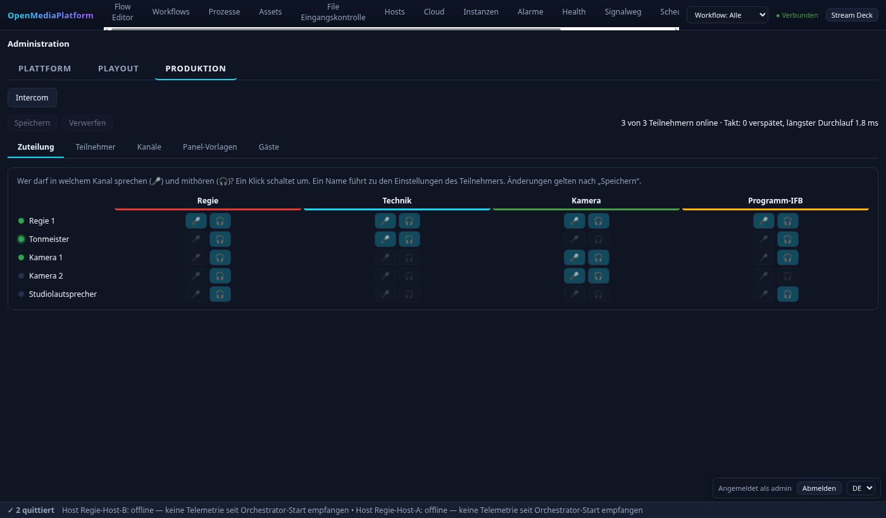

   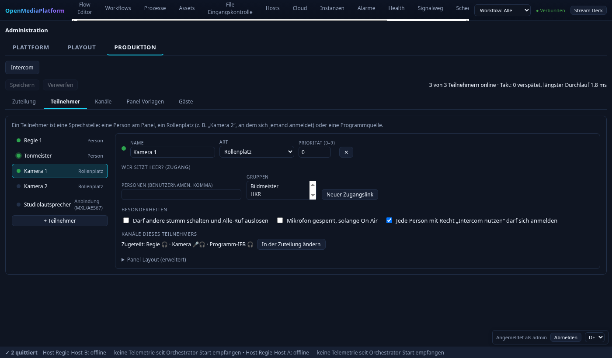
4. **Speichern** – erst damit gilt die Änderung (**Verwerfen** stellt den gespeicherten Stand her). Mit dem Recht „Intercom nutzen“ (Administration → Rechte) öffnet jede Person ihr Panel über die Kachel **Intercom** der Operator-Konsole.

**Das Panel:**

- Je Kanal eine Karte mit großer Sprechtaste: **Halten** = sprechen, **nur solange gedrückt** — Loslassen beendet es sofort; auf dem Handy öffnet ein langer Druck kein System-Menü. Wer lieber rasten möchte, schaltet oben **Rasten** ein: dann schaltet ein kurzer Tipp das Sprechen an und der nächste aus. Am Rechner: Ziffern 1–9 halten = Kanal sprechen, **M** = Mikrofon stumm.
- **Hören** schaltet einen Kanal weg, **Solo** hört nur diesen Kanal, **Pegel** und **Lage** (links/rechts) stellen die Mischung für Kopfhörer ein. Unter dem Kanal steht, wer gerade spricht.
- **Mikrofon** (oben rechts) schaltet stumm. Ist das Mikrofon gesperrt (On Air oder durch die Regie), steht das ausdrücklich dort – ein Mikrofon ist nie heimlich stumm. **Nicht stören** hält Rufe fern (Regieplätze dürfen trotzdem durch).
- **Rufen**: Beim Teilnehmer gedrückt halten, um ihn direkt anzusprechen – auch ohne gemeinsamen Kanal. Der Angerufene hört einen Rufton, sieht den Namen und kann mit **Antworten** zurückrufen. Ist er auf „Nicht stören“, meldet das Panel „nicht erreichbar“. **Alle rufen** (nur Regieplätze) spricht jeden Teilnehmer an.
- **Layout:** Wer es einrichtet, bestimmt, welche Tasten das Panel zeigt: Seiten (Reiter) mit Kanalkarten (mit Reglern), kompakten Kanaltasten, Rufen-Tasten, Alle rufen, Antworten, Mikrofon stumm und Nicht stören – mit eigener Beschriftung. Ohne Layout zeigt das Panel alle zugeteilten Kanäle der Reihe nach. Eingehende Rufe erscheinen immer oben, auch wenn der Kanal im Layout fehlt. Die Ziffern 1–9 gelten für die Kanäle der aktuellen Seite.
- Bricht die Verbindung ab, verbindet das Panel selbständig neu; eine neu geöffnete Sprechstelle startet immer ohne hängende Sprechtaste.

**Gäste:** Unter **Gäste** Namen, Gültigkeit und Kanäle wählen und **Gast-Link erzeugen**. Der Link funktioniert ohne Konto, endet von selbst und lässt sich vorher **sperren**. Für Gäste außerhalb des Hauses muss der Intercom-Port (HTTPS, Standard 9445) von außen erreichbar sein (Portweiterleitung, wie bei der Handy-Kamera).

**Programmton und Studiolautsprecher (MXL):** Der Dienst bietet **Programm n**-Eingänge (IS-05-Receiver, im Flow-Editor verbinden) und **Intercom Mix n**-Ausgänge (MXL-Sender). Ein Teilnehmer der Art **Programmquelle** mit „Programmeingang Nr.“ speist den verbundenen Programmton in seine Kanäle (mit einem IFB-Kanal wird er gedämpft, sobald jemand spricht). Ein Teilnehmer der Art **Anbindung** mit „Mix-Ausgang Nr.“ gibt aus, was er hört – z. B. an einen Studiolautsprecher oder eine Aufnahme. Anzahl der Ein-/Ausgänge: Start-Optionen des Dienstes.

**On Air:** Der Parameter **onAir** des Dienstes (von Hand oder von der Automation) und die Start-Option **On-Air-Auslöser** (Namen von Nodes, z. B. der Bildmischer: sobald einer eine Quelle im Programm hat) sperren die Mikrofone aller Teilnehmer mit „Mikrofon gesperrt, solange On Air“.

**Stream Deck:** Im Dienst-Panel der Konsole fernbedient ein Stream Deck die eigene Sprechstelle: Tasten für Mikrofon, Nicht stören, Rasten, Kanäle (halten = sprechen), Rufe und Hören; Drehgeber stellen Pegel. Das Mikrofon bleibt im Browser-Panel – dieses muss geöffnet und verbunden sein.

**Hinweise:** Auslastung: Kodiert wird je *verschiedenem* Hörsignal, nicht je Hörer (alle Zuhörer einer Partyline teilen einen Encoder), Stille wird nicht gesendet. Gemessen auf einem 1,8-GHz-Laptop unter Last: etwa 7 % eines Kerns je angemeldetem Teilnehmer; ein Server ist deutlich schneller. Die Verzögerung im Haus hängt vor allem von Browser und Audiogerät ab (Kopfhörer am Gerät, kein Lautsprecher). Gespräche werden **nicht aufgezeichnet**. Kennzahlen unter `GET /metrics` (`omp_intercom_*`); bei überlastetem Rechner meldet der Dienst einen Alarm.

## 10d. Playout-Workflow „Playout MXF“ (Player, Mischer, Monitor)

Der Workflow **Playout MXF** (Reiter Workflows, nach dem Anlegen im Zustand „gestoppt“) enthält:
zwei **Kanal-Player** (A/B), eine **Live-Quelle** (Testbild mit Ton), **Bildmischer**, **Tonmischer**,
**Audio-Monitor**, **Viewer** und die **Playout-Automation** — ohne Grafik. Programmformat 720p25; der
Bildmischer ist mit dem Viewer verbunden. Die Playlist ist als Beispiel mit sechs Events belegt: MXF-Clip und
Live-Quelle im Wechsel, mit den Übergängen Cut, Fade-Cut und Cut-Fade. Sie bleibt über Neustarts erhalten
(der Workflow hat dafür einen Channel „Playout MXF“, der an die Rolle gebunden ist).

**Starten und abspielen**

1. Workflow **starten**. Die Automation belegt ihre Ziele selbst anhand der Rollen (erster Kanal-Player =
   Kanal A, zweiter = Kanal B, Bildmischer, Tonmischer, Grafik falls vorhanden; Panel-Bereich „Ziele“,
   dort weiter änderbar).
2. In der Operator-Konsole (oder im Panel der Automation) im Bereich **Playlist** mit **＋** ein Event
   anlegen, als Medium die MXF-Datei wählen (Dateiliste des Kanal-Players, `OMP_MEDIA_DIR`), und im Reiter
   **Audio** bei Bedarf die Zuordnung wählen (Standard für MXF: „Stereo“).
3. **TAKE** bzw. ▶ beim Event drücken. Der Viewer zeigt das Programmbild.

**Übergänge** (Reiter Inhalt/Timing des Events, Auswahl „Übergang“, gilt beim Auftakt des jeweiligen Events):

| Übergang | Wirkung |
|---|---|
| Cut | harter Schnitt |
| Mix | Überblendung (Dauer in Frames einstellbar) |
| V-Fade | das bisherige Bild blendet über Schwarz aus, danach blendet das neue auf (Dauer in Frames einstellbar) |
| Fade-Cut | das bisherige Bild blendet über die Dauer auf Schwarz, danach steht das neue hart da |
| Cut-Fade | hart auf Schwarz, das neue Bild blendet über die Dauer auf |

**Quellenwahl im Live-Event:** Der Typ **Live-Quelle** listet **alle** sichtbaren Videoquellen des Systems als „Node · Sender“ — auch Ausgänge anderer Workflows/Regieplätze und Geräte-Gateways (z. B. DeckLink, ST 2110); Offline-Quellen sind gekennzeichnet. **Live nach Tags** wählt dagegen per Tag; die Felder bieten dazu ein Dropdown „+ bekanntes Tag …“. Quellen auf anderen Hosts sind nur wählbar, wenn ihr Signal dort über ein Gateway im lokalen MXL-Bereich des Players ankommt.

**Grafik-Children:** Bei den Typen Grafik/Logo/Branding wählt das Dropdown die Vorlage des Ziel-Grafikknotens (Ziel „Grafik“); die Daten werden mit den Vorgabewerten der Vorlage vorbelegt. Unter den Auswahlfeldern erscheint der **Editor zur Vorlage**: ein Feld je Eintrag des Vorlagen-Schemas (Text, Zahl, Ja/Nein-Schalter, Auswahlliste, Farbwähler; Listen/Objekte als JSON), Pflichtfelder mit *. Beim Zeigen einer Grafik stellt die Automation den **Downstream-Keyer des Ziel-Bildmischers** selbst auf Fill+Key des Ziel-Grafikknotens und schaltet ihn ein (bereits passende Einstellungen bleiben unverändert). Ein von Hand gewählter anderer Keyer-Eingang wird dabei überschrieben.

**Zeitangaben:** Dauer, Verzögerung und „Vor Ende“ werden als **HH:MM:SS.FF** eingegeben (auch „MM:SS.FF“ oder „SS.FF“; Bilder 00–24 bei 25 fps) und so auch in der Playlist angezeigt.

**Live-Quelle in der Playlist:** Die Quelle wird per Tag (`source.live`) gewählt, nicht per Sender-ID; die
Playlist funktioniert deshalb auch nach einem Neustart der Live-Quelle.

**Dateiende:** Der Kanal-Player wiederholt eine Datei nach ihrem Ende **nicht** mehr, sondern zeigt das leere Bild, bis die Automation das nächste Event lädt (Loop nur mit `OMP_LOOP=1`).

**Ausgangsgruppen hören:** Im Panel des **Audio-Monitors** über das Dropdown **Gruppenwahl** die gewünschte
Quelle wählen — jeder Kanal-Player bietet dort seine Audio-Gruppen an („… Audio“ = Programmton, danach
„… Audio Hörfilm/AD“, „… Originalton“, „… Dolby E“, „… Audio 5.1 Diskret“). Das Audio wird direkt im
Browser abgespielt. Mehr Kanäle gleichzeitig mischt der Tonmischer (Kanäle dort hinzufügen und die
Gruppen als Quelle wählen); er folgt dem Bildmischer nur, wenn die Quelle als Gruppe (Video + Audio) bekannt
ist — Kanal-Player melden dafür ihre Audio-Gruppen als zusammengehörig.

**Wo werden die Ausgabegruppen festgelegt?** Welche Gruppen es gibt (Programmton, Hörfilm/AD, …), definiert
**Admin → Audio-Ausgabe**; pro Event wählt der Reiter **Audio** die Zuordnung der Quellspuren. Der **Tonmischer**
startet **leer und frei konfigurierbar** (z. B. nur Stereo, ohne Playout-Automation). Über den Knopf
**Ausgabegruppen** in der Kopfleiste legst du bei Bedarf **je Ausgabegruppe einen Kanal** an (Erwartung
`role.<Gruppe>`); bestehende Kanäle bleiben unberührt. Es wird nichts automatisch angelegt.

**Szenen und Automatik (Tonmischer):** Mix einstellen → in der Kopfleiste **● Szene speichern** → im Dialog
**⚙ Szenen & Automation** pro Szene im Feld **automatisch bei** eine Videoquelle wählen: Sobald diese im Programm ist, wird die
Szene aktiv (**— nur manuell —** schaltet das ab). Freie Mehrfach-Zuordnungen stehen im Reiter „Video → Audio“.

**Hinweise**

- Die Automation sucht ihre Ziele jetzt in der Node-Liste des Orchestrators, nicht nur in der lokalen
  Registry: Player und Mischer auf einem **anderen Host** erscheinen dadurch in der Zielauswahl.
- Für Workflows auf Remote-Hosts lässt der Host-Agent jetzt auch die Bildraten-Variablen (`OMP_FRAMERATE_NUM/DEN`), die Mischer-Ebenen und die Ziel-Variablen der Automation durch; vorher scheiterte der Start eines Workflows mit Programmformat auf einem Remote-Host mit „extraEnv key … not allowed“. Host-Agents nach dem Update neu starten (`make hosts`).
- **Leistung:** Die Medien-Nodes laufen als Release-Build (`make nodes`), das Programmformat ist 720p25. Gemessen beim Kanal-Player mit einer 1080i-MPEG-2-Datei: Release spart nur etwa 5 % gegenüber Debug, weil die Arbeit in GStreamers C-Code läuft; 720p statt 1080p etwa 15 %. Den größten Teil kostet die Dekodierung des 1080i-Materials samt Deinterlacing. Mit der Umgebungsvariable `OMP_DEINTERLACE_METHOD` (`greedyh` Standard, `linear` oder `vfir` sparen rund ein Viertel der Rechenzeit) lässt sich die Methode ändern.
- Läuft die Automation auf einem anderen Host als der Player, liest die Dateiauswahl die Dateien des
  Players (Kanal A); die Datei muss dort unter `OMP_MEDIA_DIR` liegen.

## 10d-2. Demo-Kanal „ORF1“ mit den ORF-Audioprogrammgruppen

`python3 tools/demo-orf1/setup.py --start` (bei vorhandener Demo zusätzlich `--recreate`) legt den Workflow **ORF1 Playout**, den Channel **ORF1** und eine Beispiel-Playlist an (Sendungskennung mit Uhr, Magazin-Clip, Live-Schalte mit Lower Third, zwei Werbeblöcke, Trailer).

Am **Tonmischer** entstehen vier Ausgänge (Gruppen-Busse, je ein eigener Sender): **Stereo Programmton**, **5.1 Programmton**, **Stereo Originalton**, **Stereo Audiodescription**. Je Gruppe und Kanal-Player gibt es einen Kanalzug (Quelle = Gruppen-Sender des Players, folgt dem Bild, nicht auf dem Master) — im Programm hörbar ist immer nur der Player, der gerade sendet. Der Magazin-Clip `ORF-Demo-12ch.mxf` hat 12 Spuren (je Spur ein eigener Ton) und nutzt die Zuordnung **„ORF komplett“**: Spuren 1–2 Stereo-PT, 3–8 5.1-PT, 9–10 Stereo-OT, 11–12 Stereo-AD.

Die Gruppennamen und die Zuordnung „ORF komplett“ stehen in **Admin → Audio-Ausgabe** (globale Einstellung; die Gruppen „Dolby E“ bleibt unverändert vorhanden, wird im Demo-Mischer aber nicht verwendet).

## 10d-3. Werbeblöcke kennzeichnen (SCTE-35 / SCTE-104)

Wenn der Sendeweg wissen muss, wo ein Werbeblock beginnt und endet, leitet die Playout-Automation die Marker aus der Playlist ab.

1. **Events klassifizieren:** Im Event-Editor (Reiter Allgemein) bei **Werbe-Klasse** *Spot (commercial)* oder *Promo* wählen — aufeinanderfolgende Spots/Promos bilden **einen Block**. Mit *Block-Anfang* / *Block-Ende* legst du Grenzen ausdrücklich fest; ein Event ohne Klasse beendet den Block. In der Playlist sind Block-Events am rechten Rand orange markiert; der Hinweistext nennt Position und Gesamtdauer (z. B. „Werbeblock 2/3 · 00:00:30:00“).
2. **SCTE-Node starten:** Instanz *SCTE-35 Generator* anlegen. Unter **Admin → Einstellungen → omp-scte35** wählst du die Ausgabe: *SCTE 104 als ANC-Flow* (erscheint als NMOS-Sender „… ANC (SCTE 104)“ und lässt sich wie ein Videosignal verbinden, die Bildrate muss zum Video passen), *Transportstrom-Ziel* (`udp://host:port` oder `srt://…`) und/oder ein UDP-Ziel für den rohen Abschnitt.
3. **Kennzeichnung einschalten:** Im Panel der Playout-Automation den Bereich **Werbeblöcke (SCTE)** öffnen, *Werbeblöcke automatisch kennzeichnen* anhaken, den SCTE-Node wählen und den **Vorlauf** einstellen (Standard 4000 ms, mindestens 1000 ms). Standard ist *aus*.

**Was gesendet wird:** Das Event **vor** dem Block sendet das *Out* (mit Gesamtdauer und Auto-Return) um den Vorlauf vor dem Schnitt, das **letzte Block-Event** das *In* um den Vorlauf vor dem Ende. Beginnt der Block ohne Vorgänger (erstes Event, Sprung), kommt das *Out* sofort. Wird ein laufender Block verlassen (Skip, Take, Stop), nimmt die Automation ihn zurück. Bei eingeschalteter Kennzeichnung schneidet jedes Event genau an seinem nominalen Ende (kein Taktverzug). Die Marker erscheinen als Child Events `ad-pre-…`, `ad-out-…`, `ad-in-…`, `ad-close-…` und im Verlauf des SCTE-Nodes. Zum Ausprobieren kann man am SCTE-Node die Methoden `splice.out` / `splice.in` direkt aufrufen.

**Grenzen:** Eine Gegenprüfung mit einem realen Inserter/Injector steht aus. Verschlüsselung, Komponenten-Splices und der Empfang von SCTE als Auslöser gibt es nicht. Test-Muster-Events erscheinen im Programmbild bis zu ~0,3 s nach dem Schnitt (bekannte Eigenschaft der Testmuster, Dateien sind bildgenau).

## 10e. Cloud-Ressourcen, Kosten und Autoscaling

Der Tab **Cloud** zeigt, ob zusätzliche Rechenleistung in einer Cloud gemietet werden kann, was das kostet und wann das passiert. Ohne konfigurierten Anbieter zeigt der Tab eine **Demo-Seite mit Beispieldaten** (deutlich als „DEMO“ gekennzeichnet, nur lesend, nichts wird gemietet oder abgerechnet); alles läuft wie bisher lokal. Ein Anbieter wird vom Betreiber über Umgebungsvariablen eingerichtet (`docs/CLOUD-AWS.md`); zum Ausprobieren gibt es einen **Simulations-Anbieter** (`OMP_CLOUD_PROVIDER=mock`), der nichts mietet und nichts kostet.

**Wichtig:** Alle Beträge sind **Schätzungen** aus Preisliste × Laufzeit — nicht die Abrechnung des Anbieters. Datentransfer und Speicher sind nicht enthalten.

- **Kosten (geschätzt):** je Pool heute und im Monat: angefallen, Hochrechnung (laufende Hosts bis zum Ende der Periode) und der **Budgetdeckel**. Ist die Hochrechnung über dem Deckel, wird der Balken rot.
- **Gemietete Hosts:** Zustand (startet → wartet auf Host-Agent → bereit → wird geleert → beendet). **Abbauen** sperrt neue Platzierungen auf dem Host und beendet ihn, sobald nichts mehr auf ihm läuft.
- **Kapazität reservieren:** Pool, Anzahl und Zeitraum wählen; **Kosten vorab** zeigt die Schätzung (inklusive Boot-Vorlauf und Abbau). Der Cloud-Host wird rechtzeitig vor dem Beginn hochgefahren und nach dem Ende geordnet abgebaut. Eine Reservierung ist eine Zusage, Geld auszugeben: es erscheint eine Rückfrage.
- **Im Scheduler:** Läuft die Planung in einen Engpass (CPU/RAM/GPU), zeigt der Scheduler eine Zeile „☁ Cloud-Vorschlag … ca. X €“ mit **Reservieren**.
- **Autoscaling-Regeln (je Pool):** Standard **Aus**. *Nur vorschlagen* erzeugt bei anhaltend hoher Auslastung einen Vorschlag, den du **annimmst oder verwirfst**. *Automatisch* fährt selbst hoch — dafür ist ein **Tages- oder Monatsdeckel Pflicht**. Hochgefahren wird erst nach anhaltender Überschreitung (Zeitangabe), mit Mindestabstand zwischen zwei Schritten und höchstens so vielen Zusatzhosts wie eingestellt. Abgebaut wird nach anhaltend niedriger Last, und nur Hosts, auf denen nichts mehr läuft.
- **Der Budgetdeckel ist hart:** Er verhindert jedes weitere Hochfahren (auch Reservierungen), **schaltet aber nie eine laufende Sendung wegen Kosten ab**. Eine Blockade steht im Aktionsprotokoll. Der Deckel rechnet einen neuen Host bis zum Ende der Periode; ein Monatsdeckel am Monatsanfang kann deshalb früh greifen.
- **Aktionsprotokoll:** jede Aktion des Controllers (hochfahren, abbauen, vorgeschlagen, Budget blockiert) mit Begründung; zusätzlich im Audit-Log.

## 10f. Playout-Puffer (Ausgangs-Anker eines Workflows)

Der **Playout-Puffer** steht am Ende eines Workflows (vor Gateway, Aufzeichnung oder Viewer). Er hält Bild und Ton um eine
einstellbare Zeit zurück und schreibt sie als eigene Flows weiter. Der Zweck: **Ausfälle davor sollen den Ausgang nicht
abreißen** — ein abgestürzter oder umgeschalteter Node, eine Standby-Übernahme, ein Neustart.

**Einbauen:** im Workflow-Designer „+ Playout-Puffer“ hinzufügen und die letzte Rolle auf ihn verbinden (eine Verbindung
genügt, sie verbindet Bild **und** Ton). Die Rolle ist fest verankert (Schloss statt „ד) und nicht löschbar; im Feld
**Puffer (ms)** steht die Tiefe dieses Workflows (leer = 2500). Fehlt der Puffer in einem Workflow, warnt die Start-Vorschau.
Das Rollen-Format legt die Auflösung/Bildrate des Ausgangs fest wie bei Scaler und Quelle.

**Das Panel** zeigt:

* **Zustand:** *Vorlauf* (der Puffer füllt sich, der Ausgang zeigt Schwarz/Standbild), *Läuft* (Normalbetrieb, der Ausgang ist um die
  Puffertiefe verzögert), *Überbrückung* (der Eingang liefert nichts mehr und der Puffer ist aufgebraucht — der Ausgang hält Standbild oder
  Schwarz und sendet Stille, bis wieder genug neues Material da ist).
* **Balken Bild/Ton/Speicher:** Füllstand gegen die Zieltiefe, belegter Speicher gegen die Obergrenze (orange ab 80 %, rot ab 95 %).
* **Einstellungen** (mit „Übernehmen“): *Puffertiefe* (ms), *Wiederaufnahme nach* (ms; nach einem Ausfall, der länger als der Puffer
  dauerte, wird erst nach so viel neuem Material wieder gesendet; leer = Puffertiefe), *Wiederauffüllen* (‰ der Abspielgeschwindigkeit),
  *Bei Ausfall zeigen* (letztes Bild / Schwarz).
* **Zähler:** Ausfälle, Wiederaufnahmen, Haltebilder, verworfene/übersprungene Bilder, neu ausgerichteter Ton, Zeitsprünge im Eingang, Eingang neu aufgebaut.

**Was bei einem Ausfall passiert:** Ein Ausfall, der kürzer ist als die Puffertiefe, bleibt **unsichtbar** (das bereits gepufferte
Material wird weitergesendet; danach springt das Bild über die Lücke). Dabei schrumpft die Verzögerung um die Ausfalldauer; der Puffer
baut sie anschließend mit der *Wiederauffüll-Rate* (Standard 1 %: ein Bild doppelt je 100 Bilder, der Ton unmerklich gedehnt) wieder auf.
Ein längerer Ausfall führt in die *Überbrückung*; der Ausgang bleibt dabei durchgehend am Leben (Bild- und Ton-Takt laufen weiter).
Der Puffer baut einen still gewordenen Eingang selbst neu auf (nach 3 s ohne Daten, mit wachsender Wartezeit bis 4 s).

**Mehrere Spuren:** Mit *Bildspuren* (1–8) und *Tonspuren* (1–16) — Startwert `OMP_VIDEO_TRACKS`/`OMP_AUDIO_TRACKS`, zur Laufzeit im Panel
änderbar — bekommt der Puffer je Spur einen eigenen Empfänger und Sender („Video“, „Video 2“, …; „Audio“, „Audio 2“, …). Alle Spuren laufen
im selben Takt und mit derselben Tiefe, Bild und Ton bleiben zueinander ausgerichtet; jede Spur hat ihren eigenen Ring (Speicher wächst mit der
Bildspurzahl). Eine unverbundene Spur zeigt Haltebild/Schwarz bzw. Stille, ohne die anderen zu stören; fällt die Quelle einer Spur aus, läuft nur
diese aus ihrem Puffer. Das Panel listet alle Spuren (Verbindung, Füllstand, Speicher). Beim Verkleinern der Spurzahl wird der Speicher der
entfernten Spuren sofort frei; Spur 1 bleibt immer.

**Delay-Ausgleich:** Setzt ein Workflow ein Ziel-Latenzbudget, weist der Orchestrator den Ausgleich dem Puffer zu (er sitzt am Pfadende);
der Ausgleich wird zur Tiefe addiert, Bild und Ton verschieben sich gemeinsam.

**Grenzen:** Der Puffer arbeitet auf unkomprimierten MXL-Frames; eine Variante auf komprimierten Paketen (SRT/WebRTC-Ausgang, Schnitt an
Schlüsselbildern) ist nicht umgesetzt. Speicherbedarf ≈ Tiefe × Bildgröße (1080p25 bei 2,5 s ≈ 0,45 GiB), begrenzt durch die
*Speichergrenze*. Die im Katalog hinterlegte Latenz (63 Bilder) gilt für 25 Bilder/s und die Standardtiefe. Ton-Kanalzahl und -Abtastrate
sind pro Workflow fest (Standard 2 Kanäle, 48 kHz).

## 10g. Stream Deck als Bedienpult (Tasten, Dials, Streifen)

Ein angeschlossenes **Stream Deck** bedient dieselben Node-Oberflächen wie die Maus — jede Taste ruft genau den Befehl auf, den auch der
Bildschirmknopf auslöst, und zeigt denselben Zustand (on-air rot, Preset grün, Cue orange). Unterstützt sind **XL** (8×4 Tasten), **„+“**
(4×2 Tasten, 4 Dials, Touch-Streifen), **„+ XL“** (9×4 Tasten, 6 Dials, Touch-Streifen) und die 15-Tasten-Modelle. Die Screenshots
unten stammen aus dem **Simulator** mit dem Workflow „MINI REGIEPLATZ“ (Bildmischer, Audiomischer, Grafik, Quellen, Viewer, Audio-Monitor,
Kamera-Gateway) — die Tasten zeigen, was ein echtes Gerät zeigt.

**Voraussetzungen:** Chrome oder Edge am Desktop (Firefox/Safari bieten kein WebHID), die Seite über `https://` oder `localhost`,
die Herstellersoftware des Geräts **geschlossen** (sie hält das Gerät exklusiv). Unter Linux einmalig am Bedienplatz-Rechner
(dort, wo das Gerät steckt und der Browser läuft — nicht zwingend der OMP-Server):
`make streamdeck-udev` (oder `./install.sh --streamdeck-udev`), danach das Gerät einmal abziehen und wieder anstecken.

**Verbinden:** in der Operator-Konsole auf **Stream Deck** klicken (Kachel-Ansicht: im Knopfstreifen oben rechts neben „Alle anordnen“;
Einzelansicht mit einer Rolle: unten links) → **Echtes Gerät verbinden**, im Browser-Dialog das Gerät wählen. Nach dem ersten Freigeben
verbindet sich das Gerät beim Wiederanstecken selbst. Fehler (Berechtigung abgelehnt, Browser ohne WebHID, Modell nicht unterstützt, Gerät
belegt) erscheinen im Panel. **Simulator starten** zeigt ein virtuelles Gerät im Browser (zum Ausprobieren ohne Hardware; Modell im Menü wählen,
das Bild passt sich der Fensterbreite an); **Testraster senden** (Pfeil nach oben + Nummer je Taste — damit sieht man, ob die Bilder richtig herum
stehen) und **Render-Test** prüfen das Gerät.

**Aufbau:** Die oberste Tastenreihe ist immer gleich: Taste 1 **Home** (Startseite; die Tabs stehen nur in dieser Reihe, bei Überlauf
zusätzlich darunter), danach je geöffneter Kachel ein **Tab** (aktiver Tab grün; mehr Tabs als Tasten → letzte Taste „⇄“ blättert). Ein
Tabwechsel am Gerät holt die Kachel am Bildschirm nach vorn und umgekehrt. Alles darunter gehört dem aktiven Tab. Ist eine Seite zu klein,
belegt die **letzte Taste unten rechts** „⇄ n/m“ zum Blättern (am „+“ / „+ XL“ auch Wischen am Streifen). Tastentexte brechen um und
werden bei langen Namen kleiner; nur wenn auch die kleinste Schrift nicht reicht, wird mit „…“ gekürzt.

### Video-Mixer M/E

Zeile 1 = **PGM** (direkt auf Sendung, rot), Zeile 2 = **PRE** (Vorschau, grün), Zeile 3 = **CUT**, **AUTO**, **DSK**, Übergangstyp (weiter),
Rate (weiter), **FREEZE** (nimmt das aktuelle Programmbild als Standbild auf; es erscheint danach als eigene Quellentaste in PGM/PRE) und die PIP-Voreinstellungen (Umschalter). Quellen, deren Node einen Fehler meldet, sind rot (Untertitel „✖“); bei einer Warnung steht „!“ im Untertitel; liegt die Quelle gerade auf dem Bus, bleibt dessen Farbe. Die Tasten sperren nicht — wer eine rote Quelle drückt, schaltet sie (am Bildschirm fragt der Mischer dagegen nach). Kleinere Geräte zeigen PGM/PRE/Steuerung nacheinander als Seiten. Nur die Master-Ebene.

### Audio-Mixer

Je Kanal eine Spalte mit **MUTE**, **PFL** und **SELECT** (Pegel in dB auf der SELECT-Taste). SELECT öffnet mit **einem Druck** die Detailseiten
des Kanals: **EQ** (4 Bänder, Bypass), **Dynamik** (Kompressor, Gate) und **Pan** (Phase, Hauptmix); „◀ Mix“ führt zurück. Parameter anwählen und mit
−/+/−−/++ ändern. Am „+“ und „+ XL“ stellen die **Dials** den Pegel bzw. den Detail-Parameter, Drücken = Mute bzw. Schalter.

Rechts neben den Bedientasten (XL, + XL) bzw. auf dem Touch-Streifen („+“, + XL) zeigt eine **Kurve** den EQ-Frequenzgang (Punkte = Bänder,
das fokussierte Band ist ausgefüllt, bei Bypass grau) bzw. die Dynamik-Kennlinie (Kompressor mit Schwelle, Verhältnis, Knie und Makeup; die
Gate-Schwelle gestrichelt). Die Kurve folgt den Werten live.

### Grafik (OGraf)

Die Vorlagen („Presets“) stehen als Tasten oben — Drücken wählt die Vorlage (grün); **on air stehende Grafiken sind rot** und tragen „ON AIR“
(bei mehrstufigen Vorlagen mit Schritt „2/3“). Untere Zeile: **TAKE** (zeigt die gewählte Vorlage mit ihren Standardwerten), **TAKE OUT**
(blendet die gewählte aus), **CONTINUE** (nächster Schritt, zeigt „2/3“) und **ALLE AUS** (blendet alles aus, zeigt die Anzahl on air).
Viele Vorlagen blättern über „⇄ n/m“. Am „+“ / „+ XL“ liegen die Steuertasten auf der ersten Seite, danach die Presets; Dial 1 wählt die
Vorlage, Drücken auf Dial 2 = TAKE bzw. TAKE OUT, Dial 3 = CONTINUE, Dial 5 = ALLE AUS; die Anzeigen zeigen Auswahl und die Namen der laufenden
Grafiken. Feldwerte (Texte der Grafik) lassen sich am Gerät nicht bearbeiten — TAKE nimmt die Standardwerte der Vorlage.

### Geräte-Hub (Ein-/Ausgangsgeräte)

Je erkanntem Ein- oder Ausgangsgerät (Kamera, Capture-Karte, Audio-Ein-/Ausgang) eine Taste: **grün = EIN** (Gerät wird angeboten bzw. als
Ausgang bereitgestellt), **grau = AUS**, **rot** bei einem Gerätefehler, gedimmt wenn das Gerät gerade fehlt. Die Beschriftung zeigt Name sowie
„Video/Audio Ein/Aus · EIN/AUS“; Drücken schaltet um (wie der Schalter im Panel, das Ergebnis bestätigt der Hub nach wenigen Sekunden). Die erste
Taste **NEU SUCHEN** startet die Geräteerkennung. Viele Geräte blättern über „⇄ n/m“; die Dials am „+“ zeigen die Zahl der angebotenen
Geräte, Ein- und Ausgänge sowie Fehler.

### X/Y-Panel (Kreuzschiene)

**Große Decks** (XL, „+ XL“, ab 5 Spalten und 3 Zeilen): Quellen **links**, Ziele **rechts**, die Bedientasten in der **mittleren Spalte**
(von oben: **TAKE**, **Trennen**, **AUTO**, **Medium**).

- **Kategorien:** Die oberste Zeile jeder Seite zeigt **Alle** und je einen Node als Kategorie. Ein Druck filtert die Punkte darunter auf diesen
  Node, die gewählte Kategorie ist hervorgehoben. Passen nicht alle Kategorien in die Zeile, blättert **mehr ▶** weiter.
- **Punkte:** Darunter stehen die Quellen bzw. Ziele der Kategorie. Hat ein Node nur einen Punkt, trägt die Taste den **Node-Namen** (z. B.
  „viewer“), sonst den Punktnamen mit dem Node als Zusatzzeile. Ziele zeigen die aktuell geschaltete Quelle; die zur gewählten Quelle passenden
  Ziele sind hell, unpassende Medien gedimmt, ein Ziel an der gewählten Quelle rot. Reicht der Platz nicht, blättert **mehr ▶** (letzte Taste
  der Seite, mit Zähler).
- **Schalten:** Quelle drücken, Ziel drücken — bei **AUTO an** (Standard) wird sofort geschaltet, sonst erst mit **TAKE**. **Trennen** löst das
  gewählte Ziel. **Medium** wechselt Alle/Video/Audio/Daten und setzt beide Kategorien auf „Alle“ zurück.
- **Dials („+“, „+ XL“):** Dial 1 wählt die Quelle, Dial 2 das Ziel (jeweils innerhalb der gewählten Kategorie), Dial 3 das Medium; Drücken auf
  Dial 2 schaltet (TAKE), Drücken auf Dial 4 wechselt AUTO.

**Kleine Decks** (z. B. „+“ mit einer Tastenzeile) haben keine Spalten: Seiten **Quellen**, **Ziele** und **Steuerung** (TAKE, AUTO, Medium,
Trennen, Blättern), ohne Kategorien.

**Rechte:** Schalten und Trennen verlangt wie am Bildschirm mindestens **operate** auf dem Node des Ziels (Node-Bindung oder Workflow-Rolle,
z. B. der eigene Workflow) oder global **configure**; sonst meldet das Panel „forbidden“.

### Alle anderen Nodes

Ein **Auto-Raster** aus dem Descriptor — jeder schreibbare Ein/Aus-Parameter und jede Auswahl wird eine Taste, Methoden ohne Argumente eine
Starttaste, Zahlen mit Bereich werden am „+“ / „+ XL“ zu Dials. Eigene Nodes bekommen mit wenig Aufwand eine richtige Belegung:
[`NODE-TUTORIAL.md`](NODE-TUTORIAL.md), Abschnitt „Stream-Deck-Belegung für einen eigenen Node“.

**Grenzen:** ein Gerät je Browser-Sitzung; Neo, Mini und Ur-Modell sind nicht eingebaut. Pegelanzeigen gibt es nicht auf den Tasten. Das Gerät
wird nur im geöffneten Browser-Tab bedient (kein Hintergrunddienst). **Noch nicht am echten Gerät geprüft** (nur Simulator und echter Stack): Drehung
der Bilder beim „+“ und „+ XL“, USB-Dauer, Wiederverbinden, Dial-Drehsinn — Prüfliste am Ende von `UMSETZUNG.md`.

## 10h. ffmpeg-Jobs: wo sie laufen und wie die Sendung geschützt wird

Alle ffmpeg-/ffprobe-Läufe der Plattform — der Workflow-Schritt **Script**, die **File-QC**, **Review-Proxys** und Einzelbilder, die **Nachbearbeitung der Aufnahmen** — laufen als *Jobs*. Unter **Administration → Plattform → ffmpeg-Jobs** sehen Sie Hosts, Jobs und Einstellungen. (Für die Ansicht genügt das Recht „Jobs ansehen“, zum Ändern „Job-Verteilung einstellen“, zum Abbrechen „Jobs starten und abbrechen“.)

**Wo ein Job läuft (Ziel).** Jeder Job hat ein Ziel: `local` (der Orchestrator-Rechner), `auto` (automatisch nach Last auf dem besten geeigneten Host), `host:<id>` (ein bestimmter Host) oder `pool:<name>` (der beste Host einer benannten Gruppe, z. B. alle Hosts mit Grafikkarte). Welches Ziel gilt, wird in dieser Reihenfolge bestimmt: das Ziel am Job (beim Script-Schritt im Dialog unter „Weitere Einstellungen → Ausführungsort“) → das Standardziel des Aufrufers (QC, Proxy, Nachbearbeitung, Script) → das **Standardziel** des Systems. Ausgeliefert ist `local`: nach einem Update läuft alles wie bisher, bis Sie umstellen.

**Automatische Zuweisung.** Bei `auto` (und `pool:`) prüft die Plattform zuerst, welche Hosts überhaupt geeignet sind: online, nicht in Wartung, Jobs erlaubt, Programm und benötigter Encoder vorhanden, die Dateien sichtbar, noch ein freier Job-Platz, und die **Live-Reserve** bleibt frei. Unter den geeigneten gewinnt der mit der niedrigsten Bewertung aus CPU-Last, GPU-Last (nur wenn der Job die GPU nutzt, z. B. `h264_nvenc`; fehlt die Messung, gilt der Wert als „unbekannt“, nicht als „leer“), Anzahl laufender Jobs, Live-Nodes auf dem Host, Datennähe und Netzlast. Gleich schlechte Hosts bekommen abwechselnd Jobs; zugewiesene, aber noch nicht gestartete Jobs zählen schon mit. Ist gerade kein Host frei, **wartet** der Job in der Warteschlange (wichtigste Klasse zuerst) und zeigt den Grund; wartet er länger als eingestellt, gibt es eine Warnung im Protokoll. Klicken Sie auf einen Job und dann auf **„Warum dort?“**: Sie sehen alle Kandidaten mit Bewertung bzw. Ablehnungsgrund. Unter **Testjob** können Sie ein Ziel ausprobieren (`ffmpeg -version`), ohne Medien anzufassen.

**Sendeschutz (hat Vorrang vor allem anderen).**
- **Live-Reserve:** Je Host bleibt ein Anteil für die Sendung frei (Standard CPU 30 %, Speicher 25 %, GPU 30 %, Netz 25 %). Jobs starten nur unterhalb der Restkapazität; Batch-Arbeit (QC, Script) erst unter 80 % davon, damit immer Luft bleibt.
- **Gebuchte Aufnahmen:** Ein Job startet nicht auf einem Host, wenn dort in seiner geschätzten Laufzeit (Standard: nächste 30 min) eine Aufnahme gebucht ist.
- **Wächter:** Alle paar Sekunden prüft die Plattform die Auslastung. Nähert sich ein Host der Grenze, werden Jobs **gedrosselt**; ist sie erreicht, werden Batch-Jobs **pausiert** (danach automatisch fortgesetzt); wird sie deutlich überschritten, oder meldet ein Live-Node Aussetzer, werden Jobs **abgebrochen und neu eingeplant** — zuerst die zuletzt gestartete Batch-Arbeit. Interaktive Jobs (Review-Proxy, auf den jemand wartet) werden wegen reiner Last nie abgebrochen. Jobs mit Live-Quelle werden nicht pausiert (die Quelle läuft weiter), nur gedrosselt. Jeder Eingriff steht im Job-Verlauf und im Metrikzähler `omp_job_protect_total`.
- **Hosts markieren:** Je Host lässt sich einstellen, ob er überhaupt Jobs bekommt, ob nur Batch (`nur Batch`: dedizierter Rechenhost, Live-Last zählt nicht gegen ihn) oder kein Batch, und zu welchen Pools er gehört. Mit „Hosts mit Live-Nodes: nur interaktive Jobs zulassen“ sperren Sie Hosts mit laufenden Live-Nodes ganz für Batch.

**Live-Reserve automatisch kalibrieren.** Die feste Reserve (Standard 30/25/30/25 %) ist nur ein Startwert. Die Plattform misst je Host, was die **Live-Nodes** tatsächlich brauchen — CPU-Kerne, Arbeitsspeicher und GPU der gestarteten Instanzen, **ohne** die Last der ffmpeg-Jobs selbst (sonst schaukelte sich die Reserve an den Jobs hoch). Die Messwerte stehen in Stundenwerten 30 Tage in der Datenbank, die Kalibrierung betrachtet standardmäßig 7 Tage. Daraus entsteht je Host ein Vorschlag: **Bedarf = das Größere aus dem 95-%-Wert und 75 % der Spitze, plus Sicherheitsabstand** (Standard 10 Punkte), begrenzt auf 10–60 %. Die Karte **„Live-Reserve und Kalibrierung“** zeigt je Host jetzt / typisch (P95) / Spitze, den Vorschlag und die tatsächlich geltende Reserve samt Herkunft; ein Klick auf die Zeile zeigt die **typische Last je Node-Typ auf diesem Host** (CPU Ø/P95/max, RAM), damit man abschätzen kann, was ein weiterer Node braucht. Zwei Betriebsarten in den Einstellungen: **manuell** (Standard) zeigt nur Vorschläge — „Vorschlag übernehmen“ macht ihn zur festen Vorgabe des Hosts, „Vorgabe entfernen“ nimmt sie zurück; **automatisch** verwendet den Vorschlag selbst: Steigt der Bedarf, steigt die Reserve sofort, sinkt er, geht sie höchstens um 1 Punkt je 5 Minuten zurück. Reihenfolge der Quellen: feste Vorgabe des Hosts → automatischer Wert (erst nach mindestens 2 h Messdauer) → Wert aus den Einstellungen. Netz wird nicht kalibriert (die Karte trägt auch den Verkehr der Jobs).

**Wenn ein Host ausfällt**, läuft der Job auf einem anderen Host neu (bis zur eingestellten Zahl von Versuchen); Ausgabedateien entstehen als `<name>.part.<ext>` und werden erst nach Erfolg umbenannt, eine halbe Datei bleibt nie liegen. Ein Programmfehler (Exit-Code ≠ 0) ist ein Ergebnis und wird nicht wiederholt; ein Zeitlimit ebenfalls nicht. Wird der Orchestrator neu gestartet, gelten laufende Jobs als unterbrochen (Verlauf bleibt sichtbar); die Aufrufer wiederholen über ihre eigene Logik.

**Pfadprüfung.** Argumente mit `..` (auch eingebettet, z. B. `movie=../x.mp4`) und Nullzeichen werden immer abgelehnt — auf Hosts und lokal; ein abgelehnter Auftrag scheitert sofort ohne Wiederholung. Auf einem Host begrenzt `jobRoots` der `tools.json` die absoluten Pfade; für Aufträge **am Orchestrator-Rechner selbst** lässt sich dasselbe mit `local.roots` in den Job-Einstellungen (`ffmpeg.config`) einschalten (leer = keine Einschränkung außer dem `..`-Verbot).

**Medien auf anderen Hosts (Pfadzuordnung).** Ein Job auf einem anderen Host braucht Zugriff auf dieselben Dateien: gemeinsamer Speicher (NFS/SMB/Isilon …), der dort eingehängt ist. Tragen Sie unter *Pfadzuordnung* ein, wie der Pfad am Orchestrator (z. B. `/data/media`) auf dem Host heißt (z. B. `/mnt/media`). Fehlt der Zugriff, ist der Host für diesen Job „nicht geeignet“ (steht unter „Warum dort?“). Dateien werden nicht kopiert.

## 11. Weiterführende Dokumente

- [`HANDBUCH.md`](HANDBUCH.md) — Installation, `make`-Targets,
  Troubleshooting, mTLS/Backup/Soak-Betrieb.
- [`NODE-TUTORIAL.md`](NODE-TUTORIAL.md) — eigene Node-Typen
  entwickeln (Node-Contract, SDK).
- [`../ARCHITECTURE.md`](../ARCHITECTURE.md) — Architekturentscheidungen
  und Standard-Basis (EBU DMF, MXL, NMOS/ST2110).
- [`../UMSETZUNG.md`](../UMSETZUNG.md) — Umsetzungsstand, Status-
  Checkliste aller Kapitel.
