# OpenMediaPlatform — User Manual

> English version of [`BENUTZERHANDBUCH.md`](BENUTZERHANDBUCH.md) (the German original). The German text is authoritative when the two differ; section numbers match. The screenshots show the German UI (the English UI is selected with **EN**, see 1.1); labels in this text use the names of the English UI. The technical manual is [`MANUAL.md`](MANUAL.md).

A guide for operators of the web interface (Flow Editor,
instance start, workflows, alarms, administration). The screenshots come
from a real, locally running development instance (`make start`),
not a mock-up.

For the technical dev operation (installation, `make` targets,
troubleshooting) see [`MANUAL.md`](MANUAL.md). **For the
first installation run `make preflight` first:** it checks whether the
machine has everything needed and names the command to fix each problem
(`MANUAL.md` §1.1). For architectural
background see [`../ARCHITECTURE.md`](../ARCHITECTURE.md).

## 1. Logging in

When you open `http://localhost:8000` (or the URL under which the
orchestrator is reachable), the login screen appears first:

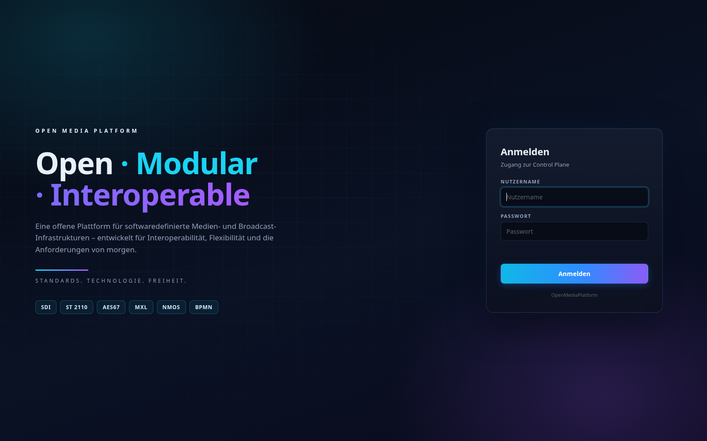

The administrator assigns user name/password in the
Administration view (section 7). In local dev operation an `admin` user exists
by default (see `MANUAL.md` section 3 for
the dev password — not suitable for production).

After a successful login the session stays logged in (token stored in the
browser) until "Log out" is clicked or the token
expires. If the user is deleted or their password is changed, the
session ends immediately. New passwords need at least 10 characters and must not contain the
user name.

**Too many failed attempts:** after 5 wrong logins with the same name from
the same address (and with a very large number of failed attempts from one address)
"too many failed login attempts" appears; after about 15 minutes it works again. From
a different address the user is not locked out by this.

### 1.1 Language (German/English)

At the top right (next to the connection indicator) and in the user widget at the bottom right
the **DE/EN** selection switches the interface; the page reloads in the process. The
choice applies per browser; without a choice the language follows the browser
(German, otherwise English).

**Status:** the entire orchestrator interface (all tabs, administration,
dialogs, operator console) and all node interfaces are bilingual. The
node catalog, node options and the operating values under Settings
also appear in the chosen language; known server messages
(errors, placement reasons, trigger log) are
translated for English, unknown ones stay German. The phone pages of the WebRTC gateway
(camera/monitor) follow the browser language (or `?lang=en`). **Still
German:** messages and descriptions that a node produces itself,
workflow names/descriptions and audio group names from your own data.
Both manuals exist in German and English (`BENUTZERHANDBUCH.md`/`USER-MANUAL.md`, `HANDBUCH.md`/`MANUAL.md`).

## 2. The Flow Editor

The Flow Editor is the central view: on the left the **node catalog**
(all node types that can be started on this installation),
on the right the **work area** with the running instances as
tiles. Each catalog entry additionally shows a short
function description, a rough load estimate (e.g. "~ low,
constant") and, as soon as the type has run at least once, a measured
CPU/RAM ballpark figure ("typically 47–56 % CPU · 34 MB RAM") — helpful for estimating
before the start what a further instance costs. The
search field above the list filters by name/type without reloading the page.

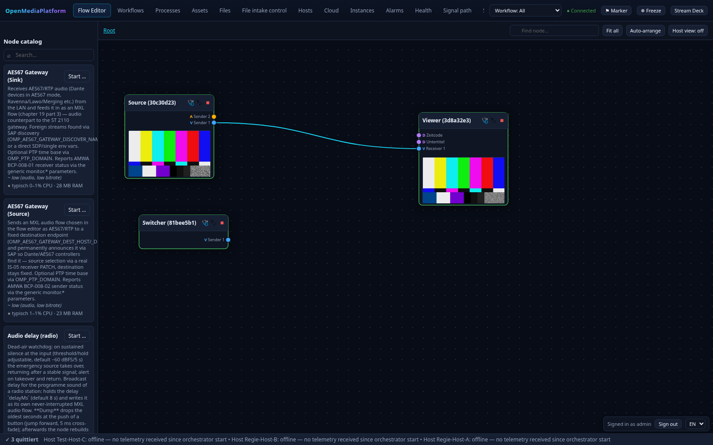

In this example the following are visible on the work area:

- **Source → Viewer** — a test source (color bars + test tone) connected
  by an edge to a viewer; the colorful color-bar picture in the
  viewer tile is a **real**, running MJPEG preview, not a
  placeholder.
- **Switcher** — still unconnected, but already shows its
  available connection point.
- **Regie 1** — a running workflow (section 4): at the root it always appears
  as **one** collapsed tile, regardless of the status;
  a double click opens it to edit/view its roles.
- **omp-registry** — the orchestrator itself as an NMOS node (registry
  housekeeping, no media function).

### 2.0 Finding a particular node

In the bar at the top of the Flow Editor, on the right, is the field **"Find node…"**. Type part of the name (or the ID); several words must all match, upper/lower case does not matter. The result list shows for every node which group it is in. With **arrow keys + Enter** or a click, the editor jumps to the matching group, selects the node and centers the view on it. **Esc** clears the search. If a node belongs to a running workflow and is combined into a tile on the main level, a notice says that it is hidden in this view. (The search field on the left in the palette, by contrast, searches the *catalog entries* that you can newly start.)

### 2.1 Starting an instance

In the node catalog on the left every node type is a card with **name, description and a "Start …" button**. The button opens the **start dialog**:

- **Name (optional):** whoever enters a name gets the instance under that name (instead of "type (short ID)") — it also appears as the source/sink name in crosspoint matrices and mixer selection lists. The instance ID is unaffected.
- **Target host** (only if there are host agents), with an online indicator and the profile traffic light (typical CPU/RAM demand, free capacity of the chosen host).
- **I/O port** (DeckLink only): input or output.
- **Settings:** all adjustable options of the node type (the same as under Administration → Settings), ordered by group. Fill in only what should differ for **this instance**; an empty field takes the value of the node type or the default (shown in the field). Invalid values are reported by the dialog immediately and it stays open.

"Start" starts the instance with exactly these values already at the first start (afterwards they are shown as instance values under Administration → Settings). Escape or "Cancel" discards the dialog. After a short time the instance appears as a new tile on the work area and in the catalog entry with CPU/RAM values and a "Stop" button. In the edit mode of a stopped workflow the button is instead called **"Add as role"** and adds the role without a dialog.

### 2.2 Connecting (routing)

Drag from an output connection point (right edge of a tile) to an
input connection point (left edge of another tile). This
creates a real NMOS IS-05 connection in the background — the target node
opens the corresponding MXL flow and starts reading immediately. An
active connection is shown as a colored line between the tiles
(in the screenshot above: Source → Viewer, orange/active).

**Editing the tags of the connections (🏷):** the 🏷 button in the tile header opens
an editor for the tags of the ports of this tile. At the top you choose the
port (→ outputs/senders, ← inputs/receivers). Below are your
own tags as chips (remove with ×); you type new tags and
confirm with Enter or "+" (format `domain.name`, e.g.
`role.commentator`, lower case, at most 32 per port). In gray are
the automatic tags: ⓘ derived from media type/channel count, ◌ reported by the
node — they cannot be changed. Only **Save** writes the
list (replaces the previous own tags of the port); **Cancel**, Esc
or a click outside discards. As long as changes are unsaved,
the port choice is locked. Requires the right *Configure*. The tags
control tag-based switching (X/Y panel, playout source "Live by
tags"). They apply per node and port name: for workflow roles they stay
across restarts, for ad hoc started instances they are lost
with the instance.

### 2.3 Layout

"Fit all" (top right) centers and scales the view to
all existing tiles. Tile positions are saved per user. Earlier there was a button "Save snapshot" at the bottom left;
it has been dropped. Existing scenes still appear as
buttons at the bottom left and can be applied with a click — without saved
scenes the bar stays hidden.

### 2.4 Grouping

Several tiles can be combined into a collapsible macro block
— handy for a whole control-room position, which then appears in the root
graph as only **one** tile:

1. Click the first tile, add more with **Shift+click**
   (at least two).
2. Press the key **G**, enter the name of the group.

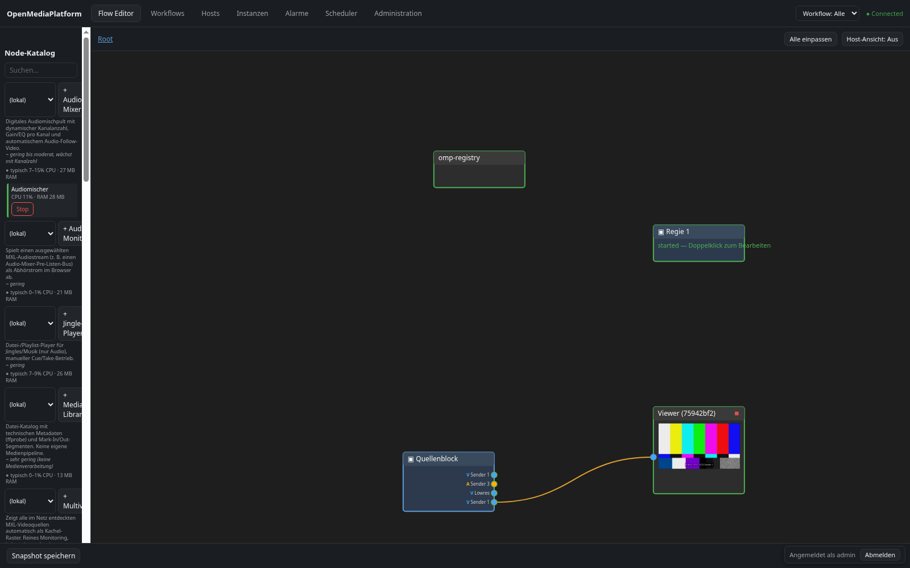

In the example "Source" and "Switcher" were combined into the group "Source block"
— their inputs/outputs are passed through outward on the group tile
(here: the four ports of the source, still
reachable unchanged), the other, ungrouped tiles (Viewer, Regie 1,
omp-registry) stay visible unchanged.
A double click on a group tile "enters" it (breadcrumb path at the top
left); "Dissolve group" there undoes the grouping.
"Save as workflow" inside a group creates a startable
workflow object directly from it (section 4).

### 2.5 Host view (zones for multi-host operation)

As soon as more than one host is registered (section 8), the Flow
Editor automatically shows **host zones** on the work area — one
rectangle per host, with label, online dot and live CPU/RAM display in the
zone header, plus a fixed zone "Orchestrator host (local)" for locally
started instances and a zone "Unassigned" for nodes without
instance launcher assignment. Every node tile visibly lies in the zone
of the host on which it actually runs. A B5 group (section 2.4)
also gets a zone — unambiguous if all its members run on
the same host, otherwise it lands in its own collective zone
"Groups across several hosts":

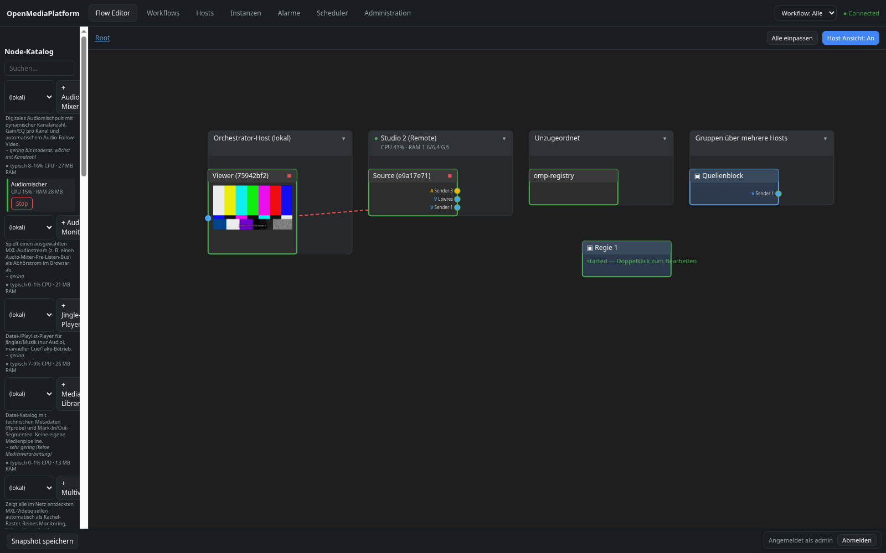

In this example the source "Source" runs on the remote host
"Studio 2 (Remote)" (live CPU/RAM in the zone header), while its viewer
still runs locally. The group "Source block" from section 2.4
contains members on different hosts and therefore appears in
the collective zone on the right.

The button **"Host view: On/Off"** (top right, visible only in the root graph)
switches the zones manually; below two
registered hosts it stays off by default. Positions inside
a zone can be moved freely — this layout is remembered separately
from the normal free layout: switching off restores the tile
positions from before the switch-on unchanged. A ▾/▸
symbol in the zone header collapses a single zone along with its tiles
(then showing only the number of contained tiles) — handy
for keeping an overview with many hosts.

**Edge warning style:** MXL is host-local (shared memory) —
a connection whose sender uses MXL transport and whose two
tiles lie in different zones does not work on the media side and is therefore drawn dashed in warning color (in the
screenshot: the connection between "Source" on "Studio 2" and the
local "Viewer"). That is a hint, not a block — for real
host-boundary transfer use ST 2110, the SRT gateway or MXL fabrics
(section "Related project"/`MANUAL.md` §9.3) instead of a direct
MXL edge.

**Accompanied host move via the ⇄ button:** on a **standalone** (not
belonging to a workflow) node tile, with host view active, the ⇄ button appears in the tile header. It opens a list of the other
hosts; after the choice a confirmation dialog appears; after confirming, the instance is
restarted on the target host and its existing connections are automatically
re-established (matched by port role, not by the old ID, which
changes at the restart). For roles inside a running
workflow this function does not yet exist in this view — a running
workflow always shows itself in the host view as one collapsed
tile (section 2), individual roles do not appear there individually
zoneable. The collapsed tile itself lies in the zone matching its
roles (with mixed hosts in the collective zone
"Groups across several hosts" at the top) — only dragging a
single role into another zone is still missing.

## 3. Instances overview

The **Instances** tab shows all running node processes in a table
with status, **workflow** (e.g. "Playout MXF · Audio mixer"; "–" = started by hand, belongs to no workflow), host, CPU load, RAM use, PID and the number of
automatic restarts after a crash:

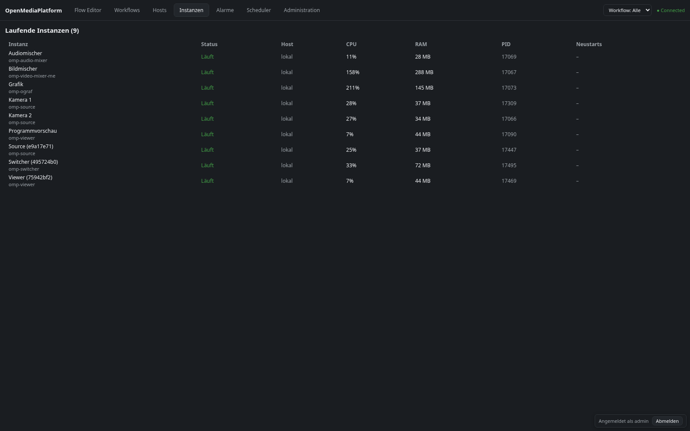

A process that crashes is restarted automatically (with a
brake against restart loops) — the restarts column makes that
visible without having to search the logs.

In the **Actions** column every row has three buttons:

- **Rename** changes the display name of the running instance — without
  restart and with the same instance ID. The node re-registers the new name
  (with its senders/receivers) within a few seconds; the name
  also stays after restarts. If the node still runs an
  older program version without this function, the name applies only from the
  next restart (a notice appears).
- **Restart** ends the node process and starts it again (after a safety prompt;
  the output of this instance is briefly interrupted). Roles of running workflows
  keep their IDs; instances started by hand get a new instance ID,
  name, host and settings stay.
- **Move …** moves the instance to another host (or back to
  "local"), after a confirmation.

Both are reserved for administrators.

After a **system update** (section 7, "System update") an
instance carries the mark **"outdated"** if its program was
replaced by the update but the running process still executes the old version.
That applies to instances on the orchestrator host as well as to instances
on remote hosts. An update never restarts running broadcasts by itself;
the instances only become current with their next restart —
specifically via "Restart outdated instances now" in the
System update tab.

## 3a. Signal path (tracing source → destination)

The **Signal path** tab answers the question "Does source X really arrive at
destination Y — and where does it break?". It shows the **actual state** (the currently
active connections), but changes nothing.

**"Why does nothing arrive here?" — all destinations at a glance:** above the
search fields there is, for **every destination** (viewer, recorder, gateway … — every node
with inputs and without an output), a card with a traffic-light edge: green = OK,
yellow = notice, red = error, gray = no source is connected. For
a problem it shows the **first fault upstream** — the
cause, everything behind it is a consequence — and below it **"What to do?"** in one
sentence. "Show chain" opens the single view of that destination. Not only
the connection is checked but also the runtime state: node offline or
crashed, node runs but **delivers no picture or no sound**, **frame rate
collapsed** or **no more frames** (rate metrics, as far as the node
reports them), **restarted automatically several times**, the **host does not answer**,
is heavily loaded or has a **clock that is not in sync**.

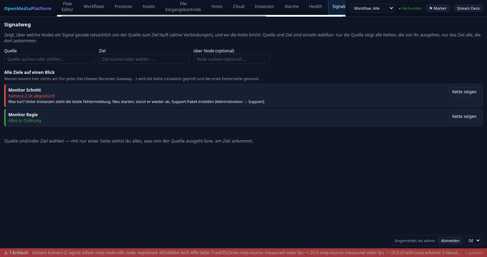

1. Choose a **source** (an output of a node) and/or choose a **destination** (a
   node "any input" or a particular input). The three fields
   are **search fields**: a click opens the whole list, typing filters (all
   search words must occur in the name, e.g. "mixer pgm"), arrow keys +
   Enter choose, Esc cancels, × or an empty field clears the choice. **One
   side is enough:** only the source shows all chains that start from it (each up
   to its last link); only the destination shows all chains that
   arrive there (each back to its origin). If both are chosen,
   the paths in between are shown.
2. Optionally **via node**: only paths that run through this node (also
   together with only one side).
3. Below that every path found appears as a chain of cards: node with
   host and online status, in between the connection with format and
   transport (e.g. "Video · MXL").
   Video mixers and switchers have no input connections of their own;
   their currently switched program source is added as an input, so the
   chain continues to the actual source.

The header line of every path says "OK", "with notices" or names the
**first fault** (outlined in red): node offline or crashed,
formats do not match (e.g. audio → video), MXL across host boundaries
(gateway needed). Orange are notices, e.g. different transports.
**Messages of the nodes (BCP-008):** in addition the signal path reads the
status of every node. If it reports "Unhealthy" (red) or "PartiallyHealthy"
(orange), its reason is shown at this point of the chain — e.g. for the
phone gateway "no sending session: the phone is not connected" or
"session is up but no pictures arrive", for the phone monitor
"phone not connected" or "no source connected". For this, the
camera gateway (as sender) and the phone monitor (as receiver) now report
BCP-008; a gateway without a phone is therefore also red in the health dashboard.

**Bandwidth:** a single connection is not measured. Between nodes
on the same host it says "local, no network" (MXL runs over shared memory).
Only gateways (2110, SRT, AES67, WebRTC) run over the network: their card
shows the **calculated network demand** ("Network: Tx 871 Mbit/s", "~" = assumption,
e.g. default format) and the current load of the host's network card
("Card: 6 % of 10 Gbit/s"). It turns red if the demand
exceeds the card or the card is loaded above the limit (default 85 %);
orange if the link speed is unknown.

Limits: inside a node it is assumed that every output can arise from every
input (the actual signal routing inside the mixer is not
visible). At most 20 paths are shown, the shortest first. Whether
picture/sound really flows is checked by the health and scope views.

## 4. Workflows

> **Safety prompt:** manually starting, stopping and deleting a workflow as well as manually starting a new node from the catalog (start dialog) ask before execution ("Really …?" or the dialog). Only "Start"/"Stop"/"Delete" triggers the action; "Cancel" or Escape discards it.

The **Workflows** tab manages named, reusable
combinations of node types and connections — in effect a
template system for "this broadcast always needs the same nodes in
the same wiring":

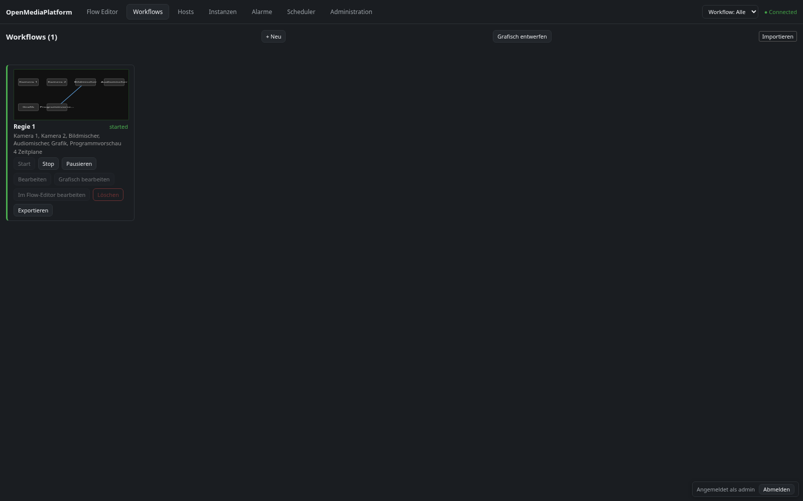

**Structure of the tile (fixed fields):** at the top are title and status (with a glowing dot, pulsing for running states), below that key figures as chips (roles, hosts, category, format, schedules, tags), the description and — if present — errors and held roles. The **plan** (roles and hosts) is collapsed and opens with a click; it does not stretch the card. At the bottom, always at the same place, are **Start/Resume, Stop and Pause** in three equally wide fields and below them **Edit, Graphical, Duplicate, Export, Delete**. Actions that are not possible are dimmed but stay in their place. At the top of the tab, **status pills with a counter** (Running/Stopped/Paused/Error), the search and the category filter.

**Export, import, duplicate (with dialog):**
- **Export** opens a dialog with the **roles**, the **role bindings** (user — role — right) and the **alarm rules** of the workflow. Two ticks decide separately whether role bindings and/or alarm rules go into the file (the former checkbox at the top of the tab is gone). Role bindings name user accounts, alarm rules contain recipient addresses; without a tick none of that leaves the file.
- **Import** checks the file before anything is created and shows the result in the dialog: **errors** (e.g. a node type that does not exist in the catalog, or an invalid definition) block the import; **warnings** name consequences (a host of the file does not exist here, a group of the role bindings is missing, the file comes from a **newer version** of the orchestrator or contains fields that this version does not know and discards); notices mention e.g. an older version. The roles, role bindings (with group or user names) and alarm rules of the file are listed below, each with a tick whether they are created too.
  - **If the workflow already exists** (same name), the dialog asks: **create as a new workflow** (the name gets a number) or **replace the existing one**. When replacing, ID and name stay; the line *Replacing would change* lists added, removed and changed roles, connections, settings and schedules. Role bindings from the file are added to the existing ones (nothing is revoked), alarm rules from the file replace the previous ones. A running workflow can be replaced; the new definition then applies from the next start.
  - Role bindings of **groups** are found again on another system via the **group name**; if the group does not exist there, the binding is left out and the import reports it.
- **Duplicate** asks for the **name of the new workflow** and then whether the **roles (nodes) are renamed accordingly**. If a role name contains the old workflow name, it is replaced; all others get the new name appended. The proposed names are listed line by line in the dialog and can be changed; empty or duplicate names are rejected. Connections and the inputs/outputs of the workflow follow the new role names. A duplicate inherits no role bindings and alarm rules.

Every workflow tile shows name, status and — grouped by host — its
roles: per host a block with the roles that run there (for a
stopped workflow: would run), node type, whether the host is fixed
or chosen automatically, and the expected demand (from the measured
profiles). Next to the host are its current load and the forecast
with this workflow ("CPU 35 % → 96 %"). At the top of the tile a
yellow box warns about a **bottleneck at start** (CPU/RAM over the limit),
about unreachable hosts and about node types without a measurement profile (demand
unknown, not "zero"). The plan preview starts nothing. "+ New" creates an empty workflow,
"Design graphically" opens the Flow Editor in a workflow
design mode, "Import" loads a previously exported workflow
definition. Start/Stop/Pause act on the whole workflow;
"Edit" opens the form (roles, connections, schedules),
"Edit graphically"/"Edit in Flow Editor" the graphical
design mode, "Export" delivers an importable
JSON definition. The app-bar selection "Workflow: All" (top right, visible on
every page) filters the Flow Editor to the instances of a
single workflow.

**Role name = source label:** the freely assignable "role name" of every
role in the workflow form is at the same time the label under which this
source later appears everywhere it can be selected — e.g. in the
crosspoint dropdowns of picture/audio mixers. A role "Camera 1"
shows up there as "Camera 1", not as a cryptic instance ID. Instances
started directly through the start dialog in the node catalog (section 2.1)
without workflow membership, on the other hand, still get only the
generic "`<type>` (`<short ID>`)" label — an own name field for that
does not yet exist in the UI. (Role names of existing workflows are changed through the rename function, see `MANUAL.md` §9.6 — not by overwriting the definition, which would lose the backed-up state.)

**Workflows that are not started** also appear in the zones: a
stopped workflow lies as a tile in the zone of the host on which it would run
(expected host per role according to the plan preview, see section 4).
If it is spread over several hosts, its tile lies in "Groups across several
hosts", and **every participating host zone shows at the top, directly under the zone header,
a dashed block "Planned (not started)"**. Each line stands for
a workflow (`▣ workflow name: role, role`) and names only the roles that are
intended on this host (fixed host of the role, otherwise the automatic
placement according to the plan preview). It is a preview: nothing runs there yet.
The block disappears as soon as the workflow runs and its
real tiles are in the zones.

### 4.0a Interface of a workflow: outputs and inputs

A workflow (e.g. a control-room position) has many senders and receivers in its
roles, but the operator needs only a few: the **output** ("PGM") and
the **inputs** ("Feed"). You define these in the **interface**:

1. Open the workflow with a double click, in the bar at the top **"Interface…"**.
2. **Create an output or input**, assign names (unique per side),
   optionally a display name.
3. **Assign members:** choose a role and enter the port of the role
   (with a running workflow the field offers suggestions; empty means for an output "all senders of the role", for an input the first receiver).
   Several members bundle an output, e.g. picture and sound as "PGM".

For a stopped workflow the change acts in the draft and is applied with
**"Save"**; for a running one it applies immediately (it changes
only the assignment, not the running processes). Nothing is
exposed automatically, only what you define here. What is stored is the
port name, not the ID — the assignment survives every restart.

The workflow tile shows the pads: inputs on the left, outputs on the right (green
= workflow running). In every **source selection** the section
**"Workflow outputs"** is at the top: bundled per workflow and output ("Control room 1 →
PGM" with picture and sound). The selection filters by media type as usual, so a
video mixer input shows only the picture of the output. Rights do not
change: switching is done at the destination, the rights there decide.

**Balls per interface group.** Every pad consists of one ball **per
member** in the color of the media type (as with the ports of nodes: picture,
sound, data). An output "PGM" with picture, sound and timecode thus shows three
balls; at an input you can see which media types it accepts (a
mixer input: picture). If the workflow is not running the balls are gray, because
the media type is only known at the running node. When dragging a port
the balls of the workflow inputs that do not accept this media type
become pale. The tooltip of a ball names the media type and the port.

**Connection lines.** The editor draws dashed lines between the
pads and the real ports or other pads: for real connections to
members, for permanent assignments (output → input) and for sources
that currently feed an input (e.g. pinned in the mixer). The lines
lie above the tiles and, for tiles lying one below the other, run around the outside. **To disconnect**
click the line (it turns white, a red × button appears in the middle)
and press **Del** or click the ×. For a real connection the edge is deleted; if it ends at a
workflow input, its permanent assignment is also released. For
an assignment without a real edge (source pinned in the mixer) the
assignment is deleted and the source unpinned in the mixer. The assignment can
also still be released in the "Interface…" dialog.

**Dragging pads (drag & drop).** The pads of the workflow tile are real
connections in the Flow Editor:

- **Output → receiver:** drag the right pad onto an input of a node
  (e.g. viewer "Video in"). The sender of the output whose
  media type fits the target is connected (picture to picture, sound to sound).
- **Sender → workflow input:** drag an output of a node (or the pad
  of another workflow) onto the left pad. The orchestrator
  switches onto the members of the input: members with a receiver are
  connected via IS-05, for **mixers and switchers** the source is
  **pinned** — it is then in their source list and can be switched
  there.
- The workflow input must be running; otherwise the editor reports that nothing
  could be switched.

**Permanent assignment.** If you drag the **output of a workflow** onto a
workflow input, it is stored that this input is fed by this output
(workflow and output, not the changing sender ID). If
one of the two workflows restarts, the orchestrator switches the assignment
again by itself; if the source is not running yet, it happens when the
source starts. In the "Interface…" dialog the input shows "Fed by …"; there
"Release assignment" releases it again. If you switch the input by hand to
another source (sender instead of workflow output), the stored
assignment is dropped. A single node source (not a workflow output) applies only to the
running instances.

In the **video mixer M/E** a source fed this way carries the **name of the
workflow input** (e.g. "FQ1") instead of the sender label, in the keys, the
source selection and the PIP/DSK lists.

### 4.0 Changing a running workflow and saving the start state

A double click on a running workflow opens it in the Flow Editor. There
you can add, move and reconnect nodes. **"Save in workflow"**
(breadcrumb bar) becomes active as soon as something has changed compared with
the saved definition — new nodes **or** new or
removed connections. When saving:

- The wiring is adopted as the definition and comes back with every
  restart of the workflow. Other role settings (format,
  mixer levels, environment, placement) are kept.
- The **current operating state of all roles** (e.g. the test pattern of a
  source, mixer settings) is **frozen as the start state**.
  If you change something afterwards and stop the workflow, it starts the
  next time anyway with the **saved** state.
- A workflow that you have never saved this way starts with the **last
  state before stopping**.
- If a single role is restarted, moved to another host
  or its standby takes over, the running state passes to the new instance;
  the freezing then no longer applies to this role. If you want to set the
  start state again, save again.
- **Stop a role in the running workflow and save:** if you have ended the node
  of a role in the running workflow (stop button on the tile) and
  press "Save in workflow", the editor asks whether the stopped
  role together with its connections and its entries in the interface should be removed from
  the workflow. After confirmation it is deleted from the
  definition. Without confirmation everything stays as it was.
- If a **stopped** workflow is edited and saved, the remembered operating state
  is discarded, because the wiring may have
  changed.

In addition the orchestrator backs up the operating state of running workflows
**every 60 seconds** (roles not frozen), so that it is not lost even after
a crash or hard termination of the nodes. The
interval is controlled by the environment variable `OMP_ROLE_STATE_BACKUP_INTERVAL`
(Go duration, e.g. `30s`; `0` switches the backup off).

### 4.1 Hot standby (redundancy for critical roles)

In the role designer every role offers an additional dropdown "Standby
for: …", which lists all other roles of the same node type in the workflow.
If a role is entered as a standby for another,
it runs along permanently from the workflow start, but unconnected — shown dashed in the
Flow Editor as long as it is not active.

If the accompanied role fails for good (process crash beyond the
restart brake, or its host is detected as no longer reachable),
the standby instance takes over automatically: wiring and
operating state (e.g. crosspoint position, channel levels) are
transferred, its tile changes from dashed to normal, and a
toast message "Failover: … → …" appears. The takeover itself is a
short visible cut (not a seamless genlock switch) —
usually unnecessary for uncritical control-room positions, recommended for 24/7 broadcast positions with
a single load-bearing role (e.g. the video mixer).

The takeover starts at the **first** unexpected process exit of the primary
role (not only after several restart attempts); `OMP_STANDBY_FIRST_EXIT=off`
restores the earlier rule. Choosing **"Live standby for: …"** in the dropdown
gives the standby the same inputs as the primary role and lets it render
continuously; on takeover only the outputs are re-plugged. This costs the full
CPU load of a second instance — switch it off per role by choosing
"Standby for: …" (cold standby).

With a live standby, **operator commands** (methods, parameters, state) sent to
the primary role are also sent to the standby, so its operating state follows
continuously; on takeover the saved (up to 5 s older) state is therefore no
longer re-applied. If a command does not reach the standby, or the standby
restarts, it is fully caught up at the next tick (5 s). Commands arrive one
after the other, not with a shared timestamp — a cut may take effect one frame
earlier or later on the standby.
 For an uninterrupted output put a
`omp-failover` switch with the "redundancy" profile behind the pair (see the
node table in the manual).

### 4.2 Latency budget (delay compensation)

The workflow form has a field "Target latency (frames)"
(`targetLatencyFrames`). If it is set, every signal path in the
workflow must arrive at the respective output after exactly this number of frames:

- If the target is **too tight** for the shortest possible path, "Start"
  rejects the workflow with a concrete error message (which
  path, how many frames are missing) — no partial start.
- If a path is **shorter** than the target, the orchestrator automatically assigns the
  missing delay to a suitable node along the
  path (currently video mixer and scaler) — without anything having to be
  wired or set by hand. If no suitable node is available on a too-short
  path, "Start" likewise fails with a concrete error message.

Practically useful to let several camera paths of different length (e.g.
one via a scaler, one direct) arrive at the video mixer
picture-synchronous again without calculating the delay by hand.

## 5. Scheduler

The **Scheduler** tab shows a row of its own for every workflow on
a horizontal time axis — day view (30-minute grid), week view (7 days,
same resolution, just narrower) and month view (day overview without
time of day, a click jumps to the day view), switchable with the three buttons at the top,
`◀`/`Today`/`▶` navigates. The blue vertical line
marks "now".

Below the workflow rows the scheduler shows **which resources are occupied
at what time and where they are still free** (section 5.1). Knowing
the available resources is the most important point when planning: a schedule
is only reliable if the host also has enough reserve at the planned time.

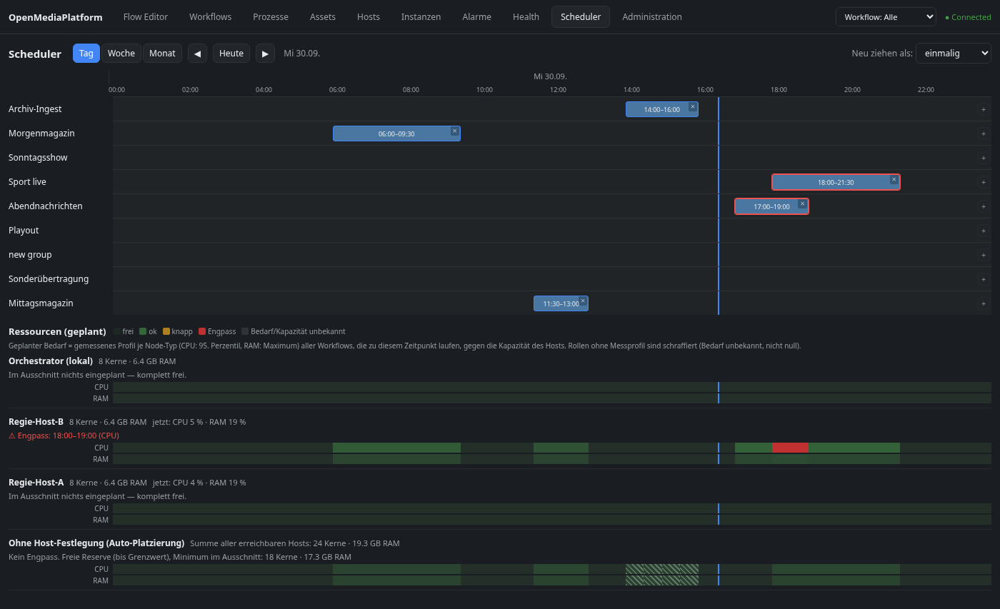

**Editing schedules** — all by mouse, releasing saves immediately (no
separate "Save" step, unlike the workflow form in
section 4):

- **Move:** grab a bar in the middle and drag.
- **Lengthen/shorten:** drag the left or right edge of the bar
  (start or stop changes individually).
- **Create new:** click on an **empty spot** of a workflow row,
  hold and drag over the desired duration — on release
  a start/stop pair is created. You choose the kind (**once**, **daily**,
  **weekly**) at the top right under "Drag new as". A
  new schedule applies to the day on which you dragged (for "daily"
  every day, for "weekly" on this weekday).
- **"+"** at the right end of the row alternatively creates a pair with
  default times (09:00–17:00).
- **Double click** on a bar opens exact HH:MM input fields
  (dragging snaps to 30 minutes).
- **"×"** on a bar deletes the schedule.

Depending on the end of the bar, a schedule triggers **start** or **stop** of the whole
workflow — technically the same action as a click on "Start"/"Stop"
in the Workflows tab.

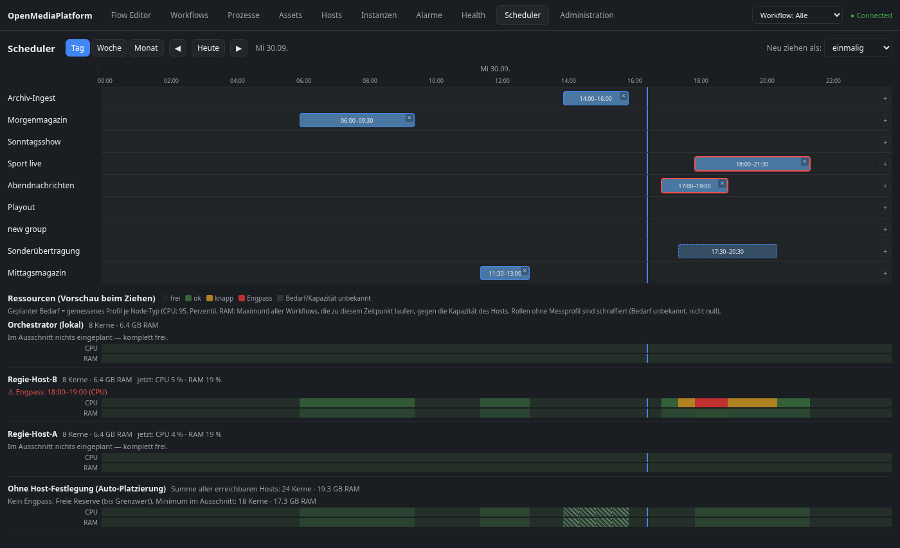

While you drag, the resource block updates live
("Preview while dragging") — you see immediately whether the new position overloads a host. If the change on release creates a **new** bottleneck,
a warning with host, time and resource additionally appears. It is saved
anyway: the scheduler informs, but does not decide for you.

### 5.1 Resources: bottlenecks and free capacity

For every host (and a strip for workflows **without a fixed host**,
which the orchestrator places itself at start time) the
resource block shows:

- **CPU** and **RAM** as strips over time, plus per **I/O card type**
  (e.g. SDI inputs) a strip of its own — demand against the number of
  available ports.
- **Colors:** dark = free, green = OK, yellow = tight (from 80 % of the
  limit), **red = bottleneck** (above the limit, by default 85 % CPU
  and 90 % RAM — the same values with which placement decides).
  Hatched = **demand unknown**: no measurement profile exists yet for a node type. That is explicitly not "zero" but "not
  known" — such periods can mean more load than shown.
- Per host a **summary**: either the bottleneck periods
  ("⚠ Bottleneck: 18:00–19:00 (CPU)") or the **free reserve** up to the
  limit (minimum in the visible section, in cores and GB), or
  "completely free".
- Next to the host name the **current load** ("now: CPU 5 % · RAM
  19 %") — a snapshot, not the planning.
- A **tooltip** on every cell names time, demand, capacity, the free
  reserve and which workflows/roles contribute how much.
- A **bar gets a red edge** if during its run time a bottleneck exists on
  one of its hosts (reason in the tooltip).

How the demand arises: for every role of a workflow that runs at the
time, the **measured profile of its node type** on the
fixed host counts (if missing there, the type-wide profile) — CPU as the 95th
percentile (in cores), RAM as the maximum. A workflow counts as running
if the schedule has started it at that time; a workflow just
started by hand counts until its next planned stop.
The basis is the measurements of the host agents; the longer a node type has
run, the more reliable the values.

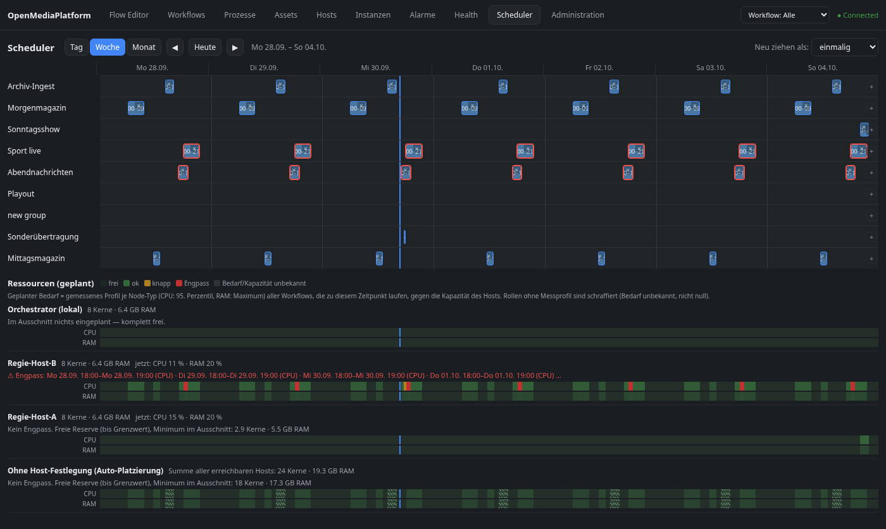

In the **week view** daily schedules visibly repeat; in
the **month view** every day cell shows the **worst moment
of the day** — a quick look at which days bottlenecks threaten.

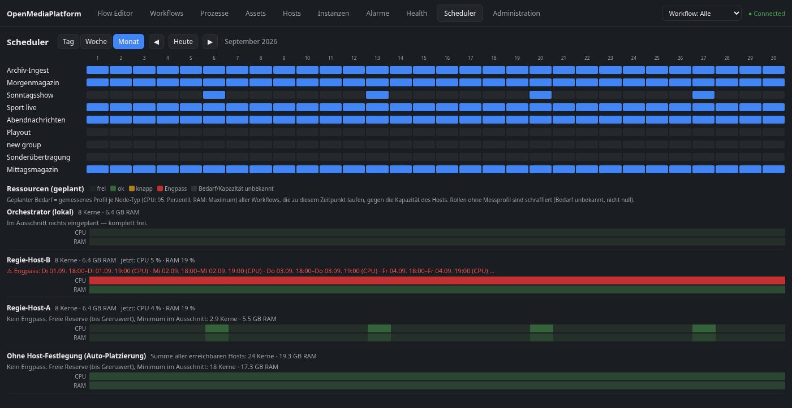

**Limits worth knowing:**

- Only what is **in schedules** is planned. Instances additionally
  started by hand are only seen in the host's "now" indication.
- Network and GPU load appear only live, not in the planning (there
  are no measurement profiles per node type for them).
- For the strip "without fixed host" the sum of all reachable
  hosts counts as capacity; whether a single role still fits on a host
  there, the display does not check.
- Schedules that run past midnight (start 22:00, stop 06:00) are
  taken into account correctly in the resource calculation; as a bar
  the day view shows them today only if start and stop are on the same day.

The tab is visible to all users with read access; changes
require (like the workflow form itself) the configure right on
the affected workflow — without this right saving fails with
an error message instead of silently discarding the change.

**Caution with your own tests:** a schedule entered here starts/
stops the real workflow at the entered time, even unattended
— for trying out use a workflow created specially for it and unimportant,
not a control-room position in productive use.

## 5a. Processes

The **Processes** tab is the business process engine (flow graph made of
steps such as approval, service call, ffmpeg script, condition) —
deliberately a different concept from the **workflows** in section 4 (there:
the node wiring of a control-room position). On the left the process definitions,
on the right their versions, executions and open tasks.

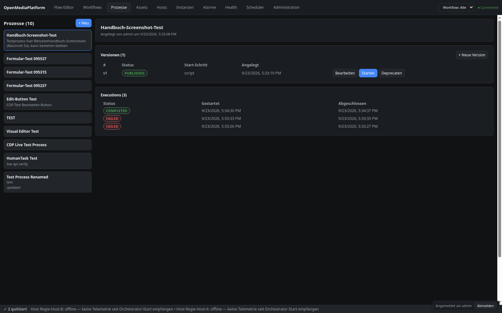

- **"+ New"** creates a definition (name/description only).
- **"Delete process"** (at the top of the detail area of the chosen definition)
  removes the process along with all versions and the execution history —
  after a safety prompt and permanently. As long as executions
  are still running (also waiting or paused), the server refuses the deletion;
  then cancel the executions first.
- **"+ New version"** opens the graphical editor. On the left are the
  **building blocks**, grouped by actions (node function, web call,
  file tool ffmpeg/ffprobe, notification, subprocess),
  people (task for a person, approval) and flow (If … then,
  distributor, split/join in parallel, wait, timer).
  Blocks that this server cannot execute are collapsed
  under "Not available". A block is added by click or drag.

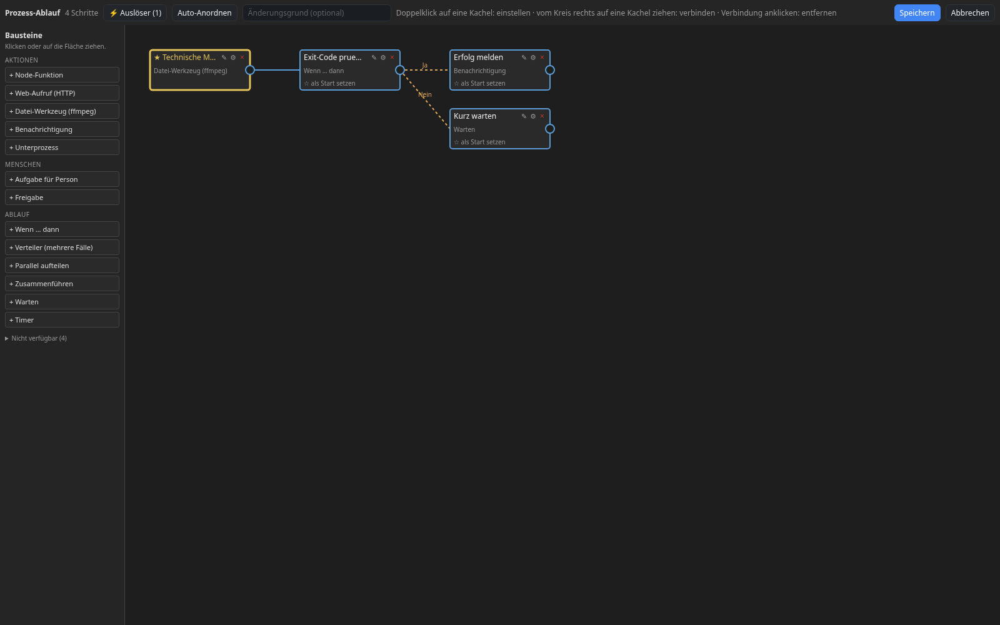

- **Double click on a tile** opens a form for exactly this
  step type, without JSON: for "If … then" a rule made of
  *value · comparison · value*, for the node function the running
  microservices and their functions as a choice. If a
  mandatory entry is missing, the tile shows "⚠ … missing".
- **"{x} Variable"** next to text fields inserts values from the process run:
  fields of the start input/of the triggering event (e.g.
  asset ID), results of previous steps (e.g. "Output (stdout)"
  of "Read metadata") and details of the process run. Only
  steps that are guaranteed to have run before this step are offered.
  If a step follows **"Read technical metadata"** (ffprobe),
  its measured values are available individually — duration, file size,
  container, start timecode, picture width/height, frame rate, field
  order, pixel format, video/audio codec, sample rate, number of
  audio tracks and streams — without having to split the result
  by hand (technically: `outputs.<step>.json…`).
  **Dropdowns, sliders and yes/no fields** have the same button: one
  click replaces the choice with a variable (e.g. width of the
  thumbnail = width from the probe); "↺ Choose value" returns to the
  choice. This also applies to the arguments of node functions.
  In expert mode (raw arguments) a selection list, a yes/no field or
  a slider (range from ffmpeg) automatically appears under the value of a
  known flag, staying
  in sync with the text line.
- **Connecting:** drag from the circle on the right of a tile to the next tile.
  For "If … then", "Distributor" and "Approval" the
  editor asks which path leads there (e.g. "Yes"/"No" or
  "approved"/"rejected"/"changes requested").
- **"If something goes wrong"** (in the same form): repeat
  automatically (count, pause, increasing interval), maximum run time and
  a step that undoes the effect on a later error.
- **"⚡ Trigger"** (toolbar): start the process automatically,
  e.g. when an asset is created or changes to "Ready". The
  data of the event is then available as the start input.
  Triggers only take effect once the version is published.
- **"Advanced: settings as JSON"** at the end of each form is
  intended only for special cases.
- **Save** creates the version as a draft.
- **Editing an existing process:** in the version table
  **"Edit"** on the desired version — the editor opens with
  exactly this graph, **Save** creates a **new**
  draft version from it. A version itself is never overwritten:
  published versions are immutable, running and earlier
  executions thus stay traceable.
- **"Publish"** makes a draft startable, **"Start"** on
  a published version starts an execution (optionally with
  JSON input). Executions can be paused, resumed and
  cancelled; their steps and approval tasks appear below
  ("Claim for me" → "Approve"/"Reject"/"Request
  changes").

### 5a.1 File tool (ffmpeg/ffprobe): the assistant

At the top a switch toggles between **Assistant** and **Expert (arguments)** — both equal in value. The assistant is divided into
sections (1 Task · 2 Settings · 3 Command as a readable preview, one flag with its value per line); the time limit is under
"More settings". In **expert mode** "+ Argument" immediately opens the choice of all flags and options (searchable,
also encoder/format/filter options, with description); a click creates a **card of flag and value** with a suitable input field
(selection list, yes/no, slider or text with "{x} Variable"). "Free-text argument" remains for everything missing in the list.
What is still stored is the flat argument list.

For the file tool a double click by default opens the
**assistant** — a form with real values actually
supported by this server (containers, codecs, filters with
help text), no raw arguments. Via **"Task"** the following
guided flows are available:

- **Read technical metadata** — give only the input file,
  delivers codec/resolution/duration as JSON in the result field "Output
  (stdout)".
- **Create thumbnail** — input/output file, time and
  width in pixels.
- **Convert format/codec** — optionally force the container,
  choose video/audio codec from the real list of this server; if
  a codec is chosen, its actual settings appear
  below — selection list for fixed values, slider for
  numeric values with known upper/lower limit (e.g. `-crf`),
  checkbox for yes/no, otherwise a text field — each with
  help text, allowed value range and default. Whoever needs more than
  one independent output track (see "Output tracks" below)
  simply leaves these two fields empty.
- **Extract audio track** — like convert, only without picture.
- **Concatenate clips (cut list)** — join several files in a
  fixed order into one output file, reorderable with
  ↑/↓, per clip optionally with start/end trim. The
  tick **"Lossless (stream copy, no re-encoding)"** switches
  to pure stream copy (hiding trim and codec fields,
  as both would be ineffective in this mode) — reliable
  above all for containers such as MPEG-TS/-PS, not generally for MP4/MOV/MKV
  (see the hint text in the form).
- **Overlay/station ID/end credits, time-controlled** — any
  number of text (e.g. lower third, end credits) or picture events
  (e.g. station logo), each with its own start/end time in seconds
  and optional position; a plain timeline above it shows for
  orientation how the events are distributed in time (not
  draggable, overview only).
- **Normalize loudness (EBU R128)** — target loudness (LUFS),
  maximum true peak (dBTP) and loudness range (LRA)
  adjustable, defaults correspond to EBU R128 (-23 LUFS/-2 dBTP/7
  LU); the picture is always passed through unchanged. Single-pass method — for
  an even more precise two-pass measurement use expert mode.
- **Lossless passthrough/remux (change container)** — pure
  container change without re-encoding, optionally force a
  container (otherwise derived from the file extension).
- **Streaming output ladder (multi-bitrate HLS)** — any number of
  renditions (name, resolution, video/audio bitrate, added/removed with "+ more
  rendition"), creates a master playlist
  (`master.m3u8`) in the chosen output directory plus per rendition
  a subfolder with segments — for adaptive streaming in web/
  app players. Rendition names may contain only letters, digits and
  hyphens (they are used as directory names).

  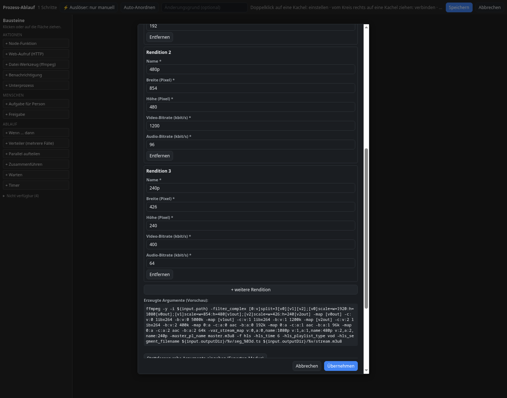

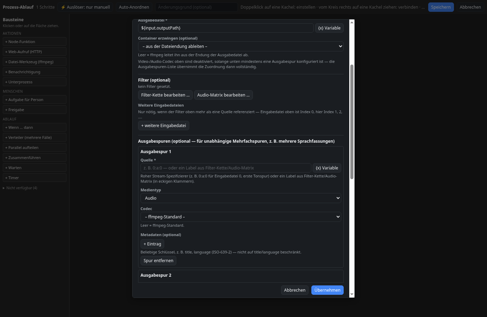

Within "Convert format/codec" there are two further
building blocks which together cover what used to be a separate, meanwhile
removed special function "Build multi-track container":

- **"Edit audio matrix …"** opens a crosspoint grid:
  rows are the audio channels of all given source files (main
  input file plus any number of additional sources). Each additional source
  gets an **"Auxinput"** section of its own that can be named (e.g.
  "SW8-Trailer" instead of just "Source 2") — collapsible/expandable by a click on the header row,
  so the list stays clear with many additional sources; the chosen name appears directly as the
  row label in the grid below.

  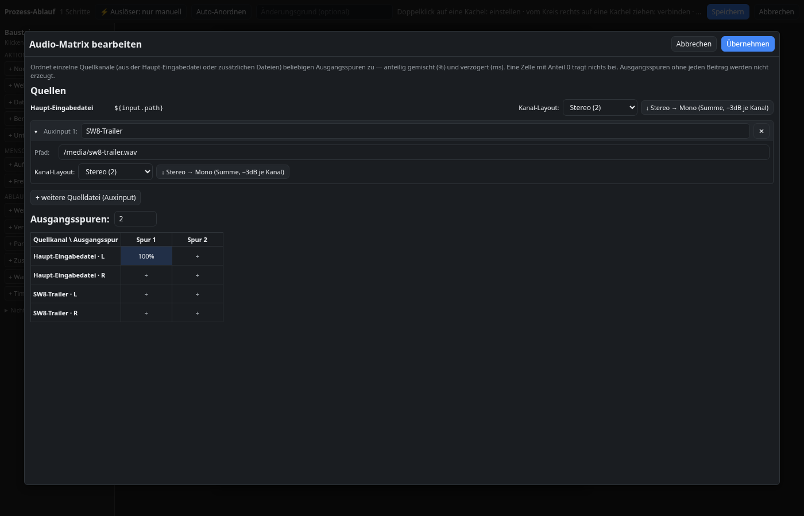

  Columns are freely selectable output tracks. For each source file you choose a
  **channel layout** (mono/stereo/5.1/7.1 or "Custom count" for everything
  else) — the rows then show real channel names (L/R/C/LFE/Ls/Rs
  instead of just "Channel 1/2/3"). A click on a cell opens a
  **downmixer** dialog with gain slider (%, including a live-calculated
  dB display) and delay (ms) — a cell without a share contributes
  nothing, an output track with no contribution at all is not even
  created. This way channels can be routed freely, mixed proportionally and
  delayed relative to one another without knowing filter syntax.

  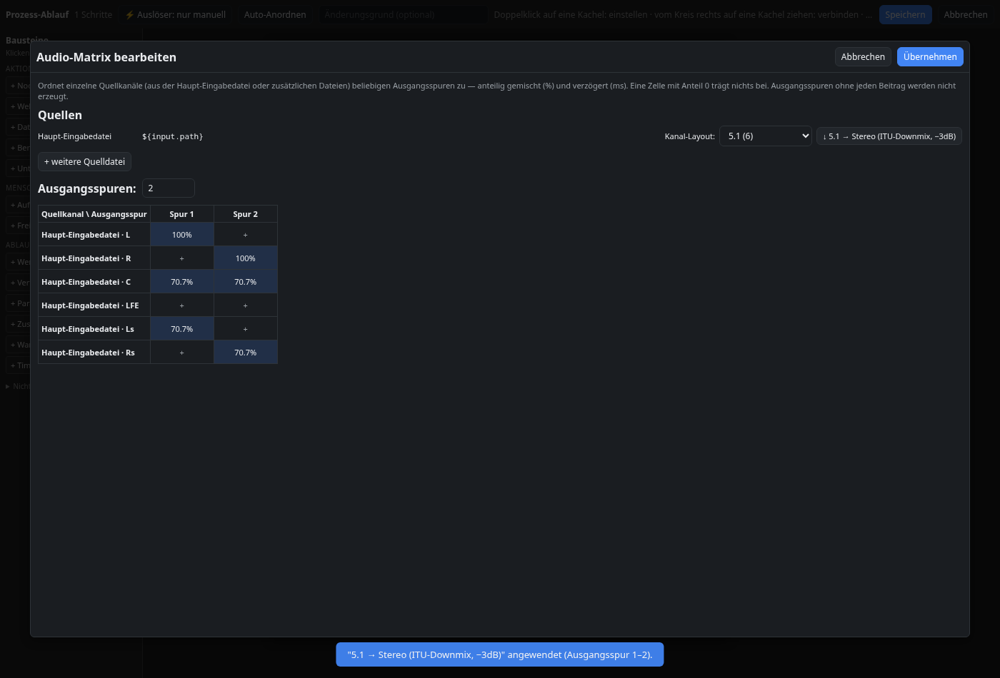

  For common layout combinations the matrix offers a
  **downmix template** as a one-click button next to the channel layout
  (e.g. "5.1 → Stereo (ITU downmix, −3 dB)", "Stereo → Mono", "Mono →
  Stereo") — it immediately fills the matching cells with sensible
  defaults, which you can then readjust by click like any other cell.
  The downmixer dialog of a single cell looks like this:

  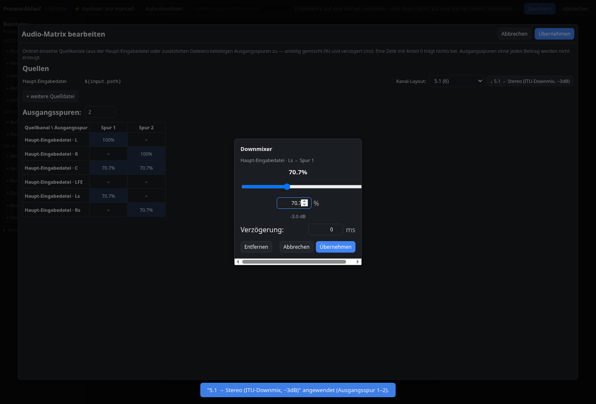

- **"+ Output track"** (further down in the form) creates any number of
  independent, individually encoded output tracks — source (raw
  stream specifier such as `0:a:0`, or by button adopt a label from the
  audio matrix/filter chain such as `[mxout0]`), media type,
  codec with options and any metadata keys (not only
  title/language — every key that ffmpeg understands). As soon as
  at least one output track is created, this list takes over the
  complete track assignment; the simple video/audio codec fields
  further up are hidden for that, so that never two contradictory
  entries are visible at the same time.

Also with "Convert format/codec", **"Edit filter chain
…"** opens a separate, larger dialog: search filters from the real
filter list of this server and add them as tiles, connect them by
dragging from the colored dot of a tile to the input of the next.
An "Input" block stands for a source file (identifier
e.g. `0:v`), an "Output" block for the result. Filters with an
adjustable number of inputs/outputs (e.g. for mixing several
audio tracks) show a number field for it, numeric values with known
upper/lower limit appear as sliders. "Arrange automatically"
tidies the tiles, "Apply" builds the actual
filter chain from them. If the filter chain references more than one source,
"Further input files" appears below in the main form — the
first file stays identifier `0`, every further one counts up. Audio matrix
and filter chain share the same result (the filter chain behind
the scenes) and therefore replace each other instead of complementing each other — whoever needs both builds the audio matrix logic by hand as a
filter chain.

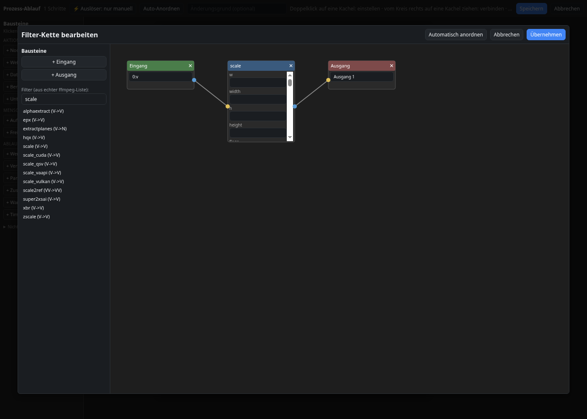

Whoever knows the raw ffmpeg command line can switch at any time to
**"Enter raw arguments instead (expert mode)"**.
Here too nobody has to know parameters by heart: known flags
are suggested automatically when typing a "-" (name +
help text), and the entered value is immediately checked against the known
definition (number range, selection list, yes/no) — a
wrong value appears directly as a warning under the field. The button
**"Search parameters …"** opens a searchable catalog that covers
literally every parameter of this server: all global
ffmpeg flags (from `ffmpeg -h full`) plus all AVOptions of all
installed encoders/decoders/muxers/demuxers/filters (typically over
1,000 parameters in total) — a search for e.g. "crf" directly finds
`-crf` in every encoder that knows it, without having to expand that encoder
by hand first. Every hit shows its category as a
label (e.g. "libx264 (encoder)", "Filter", "global flag").
A typo in the searched name (e.g. "sacle" instead of "scale", a
digit swap such as "libx265" instead of "libx264") still finds the intended
parameter — such hits are additionally marked with **"≈
Typo?"** so that it stays clear that the entered text
does not occur literally. The hit list can be operated entirely by
keyboard: **arrow keys** change the highlighted hit,
**Enter** inserts it (for a flag with a value directly followed
by an empty, focused value line), **Esc** clears the search.
A click on a hit likewise inserts it as a new argument.

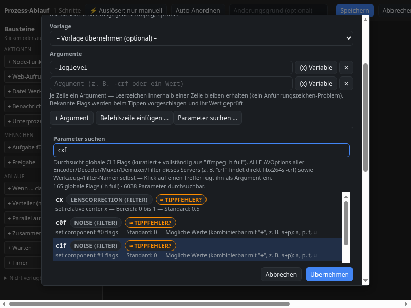

## 5b. Assets

The **Assets** tab manages media assets with metadata,
versions and technical files (representations):

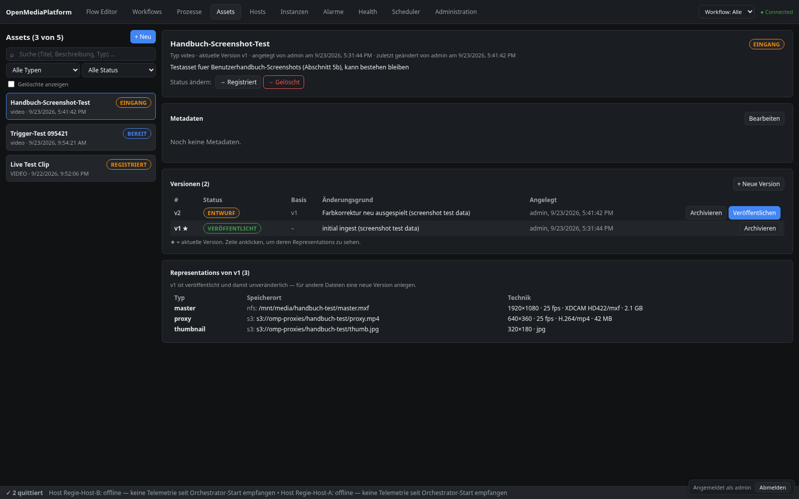

- On the left the asset list with search (title/description/type) and filters
  by type and status; deleted assets are hidden until
  "Show deleted" is active. **"+ New"** creates an asset (title,
  freely selectable type such as `video`/`audio`, description) — it starts in
  status "Intake".
- **Changing the status:** the buttons under the title offer only the transitions
  that the lifecycle allows from the current status (Intake →
  Registered → Processing → Ready → In review → Approved →
  Published → Archived, plus ways back, "Expired" and
  "Deleted"). "Deleted" is a final state and asks beforehand. Assets marked as deleted initially remain; the button **"Clean up deleted (n)"** (administrators only, appears as soon as there are any) removes them **permanently** along with versions, representations, QC reports, review history and proxies. The source files on disk remain untouched; ingest jobs keep their history entry and lose only the reference to the asset. This cannot be undone.
- **Metadata → "Edit"** opens a form with field name/value per
  category (Descriptive, Editorial, Technical, Custom fields,
  AI-generated, System). Structured values (numbers, lists) appear
  as JSON in monospace font and stay a number or
  list when saved. If someone else has changed the asset in the meantime, the
  server refuses the save, the form closes with a notice — reopen
  it so that nothing of someone else's is overwritten.
- **Metadata fields (type, mandatory, selection list):** the button **"Fields…"** opens the field administration. There are the
  supplied fields (alternative title, keywords, language, genre, creator, contributors, publisher, synopsis,
  external identifier) and the ones you created yourself. An administrator creates new fields without a restart: category, key,
  label, **data type** (text, long text, integer, number, yes/no, date, timestamp, selection, URL), optionally
  selection values, **mandatory**, **multiple values**, applicability to one asset type or all, and the **EBUCore target**. When
  saving the metadata the server checks the values of registered fields (wrong type, value outside the selection list,
  missing mandatory field); the message names each field. Keys without an entry remain allowed as **free fields** and
  are not checked. In the edit form the key input suggests the registered fields and converts
  numbers and yes/no automatically to the right type. Deleting a field does not delete stored values.
- **Exchange with other systems (EBUCore, EBU Tech 3293):** **"EBUCore ↓"** downloads the metadata of the asset including
  representations of the current version as EBUCore XML (version 1.10, schema-valid against `ebucore.xsd` 1.10.1).
  **"EBUCore ↑"** reads in such a file, shows beforehand how many values are adopted, and merges them into the
  metadata (same keys are overwritten, title and description stay). Fields with an EBUCore target land in the
  matching standard element (e.g. keywords → `subject`); all other values go along as labeled additional fields
  (`typeLabel`, Tech 3293 §3.19) and come back on re-reading. API: `GET`/`POST /api/v1/assets/{id}/ebucore`
  (`?dryRun=1` for the preview). More: `docs/entwuerfe/ENTWURF-NORMEN-EBUCORE-R103-R143.md`.
- **Versions:** "+ New version" creates a draft (optionally based on
  an earlier version, with a reason for the change). Clicking a row
  shows its **representations** (e.g. master, proxy, thumbnail with
  storage location and technical data such as 1920×1080 · 25 fps). Representations can
  only be added to or removed from a **draft**;
  **"Publish"** makes the version immutable and the
  current version of the asset (★, "published and therefore
  immutable" in the representations panel, without "Remove" buttons).
  For changed files create a
  new version afterwards.

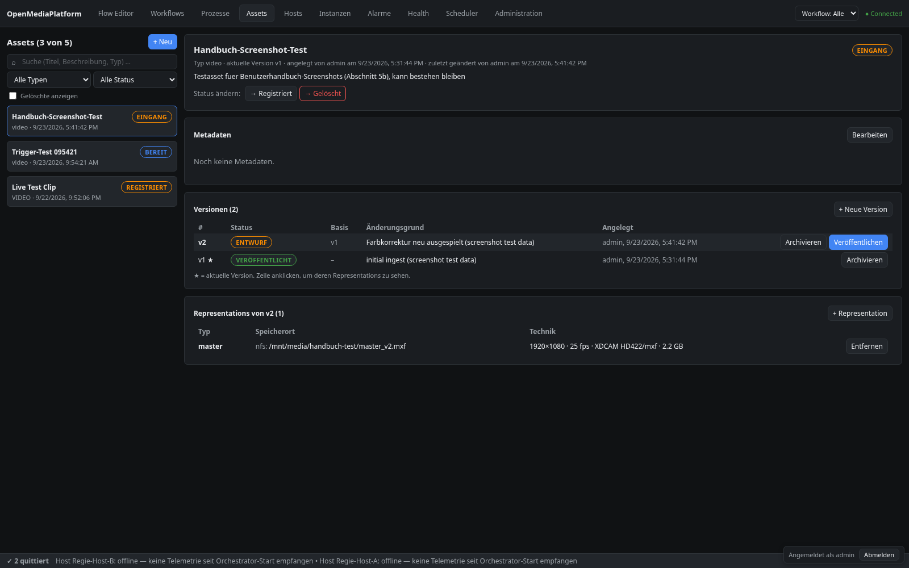

### 5b.1 Adding files from local hosts or a network drive (e.g. Isilon)

"+ Representation" **uploads no file** — the field "Storage"
(`filesystem`/`s3`/`http`, freely selectable) plus "Path/URI" register
only a **reference** to where the file already lies (pure
catalog/search metadata, no bytes are moved). A real
browser file upload via the configured S3 storage backends (development: `make s3-up`, SeaweedFS)
(Administration → Storage) is prepared on the backend side but not yet
connected to this form.

**Since chapter 86 there is the "Files" tab for this** (§5h): view files of a location, create them as an asset with a click or assign them to an asset, upload them to the
orchestrator machine and delete them with a recycle bin; the asset list then misses nothing — assets whose file has disappeared can be filtered there.

What actually makes a media file **playable** is independent
of that: playout nodes (channel player, MXF player, …) read their
file directly from the file system of the host on which their process runs —
via `OMP_MEDIA_DIR` (default `data/media`, relative paths stay
restricted to it) or an absolute path without restriction.
From this it follows:

- **The file is on the same machine as this node** (e.g. your
  laptop, if node and browser run there): a completely normal
  absolute path is enough, also outside the project directory.
- **Network drive/NAS such as an Isilon:** must itself be mounted on the host that runs
  the node process (NFS/SMB, outside
  OMP's responsibility) — after that it is a completely normal
  local path for the node.
- To include a directory or network drive as a searchable library: in the **File intake control** tab "Import" imports files from the media directory (setting `importDir`) as assets; there QC and review read the technical metadata via `ffprobe`. The players show their own media list from the directory `OMP_MEDIA_DIR`.
- If your Isilon (newer OneFS versions) offers an S3-compatible
  protocol, it can be entered like MinIO in the Administration tab under
  "Storage" as a backend of its own — likewise currently only as a
  backend, still without a browser upload button in the Assets tab.

## 5c. File intake control (file QC, review, conform, metadata)

The **File intake control** tab is the work list for newly arrived media assets. Every file automatically goes through a technical **QC analysis**;
then a person takes it over, checks it in the player, creates **segments**, enters **metadata** and submits it for **approval**. The
original file is never changed in the process.

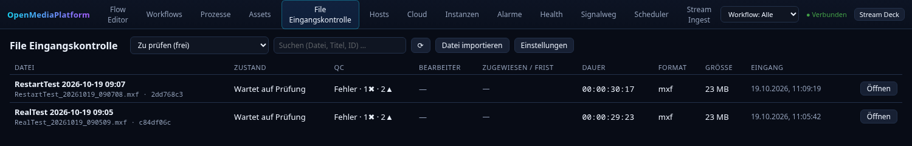

- **List:** views "To check (free)", "Mine", "QC waiting/running/failed", "In progress", "For approval", "Approved", "Archived".
  Double click or "Open" shows the detail view. With the function right *Import files* there is **Import file** (files from the import directory
  of the settings); newly arriving assets with a local file appear automatically. "My tasks" shows what is assigned to yourself or your own group.
  Whoever does not have the right *See all files* sees in the list only files assigned to them or their group or that they are working on (with *Approve and reject* additionally those submitted for approval).
- **QC report:** overall status (Passed / Warnings / Errors / **Incomplete**), counters, rule set, tool versions. Findings can be filtered by
  category, result, severity and text and expanded (measured value against limit, tool, time). "▶ Timecode" jumps to the spot in the player.
  "Repeat QC" (optionally with another profile) creates a new report — the earlier ones stay in the "Reports" selection field. Export as JSON (complete) or CSV.
  Technical stream metadata is at the bottom, expandable.

  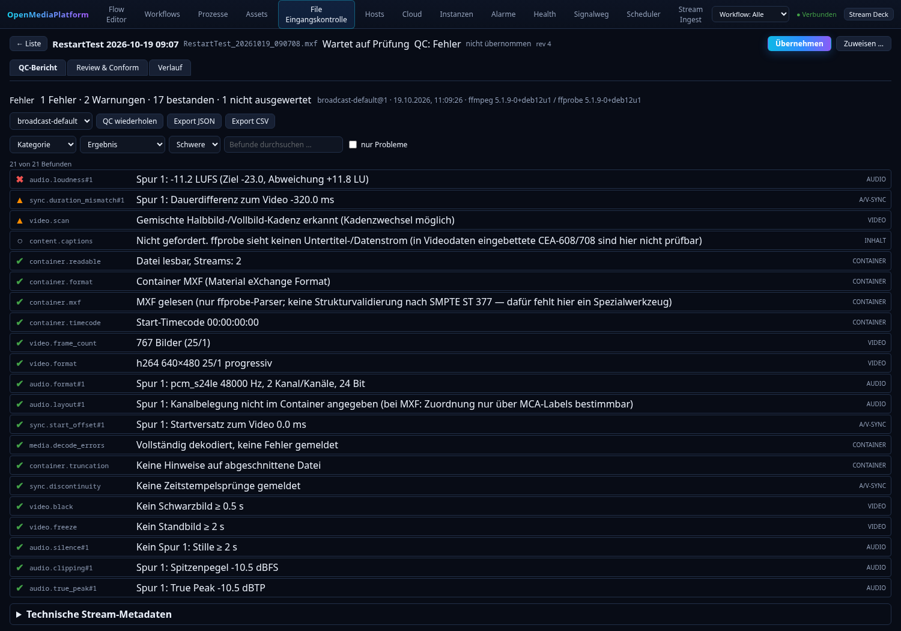

- **Important to understand:** "**QC not executable**" (red, with a reason) means that the analysis could not run — there is then *no* verdict on the file.
  A finding "Error", on the other hand, means that the analysis ran and found a problem in the file. The analysis is a probe plus content check with ffmpeg/ffprobe,
  **not** a structure validation according to MXF standards.
- **Take over:** excludes simultaneous editing (first come, first served). "Give back" releases it (the draft stays); with the right *Assign tasks* also
  "Assign …" (person and/or group, with **deadline**), "Reassign" and "Force release". A file assigned to a person is taken over only by that person, one assigned to a group
  by any member (after "Give back" it is back in the pool of the group); *Assign tasks* may always take over. If QC is not finished yet, taking over may not be possible, depending on the setting.
- **Review & conform:** on the left the player with the **review proxy** (marked "PROXY" — not the original file; frame n of the proxy is frame n of the file).
  Operation: ←/→ one frame (Shift ±10, Ctrl ±1 s), space bar play/pause, **Stop** = stop and back to the start point, **Jog** (drag or mouse wheel:
  single frames) and **shuttle** (slider or J/K/L: −8× … +8×; backwards via single-frame jumps, not every frame is shown), timecode field (key G),
  I/O set in/out (**Out is exclusive**: the current frame is the last one included), Alt+I/Alt+O jump there, `[` `]` jump to segment boundaries, N creates a segment from
  the marks. QC findings appear as red/orange markers on the timeline.
  **Zoom of the timeline and the waveform:** under the timeline are **−**, **＋**, **⤢** (whole length), **I–O** (zoom onto the marks, without marks around the playhead) and the
  zoom level. Mouse wheel on the timeline zooms around the pointer, Shift + mouse wheel scrolls; the overview strip next to it shows the visible section and can be dragged.
  Segments, marks and QC findings follow the section, a click jumps to the frame below, and during playback the section moves along with the playhead.
  The waveform has one peak value per frame — so you cannot zoom in further than to single frames (at least 10 frames in the section).
  **Proxy is being created:** as long as the review proxy is still being created, a **progress bar** shows the share of frames created (first "waiting", then percent); afterwards the player appears by itself.
  On the right: **Usable range**, **Segments** (name, in, out exclusive, order, description; "▶" plays the range), then the **metadata** (mandatory fields with *;
  fields and selection lists are set by the administrator). Overlaps/gaps are reported by the interface immediately if the settings forbid them.
- **Save/submit:** "Save draft" saves the state at any time (even incomplete). "Submit" checks completely (mandatory fields, at least one segment).
  Depending on the approval mode (setting: none / one person / four-eyes) someone with the right *Approve and reject* then decides with **Approve** or **Reject** (reason mandatory).
  Only with approval do the editorial metadata go into the asset. Rejected or approved assets can be edited again with "New revision".
- **Changes by others:** if someone else has saved in the meantime or the source file is new, a notice appears: "Load current state" or
  "save anyway" (explicitly overwrites). Unsaved changes are asked about when leaving.
- **History:** all actions (who, what, when, state from → to) and the conform revisions.
- **QC profiles** (administrators, *Administration → Platform → QC profiles*): list of all profiles with identifier and version (`broadcast-default@1`), the default mark and a short summary of the expectations and the loudness. **+ New profile** starts with the values of the supplied broadcast profile; **Edit**, **Copy**, **Make default** and **Delete** (the default profile and the last profile stay). The editor contains the thresholds for black picture, frozen picture, silence and **gamut (EBU R 103 v3.0)** (area limit, samples per second, minimum duration, warning/error threshold; the check samples the file and reports contiguous sections; new profiles have it on, existing saved profiles only after activating it), the loudness (EBU R128), overload, picture/sound offset, the time limit and the expectations on the file (resolution, frame rate, fields, codec, container, audio tracks, sample rate, bit depth, subtitles). The identifier of a new profile follows the name and cannot be changed afterwards, because it appears in every check report. **If the rules change, the version rises automatically** (a mere rename leaves it), so that every finding stays attributable to a rule state. Nonsensical values (warning threshold above the error threshold, negative times, levels above 0 dB …) are rejected by the server with a message. A profile is chosen per file when checking; without a choice the default profile applies.
- **Settings** (administrators): form with the sections *Approval and checking* (mode, self-approval), *Segment rules*, *Quality control* (default profile, parallel checks; edit the profiles themselves under *Administration → Platform → QC profiles*, see below), *Review copy*, *Metadata form* (create fields, sort, type, mandatory, allowed values) and *Import*. Entries are checked before saving; the server checks in addition.
  The module can be switched off with `OMP_MODULES_DISABLE=review`; proxies are under `OMP_REVIEW_DIR` (default `data/review`).

## 5d. Stream ingest (scheduled live recording)

The **Stream ingest** tab plans recordings of live sources (MXL senders): once or recurring, with time zone, priority and policies. A finished recording is registered as an asset and appears in the
**File intake control** tab (QC, review). The system checks **beforehand** whether the recording is feasible — not only at the start.

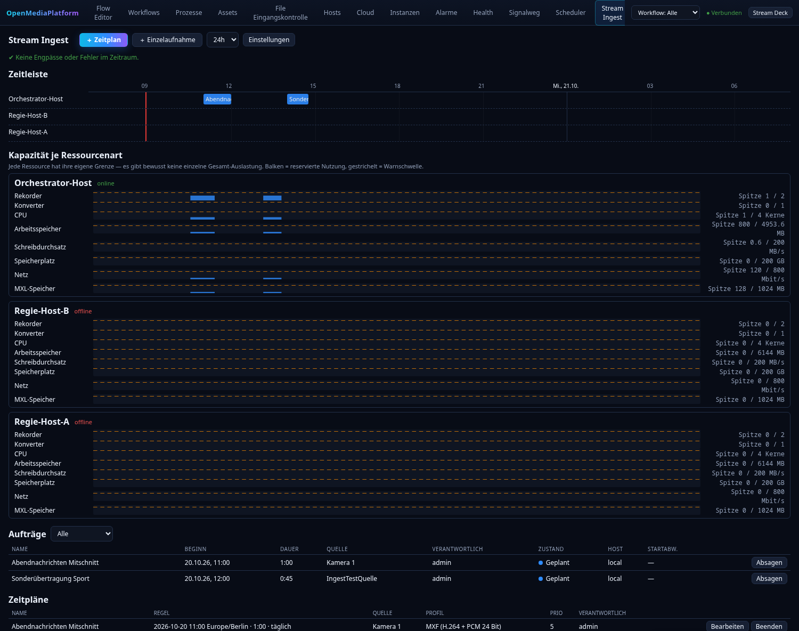

- **＋ Schedule / ＋ Single recording:** name, source (node with senders), recording profile, **time zone** and start as local time, duration (h:mm), repetition (daily/weekly with weekdays/monthly, until/count),
  priority 0–9, "If the source is missing" (wait / wait for a limited time / fail immediately — the recording always ends at the planned time), attempts on abort, preferred host, target folder and file name.
  Below the form the **live check** shows with every input whether the recording would be admitted — with reasons and earliest possible start, without saving anything.

  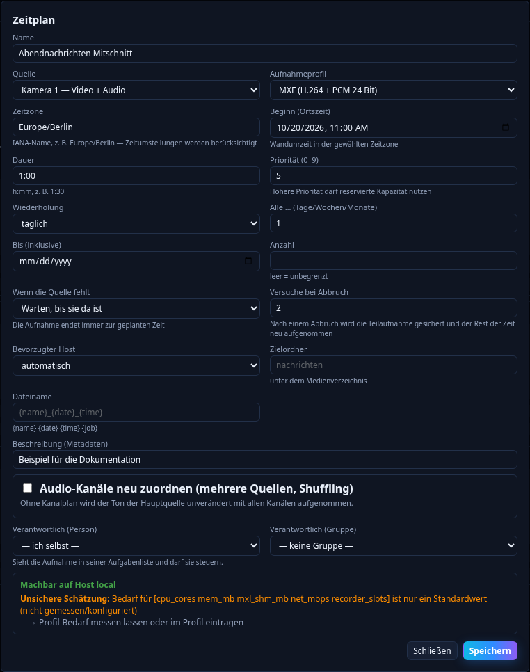
- **Responsible persons:** every schedule and every single recording has a responsible person and/or group (default: whoever creates it; only whoever has the right *Set responsible persons*
  may change it). Jobs inherit it. Responsible persons see the recording in their task list and may edit or control it; others only with *Edit others' recordings*.
  Whoever does not have *See all recordings* sees in lists, timeline and problems only their own (the load of the hosts stays visible). Filter "Mine" in the job list.
- **Problems** (top): *PREDICTED* = a bottleneck that has not occurred yet (with cause, period, jobs involved and recommended action); *CURRENT* = currently waiting for source/host;
  *FAILED* = actually failed (stage and reason; "Recording secured" if a file was preserved). Reasons: source conflict, hard resource shortage, temporarily busy, function missing,
  storage/throughput insufficient, capacity warning, uncertain estimate.
- **Timeline:** one track per host, jobs colored by state, overlapping ones stacked; those not admitted in the striped track "Not admitted". A click opens history and reasons; ⏱ in the list marks a
  time change (clock time does not exist → start after it; clock time twice → the first counts).
- **Capacity per resource type:** recorders, converters, CPU, memory, write throughput, disk space, network, MXL memory — each with its own limit (deliberately no overall percentage). Bar = already reserved use in the period,
  dashed = warning threshold, on the right peak/limit.
- **Running recordings are never interrupted automatically.** A schedule change replaces only future jobs. "Cancel (running)" ends deliberately; the recording so far is secured and registered as an asset.
  If a recorder crashes, the partial recording is secured and (depending on attempts) the rest of the time is recorded again. The orchestrator may restart in the meantime — the recording continues and is taken over.
- **Reassign audio channels (channel plan):** in the form below, "Reassign audio channels" switches the plan on. Each row is an **output channel** of the file and takes one **channel of a source** — any order
  (↑/↓), with gain (−96…+24 dB), label or **silence**. "Further source" adds up to seven sources from which **only the audio** is recorded (picture and default audio come from the main source); the channel count
  of every source is shown. "Main source 1:1" sets all channels of the main source as a starting point. Limits: MXF up to 32 channels (PCM 24 bit), other formats up to 8. Admission treats every further source like the
  main source (source conflict and limit apply to it too); if one is missing at the start, the recording waits according to the late-start policy. The channel assignment is afterwards in the asset metadata (`audioChannels`). Without a plan the audio of the
  main source is recorded unchanged. Note: the sources are merged via the common MXL time base; latency differences between different sources are not compensated.
- **Limits:** MCA labels (profile `mcaPlan`) refer to the output channels of the file; a channel plan does not create them itself. A recording has exactly one picture.
- **Settings** (administrators): form with five sections — *General* (warm-up time, start deviation target, planning horizon, target folder), *Default policies* (behavior with a missing source, attempts, pauses), *Admission rules* (source limit, reserve per resource from priority, displacement suggestion), *Limits per machine* (default and deviations per machine, warning threshold, functions) and *Recording profiles* (file format by selection, expected demand per resource — empty = measured/default —, optional conversion with ffmpeg arguments). Entries are checked before saving; the server checks in addition.
  Measured values from finished recordings replace default values automatically ("measured" before "configured" before "default").

## 5h. Files (explorer, recycle bin, "File missing")

The **Files** tab (settings: Administration → Platform → Operation → Files) shows the media files of the **locations** (media folders, proxies, subtitles, recordings …) on the orchestrator machine and on the hosts and
manages them: view, assign to an asset, upload, delete and restore. It needs the function rights *View files* (`files.view`),
*Delete and restore files* (`files.delete`), *Delete locked files (force)* (`files.force`), *Upload files* (`files.upload`) and
*Manage locations and file settings* (`files.admin`). Background and decisions: `docs/entwuerfe/ENTWURF-DATEIVERWALTUNG.md`.

- **By location:** on the left the locations (host, role, free space, number in the recycle bin), on the right the folder content. For each file there are **role** (master, proxy, subtitles,
  recording …), **belongs to** (the asset), the **file state** and a lock/warning symbol (🔒 locked or in use, ⚠ notices). The tick
  **"orphaned files only"** searches the whole location (up to 3000 files) for files that no asset, no subtitle and no recording refers to.
- **Create as asset / Add to asset:** selected files each become a new asset (published version, status "Registered", appears in the intake) or are attached as a
  representation to a draft of an existing asset (only "Publish" makes the version valid). Files that already belong to an asset are not created twice.
- **Upload** (`files.upload`): a file from the browser into the open folder of a location **on the orchestrator machine**; locations on hosts do not accept an upload.
- **Delete:** the preview shows the selected files and, for each, why it is locked or what it warns about. **"Take related files along"** adds the family
  (further representations, subtitles, review proxies); the master is never silently deleted along with it. Afterwards the files are in the **recycle bin** of the same location
  (same disk, no copying) and can be restored.
  - **Absolutely locked** (cannot be bypassed): the file is currently on air, being recorded, checked (QC) or read/written by an ffmpeg job, or the location is write-protected.
  - **Locked** (only with **Force**, right `files.force`, reason of at least 5 characters, is logged and raises an alarm): the file is in the **lock window** around a broadcast
    (start minus "before" to end plus "after") or is still **scheduled**.
  - **Notice** (confirmation is enough): part of a published version, asset approved/published or being edited in the intake.
- **Copy and move** (right `files.transfer`; moving additionally needs `files.delete`): files and **whole folders** can be transferred between **locations, folders and hosts**. Tick files and choose **Copy to …** or **Move to …**, or drag the selection by **drag and drop** onto a location (left) or a folder of the list (with Shift held it moves, otherwise it copies). The dialog shows beforehand what happens: number and size of the files, free space at the target, **conflicts** and locks.
  - **Conflicts** (same name at the target): *put next to the existing one* ("name (2)"), *skip* or *overwrite* (the old version goes to the recycle bin of the target).
  - **Moving within a location** is a rename (immediate). **Between locations** it is copied, verified and the source is then put into the **recycle bin** (restorable). If the file belongs to an **asset**, moving is blocked (the asset's reference would break) — copying works. The same locks as for deleting apply to moving (on air, being recorded/checked, lock window with *Force*); for copying only files that are still being written lock.
  - **Data safety:** every block is read back against a SHA-256 checksum; the target file is created under the name `….omp-part` and gets its final name only after a size check and `fsync` (a hot folder never sees a half file). If the source is changed during the transfer, the transfer aborts.
  - **Transfers tab:** progress in percent, speed, remaining time, current file, result per file; **Cancel** removes half files at the target. At most two transfers run at the same time; after an orchestrator restart running ones count as *interrupted*.
  - **Paths:** all hosts move the data in blocks (384 KiB) over the existing host connection, controlled by the orchestrator — the hosts do not have to reach each other. This is designed for tens of MB/s, not for line speed; very large holdings belong on shared storage. **Host agents must be updated to the new version** (they need the block operations); an older agent reports "unknown operation".

- **By asset:** the assets with the file state and filter (all present, file missing, partly missing, unreachable, never checked, without file). A click shows per representation state, size
  and check time as well as related subtitles and proxies; **"Check now"** checks immediately. The same filter is in the asset list (*Assets* tab, selection field "Files", ⚠ on assets with a missing file,
  column "File" in the representation table).
- **Recycle bin:** per location the deleted files with remaining time; **Restore** (never overwrites an existing file), **Delete permanently** and **Empty recycle bin** (right `files.admin`).
- **Settings** (`files.admin`) are in **Administration → Platform → Operation → Files**: retention in the recycle bin (days, 0 = permanently at once), **emergency limit** (free space in GB or percent),
  grace period for freshly deleted items, **lock window** before and after the broadcast, "stays locked as long as scheduled" as well as the check and maintenance intervals; per location the recycle bin days, lock window and
  emergency limit can be overridden, plus role and write protection. **Add location:** name, host (empty = orchestrator machine), absolute path, role. A host agent can restrict the roots it serves with
  `OMP_FILE_ROOTS` (colon-separated); if a location lies outside, it reports "unreachable … not released".
- **Shared storage (e.g. Isilon):** when creating, tick "Shared storage" and choose the hosts that have it mounted under the **same path** (the orchestrator machine counts as a host). The
  order of the ticks is the order of preference: the first is asked first, if it fails or its mount hangs, the next takes over (the last successful one stays in front). The location appears **once**
  in the explorer, with the host currently serving. "Hosts …" changes the list later. Upload works only if the orchestrator machine is one of the hosts.

**Hanging mounts block nothing:** every file operation has a deadline (reading 3.5 s, modifying 25 s) and runs in a thread of its own; an NFS/SMB mount that does not answer never brings the UI, the
orchestrator, the host agent or other locations to a halt. The location then immediately reports "Mount hangs" (red line on the card, mark in the administration); further operations on it are rejected without waiting,
at most one hanging thread per location remains and resolves itself as soon as the mount answers again. A clock test (every 30 s) checks every location even without operation. **Two failures in a row** trigger the alarm:
`file-mount-hung` (critical: mount hangs), `file-root-unreachable` (warning: host offline, path missing, not released) and on recovery `file-mount-recovered`; plus audit and event (`omp.files.mount-hung` …).
File states on such a location become "unreachable", never "missing".

**File state ("File missing"):** for each representation the orchestrator remembers whether the file is there (*present*, *missing*, *unreachable*, *not checkable*). It is checked in the background (default every 6 hours, in batches),
immediately on opening/"Check now" and after delete/restore. **"Missing" applies only after the second check in a row** (a briefly disconnected network mount triggers no alarm); an unreachable host
is **never** "missing". On a confirmed "missing" an alarm (webhook, e-mail — kind `file-missing`), the domain audit and an event (`omp.files.missing`) go out; if the file is in the lock window or scheduled, the
alarm is **critical**, otherwise a warning. If the file comes back, `file-recovered` reports that. Files without a location (no storage location created for the path) are searched on the orchestrator machine.

**Storage low:** if the free space of a location falls below the emergency limit, maintenance empties the recycle bin **earlier** — oldest entries first, only until the limit is reached again, never freshly deleted items within the
grace period and never files outside the recycle bin; the alarm `file-trash-emergency` names what was removed (or that the recycle bin contains nothing deletable).

## 5d-2. Target file format AVC-Intra Class 100 (1080/50p, 16 audio tracks)

The future file format of production is **AVC-Intra Class 100** in **1080/50p** with **16 audio tracks**. What the platform can do for it and what it cannot:

- **Recording (recorder):** the recording profile `avci100` (node option *Recording profile* or parameter `record.profile`; also `avci50` and `avci200`) writes **pure intra pictures in 10 bit 4:2:2** (x264 with `avcintra-class`) into an **MXF** file and **every audio channel as its own mono track** (24 bit PCM, 48 kHz). Without a channel plan it records the channels of the main source onto tracks 1 to 16 and fills missing tracks with silence; with a channel plan, that determines the tracks. Prerequisite: target file `.mxf`; x264 checks the class against resolution and frame rate (Class 100: 1080 and 720, Class 200 for the double rate). A selected profile also applies to the scheduled recording in the stream ingest of this recorder.
- **Playback (player):** the MXF players read the file with any number of mono tracks (the 16 are collected; the default presets address tracks 1–8, the supplied schema `mxf-16` names all 16 as `pos:1` … `pos:16` for your own assignments). **New:** the frame rate of the player output now follows the format choice of the workflow (`OMP_FRAMERATE_NUM/DEN`, e.g. 1080p50 → 50/1); before, it was fixed at 25/1. For 50p material **set the workflow format to 1080p50**.
- **Asset / QC:** the supplied QC profile **"AVC-Intra Class 100 (1080/50p, 16 audio tracks)"** (`avc-intra-100-1080p50`) checks the format: MXF, 1920×1080, 50 frames/s progressive, codec H.264 with profile *High 4:2:2 Intra*, chroma 4:2:2, at least 10 bit, **exactly 16** audio tracks, 48 kHz, at least 24 bit. Loudness is off in this profile (it belongs to the program, not to the single track). Review proxies now carry up to 16 audio tracks (default was 8 before; already saved settings keep their value).
- **Limits you must know:**
  - **Compute power:** software encoding of Class 100 in 1080/50p manages about **28 frames/s** on the 8-core development machine (real time needs 50, so roughly 14 cores). Decoding is uncritical (about 90 frames/s per core). Hardware encoders (NVENC, QSV, VAAPI) do not support AVC-Intra.
  - **Data rate:** Class 100 in 1080/50p needs about **230 Mbit/s** (≈ 29 MB/s, **≈ 100 GB per hour**) plus 16 × 1.15 Mbit/s audio.
  - **MXF conformance not proven:** the recorder writes with GStreamer's `mxfmux` (H.264 mapping, ffprobe recognizes *High 4:2:2 Intra*, 1920×1080, 50 fps, 16 mono tracks). Whether third-party systems (e.g. editing systems, archive) accept the file as real **AVC-Intra MXF according to SMPTE RDD 9 / ST 381-3** has not been established without their check tool; also MCA labels and a timecode track according to the delivery specification are missing as long as they are not added through the channel plan or `mcaPlan`. Check against the target platform before production use.

## 5e. Foreign playlist, follow mode (emergency) and broadcast release

**Layout of the panel.** The playout automation has tabs: **Broadcast** (control and playlist — the most important, always opens first), **Carts**, **Triggers & advertising** and **Configuration** (targets, preflight lead time, default filler, broadcast release, foreign list). The last chosen tab is remembered in the browser.

**Carts.** A cart is a button that immediately interrupts the broadcast (black clip, standby, pause picture, notice) and afterwards returns to the interrupted event. Under "Manage assets / carts" you create carts and edit them in the same editor as a playlist event: **source** (test pattern, file from the media library, picture, fixed live source or live source by tag), **duration** (0 = stays until RETURN is pressed), **audio**, **children** (graphics, node commands etc., as with events) and **block**: after the cart further carts run automatically in sequence, each with its own children. This way, for example, "pause picture → notice graphic → speaker live" can be built as one button. Every step needs a duration, otherwise the block stops there; RETURN ends the whole block. You choose the **icon** in a dialog (playback, broadcast, sound, notices …) or enter a character of your own. If a **cart block** (cart with follow-up carts) is running, the duration of each cart advances automatically; a cart with **duration 0** runs endlessly and stays until the operator advances the block: the banner "CART ON AIR" then shows **NEXT** (method `cart.next`) as long as follow-up carts are pending; **RETURN** ends the whole block.

**Restart without data loss.** Playlist, carts, counters and **all settings** (targets, audio mixer target, advertising, preflight, default filler, broadcast release, cue hold) survive a restart of the instance. If a **channel** is bound (workflow role), the state is held by the orchestrator. If the instance runs **standalone without a channel**, it saves itself as the file `.run/playout-automation/state-<state key>.json` (permissions 0600, adjustable with `OMP_PLAYOUT_STATE_DIR`); the state key stays the same on a manual restart with a new instance ID. The parameter **persistence** shows which way is active. An unreadable file is never overwritten but put aside as `.bad`.

**Linking a channel.** In the **Configuration** tab there is the section **Channel (storage)**: choose an existing channel and **Link**, **Unlink**, or via **＋** create a new channel and link it right away (rights as in the playout administration). The chip "Channel: …" or "no channel" at the top leads directly there. If the channel is already bound to another instance, the panel asks; if it already has stored content, the current content of the automation replaces it. On a manual restart of a standalone instance the channel moves to the new instance ID (requires the updated orchestrator); channels bound to a workflow role are released in the workflow.

**Setting up mixers.** Under **Targets** there are **Set up mixers now** and the option **Set up mixers automatically as soon as connected** (default off). The automation then reads the programs of the channel (audio output of the channel) and creates in the connected **audio mixer** for every player and every program (program sound, audio description, original sound, Dolby E, 5.1 …) a channel: the source is the matching sender of the player, "Audio follows video" is set on this player. In the **video mixer** both players are pinned. Only what is missing is added; existing channels and sources stay, nothing is deleted, a second run changes nothing. Whoever builds a mixer of their own finds the interface in `docs/contracts/CONTRACT-MIXER-SETUP.md`.

**Audio output per channel.** In the **Configuration** tab of the automation there is the (collapsible) section **Audio output (this channel)** with the same editor as under *Admin → Playout → Audio output* (output groups, track schemes, assignment templates, fallback rules, simulator), but for the document of **this channel**. A channel without a document of its own **inherits the platform default** (the admin subtab remains as a template for it); only **Save** creates a document of its own, **Discard own document** goes back to the default. Prerequisite: the automation is linked to a channel. Players and mixers **in a workflow** automatically get the document of the channel of this workflow (at the next start of the instance); in addition **all targets of the automation** (players A/B, audio mixer) get the document automatically — the automation reports its target labels to the orchestrator, the assignment runs via the label of the node. Players that no automation leads and that are in no workflow stay **standalone** (platform default); they can choose the channel by hand with the environment variable `OMP_AUDIO_RULES_CHANNEL` (channel ID). Changes take effect only after a restart of the players (the output groups are their senders). Write access: admin.

**Look, counters, timeline.** The panel has the dark **console 2 look** of the mixers. The ticked **counters** (next live, fixed, manual event, event without source) stay visible even if there is no matching event — then "… : —" is shown dimmed. With **▤ Timeline** above the playlist you show a **timeline** (window 5–120 min, remembered in the browser): the events as blocks from the broadcast position (red line = now; green = on air, yellow = cued, magenta = live), below them their **child events** as violet bars (green = active, red = failed). A click selects the event or opens the child in the editor. Child events with absolute time are not on the axis.

These functions belong to the node **Playout automation** (panel section **Foreign list / follow**, setting **Broadcast release** under *Targets*).

**Several channels in one workflow.** Each playout automation controls the players and the video mixer whose role name starts with its own, e.g. `channel-a` → `channel-a-player-1`, `channel-a-player-2`, `channel-a-mixer`.

**Loading, appending and saving playlists.** Above the playlist: **Save** downloads the complete list as `<channel>-<date>-<time>.omp-playlist.json` into the browser's download folder (with all properties: start types, transitions, child events, audio, asset references, jump targets). **Load …** replaces the current playlist with such a file (confirmation if the list is not empty; the players are not touched, a running event is recorded as interrupted in the as-run log). **Append …** adds the events of a file to the end. A faulty file is rejected as a whole. Examples: `docs/examples/playlists/`.

**Importing foreign lists.** *Import list …* opens a broadcast list from another automation system (adapter `mpl3`, XML broadcast list). Before adopting it, a **preview** shows how many broadcast events arise, how many have already run (are omitted), what is only *approximated* (e.g. crossfade "Fade Cut" becomes "Mix") and what is *not adopted* (e.g. logo/graphic children without assignment). Then: **Append** or **Replace playlist**. Mappings are in the plugin configuration `foreign-mpl3` (`mediaTemplate`, `liveMap`, `childMap`, `skipDone`, `requireRelease`). The list is only read — the foreign format is not an internal format.

**Follow mode as emergency playout.** In the section *Foreign list / follow* enter the folder (watch folder with the automatically saved lists) and channel identifier (e.g. `5000`) and **Save & activate**. OMP reads the **newest complete** file each time (half-written ones are never loaded), reconciles it with the last state (new/dropped/changed) and shows which event is running according to the list. The players are **not touched** in the process. If no new valid file arrives for longer than `maxAgeSec` (default 120 s), **⚠ OUTDATED** appears — the foreign system no longer delivers. **Pull emergency …** replaces the playlist with the shadow list from the event after the running one; the first event gets its planned fixed time. The running event itself is not taken along (no jump into the middle of a file).

**Broadcast release.** *Require broadcast release* (targets; node option `OMP_REQUIRE_RELEASE`) or per event *Broadcast release* (event editor, file): the event goes on air only if the file in the intake (5c) has **QC green** **or was released manually**; a rejection in the intake always applies. Blocked events show 🔒 with a reason, are not cued/taken, and the failure policy of the event applies (hold, skip, fallback file …). If the intake is not reachable, the file counts as **not released**. A file that has not arrived yet stays marked unavailable until it is in the media directory.

**Follow mode (emergency).** Follow mode is prepared but postponed: it will only be used once the POC for it is large enough (plugin off by default).

**Secondary record and overwrite protection.** `record.start` of the recorder has the argument `overwrite` (default **off**): if the media ID already exists as a clip (in the recording directory or in the directory of the option *Clip directory*), the recording is rejected. With `overwrite=true` it is overwritten deliberately.

**End-to-end test.** `python3 tools/durchlauf-e2e/e2e.py` creates permanently the workflow "Durchlauf Playout", the channel "Durchlauf" and the process "Durchlauf Eingang" (nothing is cleaned up, start it in the *Workflows* tab for further testing) and runs the whole way from the new file to the comparison.

**Compare a recording against the original.** In the intake the detail has the tab **Recording comparison**: choose the recording (second entry in the intake), then *Compare*. Checked are duration (±1 frame, adjustable), frame rate (exact), resolution/codec (notice), audio and picture quality (SSIM ≥ 0.98 on a 10 s sample, adjustable). The **lead time of the recording** is determined from the pictures by default (the recording usually starts a little before or after the event); if the picture is too static for that, the entered value applies. The same function exists as `POST /api/v1/review/items/{id}/compare`.

## 5g. Automatic subtitles

The **Auto subtitles** node recognizes spoken language from an audio stream and creates subtitles from it: live in the subtitle layer of a graphics node and as a continuous SRT track. You set source, language, graphics node and track name in the tile; "Start track" begins a new file in `data/subtitles`. The text appears with a few seconds of delay after speaking, the track contains the real speaking times. Recognition runs locally (whisper.cpp) and needs several CPU cores. Setup, limits and timing behavior: `docs/funktionen/ASR-UNTERTITEL.md`.

**SRT from a file (with speakers).** In the **intake** you open a file and choose the tab **Subtitles**: set audio track, language, number of speakers (**1 = without speaker recognition, default**; automatic / 2 … switches on the compute-intensive speaker recognition), names in order of first appearance and the notation (`Alice: …`), **Create SRT**. The job runs on a **dedicated file node** (Auto subtitles with task `file`, started in addition to the live instance) — live nodes accept no file jobs, so that live subtitling is never disturbed; progress, cancel, download and delete are in the list. The same exists as the process step **Subtitles (SRT)**. The result is attached to the asset and lies as a track in `data/subtitles`; you enter the name shown there in the child event **SUBTITLE** of the playout automation. If the graphics node at the output plays such a file, the live subtitling of the Auto subtitles node **pauses** by itself. So that subtitles also run frame-accurately on hold, pause and jump, drag the sender "Timecode (ANC)" of the channel player onto the receiver "Timecode" of the graphics node (this also shows in viewer and scope). Speaker recognition must be set up once with `sh tools/asr-engine/install-diarization.sh` (without it SRT is created without speakers). Details and limits: `docs/funktionen/ASR-UNTERTITEL.md`.

The viewer also shows the subtitles when its subtitle input is attached to the CEA-608 output (it reads text and CEA-608). If a subtitle input exists, its state (playing/ready/off) is in the node's diagnostics.

## 5g-2. Sign language avatar

The **Sign language avatar** node converts subtitles into German Sign Language (DGS) and delivers an animated avatar as a fill+key output for the picture-in-picture in the video mixer. It computes by itself (software, no graphics card) and only as long as someone reads the picture.

**Wiring:** put the subtitle output of *Auto subtitles* (text stream or CEA-608) on the input "Subtitles" of the avatar; fill and key to the mixer as with a graphic (PIP layer or DSK). **Size and position on the broadcast picture** you set in the mixer (PIP box or PIP preset). The **picture size of the avatar** itself (small 360×405, medium 480×540, large 600×675) and the **background card** (better legible in a small picture) are options of the instance.

**What it does:** the text is split into sentences, words are mapped to signs (filler words are dropped, time expressions come first, the verb last, the negation after it with head shaking, the question word at the end with a questioning head posture). **Unknown words** are spelled (finger alphabet), numbers as number signs. If a sentence is **mostly unknown**, it is not guessed but shown as **text in the picture**. The option **Fallback for unknown words** (`OMP_SIGN_FALLBACK`, live as parameter `fallback`) chooses whether the sentence is **spelled** (`spell`, default — the text stays visible for checking) or only the text appears (`text`, without movement). As long as no approved lexicon exists, every sentence is a fallback — the avatar then moves in the default mode `spell` (finger alphabet), in mode `text` not at all. If the avatar lags behind the subtitle, it signs faster; with a large backlog older sentences are discarded (counter "discarded" in the state).

**Approval:** signs come from the **lexicon** (`data/sign/lexicon.json`, example `deploy/sign/lexicon.example.json`). Only entries with `"verified": true` — checked by signers on the contact sheet — go on air; everything else the node treats as unknown. Checking: `omp-sign-avatar --lexicon-check data/sign/lexicon.json --sheet bogen.png` reports errors with a path into the lexicon and creates a picture with all signs, key by key. The rules (filler, time, negation, question words, fallback threshold) are a file (`OMP_SIGN_RULES`, template `deploy/sign/rules.example.json`); the built-in default rules are a **draft** that experts must check. **The finger alphabet is an approximation** and must be checked by signers before productive use.

**In the panel:** `auto` (sign subtitles automatically), `speed`, state (queue, lag, discarded, signed, as text, last glosses, share unknown), lexicon state. Methods: `translate` (treat text like a subtitle — for trying out the rules), `speak` (spell only), `stop`.

## 5f. Core binding, temperature and power consumption

**Radio: broadcast delay (audio delay).** The node *Audio delay (radio)* holds back the program by the set time (default 8 seconds) — so a slip of the tongue or an unwanted caller can still be thrown away by **dump** before it goes to air. Put the program on the input "Program", lead the output "Program delayed" to broadcast/recording. *Dump* (method `dump`, value in milliseconds) jumps forward immediately; the delay then builds up again by itself by the audio running imperceptibly 1 % slower (adjustable). If the program fails, the delay first runs empty, then the "emergency source" (second input, e.g. an emergency program) jumps in; when the program returns, the delay fills up anew without the broadcast breaking off.

**Radio: on-air operation (radio automation).** The control panel of the radio automation (node *Radio automation*, target is the *segue player*) shows in the tab *On-air* the clock, the loaded show and the **playlist**: per row start time, kind (track, jingle, spoken), file name, the marks *Intro* and *Outro* (segue point) and the duration; the next row is marked green ("ready"). On the right are *Start*, *Stop*, *Load*, *Cue*, *Reset*, *Transition*, the auxiliary windows *Navigator*, *Edit*, *Planning*, *Presenter text*, *Teleprompter* and *Log* as well as the pre-listen area (PFL) and the freely assignable *Hotkeys*. At the bottom run the two playback cards **M1** and **M2** (each with waveform and remaining time) and in the middle the counter "Next in …". The further tabs: *Planning* (prepare and import shows), *Playlist*, *Transitions* (transition editor with waveforms and movable marks), *Presenting* (presenter cards and notes on the show) and *Log* (as-run). From the marks the automation plans the transitions (track→track as a crossfade at the segue point, jingle over the outro) and sends the voices with lead time (default 30 s) to the segue player. A ready-made template with all radio nodes is the workflow *Radio presenter position* (`docs/examples/workflow-radio-moderationsplatz.json`).

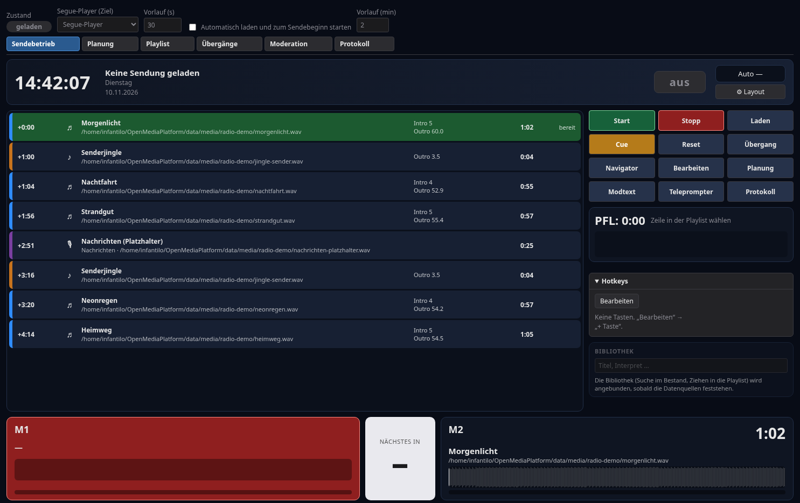

**Tab Planning** — weekly plan with the shows of the day and the form of the show (title, time window, presenter, release, *Load on air*, versions):

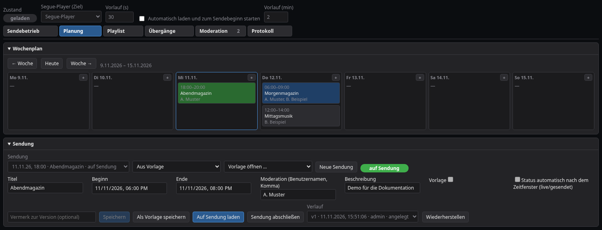

**Tab Playlist** — the log as a table: intro, segue point, start in the file, level, hard time marks, ad block with target length and check "fits". *Load log* hands the state to the segue player:

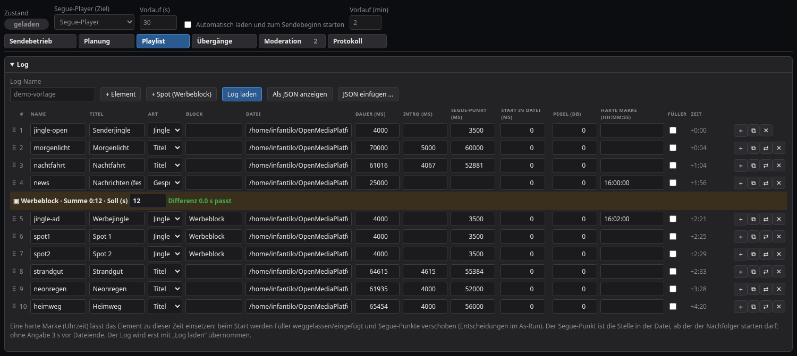

**Tab Transitions and transition editor** — each track pair with its crossfade; *Edit* (or double click on the time in the playlist) opens the editor with the waveforms of both tracks, movable marks (segue point, start, end of the fade, intro end, beginning), curves, pre-listening to the transition and the broadcast-quality check:

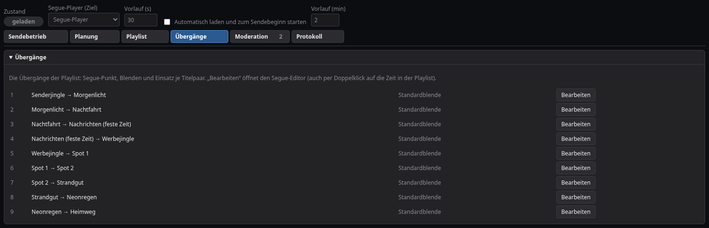
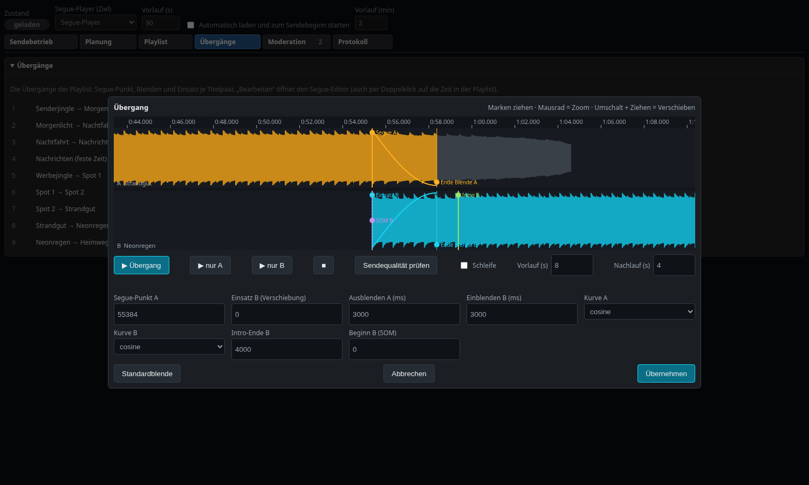

**Tab Presenting** — cards with reading-time estimate, attached to a track or the start of the show, and notes on the show:

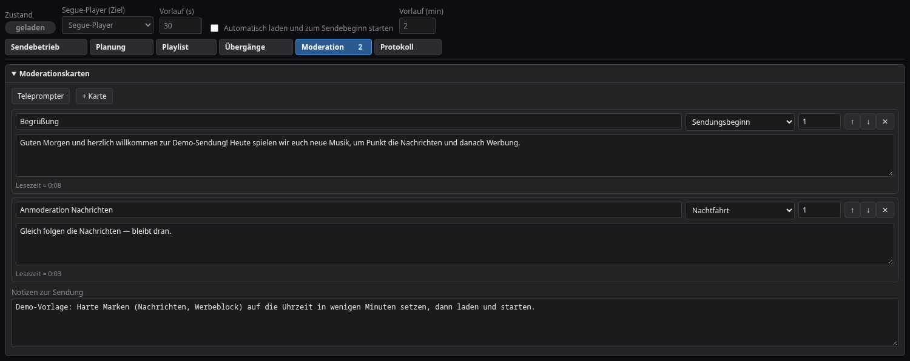

**Studio logic and contacts.** The *Studio logic* (microphone groups with on-air lamp and cough hold key, studio handover, rules for red light and loudspeaker muting) and the *GPIO* node (inputs and outputs, simulator) have their own control panels:

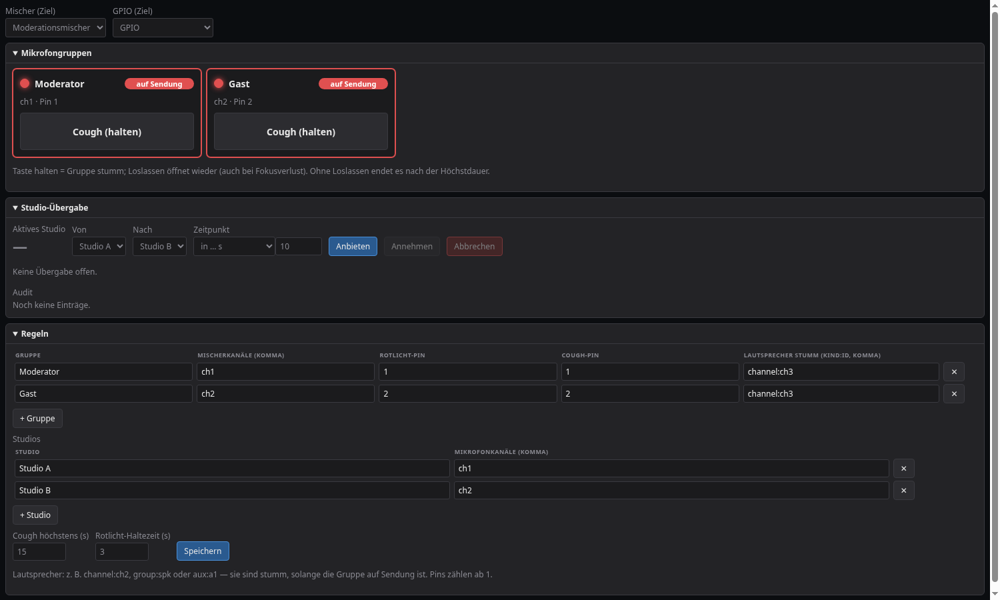
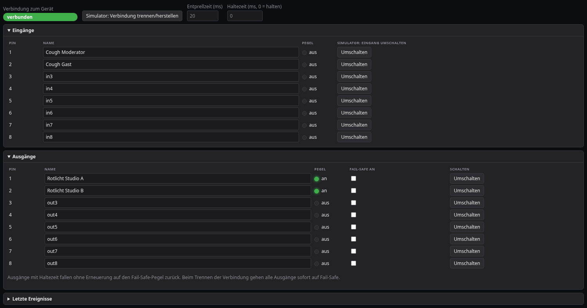

**Radio: loudness check (intake).** In the intake (file check) there are two supplied profiles for audio files: *Radio production (EBU R 128)* checks −23.0 LUFS with ±0.2 LU tolerance and true peak up to −0.7 dBTP; *Radio short form (EBU R 128 s1)* applies to spots and jingles and additionally requires that the highest short-term loudness does not exceed −18.0 LUFS. After every check the measured loudness is on the asset (integrated, loudness range, true peak, highest short-term value); later it serves the automatic level adjustment on playback. Files under 3 seconds have no short-term value.

**Own graphic templates (OGraf editor, beginning).** In the panel of the graphics node "Edit templates…" opens the library: search templates, create new, duplicate, rename (change ID), delete as well as import and export as ZIP. In the tab *General* are name, version, author, steps and desired resolution, in the tab *Parameters* the input fields of the template (text, multiline, number, yes/no, color, selection with default and mandatory), in the tab *Source* all files including pictures and fonts. The window shows whether the template conforms to the OGraf standard; errors prevent saving. An edited template appears anew at the next fade-in; a running graphic remains unchanged. A template can mark a "window" (`data-ograf-zone`): the video mixer then places a picture (e.g. program or preset) exactly there (squeeze-back) or runs the paternoster transition in the window. You set the coupling in the panel of the graphics node in the section *Layout coupling (video mixer)*: as soon as a graphic with a window is on air, a card appears there per window. Choose *Picture in window (PIP)*, the mixer, the source (for example the preset bus or a camera) and the PIP slot and click *Couple*; the picture follows the window, also while the graphic moves in. For the **paternoster** you choose *Window for paternoster* (e.g. with the supplied template "Paternoster frame") and set the transition "PATERNOSTER" (▼/▲) at the mixer: PGM and preset then run past each other in the window of the graphic. **PIP wall (reverse direction):** the supplied template "PIP wall" draws a background picture with three transparent windows (`pip1`–`pip3`), frames and one caption each (fonts, colors, background picture URL are parameters). Here the graphic does not lead the pictures, but the mixer leads the graphic: choose per window *Window follows PIP slot*, the mixer and the slot (window 1 = slot 1 etc.). Frame, font and cut-out then follow the pose of the slot from the PIP scene (e.g. "PIP 1"). If you click a PIP in the PGM monitor of the mixer, the mixer enlarges it as before, the graphic moves along; the other windows and their frames are faded out, a second click moves back. The graphic key (DSK) lies in the mixer **above** the PIPs; the graphic cuts out the windows, therefore round corners are also possible (parameter *Corner radius*) and when enlarging the remaining PIPs disappear behind the background. Captions sit as tabs above the frame. After a restart of the graphics node it fades its layers in again, and the mixer finds the graphic as a DSK source again by its name (the sender ID changes at every start). The graphic must be on air; the travel time (parameter *Travel time of the windows*, default 500 ms) should match the focus move of the mixer. **Sync with the video:** the mixer reports every PIP move with an absolute start time, the graphic recomputes it with the same curve. Because the graphic picture needs a few hundred milliseconds to the mixer output, the mixer starts a coupled move later by the lead plus 150 ms (method `pip.setAnimDelay` at the mixer, set by the graphics node itself), and the page shows the pose of "now + lead" (`leadMs`). Default lead 250 ms, measured under load (gap in the window from about 300 ms, measured with a white source). Adjustable at runtime with the method `layout.setLead` (`ms`) at the graphics node or with `OMP_OGRAF_FOLLOW_LEAD_MS`; re-measure on the broadcast host. Consequence: a click on a PIP only starts moving after lead plus 150 ms (default 400 ms) as long as a coupling exists. *Release* removes the coupling; it also persists after a restart. **Multi-step templates, timeline, actions:** the tab *Canvas* (template "＋ Designer") knows steps (element visible from/to step, Next key), a timeline with playhead for fading in and out, own fonts, pictures, multiple selection and rotation as well as *actions* (e.g. "Highlight": pulse, blink, wobble, hop on selected elements), which appear as buttons of their own in the panel of the graphics node. The button "▶ Broadcast test" in the editor fades the saved template in on the graphics node.

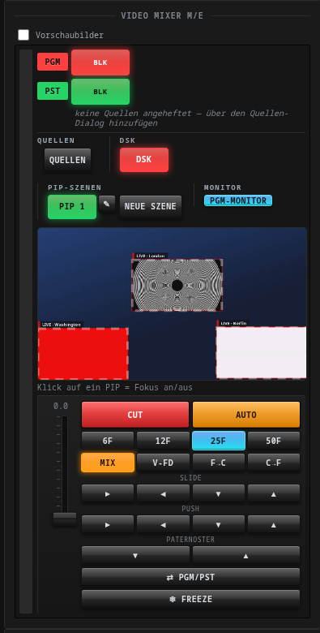

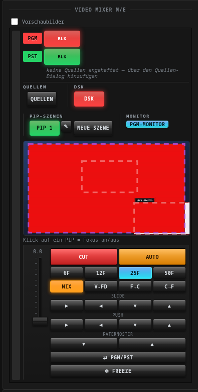

**Layout coupling per template, window list and focus behavior.** *Assignment per template:* the coupling (mixer, slot, kind) applies to the template that the layer is currently showing. If the layer changes to another template, the assignment rests and appears again as soon as you return to the first template; in the section *Layout coupling* you always see only the cards of the current template. A PIP slot last set at the mixer stays when switching (it is not switched off by itself). Older assignments from saved workflows apply unchanged to every template of the layer. *Window list:* a template can name its windows in the manifest (additional field `v_omp_zones`: identifier, name, optionally a slot suggestion). The panel then shows the name ("Window 1") instead of the identifier and pre-fills kind and slot for a suggestion; you only click *Couple*. Additional fields in OGraf manifests must, according to the standard, begin with `v_`; the supplied templates adhere to that, older imported templates with fields such as `designWidth` remain usable, the editor reports a warning for them. *Round corners (PIP wall):* with *Corner radius* and *Corner shape* the graphic shapes the PIP windows. *all* rounds all four corners, *diagonal* only top right and bottom left (shows that the shape comes from the graphic). The video in the mixer stays rectangular; the graphic background cuts off the corners, therefore the shape applies only while the graphic is on air. The corner shape appears in the input form as soon as the graphics node has been restarted. *Enlarged window (PIP wall):* the template has the option **"Enlarged window covers the others"** (`focusCover`, default on). If you click a PIP in the PGM monitor, its video lies over the other windows as at the mixer: frame and caption of the others are cut out wherever the enlarged window lies, also while it moves back. If the option is off, the captions of the other windows stay above the enlarged picture (only the frame is cut out). The graphics node updates supplied templates ("PIP wall", "Paternoster frame") itself at start if the program brings a higher version; a template you rebuilt (without a readable version) remains untouched. The option appears in the input form of the template as soon as the graphics node has been restarted.

**Supplied broadcast templates (chapter 94).** The graphics node brings twelve ready-made templates (identifier `omp-…`, display name `OMP_…`; the older supplied templates are likewise now called `OMP_Subtitles`, `OMP_PIP-Wall`, `OMP_Paternoster-Frame`, their identifiers stayed unchanged), which are installed at start (and updated with a higher program version; a template you rebuilt remains untouched): *Lower third*, *Headline/breaking news*, *News ticker*, *Station logo (bug)*, *Clock/countdown/stopwatch*, *Result board*, *Title card*, *Next/Afterwards*, *Location tag*, *Quote* as well as *Divider wipe* and *End credits*. All have colors, texts and sizes as parameters, are built in percent of picture height/width (any resolution) and can be passed on as ZIP (editor → export). **Lower third, headline, title card, afterwards, location tag, quote and result board are designer templates: open them in the editor and edit them graphically in the tab *Canvas*** (move elements, colors, fonts, animation). The others (ticker, logo, clock, divider, end credits) compute or animate by code and can be changed in the tab *Source*. Important: when the program is updated, a supplied template is only replaced if its version is higher — if you want to keep a version of your own, use *Duplicate*. **Divider wipe:** a red gradient bar travels over the left half of the picture from top to bottom, one over the right half from bottom to top; at half the duration the picture is fully covered (parameter *Full coverage* gives some leeway), then they travel further out. As a child event at the end of an event: start = changeover time minus half the duration (default 1800 ms → 900 ms before the end, duration 1800 ms); the template ends itself. **End credits:** at the start of the event (delay 0, duration = parameter *Duration to full frame*, default 10 s) the video begins squeezed on the right, on the left appear title, director, editorial staff, production year, additional lines and optionally sponsor logos; at the end the video moves back to full frame. For this, couple in the panel under *Layout coupling* the window "Video" as *Picture in window* with a second mixer layer (which shows the program of the first); without coupling the window stays transparent.

**Graphics and child editors without JSON.** In the event editor of the playout automation (tab *Child events*) and in the panel of the graphics node (ograf) there are no JSON text fields any more: graphic templates show their fields including lists and groups as a form, templates without a schema and webhooks use free fields (name, type text/number/yes-no/list/group, value), and for node commands the editor suggests methods and arguments of the target node.

**Values from the playlist in child events (chapter 95).** In every text field of a child event (graphic fields, parameters of a node command, webhook URL and content) there is the button **{ }** on the right. It opens an assistant with which you insert values from the playlist — for example "Next: *title of the next event* at *20:15*" or the remaining time to the end. Three steps: **① Which event?** Previous, current (the one the child belongs to), next, the one after next (Nth before/after), the one currently running, first/last, at a position, a specific one — or **search**: "first event after it whose title contains *Weather* and that is longer than 1 minute" (condition rows with field, operator and value; you can search for anything, also for media metadata). **② Which detail?** Title, file name, type, start time, end time, duration, time to start, time to end, elapsed since start, note or a media metadatum (e.g. artist, genre). **③ How should it look?** A list of all matching representations, each with the result you would get if the child started *now* — time of day (20:15 / 20:15:00), "today 20:15" / "tomorrow" / weekday, date, timecode, frames, seconds, hh:mm:ss, "in 5 min" and more; for texts upper/lower case, shortening, replacement text if nothing is there. A click on the row chooses it, **Insert** puts the finished placeholder (e.g. `{{next.start|short}}`) at the cursor position. Under a field with a placeholder you see live what becomes of it. The placeholder is only inserted **at the start of the child**, with the times valid then. If what you want does not exist (no next event, metadatum missing), the field stays empty instead of showing the placeholder. Number fields of a template also accept a placeholder via **{ }** (the assistant delivers seconds/frames as a number there). The complete notation is in `docs/funktionen/PLAYOUT-AUTOMATION.md` §4a.

**Core binding (CPU pinning).** Every instance has the option **CPU cores (binding)** (group *Performance*, `OMP_CPU_AFFINITY`; settable per instance or per type). Empty = no binding (default). Entry as a list, e.g. `2-3` or `0,2,4`: the node then runs only on these cores (`taskset`, also on remote hosts via the host agent). Sensible only on production hosts, to protect time-critical nodes (output, playout, device gateways) from batch work such as QC or transcodes; a wrong list only costs performance. Invalid cores or ones not present on the host are ignored with a warning in the log, the node then starts unbound. The option overrides a binding set in the catalog (`realtime.cpus`).

**Load control (playout).** A cued event holds the standby player at the first frame (option *Hold cued event at preroll*, default on) and decodes only at the take. The video mixer computes its program/preset layers in a YUV format with alpha (AYUV) instead of RGBA and therefore needs about one fifth less CPU in broadcast operation.

**How to read the CPU values.** There are three different numbers: (1) the **host CPU** in the Hosts tab (from the guest operating system, percent of *all* cores), (2) the **instance CPU** (only the nodes started by the system, percent of *one* core, next to it the share of the host) and (3) for virtual machines (e.g. Crostini) the display of the **hypervisor host** (task manager of the browser). The instance sum does *not* contain the infrastructure (database, etcd, NATS, registry, the orchestrator itself, browser, compiler). In a VM the guest total load can come out too low because it does not see the hypervisor's time; the sum of the process times and the display of the host are then closer to the truth.

**Temperature and power.** In the *Hosts* tab the column **Temp. / Power** shows the CPU/platform temperature (yellow from 75 °C, red from 85 °C; the tooltip lists all sensors) and the power consumption: the CPU package from the RAPL energy counter or — on devices with a battery — the total power. **Without a sensor "–" is shown, never 0**: virtual machines and containers often deliver no values, RAPL is readable on newer kernels only with privileges. The external alarm reports a host whose temperature is above `OMP_ALERT_TEMP_C` for longer than `OMP_ALERT_LOAD_SECONDS` (default 85 °C, 0 = off), and the recovery. In the host history (tab *Hosts → History*) there are the series **Temperature** (°C) and **Power** (W) for 1 h to 30 days (hourly values in the database); without a sensor the series stays empty (*not measured*). For Prometheus `/metrics` delivers `omp_host_temperature_celsius{host=…}` and `omp_host_power_watts{host=…,source=rapl|battery}` — only for hosts with fresh telemetry and a measured value. The values come from `/sys` (hwmon, thermal, powercap, power_supply) and cost only a few small file reads per measurement.

**Workflows in the host view.** Every host tile has under its header a sub-area of its own "Workflows": there the workflow tiles of this host stand, whether stopped or started, fixed one below the other. Node tiles begin below; newly started or moved nodes no longer overlap the workflows. Workflow tiles cannot be moved freely, a double click opens the workflow as before.

**Alarm symbol in the Flow Editor.** On the tile of an instance a ⚠ appears if it has crashed, has already been restarted or is offline; a click opens the diagnostics.

**Nodes as container packages.** Auto subtitles, graphics (OGraf) and intercom can be packaged as a container image with all accessories (`deploy/container/build.sh <type>`, import `import.sh`, removal `uninstall.sh`). Removing deletes the image and — for the last version — the data volume of the node. The intercom container uses the host network so that WebRTC stays reachable. The standard installation still starts graphics and intercom as normal programs. The container packages are in the catalog alongside as "OGraf graphics (container)" and "Intercom (container)" (types `omp-ograf-pkg`, `omp-intercom-pkg`; import with `OMP_IMPORT_TYPE=omp-ograf-pkg sh deploy/container/import.sh omp-ograf`, removal with `uninstall.sh omp-ograf-pkg`).

## 5g-3. Timecode (SMPTE ST 12-2) and offset measurement

The **channel player** delivers, besides picture and sound, an output **"Timecode (ANC)"**: the media position of the running clip (00:00:00:00 = clip start) as ST 12-2 timecode, one value per frame and **on the same frame clock as the picture** (timecode and picture cannot drift apart). On pause and hold the value stays; without a clip with media time (test pattern, live, still) it stays empty.

**Video mixer:** every layer has an output **"PGM timecode (ANC)"** with the timecode of the source currently on program. Sources with a timecode output on the same device are recognized by the mixer itself; if a source without timecode is on program (test pattern, freeze), the timecode is empty — no wrong value.

**Displays and consumers:** viewer (input "Timecode", overlay) and scope (large display, jump counter) show it. The **graphics node** follows it when playing a subtitle file (SRT): the parameter `clock` of `subtitle.start` (`auto` | `timecode` | `free`) chooses whether the subtitles follow the timecode (frame-accurate, also on hold and seeking) or run freely; `auto` follows the timecode if one is present.

**Measuring the offset to the picture:** `tools/tc-offset/make-clip.sh` creates a test clip with a burned-in frame counter (16 bars in the top row), `tools/tc-offset/measure.py --clip <file>` starts its own test instances (player, mixer), compares per frame the counter in the picture with the timecode and outputs the offset in frames (positive = timecode runs ahead of the picture). Measured: **0 frames** at the player and at the mixer program output. Limits: crossfades between two sources, several layers and the multiviewer overlay are not measured.

## 6. Alarms

The **Alarms** tab collects in one place what needs operational
attention: crashed or unstable (flapping)
instances, overloaded hosts and failed workflow starts. In
normal operation it stays empty:

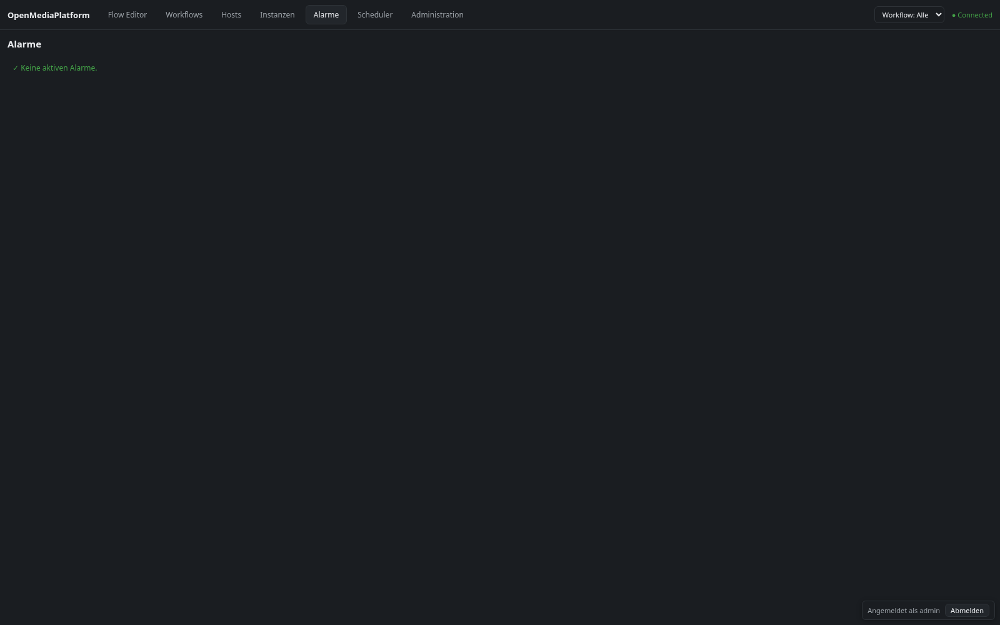

### Administration → Settings: tabs and search

The settings are divided into three tabs: **Node options** (per node type and instance), **Operating values** (retention, backups, placement thresholds of the orchestrator) and **E-mail alerting**. The **search field** above searches all three tabs at the same time — label, name of the environment variable, description and group; several words must all occur ("audit days"). The tabs show the number of hits; a tab without hits is dimmed, and the view jumps by itself to the first tab with hits (for node options to the first node type with hits, the type selection names the number per type). An empty search field shows everything again. Unsaved entries are kept while searching and switching tabs.

### Alarms by e-mail and webhook

Whoever does not look at the UI would otherwise learn nothing of a failed host or a broken pipeline. The orchestrator can therefore send alarms outward: node alarms, host online/offline, media health (broadcast path delivers no media any more) and high load. Identical messages are combined for one minute; an unreachable target slows nothing (3 retries after 2/10/30 s, then a warning in the log). Only the leading orchestrator in the cluster sends.

**Setting up e-mail:** *Administration → Settings*, section **E-mail alerting**. Enter: SMTP server, port (empty = 587 for STARTTLS, 465 for TLS), encryption (*STARTTLS* recommended, *TLS* or, only in a trusted LAN, *none*), optionally user and password, sender and recipient (several separated by comma). **Send test mail** checks the entered values immediately, without saving yet; an error (server not reachable, login refused, no STARTTLS) is shown directly below. **Save** takes effect after a few seconds, without restart. With *STARTTLS* the platform never continues sending in plain text if the server offers no encryption. The password is stored encrypted in the database (AES-256-GCM, key `OMP_STORAGE_SECRET_KEY`) and never displayed again; if the key is not set, no password can be saved (access without login works anyway). *Remove setting* goes back to the environment variables.

**Recipients by alarm kind and severity.** Every alarm has a **kind** and a **severity**: *critical* (node alarm, host offline, broadcast path delivers no media, node without sign of life), *warning* (load too high) and *info* (all-clears: host online again, node reports again, media back, load normal again). A node can give its alarm a severity of its own (field `severity` in the alarm); otherwise the default of the kind applies. In the panel you create under **Recipient rules** any number of rules: per rule severities (ticks), alarm kinds (ticks; nothing ticked = all) and recipients. An alarm goes to the **union of the recipients of all matching rules** (kind *and* severity must match, duplicates are dropped). If **no** rule matches, the **default recipients** receive it. A matching rule **without recipients suppresses** the mail — so e.g. all all-clears can be muted. Example: *Rule "Engineering"*: kind "Broadcast path delivers no media" → technik@…; *Rule "Management"*: severity critical → leitung@…; *Rule "Quiet"*: severity info, without recipients. **Rules per workflow.** Every rule can additionally be limited to individual **workflows** (ticks; nothing ticked = all, also alarms without a workflow). A node alarm (node alarm, media lost, node silent, all-clear) belongs to the workflow whose role the node fulfills. A **host alarm** (host offline/online, load) belongs to **all running workflows that have a role on this host** — if a host fails on which Studio A and Studio B run, the rules of both apply. Alarms without a workflow (manually started instance, host without a role) meet no rule limited to workflows and go to the other matching rules or the default recipients. Kind, severity and workflow must **all** match. Example: rule "Studio A" = workflow *Studio A*, critical → regie-a@…; rule "Studio B" = workflow *Studio B*, all severities → regie-b@…. The mail names the workflow (`Workflow: Studio A`). If a workflow is deleted, the rule stays and shows it as "no longer exists" — it then meets nothing until you adjust it. **Status attachment.** Every rule has a field *Status attachment*: *none*, *Status as text* or *Status as text + node graphic* (as PNG directly in the mail text or as an SVG attachment — either or; mail programs usually do not show SVG inline, but it is sharp and zoomable). The status is assembled only at sending and names: orchestrator (name, version, leader/follower, further cluster members), all hosts (media servers) with online state and load — affected hosts are marked —, the workflows involved (state, nodes, of which unreachable) and the **signal path from the alarm node upstream to the root** (source without input) with failures in red. If several rules match, the largest wish applies to the whole mail; with several graphic wishes the first rule determines the format. The webhook does not get the attachment. For host alarms there is no single alarm node, therefore no graphic, only the text block. **Marker and freeze:** the alarm kinds *Marker "Problem now" set* and *Snapshot (freeze) created* are opt-in (only rules that name them explicitly); their status lists all running workflows, without a graphic. The effort is small: drawing only when sending a matching mail, a few milliseconds, no continuous operation. **Viewing without a mail server:** the button *Status preview* shows the attachment with the current state (text and graphic of the node with the longest signal path) directly in the panel — nothing is sent. The test mail also carries the attachment: the field next to it chooses the format (*As the rules* for a test mail with an alarm kind, otherwise explicitly).

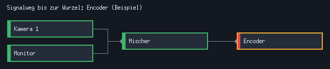

**Alarms of the processes.** If an execution of the process engine fails for good (also after a compensation), the alarm **"Process failed"** (`process-failed`, critical) arises: subject and text name process and error message. Rules can additionally be limited to individual **processes** (ticks, as with workflows). If a rule has workflows **and** processes ticked, one hit in either of the two lists is enough (*Studio A or process Night copy*); kind and severity must still match.

**Intake (files).** Three alarm kinds come from the intake: **"File failed QC"** (`qc-failed`, warning; with the number of errors/warnings), **"QC could not be executed"** (`qc-error`, warning; e.g. file unreadable) and **"File rejected in the intake"** (`file-rejected`, warning; names who rejected it, and the reason). The name of the mail is the title of the file.

**Manual user actions.** Every operation by a user that is in the domain audit (approve/reject a file, delete a workflow, change a setting …) can trigger an alarm of the kind **"Manual user action"** (`user-action`). Because that would otherwise be a mail for every operation, this kind is **opt-in**: it comes **only** if a rule ticks it **explicitly** — "all kinds" does not include it, the default recipients never get it, and the webhook does not receive it. In the rule the field **User actions** restricts to particular actions (`objecttype.action`, e.g. `review.rejected`; `workflow.*` = all actions of the object type; empty = all). The input field suggests the actions that have occurred in the audit so far — so the list is always current. Actions of the system itself (actor "system") do not count. The mail names user, action and object (and the notice text, if the action carries one).

**Everything dynamic.** The list of alarm kinds is not fixed: every source (core, modules) registers its kinds, the UI reads them from the server at every opening and groups them (nodes, hosts, processes, intake, user actions). A new kind appears in the rules without restarting the UI; a rule that names a kind not currently registered (module off) is kept. Workflows, processes and user actions in the rules are likewise read live, and saved changes take effect after a few seconds.

**Cleaning up and taking along.** If a **workflow** is deleted, it disappears from all rules; a rule that applied only to it (and no other workflow or process) is removed with it — it would otherwise suddenly apply to all alarms. The same happens when deleting a **process**. When **exporting** a workflow (tick *Export role bindings and alarm rules too*) its alarm rules go into the file, the **import** creates them again for the new workflow; without the tick (and when duplicating) rights and alarm rules stay at home, because they contain user accounts and recipient addresses of the system. If no e-mail alerting is set up on the target system, the workflow is imported anyway and a notice names the rules not adopted. Processes have no export; their rules are only cleaned up on deletion.

With **Test mail like an alarm** you check the rules without triggering a real alarm: you choose kind, severity and (optionally) workflow or process, the test mail goes exactly to the recipients that a real alarm would get, and the panel names them (or says that the mail would be suppressed). Without a choice the test mail goes directly to all recipients. The subject carries the severity (`[OpenMediaPlatform] CRITICAL media-lost: …`) so that mails can be filtered in the mailbox; the environment variables know only default recipients, rules exist only in the UI.

**Alternatively by environment** (orchestrator start, applies as long as nothing is saved in the UI): `OMP_ALERT_SMTP_HOST`, `OMP_ALERT_SMTP_TO` (mandatory), `OMP_ALERT_SMTP_PORT`, `OMP_ALERT_SMTP_SECURITY` (`starttls`|`tls`|`none`), `OMP_ALERT_SMTP_USER`, `OMP_ALERT_SMTP_PASSWORD`, `OMP_ALERT_SMTP_FROM`.

**Webhook:** `OMP_ALERT_WEBHOOK_URL` (optionally `OMP_ALERT_WEBHOOK_TOKEN` as bearer). Every alarm goes out as JSON (`kind`, `subject`, `name`, `message`, `time`) with a short text `text` that Slack, Teams and Mattermost compatible inputs display directly. Webhook and e-mail run independently of each other. Thresholds of the load alarms: `OMP_ALERT_CPU_PERCENT`, `OMP_ALERT_MEM_PERCENT` (95 each), `OMP_ALERT_TEMP_C` (85), `OMP_ALERT_LOAD_SECONDS` (120).

## 7. Administration

The **Administration** tab (visible only to users with
administration right) manages user accounts, organizations, groups,
role bindings, the node catalog import/export, storage backends, shows
an audit log of all writing API accesses and diagnostic data,
creates/restores database backups, installs **system updates**
and manages the orchestrator cluster itself. The areas are
separate sub-tabs next to one another (Users, Connected clients, Organizations, Groups,
Role bindings, Node catalog, Storage, Audit log, Diagnostics,
Backup/Restore, System update, Cluster, ffmpeg jobs) instead of one below the other.
Within **Platform** the sub-tabs are combined in **framed groups with a
heading** ("Access & rights", "Operation", "Maintenance"); the
heading is not a button, the tabs in it are. (The
screenshot below still shows the older state, the first four sections
one below the other):

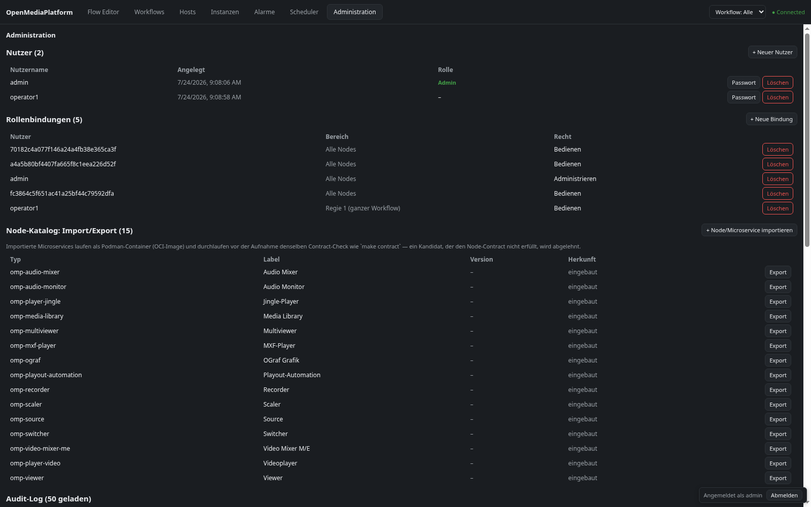

- **Users** — create, reset password, delete.
- **MXL flows** (in "Maintenance") — shows the flows of the MXL domain of the machine on which
  the orchestrator runs (`OMP_MXL_DOMAIN`, default `/dev/shm/omp-mxl`):
  name, format, state, **writer** and occupied memory. The writer is the
  process that writes the flow (program name, PID, for containers the
  container identifier); if it comes from an instance that the orchestrator started,
  its name is shown in front. A flow without a writer is a **leftover** (orange):
  the directory is still in memory although the node has ended or
  crashed. The view helps with "picture stays frozen", with a full
  `/dev/shm` and with flows that no node of the platform writes. It only reads;
  nothing is removed. The search field filters by name, flow ID, node, program,
  PID and container. Remote hosts have a domain of their own and do not appear here.
  **Separate MXL domains (option):** above the table you choose the domain. "New
  domain" creates an additional one (name: lower-case letters, digits, hyphen;
  directory `/dev/shm/omp-mxl-<name>`), "Delete domain" removes it — only if
  no instance uses it and no writer is active; leftovers are removed with it.
  When starting an instance (Flow Editor → Start …) you choose the **MXL domain**;
  without a choice everything stays in the default domain. Flows are visible only within one
  domain: a connection between different domains is rejected by the platform
  with a message (a bridge would be needed for that, which does not yet exist). Applies only
  to instances on the orchestrator machine and not to container nodes; the
  separation is by path, not a security boundary.

  **Machines and hosts:** if there are host agents, a "Machine" selection appears above the table:
  every host has its own domains in its own memory; the table then shows
  the flows of this host (the agent reads them itself).

  **Recommendation (best practice):** one domain is enough until there is a reason (test next to live, tenants, third-party nodes); assignment per workflow, bridges only between identical formats, sealing off only with a reason. Details in the operations manual (`MANUAL.md` §9.3a).

  **Sealing off a domain:** when creating ("New domain") the platform asks whether the domain
  should be sealed off (cannot be changed afterwards). Nodes of a sealed-off domain
  run in a sandbox and see of all MXL domains only their own (with a bridge
  additionally the target domain) — the flows of other domains are neither visible nor
  readable for them; this is enforced by the operating system kernel, not a file permission. No root needed. A
  🔒 marks such domains in the selection, in the zone header and on the domain tab of the tile.
  If the sandbox is not possible on the machine (`unshare` missing or user namespaces are
  blocked), the node does not start, instead of running without sealing. Applies to process nodes
  (container nodes see only their own domain anyway). In the namespace the node appears as
  user 0 (without real privileges).

  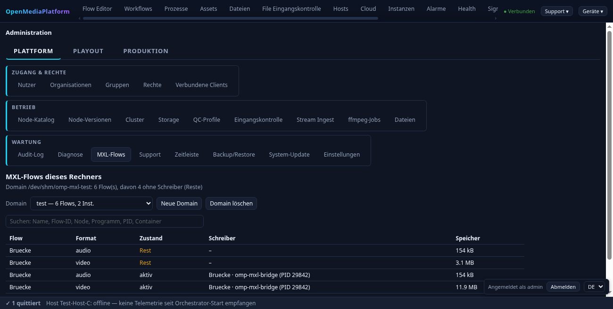

  **Domains in the workflow:** in the workflow settings ("MXL domain") you define
  in which domain all roles run; in the role designer a single role can
  choose another (selection next to the host, "⬡ (Workflow)" = that of the workflow).
  The domain also applies on remote hosts and for container nodes — the host creates
  the directory itself. The start is rejected if a domain is not created
  or a connection of the workflow runs across a domain boundary.

  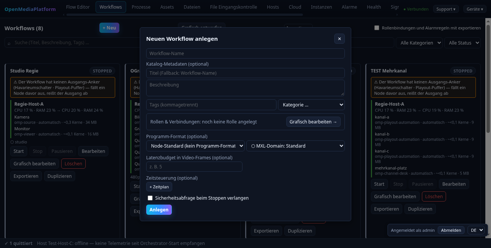

  **In the Flow Editor:** as soon as named domains exist, the switch **"Domain view"** appears next to "Host view":
  the editor then groups the tiles in
  zones per domain (default domain first, colored stripe and name in the domain color,
  tile count in the header); "Auto-arrange" and "Fit all" act as in the
  host view. A click on the active view switches the zones off, a click on
  the other switches directly. Independent of the view, every tile in a
  named domain carries a colored **domain tab** above its header. In the domain view
  the button **⇄** on the tile moves the instance to another domain (restart,
  new instance ID); that works only for standalone instances without connections — workflow roles
  change their domain in the workflow. In the domain view
  a **host tab** ("@ Regie-Host-A", "@ Orchestrator") additionally shows on which
  machine the node runs; the zone header shows on how many hosts the domain tiles
  run (tooltip: which). The zones are tinted in the color of the domain, the tiles
  stand centered in the lane. **Auto-arrange** is available in the domain view
  (zone by zone, sorted by signal flow and host, without overlap; in the host view
  the host lanes continue to determine the arrangement). An edge across a zone boundary is possible only
  via a domain bridge and is drawn purple.

  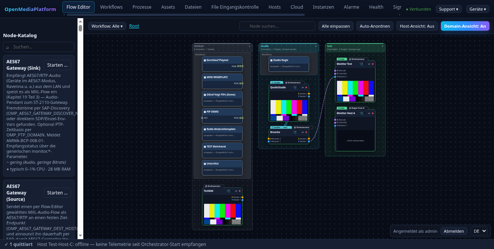

  **Demo "Zone Separation Demo":** the supplied example workflow shows the zone separation. It needs the domains
  `demo-studio` (studio zone) and `demo-external` (**sealed off**, 🔒) — both are created (Administration → MXL domains).
  In `demo-studio` run *Studio Source* and *Studio Monitor*, in `demo-external` the *External Monitor*; the *Zone Bridge*
  is the only way in between and copies picture and sound bit-exactly. To demonstrate: start the workflow, in the Flow Editor switch on the
  **domain view** (a running workflow whose nodes run in different domains is expanded automatically in this view:
  its nodes stand individually in the zones of their domain, with domain tabs; in the host view it remains one collective tile). Three things can be shown: (1) A **direct connection** from the Studio Source
  to the External Monitor is rejected ("sender and receiver are in different MXL domains … a bridge between the domains is
  needed"). (2) The *External Monitor* sees in its file system (`/proc/<pid>/root/dev/shm`) **only** `omp-mxl-demo-external`,
  the bridge sees both zones, nodes without sealing see all domains. (3) The bridge shows "copied directly" for picture and
  sound. The demo starts with "Start" in the workflow tile menu and can be stopped at any time; it does not depend on hardware.

  **Domain bridge:** the node **"MXL Domain Bridge"** connects two domains on the
  orchestrator machine. It runs in the domain of its inputs, the **target domain** you choose
  at start (start dialog or in the workflow role next to the domain: "→ Target").
  The bridge also runs on a host agent, but then together with its source on
  the same machine. In the Flow Editor connect video and audio of the source to the inputs of the bridge and
  its outputs to the receivers in the target domain. **The bridge does not convert:** it
  copies picture and sound unchanged (hardly any CPU, picture/sound relation is preserved). The format
  of the bridge (default 640×480 at 25 frames, 48 kHz, 2 channels; adjustable as with the
  source) must match that of the source, otherwise it rejects the connection with a
  message — then put a scaler in front of the bridge. The parameter `videoMode` /
  `audioMode` shows "copied directly" or the reason for rejection. Only optionally
  (`OMP_BRIDGE_CONVERT=1`) does the bridge convert itself, which costs a lot of CPU.

  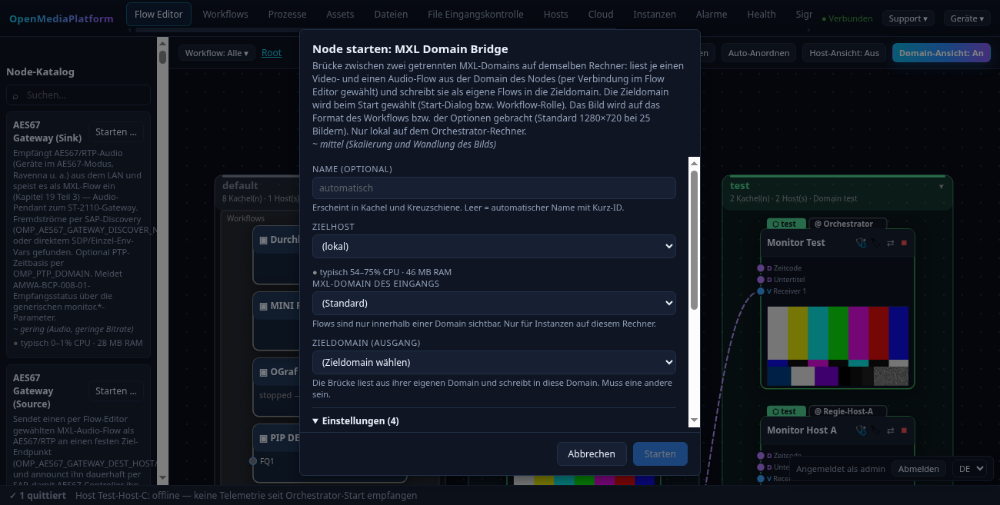

  **IS-05:** `mxl_domain_id` is a UUID according to BCP-007-03. Every instance carries the ID of its
  domain (stable UUIDv5 from the domain name, in the domain list as `id`), the
  constraints name exactly this; a foreign domain ID is rejected with 400. A
  bridge shows the input domain ID on its receivers and the target domain ID on its senders.

- **Connected clients** (in "Access & rights") — shows who is currently connected to the UI with a
  browser: per open connection **user**,
  **address** (behind a reverse proxy on the same machine the address of the
  caller; loopback is shown as "localhost"), **connected since** and the
  **browser** in short form (e.g. "Chrome 150 · ChromeOS"; the full
  user agent is in the tooltip). Above the table is the number of
  connections and logged-in users; the list updates every
  5 seconds as long as the tab is open. A user with several open
  tabs appears several times. Pure API calls with a token without an open
  event stream and the internal subscribers of the orchestrator (alarm mail,
  timeline) are not counted.

  The column **Devices** shows which control devices the browser is currently using:
  a **MIDI surface** (running MIDI session, with the name of the ports) and/or
  a **Stream Deck** (with model name); on-screen simulators are marked
  "simulator". The browser reports this itself as soon as something
  changes and after every reconnection; a browser that reports nothing
  at all (older version, API script) shows "–".

  The **search field** above the table filters while you type. Spaces
  separate terms, all must occur (case does not matter), the search covers
  user, address, browser and device names. The keywords `midi`,
  `streamdeck` (also `stream deck`) and `simulator` find all clients with such
  a device — e.g. `anna midi` for Anna's surface browser. The summary
  then additionally names how many rows are shown.

  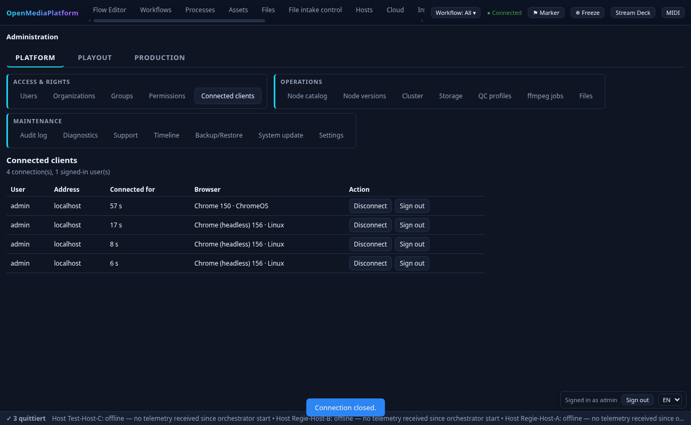

  Per row there are two buttons, both with a confirmation:
  - **Disconnect** closes only this one connection. The browser
    rebuilds it by itself after a few seconds as long as its
    login is valid — intended for hanging connections.
  - **Sign out** ends **all** logins of this user (like
    "End sessions") and disconnects their connections immediately. Afterwards
    the browser does not come back until the user logs in again. That also applies
    to your own row: whoever signs themselves out must log in again.

  Both actions are in the audit log ("Client disconnected", "Sessions of … ended").
  For monitoring `/metrics` delivers `omp_sse_clients_identified`,
  `omp_sse_clients_by_user{user="…"}`, `omp_sse_clients_with_midi`,
  `omp_sse_clients_with_streamdeck` and `omp_sse_client_kicks_total`
  (MANUAL §7).
- **Rights** (formerly "Role bindings") — an editor with search, in two
  directions of view:
  - **Who?** — choose users and groups on the left, on the right is what they
    may do (grouped by kind), with the rights inherited through groups.
  - **On what?** — choose an area on the left (global, workflow, single
    workflow role, node, process), on the right is who may do what on it.
  The search field at the top finds users, groups, nodes, workflows, roles and
  processes; a user also shows up if the search term occurs only in
  one of their areas. At the bottom "Add right": filter the kind,
  choose in the search field, set the right (`View` < `Operate` < `Configure` <
  `Administer`), "Add". Per user/group and
  area there is exactly one right; changing, adding and removing
  take effect immediately. Below are the **function rights**: per module individual functions
  (e.g. *Create schedules*, *Perform QC*, *Approve and reject*) as switches for users **and** groups; "All rights of the module" grants them bundled,
  ones inherited through groups are shown grayed out. Whoever has global *Configure* may do all functions anyway. Without a grant an operator may
  neither create recordings nor check files — not even with the right *Operate*. A process right allows start, cancel, pause and
  publishing of only this one process (or its editing
  with `Configure`), without global rights. The cryptic
  user names in the service token bindings are created by the orchestrator
  automatically for control-plane nodes such as `omp-playout-automation`
  (its instance ID as subject) — no real person accounts.
- **Node catalog: import/export** — every built-in node type can be exported here
  as a reference; "+ Import node/microservice"
  (section "Related project"/`MANUAL.md`) additionally accepts
  containerized third-party microservices, after the same
  contract check as built-in nodes. On the card of an imported type
  **"Distribute to hosts …"** distributes it to remote hosts (signed bundle, each
  host checks and decides about extensions itself); the block **Hosts** shows per host
  "ready", "being installed …", "Host offline – will catch up" or the error text with
  "Retry". The type can be started only on hosts where it is ready;
  "Remove" cleans up there (MANUAL §9.5).
- **Hosts › Software state of the hosts** — shows per host (also the orchestrator machine) which
  state it runs: build stamp of the orchestrator or host agent (release, commit, build time),
  per node type version, commit, build time (otherwise the file time, in gray) and the number of running instances,
  of which outdated ones. **Hosts with an older state are marked orange** (notice above the list, badge "⚠ Host agent older" /
  "⚠ N node type(s) older" in the host table and in the software block, affected rows tinted with "newer on <host>: <state>"):
  the agent is older than the orchestrator, or a node type is older than the newest state of the same type on any
  host. The order results from real version numbers, otherwise from commit and build time (same commit = same),
  for dev builds without build time from file size (same) and lastly the file time (a guide, 5 min tolerance). If
  the order cannot be determined, it stays at "differs from the orchestrator". Container types are not compared.
  A notice also names node types that stand differently on different hosts. Container types
  carry 🐳 and show the distributed version. The data is queried live from the host agents (cached for
  8 s, "Refresh" forces a new query); an agent that is too old says so explicitly.
- **Audit log** — shows in plain text who changed what when ("anna
  started workflow Studio", "admin granted right"), by days
  grouped. Every writing request is logged, also
  failed ones (red label with reason, e.g. "no permission");
  a click on a row shows method, path and status. Filters that the
  server applies: search (finds users as well as names of nodes, workflows,
  processes and groups), user, result (all/successful/failures),
  period (hour to All) and areas as buttons (logins,
  users, rights & groups, workflows, instances & hosts, connections,
  processes, media, system). "Operation" (cuts, faders, parameters) and
  the automatic saving of the view layout are hidden by default,
  because they would otherwise flood the log; "All" shows them. "Load older" pages within the filter, "Export as CSV"
  saves the loaded rows.
- **Diagnostics** — "What is going wrong, and where?" in two views.
  *Problems* combines similar messages (count, last, 
  affected nodes); known messages carry an explanation and a
  note on whether they are harmless (e.g. "Sender side not responding
  (404)"). "Show individual messages" jumps with the matching filter into
  the *Messages* view (every row, a click shows source, host and
  "All steps of this operation"). Filters: search in the message text, level
  (errors/warnings/info), node, period; active restrictions are shown
  as chips to remove under the bar. From the Flow Editor a
  failed connection attempt leads directly to the steps of its
  operation.
- **Support** — "Is my system healthy?" as a traffic light and the
  support package. At the top is the overall status in one sentence (green, yellow,
  red), updated every 30 seconds. Below are only the
  items that need attention, each with finding and a
  paragraph **"What to do?"**; everything that is OK is collapsed.
  Checked are disk space, memory, `/dev/shm` (the space
  through which nodes exchange video pictures), open files, load,
  database, cluster majority, every host (does it report, CPU/RAM, clock),
  unreachable nodes, crashed or continuously restarting
  instances and the findings of the operating profile. "Create support
  package" downloads a ZIP file with state, error messages of the
  chosen period (30 minutes, 2 or 24 hours) and system data,
  which goes unchanged to the support. It contains no
  media, no passwords, tokens or keys (values are replaced by
  `[removed]`) and no audit log. Parts that could not be
  collected are in the `manifest.json` in the package. Both
  functions require the admin right (`GET /api/v1/admin/selftest`,
  `GET /api/v1/admin/support-bundle?minutes=N`).

  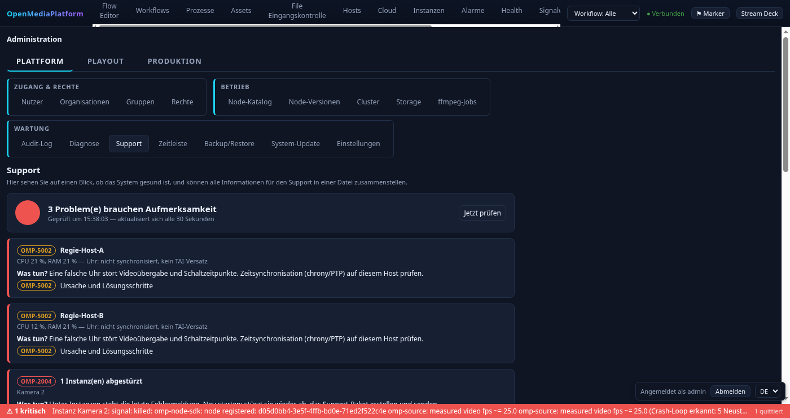
- **Support access (time-limited, read-only)** — if the support should look into the
  system itself without you creating an account or handing over a password:
  in the Support tab under **"Support access for external help"** choose
  validity (1 hour to 3 days) and a note (e.g. ticket number)
  and **"Create support access"**. The **link** appears **only
  now** — the token is stored nowhere, only its fingerprint —
  and goes by mail or chat to the support. Whoever opens it is logged in without
  login as "support:…" and sees a yellow strip at the top
  ("Support access — read-only, valid until …"). They see diagnostics, support,
  timeline, instances, hosts, graph, workflows and can download the support package
  — they **cannot change anything**, and they see no users,
  rights, settings, backups and no audit data; every attempt
  to write is rejected with OMP-6003 and noted in the audit log. The
  list below shows all accesses (active, expired, revoked), how
  often and when someone last logged in, and **"Revoke"**
  ends an access **immediately**. Creating, login and revocation are
  in the domain audit, at most 10 accesses are active at the same time.

  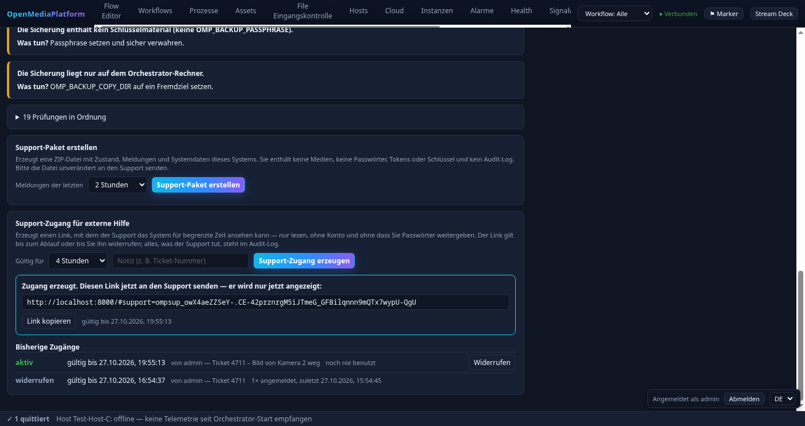

  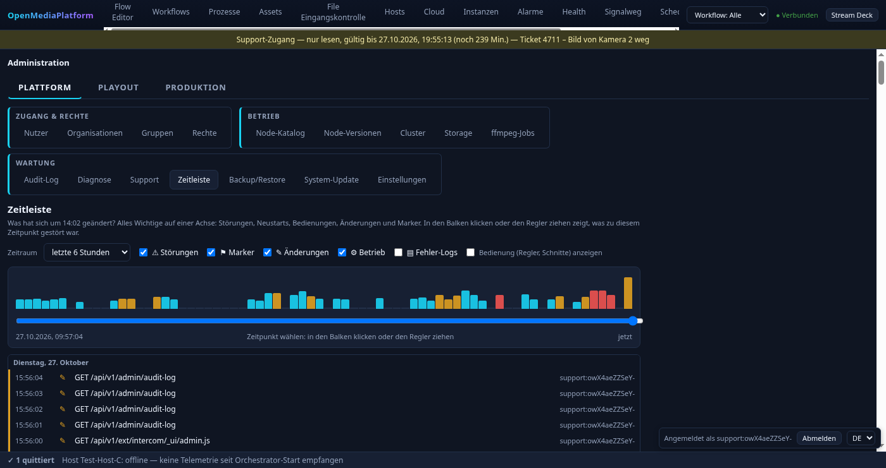

- **Baseline and trends** — "That is not normal for this system." The
  system learns what is usual for you and reports deviations before
  they become an outage. Two things are checked: **(1) Deviation from the
  usual** — processor, memory and network load of the hosts and the
  processor load of long-running processes are compared with what was usual at the
  **same time of day** on the previous days (workdays and
  weekend separately); if the last two hours are clearly above that,
  the Support tab shows a finding "… unusually high — now 92 %, usual at
  this time of day is 20 %" (OMP-1013). That needs at least
  **3 days of history**; until then the notice "Baseline and trends" says how
  far the build-up is. **(2) Steady growth** — memory, open files
  and threads of instances and of the orchestrator itself: if a value rises
  steadily for hours without falling, that is a leak (OMP-1014).
  The finding names the rise per hour and **extrapolates when the limit
  would be reached**; that is already possible after 8 hours. Every finding has a
  small chart (the course, dashed the usual or the
  initial value) and appears in the timeline (📈, once per anomaly,
  again after 6 hours). Hourly values are kept for 35 days and
  survive a restart; instances are tracked by type and name,
  so that the history survives a restart of the instance. The detection
  deliberately takes seriously only conspicuously high values and steady rise —
  single peaks and small changes trigger nothing.

  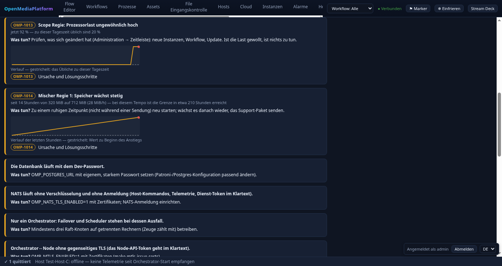

- **Freeze the last minutes (❄)** — the "flight recorder". The system keeps
  the last 15 minutes of the **metrics per node** (media ready, frame rate)
  and the **process values** (CPU, memory per instance) every approx. 5 seconds in
  memory. The button **❄ Freeze** in the top bar (or in the
  node diagnostics window for only this node, in the Support tab with
  a note) saves the last 10 minutes as a **package**: timeline and
  messages of the window, the measurement series, CPU/RAM per host, the state of
  nodes, instances, hosts and graph and the **pipeline state** of the
  nodes. The package is kept for **30 days** (at most 30, of which 10
  automatic) — long after buffers and log retention have
  overwritten the data. It is also created **automatically** when something
  fails: a process crashes and restarts or gives up, media
  drops out, a host falls silent, a failover runs (at most
  every 5 minutes, 10 seconds after the disturbance, so that the trigger itself
  is included; can be switched off with `OMP_AUTO_FREEZE=0`). Every snapshot
  appears in the timeline (❄). In the Support tab under "Frozen
  snapshots" the packages can be **downloaded** and deleted;
  a support access may download them. Like the support package it contains
  no media, passwords, tokens or keys. Limit: the flight recorder
  lives in memory — after a restart of the orchestrator it starts
  anew.

  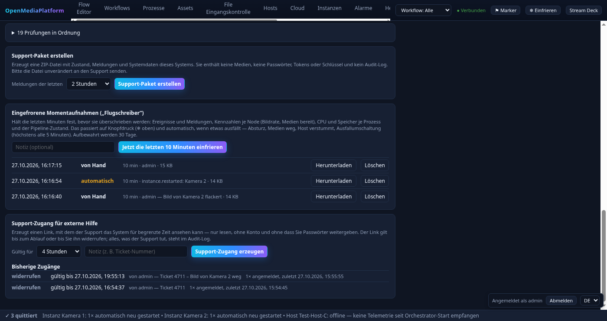

- **Evaluate package** — a support package or snapshot (ZIP) can be read directly in the
  Support tab: under "Evaluate package" choose the ZIP, or for
  a saved snapshot press **"Analysis"**. At the top is one
  sentence ("2 errors and 3 warnings found"), below it the **findings** with
  "Next step", the **outages** (periods without ready media), the
  **timeline**, **conspicuous measurement series** as curves (host permanently above
  90 %, memory grows, metric fell to 0) and similar
  messages grouped with count. **"Copy report for AI"** puts the same
  evaluation as text on the clipboard — paste it into a conversation with an AI;
  the guide for that is in `docs/berichte/PAKET-AUSWERTUNG-KI.md`.
  The file is only evaluated, not stored.

- **Timeline** — "What changed at 14:02?" on a single
  axis. At the top a bar chart of the chosen period (last hour to 7
  days): red = disturbance, yellow = notice, blue = information. **Clicking into the bars
  or dragging the slider** (or clicking a row) chooses a
  point in time; below it then appears **"State at …"** — what was disturbed at that
  time (e.g. "Host Regie-A no longer reports since
  14:02") — and **"This changed in the 5 minutes before"**. The list
  below shows chronologically: *Disturbances* (crash, media gone, host
  silent, failover), *Markers*, *Changes* (operations from
  the audit log, workflow started/stopped, connections, hosts),
  *Operation* (automatic restarts, clock, orchestrator started) and
  optionally *Error logs* and the *Control* with faders and cuts
  (off by default, they would be thousands of rows). Recording starts from the
  start of this version (14 days, like the audit log); the state before the
  last restart of the orchestrator is not known.
  **Marker "Problem now":** the button **⚑ Marker** in the top bar
  (on every tab) puts a marker on the timeline — the support later finds
  exactly this minute. A window asks for an **optional note**
  (what happened, why the marker; at most 200 characters); Enter without text
  sets the marker anyway immediately, Cancel sets none. The same applies to
  **❄ Freeze** (top bar and diagnostics on the tile). The note appears
  in the timeline next to the entry and in the support package. A double click
  counts once. Reading the timeline requires the admin right, the marker
  the operate right (`GET /api/v1/timeline`, `POST /api/v1/timeline/marker`).

  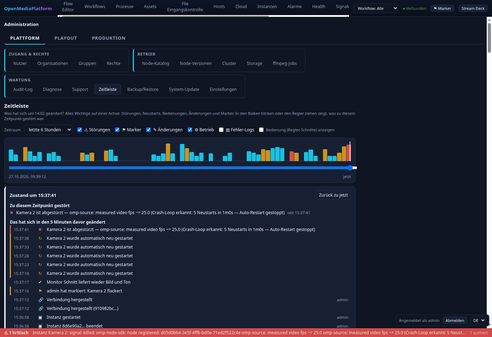
- **Diagnostics on the tile (🩺)** — "What is going on with this node?" The
  button **🩺** in the header of every node tile in the Flow Editor (or a
  **right click** on the tile) opens a window only for this one
  node: at the top the **traffic light** with one sentence, below it the **findings** with
  **"What to do?"** (node does not report, process crashed, automatically
  restarted, runs with an old version, delivers no picture/no more pictures,
  frame rate collapsed, processor fully loaded, much memory,
  almost all permitted files open, error messages of the last 15
  minutes). Then **process and media** (restarts, processor, memory,
  threads, open files, picture and sound, frames per second) and the
  **pipeline as a picture**: from the source (left) to the output (right) every
  block with its state; **outlined in red** = block in the wrong state,
  **yellow** = buffer full (the block behind takes too slowly), a
  bar shows the fill level; pointing at a connection shows the
  negotiated format. Finally the **events** (crashes,
  restarts, operations on this node, 24 hours) and the **messages**
  (errors and warnings). The window updates every 8 seconds;
  scroll position and expanded areas are kept. The
  pipeline is reported by nodes with a GStreamer pipeline (source, switcher,
  viewer, mixer, player, audio monitor, multiviewer, recorder, scaler);
  other types show an explanation there instead of a picture. The window
  requires the right to see the node (`GET /api/v1/nodes/{id}/diagnosis`).

  
- **Error codes (OMP-nnnn)** — every known error has a stable
  code with **cause** and numbered **solution steps**. The
  UI shows it where errors appear: in the Diagnostics tab (per
  problem group and message), in the Support tab and in the node diagnostics 🩺
  (badge on the finding, expandable "Cause and solution steps") and in the
  start dialog when a start fails (e.g. **OMP-2002**, container image
  missing). The complete list is in `docs/FEHLERCODES.md` (generated from the
  catalog, with an anchor per code), the same list is in the support package
  (`api/errorcodes.json`). Number ranges: 1xxx platform and machine, 2xxx
  nodes and instances, 3xxx media and pipeline, 4xxx connections, 5xxx
  hosts, 6xxx access, 7xxx update. Messages are recognized by wording;
  if a message itself carries a code (`[OMP-3001] …`), that applies —
  the nodes put it in front themselves for pipeline errors (missing GStreamer plugin,
  format cannot be negotiated, device not available …).
  Error responses of the API carry the code in the header `X-Omp-Error-Code`,
  error messages (toasts) append it as "(OMP-nnnn)".

  
- **Backup/Restore** — "Create backup now" creates a download
  immediately; Restore requires typing the chosen file name exactly
  (confirmation), afterwards replaces the complete
  database content and reloads the page automatically after a few seconds
  as soon as the orchestrator is reachable again (details:
  `docs/MANUAL.md` §5, including the supervisor process needed for it).
- **System update** — installs a new version of the server by
  browser upload (firmware-like, without access to the machine):

  

  1. Choose an **update package** (`.tar.gz`, built by the operator with `make update-bundle`
     and **signed**) via "Upload update package". The
     server immediately checks structure, checksums and the signature against the
     stored keys (shown at the top under "Trusted
     signing keys"). An unsigned, modified or
     damaged package is rejected and not stored.
  2. The package appears in the list; "Select" shows version,
     architecture, commit, checksum, notice text, **prerequisite**
     (minimum version), the contained components (orchestrator,
     supervisor, host agent, UI, node programs) and whether the update
     **changes the database**.
  3. **"Install now"** becomes active only when you type the version number
     exactly. A database backup beforehand is preset (mandatory for
     database changes). "Downgrade" explicitly allows an
     older or the same version.
  4. The server backs up, is stopped, updated and restarted
     (seconds to a few minutes; the page reloads by itself afterwards).
     **If the new version does not come up healthy, the supervisor restores the
     previous state automatically.** The result is under
     "History" (successful / failed, rolled back, with reason).
  5. **Running nodes stay in operation.** Instances whose program
     was replaced are marked **"outdated"** (tab
     Instances); at the top of the update tab a warning shows their number with
     the button **"Restart outdated instances now"** (with a
     safety prompt; workflow roles keep node IDs and
     operating state).
  6. **"Distribute to remote hosts"** sends the package to all
     reachable host agents; each checks it with its own
     key and replaces its agent program and the node programs from
     its local catalog. The result per host appears live in the
     list (OK / failed / offline). A new host agent program
     becomes active only after the agent restarts.

  7. **Several orchestrators (cluster).** "Install now" acts only
     on the orchestrator you are connected to. For a cluster there
     is the card **"Cluster rollout"** in the same tab: **"Roll out to
     all members in a rolling fashion"** (selected package, type the version)
     updates the members one after another, **the leader last** – it
     hands over leadership beforehand, control does not fail.
     **"Restart cluster in a rolling fashion"** likewise restarts all members
     one after another (central restart, without a package). Prerequisites that
     are checked beforehand: at least **3 voting members**
     (two are not enough – when one member restarts there would be no
     majority; add a third orchestrator or a witness if need be), all
     members reachable and caught up, and the package must be built as
     **"rollingSafe"** (database changes only additive, the old
     program runs against the new schema). A package without this
     mark is refused for the cluster rollout. The table shows
     per member version and step. **On an error the rollout
     stops**, the remaining members stay untouched, those already updated
     are not rolled back automatically; after fixing the cause
     **"Continue rollout"** (or "Cancel rollout"). The failed
     member has rolled itself back. With the tick **"Distribute host agents first"** (default on) the package is distributed to all reachable host agents before the cluster (line "Host agents" in the table); if that fails for a host, the cluster stays untouched. The rollout also continues
     if the leader changes in the meantime (state is in the
     database). Running broadcasts are never restarted.

  Important: an update package is executable code. Therefore the tab is
  for administrators only, every upload/installation is in the audit log,
  and without a stored signing key **every** package is rejected.
  Setup, building a package and troubleshooting: `docs/MANUAL.md` §5b.
- **Cluster** — redundancy of the orchestrator itself (Raft consensus,
  `ARCHITECTURE.md` §19.3): a status card shows the own node ID,
  state (leader/follower), term and applied log index of this
  instance as well as the current leader; below it the member list with
  leader marking and "Remove" (with a safety prompt) per
  member. "+ Add another orchestrator" opens a form
  (node ID, Raft address, optionally the HTTP address of the new instance)
  that generates below it, live, a ready start script with all required
  environment variables — run it on the new machine, wait
  until it runs, then click "Let join now" here:

  

  Joining/removing always run on the server side on the actual
  leader (a request to a follower instance is forwarded there
  automatically) — which orchestrator is being asked at the moment
  does not matter for operation.

## 8. Hosts (remote operation)

The **Hosts** tab shows remote machines on which a
host agent runs and that have registered with the orchestrator —
instances can then also be started on these remote hosts,
not only locally:

Besides the current CPU/RAM state the table shows a one-hour
history sparkline as well as minimum/average/maximum CPU — helpful
for estimating before starting a further instance whether this
host still has headroom.

A host agent executes only node types from its own,
locally configured catalog — the orchestrator cannot run an
arbitrary command on a remote host, this is a
deliberate security boundary.

### 8.1 Adding a new host (wizard)

"+ Add new host" (visible to admins only) guides through four
steps instead of operating the bootstrap token flow by hand via the API:
choose the target environment (bare metal, VM in the local cluster, or cloud/AWS EC2)
plus a label; a one-time bootstrap token valid for one hour
is generated automatically; a ready, copyable provisioning script appears — depending on the chosen
target environment a simple shell command or an EC2 user-data script,
with editable fields for orchestrator/registry/NATS address
(pre-filled, but guesses that may have to be
adapted on another machine):

After transferring the script to the new host the wizard waits
live (via SSE, with polling as a fallback) for the host agent to log in
and shows its reported capabilities (operating system, architecture,
CPU count) as soon as it arrives — no manual checking in the
Hosts tab needed. The wizard can be left running in the background at any time
and closed: the token stays valid until
expiry, the host appears anyway on successful login
in the table above. Bare metal, VM and cloud do not differ for
the host agent itself — the choice only determines the wording of the
generated script (`ARCHITECTURE.md` §18.8). An actual
automatic start-up of a cloud instance is deliberately not part of it
(no cloud SDK in the orchestrator core, `ARCHITECTURE.md` §18.9 point 5)
— creating the machine itself remains the operator's job.

As soon as at least two hosts are registered, the Flow Editor additionally
shows a **host view** with zones per host directly on the
work area (section 2.5) — the hosts table here remains the
detail view (registration, resource history), the zones in the Flow
Editor show which running instance sits on which host and
warn about host-local MXL edges across a zone boundary.

## 9. Operator console (control-room position)

A user without configure right, but with `Operate` rights on
a workflow or individual roles of it (section 7:
role bindings), lands after logging in not in the Flow Editor
but directly on an **operator console** — a pure
operating interface without graph, catalog or wiring capability. If
several workflows are assigned to a user, they first choose the desired workflow from a
tile list — each tile names the
workflow name and the number of roles assigned in it:

**Workstation:** if an operator (without configure right) has function rights for the modules *Stream ingest* or *File intake control*, their start page is the **workstation**: at the top the
workflows to switch between or the countdown to the next start, below it the **tools** (tiles "Stream ingest" and "File intake control" — each only with the matching right;
per tile the number of open tasks and problems) and the **task list**: assigned QC files, own and group tasks ("can be taken over") as well as the own recordings with
state, responsible person and deadline; overdue and failed items are at the top in red. A click on a task opens the file or recording directly. In the user widget at the bottom right
a red "⚠ n tasks" shows as long as something needs attention — in every view, also in the console; "🏠 Workstation" leads back. Even an operator
without any workflow (with only such rights) lands here instead of in the Flow Editor.

As soon as an operator is entitled to **more than one** role in a workflow,
the console shows all assigned node interfaces at the same time as
freely movable and scalable tiles (with exactly one role, its
interface appears full-screen instead, without a tile frame):

In this example the operator is entitled to operate all six roles via a workflow-wide binding
("Regie 1 (whole workflow)", section 7):

- **Audio mixer** (top left) — channel strips with gain/EQ (LO/MID/HIGH);
  "+ Channel" creates a new input.
- **Video mixer** — a real M/E control panel: PGM/PST crosspoint
  keys, CUT/AUTO for hard or soft switching, DSK
  (downstream keyer, here active/red, with the graphic as fill+key source
  via the KEY dropdown) and PIP (picture-in-picture as a layer of its own).
  The number of mixer levels (M/E banks, 1–8, default 1) is set
  in the workflow editor on the role ("Mixer levels") or as a
  node option "Mix/effect levels" (`OMP_ME_LEVELS`). Each level has
  its own program/preset bus and its own output; all levels share
  one source pool, and the outputs of the other levels are available
  as fixed source keys. The change takes effect at the
  (re)start of the node.
  The main level (level 1) is at the bottom, further levels ascending
  above it. The switch **⇄ PGM/PST** in the transition block (per level,
  parameter `crosspoint.swapOnTransition`) swaps PGM and PST after CUT, AUTO and
  a completed T-bar pull: the previous program
  becomes the preset. A hot take on the PGM bus and time-scheduled changes
  (`takeAt`) leave the preset unchanged.
  **Layout of a level:** on the left the buses PGM and PST (BLK first, then
  the pinned sources); below it a bar in three groups —
  **Sources** (dialog "Sources & DSK" for pinning/managing), **DSK**
  and **PIP scenes**. DSK and every PIP scene look like
  source keys (with "thumbnails" as a card, otherwise as a pill); for a
  PIP scene the card shows a miniature: frame = picture, green area =
  hold position, dashed = start/end of the move. "New scene" creates
  a further one, ✎ edits. On the right the transition unit: CUT/AUTO,
  below it the **ramp duration** (6/12/25/50 frames), T-bar,
  transition type, ⇄ PGM/PST and ❄ FREEZE.
  **Sources with a problem:** if the node of a source reports "Unhealthy" via its
  status (BCP-008), its key carries a ⛔ and a red
  edge (PartiallyHealthy: ⚠, yellow); the tooltip names the reason (e.g.
  "no sending session: the phone is not connected"). Taking such a
  source to PGM asks via a dialog.
  **Freeze:** "❄ FREEZE" captures the current program picture of the level as a
  still. Any number of freezes is possible; each appears
  immediately as a pinned source ("Freeze: Freeze 1") on PGM/PST and in
  the PIP/keyer selection and persists across a restart
  (stored under `~/.local/share/omp/mixer-freezes/<label>/`, another
  directory via `OMP_FREEZE_DIR`). Rename and delete in the dialog
  "Sources & DSK" under "Freezes". If the mixer resolution changes,
  old freezes are skipped (but stay on disk).
  **PIP source:** is switched live (no rebuild, the
  program picture continues undisturbed). Besides the sources and the
  PGM outputs of the *other* levels the preset bus of every level
  (also the own one) is available as "PST level N" — the PIP then follows
  what is currently preselected there. Loops (a source that
  contains the own output picture directly or via other levels)
  are switched to black by the mixer in the PIP.
  **Several PIPs, rotation, trapezoid (chapter 87):** every level has a fixed
  reserve of **PIP slots** (node option "PIP slots per level", default 4,
  `OMP_PIP_SLOTS`). Each slot shows any source; unused
  slots cost almost nothing. A **PIP scene** comprises several slots and
  moves them in and out together. In the scene editor you choose at the top the slot
  (tabs "Slot 1 … n", "+" adds another, "×" removes it from the
  scene), then source, **layer (z)** (a higher number lies further forward) and the
  positions **start → hold → end** as well as optionally **focus** (target when
  the PIP is clicked; without a value 94 % of the picture, centered). Dragging on
  the surface moves, the square at the bottom right scales. **Rotation and
  trapezoid** exist in the **2D slots** (the first `OMP_PIP_2D_SLOTS`
  slots, default 2): there the four corner circles can be dragged individually
  (trapezoid/perspective), and the field "Rotation" rotates the quadrilateral around its
  center; "Reset corners" turns it into a straight rectangle again. The
  other slots can only do straight rectangles (when saving, the
  enclosing frame is then taken). A 2D slot computes every picture at
  full-frame size (about 3 ms per 360p picture, from 1080p at half resolution) — set only
  as many 2D slots as needed (0 = rectangles only). The
  coordinates apply in the **real mixer resolution**.
  **PGM monitor and click focus:** the key "PGM monitor" (group
  "Monitor") shows a small program picture of the level (option
  `OMP_ME_PGM_MONITOR=0` switches it off; it is only computed while someone
  is watching). The monitor runs at the **frame rate of the mixer output**
  (25 frames/s): the node encodes every new output picture exactly once, the
  panel fetches it every 40 ms (up to four fetches at the same time; outdated
  answers are discarded). Measured on a throwaway mixer: about 23 distinct
  frames/s at the node, in the browser about 19 picture changes/s — limited by the
  response time of the fetch via the orchestrator (before 5 and 4 frames/s respectively); the
  overhead is about 7 % of a processor core and only with the
  monitor open. A **click on a PIP** in the picture moves it to its
  focus position (e.g. almost full frame, all the way to the front); a **second click**
  moves it back to the hold position. With the mouse over the picture
  the PIP under the pointer is highlighted in yellow (with several
  stacked ones the top one counts); a click into empty space changes
  nothing. The hit is computed by the node (method `pip.clickAt`), the focus
  therefore applies equally to all operators and the Stream Deck. On the **Stream
  Deck** there is a key "PIP n / Focus" for every PIP that is on.
  If another PIP scene is chosen or PIP is switched off, the focus
  ends.
  **DSK and graphic per PIP scene:** in the scene editor you can additionally
  store the **DSK source** (by name, stays valid across restarts; "off" switches
  the keyer off with the scene) and a **graphic layer** (graphics node, template,
  layer). When applying, the mixer first fades the graphic in
  and gives the page 700 ms of lead (`OMP_SCENE_GRAPHIC_PREROLL_MS`; omitted
  if the graphic is already up), then the PIP moves start. When switching off
  the graphic stays on air until the end of the move-out (delay + move-out time), its frames move out
  with it, then it is faded out. A
  "Presets" area with snapshots no longer exists in the video mixer.
- **Graphics** — choose a template (search field + dropdown), fill in the form fields,
  "▶ On"/"■ Off" puts the graphic on air (in the
  screenshot already active: "On Air: Hello Lower Third").
- **Camera 1** / **Camera 2** — both deliberately show here "UI bundle …
  could not be loaded": not every node type brings its own
  operating interface (`omp-source` has none, apart from the generic
  parameters there is nothing to operate) — the console reports that honestly instead of
  showing an empty tile without explanation. Which source shows which
  test pattern is set via its `pattern` parameter in the
  Flow Editor (parameter panel on double-clicking the tile).
- **Program preview** — shows the actual PGM output picture of the
  video mixer as a live preview.

If more than one host runs (section 8), the title bar of every
tile additionally shows a small host label (e.g. "Studio 2 (Remote)")
— which host is currently executing a role is thus also visible in the
control-room position, not only in the Flow Editor (section 2.5). The
screenshot above comes from a single-host setup and therefore shows
no host label.

Every tile behaves like a real window: title bar for
moving (dragging), a handle at the bottom right for scaling, and in
the title bar two buttons for **minimizing** (the tile disappears and
lies as a chip in the **taskbar** at the bottom of the console — a click
on the chip restores it; the bar leaves room on the right for
logout/language) and **maximizing** (fills the
whole visible console area; maximizing another tile
automatically restores the previous one, at most one
tile is maximized at a time). A click on a tile brings it in front of
all others. In a **button strip** of its own above the tiles (it
covers no window buttons) **"⊞ Arrange all"** makes sure that all
tiles appear again in a tidy grid and
minimized tiles expand again in the process; next to it **"Stream Deck"**
opens the Stream Deck panel (section 10g). Position, size,
minimized state and order are saved per control-room position in the browser
and are kept across a page reload —
suited to a permanently installed control-room screen on which always
the same browser runs (maximized, on the other hand, never starts automatically again
— that is a temporary focus action, not a lasting
layout decision).

**Preview (👁):** nodes with a preview picture (e.g. source) show it in the
tile only on request — the 👁 switch in the title bar shows or hides the
live preview (default: off, saved per tile).
Nodes without an operating interface of their own (e.g. source) show the notice
"This node has no operating interface of its own."

**Saving layouts:** in the button strip **💾** saves the current
window arrangement (position, size, open/minimized, preview) under a
name; the selection field **"Layouts …"** applies a saved layout,
**🗑** deletes one (name prompt). Layouts apply per user and
workflow and are kept in the browser (not on the server).

Without an assigned playout automation role an operator controls purely
manually (cut/auto, crosspoint, DSK/PIP) instead of via a playlist —
suited to a pure live switching position without tape material; if an
`omp-playout-automation` role is part of the workflow and assigned to the operator,
its playlist interface additionally appears as a tile of its own.

**Clock notice.** If the hosts table shows a **⏱ Clock** next to the status, the system clock of this host is not synchronized and/or its TAI offset is not set — MXL timestamps and switching times (playout automation) then deviate from other hosts. The tooltip names the cause; remedy is in the manual (section 8, troubleshooting).

**Secure command channel.** The orchestrator signs every command to a host (start, stop, update, ffmpeg job); the host executes only commands with a valid signature. The host gets the key at registration, older hosts receive it automatically as soon as they are online. For operation this means: set nothing up — and after a freshly set-up orchestrator data set, if necessary remove `cmdKey` in the host's `state.json` and restart the agent (manual, section 8 "Commands to a host fail"). An administrator can rotate the key of a host (`POST /api/v1/admin/hosts/<id>/rotate-key`).

### 8.2 Allowing ffmpeg jobs on a host (`tools.json`)

A host runs ffmpeg/ffprobe jobs of the platform only if **its operator allows it at the host** — the orchestrator cannot switch that on from outside. For that, create next to the catalog of the host agent (`catalog.json`) a file `tools.json` (template: `deploy/tools.example.json`; another location via `OMP_HOST_AGENT_TOOLS`):

| Field | Meaning |
|---|---|
| `tools` | allowed programs (`ffmpeg`, `ffprobe`) with absolute `path`, optionally `maxJobs`, `nice` (default 10), `threads` |
| `jobRoots` | directories in which inputs and outputs may lie. Paths outside (also via symlinks) are rejected |
| `allowNet` | `true` allows network inputs/outputs (RTMP, SRT, HTTP …). Default off: files only |
| `maxJobs` | concurrent jobs on this host in total (default 2) |
| `cpuQuota` | optional, e.g. `"200%"`: jobs run in a systemd scope with this CPU limit (if `systemd-run` is present) |

After the host agent restarts, it reports version, encoders and hardware accelerators of its ffmpeg to the orchestrator. Jobs always run with low CPU and disk priority (`nice`, `ionice`) and are ended first when memory runs short. **Path check:** arguments with `..` are always rejected (also locally). Locally, absolute paths can additionally be restricted to root directories with `local.roots` in the job settings (empty = no restriction). **Media must be visible on the host:** either under the same path (shared storage) or via the *path mapping* in the job settings (section 10h).

**Placement of groups.** Roles of a workflow that are directly connected via MXL are preferably started together on **one** host (MXL is host-local, traffic across hosts needs fabrics/RDMA). If the group fits on no host under the thresholds, it is split so that as few connections as possible cross hosts; the reasoning names these connections, and the start preview then warns that a fabrics/RDMA gateway pair is needed in the workflow for it. If no split fits either, it runs undivided on the least loaded host (overload is stated in the reasoning). The same evaluation applies when moving: maintenance mode and overload move plan the whole group anew, but never move into overload; if the current host remains the best place, nothing happens.

### 8.3 Topology and history (graphical view of the hosts)

In the **Hosts** tab a diagram above the table shows the **topology**: every host is a box with a status dot (green online, yellow maintenance, red offline), load bars (CPU, RAM, GPU, network — measured quantities only), the number of running ffmpeg jobs and its nodes. The vertical line in the CPU bar is the **live reserve limit**: above it no more jobs start. Arrows show the **connections between hosts** (number = count of connections, thickness grows with it, opposite connections run separately). If another box lies between two hosts, the line runs **around it** (at right angles through the lanes or around the outside of the grid) instead of through it; connections within a host are shown as a number in the box. Nodes without an instance (e.g. a phone camera that registers itself) lie in the box "Without instance (external)". A click on a box selects it for the history diagram below.

The **history diagram** shows for the chosen host **CPU, RAM, the CPU share of the live nodes (without ffmpeg jobs), GPU and network** over 1 h, 6 h, 24 h, 7 days or 30 days (line = average, band = up to the peak, mouse-over shows the values). For CPU the job limit is drawn. The raw values of the last hour and the minute values of the last 24 hours are in the memory of the orchestrator; **hourly values are kept for 30 days in the database** and survive restarts. Quantities that a host does not measure (GPU without `OMP_HOST_AGENT_GPU_INDEX`, network without known link speed) appear as "not measured", not as a flat line. For long-term evaluation outside the platform `/metrics` (Prometheus) remains available.

### 8.4 Early warning from the trend (move in good time)

Until now the platform warned only when a host had **already exceeded** the threshold (CPU 85 %, RAM 90 %, …). In addition it now observes the **tendency**: from the measured values of the last 45 minutes it fits a straight line through CPU and RAM of every host with running instances. If the load rises clearly (at least 4 percentage points per hour), is already at at least 60 % of the threshold, the course is reliable (no noise, at least 20 minutes of data) and the line is expected to hit the threshold within the next **60 minutes**, an **early warning** arises: in the *Alarms* tab and as an orange block in the *Hosts* tab with the estimated remaining time ("expected to reach the limit in about 25 min") and the suggestion where the instances could move. A real alarm replaces the early warning as soon as the threshold is reached.

Whether the platform also **acts** on an early warning is controlled by `OMP_PLACEMENT_PREDICT`: `off` (no early warning), `warn` (**default**: alarm and suggestion only — nobody moves a live instance unasked) or `act` (the early warning is treated like a real alarm, so the role's configured escalation applies — report only or move with a confirmation window — already *before* the threshold is exceeded). `OMP_PLACEMENT_PREDICT_HORIZON_MIN` sets the lead time (5–480 minutes, default 60). Auto-moves thus remain a deliberate decision; the orchestrator machine itself is exempt (it has no target to move to).

### 8.x Removing a host and maintenance mode

**Remove:** a host that is no longer reachable (red row) can be deleted from the registry as admin with "Remove". A host with running telemetry is rejected (409). The host agent must then register with a new token.

**Maintenance:** "Maintenance" (admin only) blocks the host for new placements and moves all workflow roles one after another by make-before-break to other hosts: the new instance starts and is wired; the old one stops only when viewer, video mixer and the moved node itself have demonstrably switched to the new source (parameter `handoverPending`, waiting time at most 25 s). The video mixer inserts the new source as an additional branch into the running pipeline (no rebuild) and takes over program and preset of the old source as soon as the new one delivers pictures.
The status is shown next to the host: "being emptied (n/m)", "empty" or "n not movable" (mouse-over names the remainder). **Not movable without interruption** and therefore only reported, never touched: standalone instances without a workflow, roles without a target host or without a free I/O port. A host in maintenance accepts no new instances and no moves (409).
**Moving standalone instances:** under the status the hosts view lists every remaining standalone instance with the reason ("standalone instance, no seamless move possible") and the button **"Move …"** (admin only). A popup lets you choose the target host (other hosts that are online and not in maintenance, as well as the orchestrator host). The instance is stopped and restarted there — the signal drops briefly; connections, settings (e.g. test pattern) and the source references of the mixers are carried over.
**Hardware-bound nodes:** nodes that need special hardware of their host (DeckLink card, USB devices) must never move automatically. They are skipped in maintenance mode and in the overload escalation; the notice "bound to hardware of this host, is never moved automatically" remains, and there is no "Move …" button. You can set this in two ways: (1) **per role** in the role designer in the placement dropdown with "Placement: bound to host (never move automatically)"; (2) **per node type** in the catalog (`deploy/catalog.json`) with `"hostBound": true` — set for `omp-capture-card`, `omp-device-hub`, `omp-gpio`, `omp-midi-gateway` and `omp-lowlat-mixer`. Roles with an exclusive I/O port (`requiredIoPort`) always count as bound. Deliberately not blocked are manual moving (dragging in the Flow Editor, API) and switching to an explicitly set-up standby role.
**Flow Editor:** a host in maintenance mode has in its zone a dashed yellow frame, the status in the header (tooltip with the remainders and reasons) and the banner "MAINTENANCE". The block survives an orchestrator restart; the leader continues the evacuation by itself after about 45 seconds (roles still on the host; standalone instances remain manual work). "End maintenance" lifts the block.
**Failures (ch. 100):** if a host fails, roles without a standby move to another host after 45 seconds without telemetry (can be switched off with `OMP_HOST_FAILURE_RELOCATE=off` or per role `placement.onHostFailure`). After a standby takeover the old instance is stopped as soon as its host is reachable again; a new standby is created via `POST /api/v1/workflows/{id}/roles/{role}/rearm-standby`. After a crash restart of a role its last saved state is kept and is **not** restored automatically (exception: `omp-ograf` — layers and PIP coupling come back by themselves; if the node crashes again within 5 minutes, the state stays held). In the **Workflows** view a notice per role then appears under the workflow with the buttons **Restore saved state** and **Discard** (Discard asks). Via API: `GET /api/v1/workflows/{id}/state-holds` lists the roles, `POST .../roles/{role}/state-hold` with `{"action":"restore"}` or `{"action":"discard"}` decides. A node whose health is stale and whose node API no longer answers is taken over or hard-restarted after 30 seconds (at most 3 nudges per 30 minutes, `OMP_HANG_ACTION=off` switches it off). **Standalone instances** (without a workflow role) on a failed host move after the same deadline and with the same switch (`OMP_HOST_FAILURE_RELOCATE=off` applies to roles and instances; `OMP_HOST_FAILURE_RELOCATE_AFTER` changes the deadline) to another host; inputs/outputs are rewired, instance options move along, the instance's own state is lost (default values). Hardware-bound types (`hostBound`: capture card, device hub, GPIO, MIDI gateway, ALSA mixer), instances with an MXL counterpart on another host and hosts that have signed off or are in maintenance stay put (the event `instance.migration` reports failed attempts). The old instance is ended as soon as the host is reachable again. The single move of a standalone instance rejects workflow roles (use the role move for that) and MXL counterparts on other hosts and waits for the handover at viewer and mixing nodes.

The audio mixer crossfades during a source move (120 ms, linear): the new source first runs along at a hold sink; then it is led together with the old one into a small crossfade mixer at the channel input and the old one is faded out (processing, fader, PFL, sends remain untouched). The crossfade mixer then stays in the channel (15 ms latency, timestamps are preserved). Multichannel sources (e.g. 5.1) are re-hung the same way as long as old and new source have the same channel count; otherwise and for internal test tones the channel is rebuilt the classic way (short gap instead of permanent silence). Limit: further receiver nodes do not yet have a soft source change. The host "Orchestrator (local)" has no maintenance mode.

### 9.1 Switching workflow (Home button)

If an operator is assigned to several workflows, the
user widget at the bottom right (next to "Log out") additionally shows a
**"🏠 Switch workflow"** button as long as you are inside a
single console — a click leads back to the tile selection
from above, without having to log in again. Deliberately "workflow" instead of
"control-room position" in the button: that also fits when an assigned
workflow is not a classic live switching position.

The button appears specifically only where there is actually something to
jump back to: an operator with only one assigned workflow
does not get it (there would be no tile selection to switch
to), nor does a user with configure/admin right (they
work in the Flow Editor, not at a control-room position).

## 10. Scope (measuring instrument)

The node type **Scope (measuring instrument)** (`omp-scope`) is a passive
measuring instrument: it attaches to a video and/or an audio flow without
sending anything itself. You start it like any other node from the
catalog and in the Flow Editor draw a connection from the source to
its video, audio or ANC/SCTE input — the three inputs are
independent, one alone is enough. A click on the tile opens the
measurement panel.

**Layout of the panel (tabs):** *Overview* (sources with status, alarms for
black/freeze/silence, short verdicts on lipsync, loudness, ANC and SCTE —
a click on a card jumps to the matching tab), *Video* (waveform and
vectorscope), *Audio* (level and EBU R 128 loudness), *Timing* (lipsync and
MXL transport), *Flow* (declaration of the writer, measured values), *ANC*
(all packet types) and *SCTE* (markers). A red or yellow dot on the tab shows
an alarm or error, even if another tab is open. If a
connection is missing, the tab shows a notice of what to connect. The last open
tab is remembered; the measurement picture is only fetched while the tab *Video* is open.

**ANC and SCTE:** the input "ANC / SCTE" takes an MXL data flow
(`video/smpte291`), e.g. the text or CEA-608 output of the Auto subtitles
node or the SCTE-104 output of the SCTE node. The tab *ANC* lists **every**
packet type (DID/SDID) with name and standard, count, rate, line/offset,
payload length as well as parity, checksum and sequence errors; a click on a
row shows the last payload, decoded for known types
(CEA-708 CDP with header, checksum and caption text, AFD, OMP text), for
unknown ones as raw data. Faulty packets and structure errors are counted
and listed instead of discarding the rest. The tab *SCTE* shows the
sequence: **SCTE 104** from ANC (assembled across several packets, duplicates
marked, every operation decoded: splice with type, event ID,
pre-roll, duration and auto-return, time signal, segmentation descriptor with UPID
and type) and **SCTE 35** (`splice_info_section` with CRC check, `splice_insert`,
`time_signal`, descriptors). SCTE-35 sections come from a UDP input
(option *SCTE-35 input (UDP)*, e.g. the UDP output of the SCTE node) or
are entered by hand in the tab as hex or Base64. Older entries are
collapsed and show a short line; a filter separates SCTE 104 and 35.
*Limits:* the decoder has only been checked against self-generated messages, not
against recordings of third-party devices; timecode packets (ATC) and the details of
SCTE-104 special operations appear as raw data; encrypted SCTE 35
is recognized but not decrypted.

From top to bottom:

- **Measurement picture** — luma waveform (left) and Cb/Cr vectorscope (right).
- **A/V timing (lipsync)** — the offset between picture and sound in
  milliseconds and in frames, computed from the origin timestamps
  that the source gives the MXL grains (not from arrival times). The
  green area of the scale is the window permitted according to **EBU R 37**:
  the sound may lead the picture by at most 40 ms and lag
  by at most 60 ms. A positive value means "sound leads", a negative one
  "sound lags".
- **Signal monitoring** — black, freeze and silence. All three
  only trigger when the state persists uninterrupted (1 s or
  2 s); a single black picture between two cuts is not an
  alarm. The tile additionally shows since when the state has been present.
- **Gamut (EBU R 103 v3.0)** — reports when R, G, B or Y lie outside the preferred range on more than 1 %
  of the picture area (8 bit: 5 to 246;
  for 10 bit correspondingly 20 to 984). It is measured according to the standard with the
  prefilter prescribed there; the YCbCr→RGB conversion follows
  the color space of the flow declaration (BT.601/709/2020). The alarm holds 1 s
  (OMP value, the standard names no duration). The chip shows the affected area
  with share of peaks (↑) and lows (↓). **Limits:** measurement is done on the
  downscaled analysis picture, the area share is therefore an approximation;
  the scope corrects nothing (R 103 advises against automatic limiting).
  Measured values: `videoGamutAlarm`, `videoGamutSeconds`, `videoGamutAreaPercent`,
  `videoGamutHighPercent`, `videoGamutLowPercent`.
- **Audio level and loudness** — peak/RMS as well as EBU R 128
  (momentary/short-term/integrated/range), true peak in dBTP according to
  ITU-R BS.1770 and a traffic light showing whether the program meets the R 128 requirements
  (−23 ±0.5 LUFS, true peak at most −1 dBTP).

- **MXL transport** — per flow the measured latency (current, mean,
  min/max), the jitter as peak-to-peak variation of this latency,
  the measured cadence against the target value as well as counters for skipped
  grains and for reader resets. **A negative latency value is
  not a display error:** it means that the source gives its grains
  a timestamp in the future.
- **MXL flow** — what the writer *declares* about its flow
  (media type, rate, bit depth, color space, sampling raster, grain size,
  data rate, NMOS group hint). Deliberately separate from the measured
  values below: only comparing the two reveals a wrongly
  declared flow.
- **Measured values** — source, resolution, target and actual frame rate,
  mean luma, picture difference, sample rate, channel count.

If the signal monitoring triggers, the affected tile turns red
and names the duration:

### Looking after several playout channels (multi-channel overview)

If several playout channels are assigned to you, the technician assigns you the service **Multi-channel desk** (catalog: `omp-channel-desk`) like any other console. It shows only the channels you may operate. Each channel has a tile with broadcast state, remaining time, timeline (10/30/60 minutes) and metrics; the traffic light shows whether it is running, waiting for operation or needs attention.

- **Overall timeline:** the button *Overall timeline* lays all channels as tracks one below the other on a common time-of-day axis; the red line is "now". This shows which events run or end at the same time.
- **Counters and "Next action":** each tile shows *Next Live*, *Next Manual* and *Next Missing* with remaining time. The bar "Next action" (and the pill at the top right, also while editing) names across all channels when something next has to be done by hand — for example starting an external control-room position. Yellow under one minute, red under 15 seconds or if the channel is already waiting.
- **Options:** *Warnings* colors events with schedule warnings or failed child events orange; *Child events* shows graphics, triggers and audio as tracks under the events.
- **Group start:** tick channels, then *Next*, *Take*, *Next Live*, *Hold* or *Auto* — acts on all chosen channels, with more than one after a confirmation.
- **Editing and switching:** *Edit* opens the full playlist of the channel; the bar at the top switches to another channel with one click (or **Alt+←/→**, **Alt+1…9**), **Alt+0** back to the overview. The remaining time of the other channels stays visible there.

### Monitoring with alarms (profiles)

In monitoring operation the scope reports signal errors as an **alarm on onset** and an **all-clear on end**. It checks black, freeze, silence, overload (clipping), loudness too high, phase errors, mono dropout (one channel silent), signal loss and deviation from the expected format. The limits are **OMP presets**, not standard values; they are in profiles and can be changed at runtime:

| Parameter | Meaning |
|---|---|
| `qc.profile` | `standard`, `strict` (shorter hold times) or `off`; a change discards own deviations |
| `qc.<check>.enabled` / `.threshold` / `.holdSeconds` / `.severity` | per check switch on/off, threshold, hold time, severity |
| `qc.expectedFormat` | expected format as JSON, e.g. `{"video":{"width":1920,"height":1080,"rate":"25/1"}}` |
| `qc.line` | name of the line in the alarm text |
| `qc.status` | state of all checks (active, adjusted, duration) |

An event shorter than the hold time triggers no alarm; the all-clear comes only after two seconds of calm, so that flicker causes no flood of alarms. The alarms appear as alarm kinds `signal-black`, `signal-freeze` etc. in the group "signal" and can be routed to recipients like all alarms.

## 10a. Audio mixer console

The console of the audio mixer shows channels as **channel strips** (name, level,
ON AIR / MUTED / OFF AIR, mute, solo, select, status badges) and the details
of the chosen channel in the **Center Control** (tabs IN, EQ, COMP, GATE, DELAY,
PAN, AUX, AUTOMIX, DUCK, AUTOMATION). Everything not bound to a channel is
global in the dialog **⚙ Scenes & automation** of the header bar.

### Console 2 (new interface)

Besides the classic view there is the dense **Console 2**. Switch with
**"Console 2 ▸"** in the header or **"Classic"** back (the browser remembers the choice;
`?skin=v2` in the URL forces it). Switching never changes
levels or routing.

- **At the top** the details of the chosen channel (click the name flag or ◀ ▶):
  input (source, Ø, PFL, trim), dynamics (GATE/COMP with rotary knobs and
  gain-reduction display), **EQ graph** (drag points: horizontal frequency,
  vertical gain, mouse wheel = Q; high-pass "H" is also draggable; below it fields
  for F/G/Q) as well as aux/N-1 sends (on/off, level) and program/group routing.
- **At the bottom** the channel strips: pan knob, MUTE, gain and peak display, vertical
  fader with level bar (double click = 0 dB), number with on-air dot, SOLO;
  on the right groups, output buses and master. Knobs and number fields:
  drag vertically, Shift = fine, mouse wheel, double click = default value.
- **Compact** hides the detail view as well as pan, peak and status line:

  

- **More…** (or double click on the name flag) opens the classic Center
  Control with the rarer settings (delay, pan, AutoMix, ducking,
  automation, source, order).

The **video mixer** (Video Mixer M/E) shows **only this look any more** (the classic
view and the switch have been removed): PGM red, PST green, CUT/AUTO colored,
dark console look; operation and commands stay the same.

- **View** (Auto, Desktop, Compact, Dense, Grid, Touch), **Operate** (overview,
  faders hidden) and **Mix** (faders + Center Control), **Faders** on/off,
  columns, meter size. These are pure display settings: they never change
  levels or routing; a hidden fader keeps its value.
- **ON AIR** means: really audible in the program (not muted, routed
  to program, not faded away) — not merely "not muted".
- **AUTO −x dB** = reduction by AutoMix, **DUCK −x dB** = by ducking,
  **MANUAL** = automation does not act on this channel. The own fader stays
  separate from this and is never overwritten by automation.
- **Fader**: drag (touch: horizontal/vertical depending on layout, a cross swipe scrolls
  the list), pull away sideways or Shift = fine mode, double tap = 0 dB,
  keyboard arrows/Page/Home.
- **Keyboard**: arrows switch the channel, M = mute, S = solo, Esc closes.
- **Group buses**: under AUX → "Manage buses" **+ Group bus** creates an
  output bus of its own: group name (e.g. `pt`, `ad`) and layout
  (mono, stereo, 5.1, 7.1 or custom with 1–16 channels) are freely selectable. Every bus is its own
  MXL audio sender with the matching channel count and the tags `role.<group>` /
  `layout.<layout>` (selectable as a source in the audio monitor). Stereo channels are mapped
  by send onto the bus (mono: mix, 5.1/7.1 and custom: L/R onto channel 1/2, the rest stays silent). **From
  output profile** adopts the groups of the audio rules as a template (layouts;
  Dolby E is skipped) — never automatically. Only one
  bus per group; a slot once built keeps its channel count.
- **Source strip → group bus (tag assignment)**: if a channel has the expectation
  `role.<group>` (routing), it feeds the group bus of that group automatically
  (post-fader, 0 dB; an explicitly set send takes precedence). If the source delivers
  more than 2 channels (e.g. a 5.1 group sender of a player) and the bus has
  the same channel count, the signal runs **natively** (all channels, unchanged) onto the
  bus; fader, mute, AFV and AutoMix act on all channels. The channel strip itself
  (level, EQ, program) continues to work in stereo (multichannel is downmixed).
  The rule engine (substitute track, up/downmix) stays in the players.
- **Audio follows video (gate)**: a channel with follow mode cut/crossfade opens and closes
  its gate when its video source goes to program or disappears. Without a fixed target the
  target is automatically the node of the chosen audio source. The gate is a stage of its own in the
  audio thread: ramp sample-accurate and linear (crossfade 500 ms, cut hard), independent of
  fader, mute, AutoMix; channels in manual override remain untouched. It acts on program
  and on post-fader sends (group buses, also multichannel), not on PFL and pre-sends.
  The method `setVideoContext` triggers the same as a tally message (probe/emergency).
- **AUX**: create aux and N-1 buses (max. 10); N-1 contains all channels except
  the excluded one — its signal is technically not contained. Sends
  pre- or post-fader.
- **⚙ Scenes & automation** (header bar, independent of the chosen channel): tabs **Scenes**
  (save, recall, rename ✎, update, delete, trigger "video source → scene", presets of the
  whole mixer), **Ducking** (all rules), **Video → Audio** (free assignments) and **Audio follows video**.
  In the Center Control, DUCK keeps only the channel reference (duckable, live value, "as trigger").
- **Areas of the console (ch. 32)**: the interface is divided into two clearly separate areas —
  **INPUTS** (channels, grouped per mix group or "By source" as needed; buttons "By source",
  "Output groups", "+ Channel" in the header of the area) and below it **OUTPUTS** with a
  strip per output (between the two lies, as soon as mix groups exist, the area **GROUPS** in violet
  with group fader, mute and AutoMix notice per mix group): **Program** (level display, limiter at the top right), **Group buses** (orange,
  e.g. "5.1 · Group"), **Aux** (blue) and **N-1** (violet), each with level display, output fader,
  mute and remove. A click on the name opens the routing matrix, a double click renames.
- **Routing on the channel strip (as on a hardware console)**: every channel strip carries below the status displays a
  row of switches: **PGM** (program) and one switch per output (group bus orange, aux blue,
  N-1 violet). A click switches the path on/off, **multiple selection** is possible — e.g. PGM off and only
  "5.1-TEST" on, or both. Paths assigned automatically by tag are locked (tooltip). A new
  channel initially runs on PGM; new outputs immediately appear as switches in all channel strips.
- **Changing the order of the channel strips**: drag at the handle **⠿** in the head of the channel strip and drop onto another
  channel strip, or choose the channel and press **Alt+◀ / Alt+▶**; in the channel editor (tab IN,
  section "Order") the same function exists as buttons. The order applies to all operators and
  is contained in presets and scene backups.
- **Creating a new output**: at the end of the area OUTPUTS there is the card **+ New output**: enter a
  name, choose a template (stereo, 5.1, 7.1, mono, custom channel count), **Create**. The group tag
  (`role.<name>`) is formed from the name.
- **Routing matrix**: the button **Routing matrix** (header OUTPUTS) shows every channel against "Program" and
  all outputs; a click switches the send on/off, a channel can feed any number of outputs.
  Cells assigned automatically (by tag) are locked, the ✕ in the column heading removes an
  output.
- **Surround panner (ch. 32)**: if a channel goes to a 5.1 or 7.1 output, a **⌖** button appears next to the
  active cell. It opens the joystick (front top, rear bottom; double click or Home =
  front center; arrow keys fine, Shift = coarse) as well as **center share** and **LFE level**
  (default off). Left/right is a balance of the stereo image, front/back distributes with constant
  power (for 7.1 onto rear and side). Without intervention the earlier mapping stays (L→front left,
  R→front right). The panner acts only on sends to surround buses and is saved with scenes/presets.
- **AFV display and grouping (ch. 31.6)**: if a channel follows the picture, its channel strip shows the
  badge **AFV ●** (source in program, gate open) or **AFV ○** (dashed, gate closed). The
  button **By source** in the toolbar groups the channels per source (sender name as
  group header) instead of per mix group; the choice is remembered in the browser.
- **Audio follows video – simple (ch. 46.5)**: the button **Audio follows video** above the channels opens
  a card per video source: "When **Camera A** is in the picture, open are: …". The channels of the source
  are listed as buttons (✓ = belongs to it); a click adds or removes. **Hard**
  or **Soft** (crossfade) applies to the whole card, the dot before "When" lights as long as the
  source is in the program of the video mixer. **Automatically from the sources** assigns in one click
  every channel to the video source its sound comes from; further sources are added via **Add
  video source …**. Level, mute variant and override remain adjustable under **Center Control → AUTOMATION →
  Audio follows video (AFV)** (collapsed). A channel belongs to exactly one card.
  **Follows video mixer:** at the top of the dialog you define which video mixers/switchers the audio mixer follows
  (**All** = every one, as before; otherwise only the ticked ones). Offered are the givers that have already sent tally. Each card can override that (**as above** / **All** / particular givers) — important
  as soon as several workflows with video mixers of their own run. The choice is saved with the mixer state
  (presets). The filter also applies to the common switching time (`setVideoContext`/`takeAt`): the playout automation reports the video mixer it operates as `giver`; a giver that is not chosen is ignored. Manual calls without `giver` (probe button, operator) are never filtered.
- **Common switching time (`takeAt`, ch. 31.4/31.5)**: at every take the playout automation passes an absolute TAI time (ns, rounded to the frame grid) to the video mixer
  (`crosspoint.cut/take/autoTrans`), audio mixer (`setVideoContext`) and channel player (`playAt`). Picture switches on exactly that frame, sound at the sample; the channel player releases the preloaded file item
  (`load` with `hold`) so that first picture and first sound are exactly there. `somMs`/`eomMs`
  in `load` limit playback to start/end marks. Settings of the automation:
  `OMP_PLAYOUT_TAKE_LEAD_MS` (lead, default 300, 0 = off; below 250 ms the first picture of a freshly started source comes too late), `OMP_PLAYOUT_FRAMERATE` (frame rate of the switching grid as `30000/1001`, `29.97`, `59.94` or whole rate; default: format of the workflow, otherwise 25 — frame-accurate at NTSC rates).

## 10b. Phone camera (WebRTC gateway)

With the node **WebRTC gateway (phone camera)** an ordinary phone can
feed into OMP as a camera via the browser — without installing an app. The
node serves the sending page itself (own port, not through the
orchestrator). A second node type, **WebRTC gateway (monitor)**, sends
any picture from the Flow Editor back to the phone as a **return picture**.

**Setting up**

1. Start the instance "WebRTC gateway (phone camera)" (Flow Editor, section 2.1).
2. In the node's operating interface create an **invitation**: this yields
   a link and a QR code. Without a valid invitation the node accepts
   no connection; invitations can be revoked individually
   (optionally disconnecting a running connection right away).
3. Optionally choose a monitor node in the field **Return picture node**: then
   the same link/QR code also contains the return picture, and the source is
   chosen by drag & drop in the Flow Editor on the monitor node.
4. The phone opens the link, allows camera/microphone and taps
   **Connect**.

**HTTPS:** phone browsers allow camera and microphone only over HTTPS. The
gateway nodes therefore additionally start an HTTPS port with a self-signed
certificate (`OMP_HTTPS=1`, set in the catalog; the certificate lies
under `.run/https/` and is reused). The field **Base URL** in the
invitation panel is automatically pre-filled with this `https://…` address,
link and QR code point to it. The phone shows a certificate warning **once**
(confirm). The TCP ports of the instance must be reachable in the LAN;
with a return picture the link likewise uses the HTTPS address of the monitor node.

**The phone page**

- In the look of the login page (dark navy, cyan→violet gradient, glass card),
  designed for portrait and landscape.
- **Preselected resolution and frame rate:** the selection fields are already set to
  the values with which the gateway is operated (workflow
  format or `OMP_WIDTH`, `OMP_HEIGHT`, `OMP_FRAMERATE_NUM/DEN`; without
  details 1280×720 at 25 fps). The user may deviate but need not.
  The preselection is set when the page loads; an already open page
  must be reloaded after changed gateway values.
- After connecting: camera picture (and if applicable return picture; tapping enlarges),
  indicator "Live", **Disconnect** and a collapsible **Status** field
  with connection state and latency. If the connection breaks, the
  button immediately changes to **Restore connection** (a tap reconnects with
  the same settings; if a short Wi-Fi hiccup heals by itself, "Disconnect"
  is shown again). If the invitation link is paired with an intercom station (intercom, section 10c-5), the compact
  intercom panel is below the picture; the page then fits exactly onto the screen, the picture becomes
  correspondingly smaller, and the page does not scroll.

   The optional **latency measurement**
  shows a timestamp strip in the picture.
- **Monitor page (return picture alone):** a tap on the video picture toggles
  **full screen** — only the video, borderless, without overlays, badge or texts
  (aspect ratio is preserved, black bars if need be). Another tap or
  the back gesture ends full screen. On devices without a fullscreen API
  (e.g. iOS) the picture fills the whole page; the browser bar may
  remain visible there.
- Errors when connecting (camera not allowed, invitation invalid, server
  not reachable) appear as a clearly visible notice on the start screen.

**Fixed HTTPS ports (port forwarding, e.g. Crostini/ChromeOS):** in the catalog
the HTTPS port is fixed at **9443** (phone camera) or **9444** (phone monitor)
(`OMP_HTTPS_PORT`). This way a forwarding set up once stays
valid. If the port is occupied (second instance), the node takes a free port
and writes that to the log. In addition the WebRTC UDP port must be reachable
(`OMP_WEBRTC_ICE_PORT`, `OMP_WEBRTC_PUBLIC_IP`).

**Tally (ON AIR):** if the camera is switched on air by a trigger,
the phone page shows a red frame with "ON AIR" and the name of the
trigger; the phone vibrates on the change. Triggers are video mixers
(program), switchers (active input) and nodes with receivers that work as
**tally givers** (option "Work as tally giver",
`OMP_TALLY_GIVER=1`, currently ST 2110 output gateway): every source
connected to it counts as "on air" as long as the connection exists.
On the camera the option **Tally triggers**
(`OMP_TALLY_SOURCES`, node names or IDs, comma-separated) restricts
whose tally counts; empty = any. The tally stays on as long as at least one
permitted trigger reports "on". The page queries it via `GET /tally`
(with invitation token); in the Flow Editor the same event colors the tile.

**CPU load and recommendation:** the gateway decodes the phone picture in
software. Therefore choose **1280×720 at 25–30 fps** if possible;
1080p or 50/60 fps double the effort. The viewer computes its
preview only at the set preview frame rate (`previewFps`) and
puts the source label as an HTML overlay over the picture.

**Operating notes:** if the phone runs over the internet behind NAT, set the
start environment `OMP_WEBRTC_PUBLIC_IP` and `OMP_WEBRTC_ICE_PORT`.
`OMP_WEBRTC_LATENCY_MS` (default 40) controls the jitter buffer,
`OMP_WEBRTC_BITRATE_KBPS` (default 4000) the bitrate of the return picture.

## 10c. Audio output (output groups, assignment, fallback rules)

Under **Administration → Playout → Audio output** you define how the channel players output their sound.
Applies to the channel player, the MXF player and the MXF player direct (their former editors of their own for program groups and presets are dropped; the MXF player direct takes over changes live via "Reload settings"). Everything is configuration, nothing is fixed in the program — other groups, more tracks (e.g. 16 for
XAVC) or new fallback rules need no program change. The whole document is saved
with **Save**; **Reset to default** loads the supplied default values into the editor
(only Save adopts them).

**MXF audio labels (MCA):** if an MXF file carries labels according to SMPTE ST 377-4/-41 (language, content such as PRM/DV, soundfield group), the players adopt them automatically as tags (`lang:`, `role:pt`/`role:ad`, `ch:`); in the MXF player the panel "MXF audio labels" shows them per playlist file.

**MXF recording with labels:** the recorder writes MXF (H.264 + PCM 24 bit) if the file name ends in `.mxf`. If you set the parameter `record.mcaPlan` before `record.start` (JSON: `channels` with `index`/`label`/`soundfieldGroup`, `soundfieldGroups` and `groups` with `items` such as `content`, `useClass`, `spokenLanguage`), the recorder writes the labels into the file after the stop; a faulty plan is rejected at start. The result can be checked with `mxf-mca dump <file>`.

1. **Output groups** — every group becomes an audio sender of its own of the players (default:
   program sound, audio description/AD, original sound, Dolby E, 5.1). Per group: ID, name, layout (mono, stereo,
   5.1, 7.1 or own channel names), tags (e.g. `role:pt`), "bit-exact" (pure 1:1 selection only,
   for Dolby E) and a default in case an event says nothing else. The first group keeps the
   sender name "… Audio". Changes to the groups take effect after a restart of the player instance.
2. **Track schemes** — what the tracks of a source mean (track number, layout, tags). The matching
   scheme is chosen automatically per file by format, track count and path pattern. With "As
   mono tracks" a scheme for N tracks is created quickly. A tag `ch:L`, `ch:R`, … assigns a
   target channel to a track.
3. **Assignment templates** — per template and group a **click matrix**: rows are the
   source tracks, columns the channels of the group. A click assigns the track to the channel, a second
   one makes it silent. Alternatively "Tags instead of tracks" (tag expression such as `role:ad AND layout:stereo`)
   and a processor (e.g. upmix stereo → 5.1). For each assignment you can set **gain (dB)**,
   **delay (ms)** (e.g. delay compensation for the audio description sound) and a **loudness target (LUFS)**.
   The loudness target switches on a dynamic EBU R 128 normalizer (e.g. −23 LUFS); empty = off.
   So far only the channel player carries out processing. The 13 default presets are included as templates.
4. **Fallback rules** — apply when the assignment of a group cannot be fulfilled. From top to
   bottom the first rule that finds a source wins; within a rule the first action that
   works: *Take source* (tag expression, optionally via upmix/downmix), *Silence* or *Do not
   send event (alarm)*, each with an optional notice text. Example: 5.1 → "take `role:pt AND
   layout:stereo` via upmix, otherwise silence".

5. **Testing** — at the bottom of the editor you describe a source (file according to track scheme, N mono tracks or
   live with stereo/mono/5.1), optionally choose an assignment and click **Compute**: you see per
   group from which tracks it arises, which fallback rule applies or whether it stays silent —
   without media and with the current, also unsaved, state of the editor. (The orchestrator
   calls the program `audio-sim` for this; it is built with `make nodes`.)

**Per event:** in the event editor of the playout automation you choose the assignment in the **Audio** tab.
Without a choice, for MXF files the template "Stereo" applies, otherwise the program sound of the source. As soon as the
event is cued or on air, the tab shows the resolved plan (per group: which tracks,
or fallback rule, or silent); the playlist column "Audio" marks fallback and warnings with ⚠.

## 10c-2. Offering local devices as a source (device hub)

The node **Device hub** (catalog: "Device hub") detects the cameras, capture sticks and audio interfaces that are attached directly to this machine (USB, but also built-in). Start one instance per host; the panel shows every device with kind, connection, capabilities (e.g. "1920×1080 @ 30 YUY2" or "2 channels, 48 kHz") and a switch **Offer**.

- **Switching on Offer:** the device appears as a source (MXL flow + NMOS sender) in the crosspoint matrix and can be connected like any other source. The status changes from *Off* via *Starting …* to *Sending*.
- **Default is off.** Nothing is offered without your action. The selection is kept after a restart.
- **Unplugging a device:** the entry stays as *Not plugged in*; when plugged in again it is offered automatically again, with the same sender ID — connections in the crosspoint matrix stay valid.
- **Errors:** if a source fails (e.g. occupied by another application), *Error* is shown with the message as a tooltip. Switching again or **Search again** gives a fresh attempt.
- **Audio outputs:** if a sound card has a playback output (headphones, loudspeakers, USB headset), it is additionally in the list as an **audio output**. With "Provide as output" a receiver appears in the crosspoint matrix; if you connect an audio source to it, it plays through the card (status *Waiting for connection* → *Sending*). If you disconnect, playback ends. If the source has more channels than the card, it is downmixed.
- **Format:** video up to 1080p at 25 frames/s at most (if the device can), audio with the highest channel count of the device (up to 8) at 48 kHz.

### Capture sticks, capture cards and SDK cards

- **Magewell (Pro Capture, USB Capture) and Elgato (Cam Link):** the device hub recognizes them by the manufacturer and shows "Magewell …" or "Elgato …". They are **capture devices**: the frame rate is determined by the input signal (e.g. 50 or 59.94 Hz), the hub forces no 25 frames/s. The prerequisite is the manufacturer's driver (for Magewell the Pro Capture driver; the Cam Link runs as a standard USB camera).
- **Capture card (SDI/IP card, SDK card with operator plugin):** one catalog entry **Capture card**, one instance per card. In the start dialog first choose the **host** in which the card sits: the assistant detects the cards of this host and shows per connection **input** and **output** with the state **free** or **occupied (by …)**. Tick what the instance should serve ("Select all free" takes the whole card). Every chosen input becomes a video and an audio sender (card → MXL), every output three receivers (video, audio, ANC/subtitles; MXL → card). **Duplex connections** (DeckLink IP, SDI with duplex profile) deliver input and output at the same time in the same instance, as with the device hub. Occupied connections cannot be chosen and become free again when the instance stops. In the workflow a role occupies a connection (manufacturer + direction in the role's dropdown) or, with **Input and output (duplex)**, both directions of the same device together; planning then counts one input and one output. For cards without a public GStreamer plugin the host needs a plugin built on the manufacturer SDK with the four element names in "GStreamer elements" (**SDK card with operator plugin:** the plugin reports no devices, so you create the connections yourself in the assistant — "Add card without automatic detection": name, number of connections, duplex/input only/output only; with "Remove" you take a device out again as long as nothing runs on it. If you then choose connections of this card, the field for the four element names of the plugin appears; without them it cannot be started. Alternatively the card is in the inventory file of the host agent, port IDs `<card type>-<N>-in|out`). If the card or plugin is missing, the instance starts with an error. The detection and all card paths have not yet been checked on real hardware.
- **Video modes of the capture card:** progressive 720p50/5994/60, 1080p23.98/24/25/29.97/30/50/59.94/60 and 576p50 as well as **interlaced 1080i50, 1080i59.94 and 1080i60**. With interlaced modes an MXL grain remains the whole picture with interleaved lines; the flow reports `interlaced_tff` (top field first) and is thus also visible in the NMOS resource. At the card output the node sets the interlace marking (TFF) itself. Bottom-field-first standards (SD 576i) are not offered. A downstream processor that does not know fields (e.g. the video mixer) treats the picture as a full frame; combing artifacts with motion are then to be expected.
- **ST 2110 gateway: bit depth, redundancy, time reference.**
  - **Bit depth:** the wire carries **10 bit** (4:2:2) by default, as broadcast devices expect; `OMP_2110_GATEWAY_DEPTH=8` sets 8 bit. On receive, `depth=` in the supplied SDP determines the depth.
  - **Interlaced (1080i):** `OMP_2110_GATEWAY_INTERLACED=1` (or the token `interlace` in the SDP) switches to interlaced, top field first; the frame rate is the frame rate (1080i50 = 25/1). The MXL flow and the NMOS resource report `interlaced_tff`. GStreamer's own depayloader cannot do interlaced, therefore the node assembles the fields itself (tested byte-exactly against the packets of the payloader); when sending it corrects its line numbers to the RFC 4175 count within the field.
  - **Audio format:** `OMP_2110_GATEWAY_AUDIO_BITS` (16 or 24) and `OMP_2110_GATEWAY_AUDIO_PTIME_US` (125, 250, 333, 1000 or 4000; default 1000 = AES67 level A). The SDP carries `L16`/`L24` and `a=ptime`.
  - **Video pacing:** the sender distributes the packets of a frame over about 90 % of the frame period instead of as a burst (`OMP_2110_PACING=off` switches it off). That is a software approximation, not ST 2110-21 hardware pacing.
  - **ST 2022-7 (two network legs) in software:** when sending, specify a second target leg (`..._DEST_B_HOST`/`..._DEST_B_PORT`, audio with `AUDIO_`); the SDP then names both legs (group DUP, `primary`/`secondary`). When receiving, specify the second port or the second group (`..._LISTEN_B_PORT`/`..._LISTEN_B_GROUP`): duplicate arriving packets are dropped, a failed leg does not interrupt the stream. **Limits:** kernel UDP without hardware timestamps and without ST 2110-21 pacing; the propagation difference of the legs must not exceed the jitter buffer latency (200 ms); the two legs must be different networks.
  - **Time reference:** with a synchronous PTP clock (`OMP_PTP_DOMAIN`) the RTP timestamps of the outputs carry the PTP time (ST 2059-1), the log line *RTP timestamp bound to PTP time* shows it. The SDP names `a=ts-refclk:ptp=…:traceable` (the node does not know the grandmaster ID), without PTP the MAC of the sending interface. The identifier of the sender is **TP=2110TPW** (wide pacing); a narrow pacing according to ST 2110-21 is not delivered by the software path.
- **Cards in ST 2110 operation (e.g. AJA KONA IP):** the card registers via NMOS on the network; its senders and receivers appear in the crosspoint matrix and are connected through the **ST 2110 gateway**. No node of its own is needed for this.
- **Network cards (NVIDIA Mellanox ConnectX, Intel):** the host agent reports per card manufacturer, driver, link, PTP hardware clock, RDMA and the possible acceleration paths. The ST 2110 path uses the kernel socket; `OMP_2110_TRANSPORT=mtl` is prepared for Intel MTL (not yet wired, the log line names the fallback).

## 10c-2b. HLS input (web source, CDN feed)

The node **HLS Source** (`omp-hls-source`) fetches an HTTP Live Streaming stream
(RFC 8216, address ending in `.m3u8`) and turns it into a normal live source:
video and audio appear as MXL flows and can be wired like any camera into
mixers, switchers, viewers or recording.

1. **Create an instance** (Flow Editor, catalog "HLS Source").
2. **Enter the address:** Administration → Settings → node type "HLS Source" →
   *HLS address* (`http://` or `https://`). Other schemes are rejected by the node.
   Restart the instance, the address takes effect only then.
3. **Format:** the node writes in the format of the workflow (or the options
   width/height/frame rate, default 1280×720 at 25 frames). The stream is scaled and adapted
   to it — it is not detected from the stream.
4. Optionally: *Highest bitrate* (upper limit for the variant choice of a
   master playlist) and *Stall time* (seconds without a new picture after which it
   reconnects, default 15, 0 = never).

The node **reconnects by itself** if the network fails, the server ends the stream
or no pictures arrive any more. The waiting time grows from 2 s to at most
30 s and starts again from the beginning after the first picture delivered again. The state
(`connecting`, `playing`, `reconnecting`), the number of reconnects and
the last error message are in the node's parameters. On an error
an alarm also arises. If the stream has **no audio**, the audio flow carries
silence (parameter `hasAudio` = no), so that downstream mixers find a valid
flow. No credentials protection in the settings: whoever enters an address with
login data or token sees it there in plain text; the display on the
node hides user, password and query.

## 10c-3. X/Y panel (switch any source to any sink)

The node **X/Y panel (crosspoint)** is a control panel without ports of its own: it shows on the left all **sources** (senders), on the right all **destinations** (receivers) and switches between arbitrary compatible points. Start an instance and open its tile or assign it to an operator role. On smartphones and tablets the panel arranges itself by the width of the tile: sources and destinations switch via two large tabs, the take bar stays visible at the bottom.

- **Navigation (separate per side):** the **Home** key (⌂) shows menu keys for all **workflows**, **groups** (as created in the Flow Editor) and **Unassigned** (nodes without workflow and group). A click opens the level: in it subgroups as keys and the points of the nodes of this level. **↑** goes up one level; the breadcrumbs show the path. Empty levels are hidden.
- **Filter:** tabs *All/Video/Audio/Data* and a search field (name, node, tag).
- **Matrix view (crosspoint matrix):** the switch **☰ Lists / ▦ Matrix** at the top left changes to the classic crosspoint matrix: **columns = sources**, **rows = destinations**, both grouped by node. A click on a crosspoint switches, a click on a green-filled (active) crosspoint disconnects again; crosspoints with an unsuitable media type are hatched and locked. On hover, row and column are highlighted. A click on a node header (▾/▸) collapses its points into a collective row or column (**Collapse all / Expand all** for all nodes); the filter *All/Video/Audio/Data* and the search apply here too. If **Switch immediately** is off, the click only marks the crosspoint and **Take** switches. Undo, bouquet recording and workflow inputs work as in the list view; the browser remembers the choice.
- **Router view (tile grid):** the switch **☰ Lists / ▦ Matrix / ▤ Router** changes to the look of a hardware router panel. The **source bank** is at the top, the **levels** in the middle, the **destination bank** at the bottom. The tabs above each bank are *Home* and the folders (workflows, groups); sub-folders appear as yellow tiles. Sources and destinations are fixed-size tiles (video blue, audio green, data violet); a destination tile shows the source currently routed to it (**◄ name**, green border). **Levels:** *Video*, *Audio* and *Data* are toggles, a switched-off level hides its points in both banks; *All levels* switches them all on again. To the right of the destination bank are **Clear selection**, **Disconnect**, **Undo** and the red **Take**. Select source and destination as in the lists; with "Switch immediately" the second selection is enough, otherwise press Take. Permissions, undo and bouquets work unchanged. The browser remembers the chosen view.
- **Switching:** tap the source, tap the destination — done (default **Switch immediately**). If the option is off, only **Take** switches. The source stays chosen, so a source can be quickly switched to several destinations. Unsuitable destinations (other media type) are dimmed. A switched destination shows "from …"; **Disconnect** releases the connection.
- **Whole node (video + audio together):** for nodes with several ports there is **⇉ All ports** in the header of the key. Choose it at a source and at a destination (e.g. source with video and audio sender onto viewer with video and audio receiver): the panel switches all ports of the same media type in one step — first by common tags, the rest in order 1:1 (video→video, first audio→first audio input …). With **Switch immediately** this happens directly, otherwise via **Take**; the message names the count and kind of pairing, **Undo** takes everything back. The same pairing as with *Tag switching* (below), only without a dialog. As soon as a node is chosen, the selection **Port assignment** appears in the bar at the bottom: *By tags, otherwise 1:1* (default), *By tags only* (ports without a common tag stay unconnected) or *1:1 only (order)* (tags are ignored). The choice is remembered in the browser and also applies with **Switch immediately**.
- **Bouquets (bundles):** a bouquet is a bundle of sources, e.g. video from source X, audio from source Y, data from source Z. *Bouquets → Compose bouquet*: click sources on the left (clicking again removes them, ↑/↓ changes the order of the channels), choose name and assignment, **Save**. In the dialog *Bouquets* you choose for the bundle the **target node** (e.g. the monitor input) and the **assignment**: *1:1* (video→video, first audio→first audio input, second audio→second …, data→data) or *by tag* (audio sender with tag X → audio receiver with tag X). The preview shows beforehand what is switched where and what has no partner (missing or offline sources, too few inputs); **Switch** executes. If a source fails, the others keep their place.
- **Bouquets (fixed switchings):** several switchings with one click. *Bouquets → Record fixed switchings*: choose sources/destinations as usual (nothing is switched but collected), assign a name, **Save**. In the dialog *Bouquets* **Switch** switches all entries; points that can no longer be found are reported by name. Bouquets apply to all users and survive restarts (referenced via node and port name, not via changing IDs).
- **Tag switching:** source and destination carry tags (e.g. `role.commentator`). In the dialog *Tag switching* you choose a source node and a destination node; the **preview** shows which sender matches which receiver (common tag, same media type, the general `media.*` tags do not count). Optionally "Connect the rest in order". **Switch** executes, **Save as bouquet** remembers the rule and evaluates the tags only when switching. You set tags in the Flow Editor via the button 🏷 in the tile header (section 2.2) or via API: for sources via `PUT /api/v1/sources/{senderId}/tags`, for destinations via `PUT /api/v1/sinks/{receiverId}/tags` (right *Configure*); a node can also report them itself (IS-04 tag `urn:x-omp:tags` on the sender or receiver).

- **Look:** the panel has the same dark **Console 2 look** as audio and video mixers (sources cyan, destinations magenta, take red). Switch with **"Console 2 ▸"** or **"◂ Classic"** at the top right; the browser setting applies to all three panels (`?skin=classic` forces the old look). Only the presentation changes.

## 10c-3b. Access to sources and sinks (who sees and switches what)

Under **Administration → Access → Sources and sinks** you define which sources (senders) and sinks (receivers) a user may **see** and **switch** — for **everyone**, for a **group** or for an individual **user**. Without rules everything stays open as before.

- **A rule** consists of: *Who* (everyone, group, user), *Kind* (sources or sinks), *Action* (See or Switch), *Effect* (**Block** or **Allow**) and a *target*. As the target you can choose everything, a **node**, an individual **endpoint**, a **workflow**, a **tag**, a **media type** (video/audio/data) or a **name with wildcard** (`Camera*`, `*/ Video*` for node / port). When creating, *See* and *Switch* can be ticked at the same time (two rules arise).
- **Block = blacklist.** A block always wins. **Allow = allow list:** as soon as there is at least one allow rule for a kind and action, only what an allow rule hits is allowed. Allow lists of different scopes (everyone, group, user) **combine** — a global list plus a group list gives the sum. The chips above the table show per kind and action whether it is *open*, *blocks only* or *allow list*.
- **Switching requires seeing:** what a user does not see, they do not switch. Conversely, switching can be blocked although seeing stays allowed (the user sees the sink but cannot switch anything onto it).
- **Where it takes effect:** in the lists of sources and sinks (X/Y panel, crosspoint matrix, bouquets, tag switching), in the graph of the Flow Editor (invisible inputs and outputs and their edges are missing) and when switching and disconnecting itself (the answer is *403 forbidden* with a reason) — also when switching onto a workflow input.
- **Who is exempt:** accounts with the right *configure* (engineering), the service accounts of the nodes and the support access are not subject to the rules — otherwise you could lock yourself out or hinder nodes in their work.
- **Checking the effect:** at the bottom of the tab the preview shows for a chosen user which sources and sinks they see and switch, **with the rule that decides**. That is the quickest way to check a new rule.
- If you delete a user or a group, their rules disappear with them. Changes to the rules are in the change log.
- **Limits:** the rules apply to the lists of sources/sinks, the graph and switching. Other views that list nodes directly (e.g. the instances overview) hide nothing. A user with direct access to the node interface (panel of a node) is not slowed by this — the role bindings remain responsible for that.

## 10c-4. Video follows audio (camera switches to the speaker)

For studios with several cameras and several people: whoever speaks is shown in the picture. Two services belong to it, which you start from the catalog: **Video follows audio** (operation and switching logic) and **Face detection (video follows audio)** (counts faces per camera, does not recognize persons). Both belong in the same workflow as video and audio mixer. If a tile does not appear in the Flow Editor, a restart of the instance helps (delete and start anew from the catalog); both services choose their port themselves at start.

**Setup in three steps (tile "Video follows audio"):**

1. **Devices:** choose video mixer and audio mixer, **+ Add camera** and choose the camera node per camera. Optionally a **wide shot on silence** (jumps there after a few seconds without a speaker).
2. **People:** **+ Person**, enter the name, choose the **microphone** (channel of the audio mixer) and press **Set up**. The person now speaks for about 5 seconds. Afterwards the tile shows per camera a preview picture with yellow frames around the faces seen; the most probable hit is preselected in green. A click on another face changes the choice, a camera without the person can be deselected. **Apply** saves ("✓ ready: Camera 1, Camera 2").
3. **Switch:** the big switch **Video follows audio: ON** starts the automatic function.

**What happens:** if a person speaks longer than the reaction time (default 0.7 s), the video mixer cuts hard to the first camera that shows them at their place. A picture stays for at least 2.5 s so that nothing flutters. At the top it always says which camera is on air and who is speaking; the level bars of the people show whether the microphone is heard. Under **Fine settings** are speech threshold (dBFS), reaction time, minimum duration and the time until the wide shot.

**Notes:** face detection reads the preview pictures of the camera nodes and needs no setting for that (the tile specifies the cameras). It works on CPU (about 5 % of a core per camera). The switching logic needs — like the playout automation — a service token; at the first use after an update restart the orchestrator once. The video mixer must have the cameras as inputs (connections in the Flow Editor).

## 10c-5. Intercom (talk connections for control room, engineering, cameras, studio and guests)

The intercom connects people with each other: **channels** are shared talk lines (e.g. "Control room", "Engineering", "Camera"), every **station** hears and speaks in the channels assigned to it. Nobody hears themselves. It is operated in the browser — on the computer as on the phone, without additional software.

**Set up once (Administration → Production → Intercom):**

1. Start the service **Intercom** via the catalog (Instances tab). It is a service of its own: it stores channels, participants and guests itself (file `data/omp-intercom.json`, path changeable via `OMP_INTERCOM_DATA`) and keeps running independently of the orchestrator; a backup copy lies in the orchestrator's database (data backup) and is restored automatically if the service ever starts empty. Without a running service the setup is not reachable (message in the UI). It needs no further setting; for the microphone in the browser it runs with HTTPS (self-signed certificate, confirm once). If you open the UI via `localhost` on the same machine, the panel uses plain HTTP — `localhost` counts as secure for the microphone, the certificate prompt is dropped.
2. Create **channels**. A channel of kind **IFB** carries program sound that is attenuated by an adjustable amount as soon as someone speaks into it.
3. The setup has five tabs. Best in this order: first **Channels**, then **Participants**, then **Assignment**; **Panel templates** and **Guests** as needed. At the top are always **Save**, **Discard** and the operating status (how many participants are online).
   - **Participants:** on the left the list (green dot = online, dot with ring = speaking right now), on the right the settings of the chosen participant. Kind: a **person** (opens their panel with their own account), a **role position** (e.g. "Camera 2", at which anyone with the right "Use intercom" may log in), a **program source** or a **connection** (hardware/MXL, see below). Under **Who sits here? (Access)** are user names and groups as well as **New access link**; under **Special features** **Priority** (0–9: if someone with higher priority speaks, lower ones in the same channel are attenuated by 12 dB), **May mute others and trigger All-call** (control-room positions only) and **Microphone locked while on air** (studio loudspeakers and similar positions). The **panel layout** is collapsed under "advanced": **Default**, a **template** (a layout that several participants share, e.g. "Camera"; create under **Panel templates**) or an **own layout** (arrange pages and keys, preview above it; **Regenerate from assignment** gives a starting point).
   - **Assignment:** a table participants × channels. Per cell a click toggles **Talk** (🎤) or **Listen** (🎧); a click on a name opens its settings. This way you see at a glance who can be heard where.

   

   
4. **Save** — only with that does the change apply (**Discard** restores the saved state). With the right "Use intercom" (Administration → Rights) every person opens their panel via the tile **Intercom** of the operator console.

**The panel:**

- Per channel a card with a big talk key: **Hold** = speak, **only as long as pressed** — releasing ends it immediately; on the phone a long press opens no system menu. Whoever prefers latching switches **Latch** on at the top: then a short tap switches speaking on and the next off. On the computer: digits 1–9 held = speak channel, **M** = mute microphone.
- **Listen** switches a channel away, **Solo** hears only this channel, **Level** and **Position** (left/right) set the mix for headphones. Under the channel it says who is speaking right now.
- **Microphone** (top right) mutes. If the microphone is locked (on air or by the control room), it says so explicitly there — a microphone is never secretly muted. **Do not disturb** keeps calls away (control-room positions can still get through).
- **Call**: hold at the participant to address them directly — even without a common channel. The called party hears a ring tone, sees the name and can call back with **Answer**. If they are on "Do not disturb", the panel reports "not reachable". **Call all** (control-room positions only) addresses every participant.
- **Layout:** whoever sets it up determines which keys the panel shows: pages (tabs) with channel cards (with controls), compact channel keys, call keys, call all, answer, microphone mute and do not disturb — with own labels. Without a layout the panel shows all assigned channels in order. Incoming calls always appear at the top, even if the channel is missing from the layout. The digits 1–9 apply to the channels of the current page.
- If the connection breaks, the panel reconnects by itself; a newly opened station always starts without a stuck talk key.

**Guests:** under **Guests** choose name, validity and channels and **Create guest link**. The link works without an account, ends by itself and can be **blocked** beforehand. For guests outside the house the intercom port (HTTPS, default 9445) must be reachable from outside (port forwarding, as with the phone camera). **Audio guest:** **Create audio guest** creates in one step a guest with audio only including return path (program input) and microphone (mix output); the list shows "Return input n, microphone output m". Afterwards, in the Flow Editor connect the N-1 output of the audio mixer to the named program input and the mix output to a mixer channel. Then the guest hears the program and the others, but not themselves.

**Program sound and studio loudspeakers (MXL):** the service offers **Program n** inputs (IS-05 receivers, connect in the Flow Editor) and **Intercom Mix n** outputs (MXL senders). A participant of kind **Program source** with "Program input no." feeds the connected program sound into its channels (with an IFB channel it is attenuated as soon as someone speaks). A participant of kind **Connection** with "Mix output no." outputs what it hears — e.g. to a studio loudspeaker or a recording. Number of inputs/outputs: start options of the service.

**On air:** the parameter **onAir** of the service (by hand or from the automation) and the start option **On-air triggers** (names of nodes, e.g. the video mixer: as soon as one has a source in program) lock the microphones of all participants with "Microphone locked while on air".

**Stream Deck:** in the service panel of the console a Stream Deck remote-controls the own station: keys for microphone, do not disturb, latch, channels (hold = speak), calls and listen; encoders set levels. The microphone stays in the browser panel — it must be open and connected.

**Notes:** load: encoding is done per *distinct* listening signal, not per listener (all listeners of a party line share one encoder), silence is not sent. Measured on a 1.8 GHz laptop under load: about 7 % of a core per logged-in participant; a server is much faster. The in-house delay depends mainly on browser and audio device (headphones on the device, no loudspeaker). Conversations are **not recorded**. Metrics at `GET /metrics` (`omp_intercom_*`); if the machine is overloaded the service reports an alarm.

## 10c-6. Controlling a PTZ camera (pan, tilt, zoom, presets)

The node **PTZ camera** (`omp-ptz`) drives a camera with remote control over the network (VISCA over IP, UDP port 52381). Start one instance per camera; the camera address is in the field **Target** (address or name, optionally `:port`) and is set with **Apply**. The field **Camera** shows at the top whether the camera answers; without an answer (red) all controls are ineffective except **STOP**. The notice **Simulator** (yellow) means: no real camera is connected.

- **Joystick:** press and hold mouse or finger on the circle area; the farther out, the faster. Releasing (or leaving the window) stops the camera. The slider **Speed** limits the edge value.
- **Zoom:** hold **Tele +** / **Wide −** pressed.
- **Hold time:** a move is valid only briefly and is continuously renewed by the control panel. If the connection to the control panel breaks (browser closed, network gone), the node stops the camera by itself after the hold time (settings, default 1000 ms).
- **Presets:** grid with the numbers 1 to 16. Under **On click on a preset** choose: **Recall** (moves to the saved position), **Save** (saves the *current* position of the camera under this number, with the name from the field next to it), **Delete**. Empty numbers are dashed. The position itself lies in the camera, the name in the node.
- **Home** moves the camera to its starting position; **STOP** stops everything.
- **Position:** shows raw values of the camera (pan, tilt, zoom) and the number of error messages of the camera, e.g. when recalling a number that was not saved.

**Limits:** VISCA over IP only; no focus, no iris, no tally coupling. The camera accepts commands from any machine on the network: the camera network belongs separated from the rest of the network. Not yet checked with a real camera; value ranges and maximum levels differ per model (settings **Pan/tilt, highest level**). Contract and details: `docs/contracts/CONTRACT-PTZ.md`.

## 10d. Playout workflow "Playout MXF" (players, mixers, monitor)

The workflow **Playout MXF** (Workflows tab, after creating it in state "stopped") contains:
two **channel players** (A/B), a **live source** (test pattern with sound), **video mixer**, **audio mixer**,
**audio monitor**, **viewer** and the **playout automation** — without graphics. Program format 720p25; the
video mixer is connected to the viewer. The playlist is filled as an example with six events: MXF clip and
live source in alternation, with the transitions cut, fade-cut and cut-fade. It persists across restarts
(the workflow has for this a channel "Playout MXF" that is bound to the role).

**Starting and playing**

1. **Start** the workflow. The automation assigns its targets itself based on the roles (first channel player =
   channel A, second = channel B, video mixer, audio mixer, graphics if present; panel area "Targets",
   changeable there).
2. In the operator console (or in the panel of the automation) in the **Playlist** area create an event with **＋**,
   choose the MXF file as media (file list of the channel player, `OMP_MEDIA_DIR`), and in the tab
   **Audio** choose the assignment if needed (default for MXF: "Stereo").
3. Press **TAKE** or ▶ at the event. The viewer shows the program picture.

**Transitions** (tab Content/Timing of the event, selection "Transition", applies at the start of the respective event):

| Transition | Effect |
|---|---|
| Cut | hard cut |
| Mix | crossfade (duration in frames adjustable) |
| V-Fade | the previous picture fades out via black, then the new one fades in (duration in frames adjustable) |
| Fade-Cut | the previous picture fades to black over the duration, then the new one stands there hard |
| Cut-Fade | hard to black, the new picture fades in over the duration |

**Source choice in the live event:** the type **Live source** lists **all** visible video sources of the system as "Node · Sender" — also outputs of other workflows/control-room positions and device gateways (e.g. DeckLink, ST 2110); offline sources are marked. **Live by tags**, by contrast, chooses by tag; the fields offer a dropdown "+ known tag …" for that. Sources on other hosts can be chosen only if their signal arrives there through a gateway in the local MXL area of the player.

**Graphics children:** for the types graphic/logo/branding the dropdown chooses the template of the target graphics node (target "Graphics"); the data is pre-filled with the default values of the template. Below the selection fields appears the **editor for the template**: one field per entry of the template schema (text, number, yes/no switch, selection list, color picker; lists/objects as JSON), mandatory fields with *. When showing a graphic, the automation itself sets the **downstream keyer of the target video mixer** to fill+key of the target graphics node and switches it on (settings that already match stay unchanged). Another keyer input chosen by hand is overwritten in the process.

**Time entries:** duration, delay and "Before end" are entered as **HH:MM:SS.FF** (also "MM:SS.FF" or "SS.FF"; frames 00–24 at 25 fps) and shown that way in the playlist.

**Live source in the playlist:** the source is chosen by tag (`source.live`), not by sender ID; the
playlist therefore also works after a restart of the live source.

**End of file:** the channel player no longer repeats a file after its end but shows the empty picture until the automation loads the next event (loop only with `OMP_LOOP=1`).

**Look:** the panel of the audio monitor (source choice, listen button, pot, level, quick selection, channel mode, headphone compensation, A/V sync) is kept compact in the same **Console 2 look** as the mixers; the **classic** interface of the audio mixer is aligned with it in color and controls.

**Listening to output groups:** in the panel of the **audio monitor** choose the desired source via the dropdown **Group selection** — every channel player offers its audio groups there ("… Audio" = program sound, then
"… Audio description/AD", "… Original sound", "… Dolby E", "… Audio 5.1 discrete"). The audio is played directly in the
browser. More channels at the same time are mixed by the audio mixer (add channels there and choose the
groups as source); it follows the video mixer only if the source is known as a group (video + audio)
— channel players report their audio groups as belonging together for that.

**Where are the output groups defined?** Which groups exist (program sound, audio description/AD, …) is defined by
**Admin → Audio output**; per event the tab **Audio** chooses the assignment of the source tracks. The **audio mixer**
starts **empty and freely configurable** (e.g. only stereo, without playout automation). Via the button
**Output groups** in the header bar you create, if needed, **one channel per output group** (expectation
`role.<group>`); existing channels remain untouched. Nothing is created automatically.

**Scenes and automation (audio mixer):** set the mix → in the header bar **● Save scene** → in the dialog
**⚙ Scenes & automation** choose per scene in the field **automatically on** a video source: as soon as it is in program, the
scene becomes active (**— manual only —** switches that off). Free multiple assignments are in the tab "Video → Audio".

**Notes**

- The automation now looks for its targets in the orchestrator's node list, not only in the local
  registry: players and mixers on **another host** therefore appear in the target selection.
- For workflows on remote hosts the host agent now also lets the frame-rate variables (`OMP_FRAMERATE_NUM/DEN`), the mixer levels and the target variables of the automation through; before, starting a workflow with a program format on a remote host failed with "extraEnv key … not allowed". Restart host agents after the update (`make hosts`).
- **Performance:** the media nodes run as a release build (`make nodes`), the program format is 720p25. Measured for the channel player with a 1080i MPEG-2 file: release saves only about 5 % compared with debug, because the work runs in GStreamer's C code; 720p instead of 1080p about 15 %. Most of the cost is the decoding of the 1080i material including deinterlacing. With the environment variable `OMP_DEINTERLACE_METHOD` (`greedyh` default, `linear` or `vfir` save about a quarter of the computing time) the method can be changed.
- If the automation runs on a different host than the player, the file selection reads the files of the
  player (channel A); the file must lie there under `OMP_MEDIA_DIR`.

## 10d-2. Demo channel "Demo channel" with the audio program groups

`python3 tools/demo-playout/setup.py --start` (with an existing demo additionally `--recreate`) creates the workflow **Demo Playout**, the channel **Channel 1** and an example playlist (station ident with clock, magazine clip, live cut-in with lower third, two ad blocks, trailer).

At the **audio mixer** four outputs arise (group buses, each its own sender): **Stereo program sound**, **5.1 program sound**, **Stereo original sound**, **Stereo audio description**. Per group and channel player there is a channel strip (source = group sender of the player, follows the picture, not on the master) — in the program only the player that is currently on air is ever audible. The magazine clip `Demo-12ch.mxf` has 12 tracks (each track its own sound) and uses the assignment **"complete"**: tracks 1–2 stereo PT, 3–8 5.1 PT, 9–10 stereo OT, 11–12 stereo AD.

The group names and the assignment "complete" are in **Admin → Audio output** (global setting; the group "Dolby E" remains present unchanged but is not used in the demo mixer).

## 10d-3. Marking ad blocks (SCTE-35 / SCTE-104)

If the broadcast path must know where an ad block begins and ends, the playout automation derives the markers from the playlist.

1. **Classify events:** in the event editor (tab General) choose at **Ad class** *Spot (commercial)* or *Promo* — consecutive spots/promos form **one block**. With *Block start* / *Block end* you set boundaries explicitly; an event without a class ends the block. In the playlist block events are marked orange at the right edge; the notice text names position and total duration (e.g. "Ad block 2/3 · 00:00:30:00").
2. **Start the SCTE node:** create an instance *SCTE-35 generator*. Under **Admin → Settings → omp-scte35** you choose the output: *SCTE 104 as ANC flow* (appears as NMOS sender "… ANC (SCTE 104)" and can be connected like a video signal, the frame rate must match the video), *Transport stream target* (`udp://host:port` or `srt://…`) and/or a UDP target for the raw section.
3. **Switch the marking on:** in the panel of the playout automation open the area **Ad blocks (SCTE)**, tick *Mark ad blocks automatically*, choose the SCTE node and set the **lead time** (default 4000 ms, at least 1000 ms). Default is *off*.

**What is sent:** the event **before** the block sends the *Out* (with total duration and auto-return) the lead time before the cut, the **last block event** the *In* the lead time before the end. If the block begins without a predecessor (first event, jump), the *Out* comes immediately. If a running block is left (skip, take, stop), the automation takes it back. With the marking switched on, every event cuts exactly at its nominal end (no clock drift). The markers appear as child events `ad-pre-…`, `ad-out-…`, `ad-in-…`, `ad-close-…` and in the history of the SCTE node. For trying out, you can call the methods `splice.out` / `splice.in` directly on the SCTE node.

**Limits:** a cross-check with a real inserter/injector is outstanding. Encryption, component splices and receiving SCTE as a trigger do not exist. Test-pattern events appear in the program picture up to ~0.3 s after the cut (known property of the test patterns, files are frame-accurate).

## 10e. Cloud resources, costs and autoscaling

The **Cloud** tab shows whether additional computing power can be rented in a cloud, what that costs and when it happens. Without a configured provider the tab shows a **demo page with sample data** (clearly marked "DEMO", read-only, nothing is rented or billed); everything runs locally as before. A provider is set up by the operator through environment variables (`docs/betrieb/CLOUD-AWS.md`); for trying out there is a **simulation provider** (`OMP_CLOUD_PROVIDER=mock`) that rents nothing and costs nothing.

**Important:** all amounts are **estimates** from price list × run time — not the provider's invoice. Data transfer and storage are not included.

- **Costs (estimated):** per pool today and in the month: incurred, projection (running hosts until the end of the period) and the **budget cap**. If the projection is above the cap, the bar turns red.
- **Rented hosts:** state (starting → waiting for host agent → ready → being drained → ended). **Tear down** blocks new placements on the host and ends it as soon as nothing runs on it any more.
- **Reserve capacity:** choose pool, number and period; **Costs in advance** shows the estimate (including boot lead time and teardown). The cloud host is started in good time before the beginning and torn down in an orderly way after the end. A reservation is a commitment to spend money: a confirmation prompt appears.
- **In the scheduler:** if the planning runs into a bottleneck (CPU/RAM/GPU), the scheduler shows a line "☁ Cloud suggestion … approx. X €" with **Reserve**.
- **Autoscaling rules (per pool):** default **Off**. *Suggest only* creates, on persistently high load, a suggestion that you **accept or discard**. *Automatic* scales up by itself — a **daily or monthly cap is mandatory** for that. Scaling up happens only after a sustained exceedance (time given), with a minimum interval between two steps and at most as many additional hosts as set. Scaling down happens after persistently low load, and only hosts on which nothing runs any more.
- **The budget cap is hard:** it prevents every further scale-up (also reservations), **but never switches off a running broadcast because of cost**. A block is in the action log. The cap counts a new host until the end of the period; a monthly cap at the start of the month can therefore take effect early.
- **Action log:** every action of the controller (scale up, tear down, suggested, budget blocked) with reasoning; additionally in the audit log.

## 10f. Playout buffer (output anchor of a workflow)

The **playout buffer** sits at the end of a workflow (before gateway, recording or viewer). It holds picture and sound back by an
adjustable time and passes them on as flows of its own. The purpose: **outages upstream should not break
the output** — a crashed or switched node, a standby takeover, a restart.

**Installing it:** in the workflow designer add "+ Playout buffer" and connect the last role to it (one connection
is enough, it connects picture **and** sound). The role is firmly anchored (lock instead of "×") and cannot be deleted; in the field
**Buffer (ms)** is the depth of this workflow (empty = 2500). If the buffer is missing in a workflow, the start preview warns.
The role format sets the resolution/frame rate of the output as with scaler and source.

**The panel** shows:

* **State:** *Pre-roll* (the buffer fills, the output shows black/still), *Running* (normal operation, the output is delayed by the
  buffer depth), *Bridging* (the input delivers nothing any more and the buffer is used up — the output holds a still or
  black and sends silence until enough new material is there again).
* **Bars picture/sound/memory:** fill level against the target depth, occupied memory against the upper limit (orange from 80 %, red from 95 %).
* **Settings** (with "Apply"): *Buffer depth* (ms), *Resume after* (ms; after an outage that lasted longer than the buffer,
  sending resumes only after this much new material; empty = buffer depth), *Refill* (‰ of playback speed),
  *Show on outage* (last picture / black).
* **Counters:** outages, resumptions, hold pictures, dropped/skipped pictures, realigned audio, time jumps in the input, input rebuilt.

**What happens on an outage:** an outage shorter than the buffer depth remains **invisible** (the material already buffered
is sent on; afterwards the picture jumps over the gap). The delay shrinks by the outage duration; the buffer
then builds it up again with the *refill rate* (default 1 %: one picture doubled per 100 pictures, the sound imperceptibly stretched).
A longer outage leads to *Bridging*; the output stays alive throughout (picture and sound clocks keep running).
The buffer rebuilds an input that has gone silent by itself (after 3 s without data, with growing waiting time up to 4 s).

**Several tracks:** with *Video tracks* (1–8) and *Audio tracks* (1–16) — start value `OMP_VIDEO_TRACKS`/`OMP_AUDIO_TRACKS`, changeable at runtime in the panel —
the buffer gets a receiver and a sender of its own per track ("Video", "Video 2", …; "Audio", "Audio 2", …). All tracks run
on the same clock and with the same depth, picture and sound stay aligned with each other; every track has its own ring (memory grows with the
number of video tracks). An unconnected track shows hold picture/black or silence without disturbing the others; if the source of a track fails, only
that one runs out of its buffer. The panel lists all tracks (connection, fill level, memory). When reducing the track count the memory of the
removed tracks is freed immediately; track 1 always stays.

**Delay compensation:** if a workflow sets a target latency budget, the orchestrator assigns the compensation to the buffer (it sits at the path end);
the compensation is added to the depth, picture and sound shift together.

**Limits:** the buffer works on uncompressed MXL frames; a variant on compressed packets (SRT/WebRTC output, cut at
key frames) is not implemented. Memory demand ≈ depth × picture size (1080p25 at 2.5 s ≈ 0.45 GiB), limited by the
*memory limit*. The latency stored in the catalog (63 frames) applies to 25 frames/s and the default depth. Audio channel count and sample rate
are fixed per workflow (default 2 channels, 48 kHz).

## 10g. Stream Deck as a control surface (keys, dials, strips)

A connected **Stream Deck** operates the same node interfaces as the mouse — every key calls exactly the command that the
on-screen button triggers, and shows the same state (on air red, preset green, cue orange). Supported are **XL** (8×4 keys), **"+"**
(4×2 keys, 4 dials, touch strip), **"+ XL"** (9×4 keys, 6 dials, touch strip) and the 15-key models. The screenshots
below come from the **simulator** with the workflow "MINI CONTROL ROOM" (video mixer, audio mixer, graphics, sources, viewer, audio monitor,
camera gateway) — the keys show what a real device shows.

**Prerequisites:** Chrome or Edge on the desktop (Firefox/Safari offer no WebHID), the page via `https://` or `localhost`,
the manufacturer's software of the device **closed** (it holds the device exclusively). On Linux, once on the operator-position machine
(where the device is plugged in and the browser runs — not necessarily the OMP server):
`make streamdeck-udev` (or `./install.sh --streamdeck-udev`), then unplug the device once and plug it in again.

**Connecting:** in the operator console click **Stream Deck** (tile view: in the button strip at the top right next to "Arrange all";
single view with one role: bottom left) → **Connect real device**, choose the device in the browser dialog. After the first approval
the device reconnects by itself when plugged in again. Errors (permission refused, browser without WebHID, model not supported, device
busy) appear in the panel. **Start simulator** shows a virtual device in the browser (for trying out without hardware; choose the model in the menu,
the picture adapts to the window width); **Send test grid** (arrow up + number per key — so you can see whether the pictures are
the right way up) and **Render test** check the device.

**Layout:** the top key row is always the same: key 1 **Home** (start page; the tabs are only in this row, on overflow
additionally below it), then per opened tile a **tab** (active tab green; more tabs than keys → last key "⇄" pages). A
tab change on the device brings the tile to the front on screen and vice versa. Everything below belongs to the active tab. If a page is too small,
the **last key at the bottom right** is "⇄ n/m" for paging (on the "+" / "+ XL" also swiping on the strip). Key texts wrap and
become smaller for long names; only if even the smallest font does not suffice is it shortened with "…".

### Video mixer M/E

Row 1 = **PGM** (directly on air, red), row 2 = **PRE** (preview, green), row 3 = **CUT**, **AUTO**, **DSK**, transition type (next),
rate (next), **FREEZE** (captures the current program picture as a still; it then appears as a source key of its own in PGM/PRE) and the PIP presets (switch) as well as, per PIP that is on, a focus key "PIP n" (focus on/off). Sources whose node reports an error are red (subtitle "✖"); for a warning "!" is in the subtitle; if the source is currently on the bus, its color stays. The keys do not block — whoever presses a red source switches it (on screen, by contrast, the mixer asks). Smaller devices show PGM/PRE/control one after another as pages. Master level only.

### Audio mixer

Per channel a column with **MUTE**, **PFL** and **SELECT** (level in dB on the SELECT key). SELECT opens with **one press** the detail pages
of the channel: **EQ** (4 bands, bypass), **Dynamics** (compressor, gate) and **Pan** (phase, main mix); "◀ Mix" leads back. Select parameters and change them with
−/+/−−/++. On the "+" and "+ XL" the **dials** set the level or the detail parameter, pressing = mute or switch.

To the right of the operating keys (XL, + XL) or on the touch strip ("+", + XL) a **curve** shows the EQ frequency response (points = bands,
the focused band is filled, gray when bypassed) or the dynamics curve (compressor with threshold, ratio, knee and makeup; the
gate threshold dashed). The curve follows the values live.

### Studio mixer (low latency)

Mix page as with the audio mixer, but with the rows **MUTE**, **SEND** (switches the strip onto the chosen bus: on = 0 dB, off = −∞; the key names the bus) and **SELECT** (level; **one press** opens the detail pages, "◀ Mix" leads back). The detail pages **EQ** (four band levels, bypass, high-pass), **Dynamics** (compressor threshold/ratio/makeup, gate threshold, switches) and **Bus** show, as with the audio mixer, the curves to the right of the keys or on the touch strip. The **Bus page**: the first key chooses the bus (next), then *Send* of the strip to this bus, *Bus level*, *Limiter* ceiling, switches *Bus mute* and *Limiter on* as well as **Mix-minus** (the bus gets all strips except the chosen one). Dials: level or detail parameter, pressing = mute or switch. The write path is the method `setParam` of the node.

### Graphics (OGraf)

The templates ("presets") are keys at the top — pressing chooses the template (green); **graphics that are on air are red** and carry "ON AIR"
(for multi-step templates with step "2/3"). Bottom row: **TAKE** (shows the chosen template with its default values), **TAKE OUT**
(fades out the chosen one), **CONTINUE** (next step, shows "2/3") and **ALL OFF** (fades out everything, shows the number on air).
Many templates page via "⇄ n/m". On the "+" / "+ XL" the control keys are on the first page, then the presets; dial 1 chooses the
template, pressing dial 2 = TAKE or TAKE OUT, dial 3 = CONTINUE, dial 5 = ALL OFF; the displays show the selection and the names of the running
graphics. Field values (texts of the graphic) cannot be edited on the device — TAKE takes the default values of the template.

### Device hub (input/output devices)

Per detected input or output device (camera, capture card, audio input/output) a key: **green = ON** (device is offered or provided as an
output), **gray = OFF**, **red** on a device error, dimmed if the device is currently missing. The label shows name as well as
"Video/Audio In/Out · ON/OFF"; pressing toggles (like the switch in the panel, the hub confirms the result after a few seconds). The first
key **SEARCH AGAIN** starts the device detection. Many devices page via "⇄ n/m"; the dials on the "+" show the number of offered
devices, inputs and outputs as well as errors.

### X/Y panel (crosspoint)

**Large decks** (XL, "+ XL", from 5 columns and 3 rows): sources **left**, destinations **right**, the operating keys in the **middle column**
(from the top: **TAKE**, **Disconnect**, **AUTO**, **Medium**).

- **Categories:** the top row of every page shows **All** and one node each as a category. A press filters the points below to that
  node, the chosen category is highlighted. If not all categories fit in the row, **more ▶** pages on.
- **Points:** below are the sources or destinations of the category. If a node has only one point, the key carries the **node name** (e.g.
  "viewer"), otherwise the point name with the node as an additional line. Destinations show the currently switched source; the destinations matching the chosen source
  are bright, unsuitable media dimmed, a destination on the chosen source red. If space does not suffice, **more ▶** pages (last key
  of the page, with counter).
- **Switching:** press source, press destination — with **AUTO on** (default) it switches immediately, otherwise only with **TAKE**. **Disconnect** releases the
  chosen destination. **Medium** switches All/Video/Audio/Data and resets both categories to "All".
- **Dials ("+", "+ XL"):** dial 1 chooses the source, dial 2 the destination (each within the chosen category), dial 3 the medium; pressing
  dial 2 switches (TAKE), pressing dial 4 toggles AUTO.

**Small decks** (e.g. "+" with one key row) have no columns: pages **Sources**, **Destinations** and **Control** (TAKE, AUTO, medium,
disconnect, paging), without categories.

**Rights:** as on screen, switching and disconnecting requires at least **operate** on the node of the destination (node binding or workflow role,
e.g. the own workflow) or global **configure**; otherwise the panel reports "forbidden".

### Multi-channel desk

The multi-channel desk (several playout channels, section 9) has an assignment of its own:

- **Overview (default):** at the top one key per channel — name, remaining time, color by state (green running, orange waiting for operation, red attention, gray no connection). A press **opens the channel** on screen. Below: **Next action** (channel and countdown of the next manual or live action; gray/orange/red by urgency, a press opens the channel) and **GROUP ROLL ▸** (submenu; shows how many channels are in the group). A ✓ on a channel key means: belongs to the group.
- **Submenu GROUP ROLL:** **◀ OVERVIEW** leads back. The channel keys **add channels to the group or remove them** (✓). Below, **NEXT, TAKE, N.LIVE, HOLD, AUTO** act on all channels in the group, as well as **All / None**.
- **Safety:** if an action affects **several** channels, the key first remembers it (addition "again", 3 seconds) — only the second press executes it. With exactly one channel it runs immediately.
- **Channel view:** if a channel is open, the device shows **◀ OVERVIEW**, the channel keys for **switching** (the open one with ▶), the action keys **for this channel only** and **GROUP +/−** to add exactly this channel to the group or remove it.
- **Dials ("+", "+ XL"):** dial 1 shows the next action with countdown.
- Small decks page (last key), the assignment depends on the device size. **Not checked on the real device** (logic tests and simulator layout).

### All other nodes

An **auto grid** from the descriptor — every writable on/off parameter and every selection becomes a key, methods without arguments a
start key, numbers with a range become dials on the "+" / "+ XL". Your own nodes get a proper assignment with little effort:
[`NODE-TUTORIAL.md`](entwicklung/NODE-TUTORIAL.md), section "Stream Deck assignment for your own node".

**Limits:** one device per browser session; Neo, Mini and the original model are not built in. There are no level displays on the keys. The device
is operated only in the open browser tab (no background service). **Not yet checked on the real device** (simulator and real stack only): rotation
of the pictures on the "+" and "+ XL", USB duration, reconnecting, dial direction of rotation — checklist at the end of `UMSETZUNG.md`.

### Main control room (MCR)

While open, the MCR view (workstation "Main control room") registers as the **MCR** tab on the device. **Event list:** one key per event (state,
number of open alarms; LIVE red, test yellow, faults red); a press opens the event. **Event page:** **ZURÜCK** (back), the next lifecycle step (e.g. "→ TEST",
"→ LIVE"), further allowed steps (back to planning, cancel), **QUITT. ALLE** (acknowledge all) and the **line keys** (traffic-light colour, alarm count). Anything that
affects the programme or tears something down (to LIVE, teardown, finish, cancel, everything leaving LIVE) needs **two presses**: the first turns the key red
("NOCHMAL", 4 s), only the second switches — the same safeguard as the on-screen confirmation dialog. If capacity does not fit the test, "→ TEST" also needs the second press. The
**line key** selector (HÖREN listen / MESSGERÄT meter / QUITTIEREN acknowledge / PIP HALTEN hold PiP) decides what a press on a line does. Missing rights (test or live on the
event) dim the key; the server checks anyway.

## 10g-2. MIDI control surfaces (motor-fader surface at the audio mixer)

A MIDI surface in **Mackie Control** mode (e.g. **iCON V1-M** or **P1-M**, with extender **V1-X/P1-X** for 16 faders) operates the audio mixer: **faders** (motorized, follow the screen and other operators),
**mute**, **solo** (= pre-listen/PFL), **select**, **encoders** (= pan; press = center), **bank/channel** left/right, the display shows channel names and level in dB, the **Rec** lamp lights if the channel is **on air**.
On request the **master fader** drives an aux bus (the audio mixer has no main level).

**At the workstation (USB):** Chrome or Edge, button **MIDI** in the app bar (or in the user widget): "Search MIDI devices", choose main surface and extenders, choose the audio mixer, "Start". The browser asks for
SysEx permission. The connection persists when switching the view; closing the page ends it.

**At the server or on the network:** start the node **MIDI gateway** (runs without a browser). In the control panel add units — a USB device from the list "Detected USB MIDI devices", or **network MIDI** (the device invites us: port; we invite:
host:port) —, enter the audio mixer (display name), "Save and restart". The process needs access to `/dev/snd/midi…` (group `audio`). Unassigned surface keys (Play, F1 …) report as an event
`omp.midi.<node>.button.<name>` and can trigger a workflow.

**Setting up iCON P1-M/P1-X (according to the device manual):** the surface shows the computer **four USB MIDI ports**. Port 1 ("iCON P1-M …"), 2 ("MIDIIN2/OUT2") and 3 ("MIDIIN3/OUT3") belong to the keys **DAW 1, 2, 3**; **port 4 ("MIDIIN4/OUT4") belongs to the software iMAP** and is not opened by OMP (the selection calls it "iMAP"). Choose the port whose DAW key is pressed on the device. The **touchscreen** (16 fields, 5 color layers) is assigned in iMAP (Windows/macOS) and sends normal Mackie keys — assign the fields there with the keys that OMP needs and label them accordingly; OMP cannot change the labels. Fields that send **own MIDI messages** in iMAP arrive on other MIDI channels and can be mapped onto methods in the JSON field under `profile` (additional profile). Keys that OMP does not know (e.g. Navi, Shuttle, Focus) report as `note<number>` and can be assigned like any key.

**Right part of the surface (jog, fixed keys, function field):** without settings a default assignment applies: **F1–F8** act on the **chosen channel** (Select key; F1 mute, F2 PFL, F3 phase, F4 EQ bypass, F5 comp, F6 gate, F7 main, F8 all mute off; the lamps show the state), **arrows left/right** choose the channel, **up/down** change the level by 1 dB, **Solo** (global) clears the pre-listen, **Cancel** cancels the selection. The **jog wheel** sets the level of the chosen channel (0.5 dB per detent, ten times coarser with **Shift**); **Scrub** switches it to channel selection (and onward). The **eight view keys** (MIDI Tracks … User) choose pages of the function field, when pressed the surface briefly shows key and function. Own assignments (also calls to other nodes, e.g. play/stop of a player, jog on any parameter) are entered as JSON in the field "Keys, function field and jog" ("Insert example" shows the structure). Unassigned keys (Play, Stop …) are reported by the gateway as an event.

**Other MIDI devices:** operating mode "Generic profile": a JSON maps controls and keys to methods (absolute, key, toggle, relative encoder). In the browser "Learn" finds the next control on the device.

**Trying out without a device:** "Start simulator" (browser) or unit "Simulator" (gateway): a virtual surface with faders (like the faders in the audio mixer: drag, Shift/sideways = fine, double click = 0 dB), keys, function field, jog wheel and display. The faders of the surface and the on-screen faders of the mixer have the same curve. **Note:** everything is tested with the simulator; on a real surface it has not yet been tried out
(set the operating mode on the device to "Mackie Control"; please report anomalies).

## 10h. ffmpeg jobs: where they run and how the broadcast is protected

All ffmpeg/ffprobe runs of the platform — the workflow step **Script**, the **file QC**, **review proxies** and single frames, the **post-processing of recordings** — run as *jobs*. Under **Administration → Platform → ffmpeg jobs** you see hosts, jobs and settings. (For viewing the right "View jobs" is enough, to change "Set job distribution", to cancel "Start and cancel jobs".)

**Where a job runs (target).** Every job has a target: `local` (the orchestrator machine), `auto` (automatically by load on the best suitable host), `host:<id>` (a particular host) or `pool:<name>` (the best host of a named group, e.g. all hosts with a graphics card). Which target applies is determined in this order: the target on the job (for the script step in the dialog under "More settings → Execution location") → the default target of the caller (QC, proxy, post-processing, script) → the **default target** of the system. Shipped is `local`: after an update everything runs as before until you switch.

**Automatic assignment.** With `auto` (and `pool:`) the platform first checks which hosts are suitable at all: online, not in maintenance, jobs allowed, program and required encoder present, the files visible, a free job slot, and the **live reserve** stays free. Among the suitable ones the one with the lowest score wins from CPU load, GPU load (only if the job uses the GPU, e.g. `h264_nvenc`; if the measurement is missing the value counts as "unknown", not "empty"), number of running jobs, live nodes on the host, data proximity and network load. Equally bad hosts get jobs in turn; jobs that are assigned but not yet started already count. If no host is free at the moment, the job **waits** in the queue (most important class first) and shows the reason; if it waits longer than set, there is a warning in the log. Click a job and then **"Why there?"**: you see all candidates with score or rejection reason. Under **Test job** you can try out a target (`ffmpeg -version`) without touching media.

**Broadcast protection (takes precedence over everything else).**
- **Live reserve:** per host a share stays free for the broadcast (default CPU 30 %, memory 25 %, GPU 30 %, network 25 %). Jobs start only below the remaining capacity; batch work (QC, script) only below 80 % of it, so that there is always headroom.
- **Booked recordings:** a job does not start on a host if a recording is booked there during its estimated run time (default: next 30 min).
- **Guard:** every few seconds the platform checks the load. If a host approaches the limit, jobs are **throttled**; when it is reached, batch jobs are **paused** (afterwards resumed automatically); if it is clearly exceeded, or a live node reports dropouts, jobs are **cancelled and rescheduled** — first the most recently started batch work. Interactive jobs (review proxy that someone is waiting for) are never cancelled because of load alone. Jobs with a live source are not paused (the source keeps running), only throttled. Every intervention is in the job history and in the metric counter `omp_job_protect_total`.
- **Marking hosts:** per host you can set whether it gets jobs at all, whether only batch (`batch only`: dedicated compute host, live load does not count against it) or no batch, and which pools it belongs to. With "Hosts with live nodes: allow interactive jobs only" you block hosts with running live nodes entirely for batch.

**Calibrating the live reserve automatically.** The fixed reserve (default 30/25/30/25 %) is only a starting value. The platform measures per host what the **live nodes** actually need — CPU cores, memory and GPU of the started instances, **without** the load of the ffmpeg jobs themselves (otherwise the reserve would swing up on the jobs). The measured values are in hourly values for 30 days in the database, the calibration looks at 7 days by default. From this a suggestion arises per host: **demand = the larger of the 95 % value and 75 % of the peak, plus safety margin** (default 10 points), limited to 10–60 %. The card **"Live reserve and calibration"** shows per host now / typical (P95) / peak, the suggestion and the actually applicable reserve including origin; a click on the row shows the **typical load per node type on this host** (CPU avg/P95/max, RAM), so that you can estimate what a further node needs. Two operating modes in the settings: **manual** (default) shows suggestions only — "Adopt suggestion" makes it the host's fixed default, "Remove default" takes it back; **automatic** uses the suggestion itself: if the demand rises, the reserve rises immediately, if it falls, it goes back at most 1 point per 5 minutes. Order of the sources: fixed default of the host → automatic value (only after at least 2 h of measurement) → value from the settings. Network is not calibrated (the card also carries the traffic of the jobs).

**If a host fails**, the job runs again on another host (up to the set number of attempts); output files arise as `<name>.part.<ext>` and are renamed only after success, a half file never remains. A program error (exit code ≠ 0) is a result and is not repeated; a time limit likewise not. If the orchestrator is restarted, running jobs count as interrupted (history stays visible); the callers repeat via their own logic.

**Path check.** Arguments with `..` (also embedded, e.g. `movie=../x.mp4`) and null characters are always rejected — on hosts and locally; a rejected job fails immediately without repetition. On a host `jobRoots` of the `tools.json` limits the absolute paths; for jobs **on the orchestrator machine itself** the same can be switched on with `local.roots` in the job settings (`ffmpeg.config`) (empty = no restriction apart from the `..` ban).

**Media on other hosts (path mapping).** A job on another host needs access to the same files: shared storage (NFS/SMB/Isilon …) that is mounted there. Enter under *Path mapping* what the path at the orchestrator (e.g. `/data/media`) is called on the host (e.g. `/mnt/media`). If access is missing, the host is "not suitable" for this job (shown under "Why there?"). Files are not copied.

## 10i. Studio mixer with low latency (presenting, conference, in-ear)

The **studio mixer** (`omp-lowlat-mixer`) is intended for paths where every millisecond counts: the own voice in the presenter's headphones, return feeds for guests (mix-minus), in-ear mixes. It is **no replacement** for the audio mixer (no aux/group logic, no AutoMix, no scenes), but brings the sound processing that presenting and conference paths need — and **without additional latency**: all stages work without look-ahead.

**Structure:** input strips (default 8) → sends → buses (default 4, bus 1 = main mix). Every bus is also provided as an MXL audio flow; for the rest of the platform the normal latencies apply there.

**Sources of a strip** (field *Source*): `mxl` (via the NMOS receiver of the strip or `strip.N.setFlow`), `alsa:3` (card channel 3) or `alsa:3-4` (pair), `aes:1` / `aes:1-2` (AES67 stream), `off`.

**Outputs:** MXL flow per bus; ALSA: enter the first channel of the pair in the bus field; AES67: bus *N* lies on channels 2*N*−1/2*N*, the SDP description is in the parameter `aesTxSdp`.

**EQ and dynamics (per strip):** the button *EQ / Dynamics* on the strip opens the detail area below the strips: **Invert phase**, **high-pass** (20–400 Hz) and **4-band EQ** (low shelf, two bells, high shelf; frequency, Q, level; bypass) with frequency-response curve, **compressor** (threshold, ratio, attack, release, knee, makeup, RMS/peak) with characteristic curve and **gate/expander** (threshold, range, ratio, attack, hold, release, hysteresis). The strip display names the current reduction of gate/compressor.

**Limiter (per bus):** button *Limiter* and ceiling in the bus field (default −3 dBFS, release 100 ms). It acts in the same block with instant rise of the reduction and keeps the output safely below the ceiling — intended as **hearing protection** for in-ear and headphone paths; a very fast pulse sounds somewhat harder for that than with a look-ahead limiter (which would cost milliseconds).

**Mix-minus for a guest:** in the bus field choose *Mix-minus for …* the strip of the guest — the bus then contains all strips except the guest.

**Settings** (instance options): block size (default 1 ms), ALSA devices and channel counts, AES67 addresses, input reserve, real-time priority. With `omp-lowlat-mixer --alsa-test hw:0,0 48 2` you can check before use which period size the card manages (the virtual card of a VM accepts only ≥ 2 ms).

**Important for reliable timing:** the mixer needs real-time rights (`RLIMIT_RTPRIO`, e.g. `@audio - rtprio 95` in `limits.d`) and ideally fixed CPU cores (`OMP_CPU_AFFINITY`). Without these rights it runs with normal priority; the metric *Real-time* shows that. It then absorbs dropouts of the machine with a larger input reserve (*Reserve grown*) — the latency rises accordingly. The target values (2–15 ms round trip) must be measured on a real host: `tools/lowlat-mixer/measure.py`, card with loopback cable.

## 10j. Recording and playback with a media store (TAMS)

A **TAMS store** (time-addressable media store, API 8.2) stores recordings by **time of day**, not by file names. From it any time range can be played or the running recording played time-shifted. OMP is only a user of a store that you provide. Both nodes have a **control panel** (start/stop, counters; for playback entry of flow IDs, "N seconds ago", time range or following with delay; entries are kept in the browser). Not yet checked against a real store.

**Setting up (both nodes):** address of the store `OMP_TAMS_URL` (with version path, https; http only locally), login `OMP_TAMS_AUTH` (`none`, `bearer`, `basic`, `url_token`). The password or token is **only** in a file (`OMP_TAMS_TOKEN_FILE`, permissions at most 0600) or in `OMP_TAMS_TOKEN`, never in the settings in the browser. If the setup is missing, the node starts anyway and shows the reason at **tams.lastError**.

**Recording (TAMS recording):** connect the source in the crosspoint matrix to the inputs **Video** and **Audio**, then **tams.start**. If the store fails, the node collects the segments on disk and uploads them later; if the queue is full (default 2 GB), the oldest segments are lost (gap, visible in **tams.droppedOverflow** and as an alarm). **tams.lagMs** shows how far the registration lags behind live.

**Container:** default is MPEG-TS segments. With `OMP_TAMS_CONTAINER=mp4` at the recording node (or `container: mp4` in the profile "TAMS store") **fragmented MP4** arises with a common init segment per flow — as some stores and players expect. Playback, export and metadata copy recognize the format themselves. OMP does not check strict CMAF marks.

**Playing (TAMS playback):** **tams.play** with the flow IDs of video and/or audio (flow IDs of the recording, see store) and either **start**/**end** as timestamp `seconds:nanoseconds` or **agoSeconds** ("N seconds ago") with **durationSeconds**. The start appears after about 2 s of lead at the outputs **Video**/**Audio** (connect to mixer or viewer). **tams.follow** plays the recording with **delayMs** delay (at least 1000, practically segment length plus a few seconds). **tams.stop** ends. If a piece of the recording is missing, the last picture stays (or black with `OMP_TAMS_GAP=black`), the sound is silent.

**Export as a file:** in the dialog "Play in TAMS reader" of the asset view (or via `tams.export` at the playback node) enter a file name and choose **Export as file**. Default is fast and lossless, the excerpt then extends to whole segments (about 2 s); with **Cut frame-accurately** it is re-encoded. The result is in the export folder of the playback node (`OMP_TAMS_EXPORT_DIR`, default `data/tams-export`); if a piece of the recording is missing, the file is shorter there (the number of gaps is in the result).

**Retention:** with `OMP_TAMS_RETENTION_HOURS` (at the recording node, e.g. 168 for a week) the node deletes segments of its own recordings automatically as soon as they are older. Without the value everything is kept. If retention should run permanently (even if the recording node ends after the broadcast), start a node **TAMS retention**: it cleans up all flows with a retention tag according to the value of the respective flow. Broadcasts extracted via the recording schedule (profile "TAMS store", metadata copy) keep their media even then.

Details and limits: `docs/contracts/CONTRACT-TAMS.md`.

## 10p. Course of a transmission in the MCR: plan → test → live → tear down

1. **Plan.** In the tab MCR → Events create an event from a template (start, responsible persons, members with role). Add lines: per line the kind (SRT, RIST, ST 2110, HLS or an existing node), address, return path if needed. Passphrases are never typed in, only stored as a key name. State: **Planned**; nothing runs, nothing costs computing time.
2. **Test.** With **Start test** (beforehand a pre-check shows whether the machines have enough reserve — a warning only). The system starts input and normalizer per line. The line cards show: green = format matches, passed through unchanged; cyan = being converted. With a marker test signal from the far end **Measure** measures the A/V offset; **Apply** compensates. In the station **Listen/Scope** (wall) you listen to a line. **Check profile:** in the event dialog under "Monitoring" choose preset/standard/strict/off and set per black, freeze and silence the time until alarm; if it deviates from the profile, "adjusted" is shown; everything else (thresholds) under "Advanced". It is only saved with **Save**.
3. **On air.** **Go on air** fixes the line structure (settings remain changeable) and stopping requires a confirmation. Alarms appear in the wall, as a notice and in the Alarms tab; acknowledging once per alarm is enough.
4. **Tear down.** **Teardown** stops everything after confirmation, afterwards **Ended**. Recordings and the alarm history are kept; rights and bindings of the event fall away.

**What "unchanged" means:** if a line matches the house format, it is passed on bit-exactly; there is no picture degradation and hardly any computing load. Only on deviation are the stages named in the card applied.

**Return feeds:** the return feed to the event venue (mix without the own line, "N-1") is defined per line; if the required source is missing, the event warns instead of staying silently quiet.

**Limits:** one audio flow per line; no motion-compensated standards conversion; quality of HDR mapping is a minimum scope only; the content-based A/V measurement (speaker in picture) is not yet available.

## 11. Further documents

- [`MANUAL.md`](MANUAL.md) — installation, `make` targets,
  troubleshooting, mTLS/backup/soak operation.
- [`NODE-TUTORIAL.md`](entwicklung/NODE-TUTORIAL.md) — developing your own node types
  (node contract, SDK).
- [`../ARCHITECTURE.md`](../ARCHITECTURE.md) — architecture decisions
  and standards base (EBU DMF, MXL, NMOS/ST 2110).
- [`../UMSETZUNG.md`](../UMSETZUNG.md) — implementation status, status
  checklist of all chapters.

## HDR, UHD and compressed formats (chapter 79)

**Marking (HDR).** Every video flow carries `colorspace` and `transfer_characteristic` according to NMOS IS-04 v1.3 (`BT601`, `BT709`, `BT2020`, `BT2100` and `SDR`, `HLG`, `PQ`). Per node process `OMP_COLORIMETRY` determines how its **outgoing** flows are marked: `sdr` (default, BT709/SDR), `hlg` (BT2100/HLG), `pq` (BT2100/PQ) or explicitly `<color space>/<transfer>`. The scope shows color space and transfer of the connected flow, chooses the color matrix for the gamut alarm accordingly, and the file QC reports the marking of a file (`video.colorimetry`; HDR needs at least 10 bit and BT.2020 primaries; a QC profile can require `expect.transfer` = `sdr`, `hlg`, `pq` or `any`).

**Limit, please note:** OMP **marks** HDR and passes the marking through, it **does not convert** between SDR and HDR (no tone mapping) and does not mix colorimetrically. A mixer that combines HDR and SDR sources delivers wrong pictures; when connecting, a warning is written to the node's log. Viewer and preview show HDR unchanged (flat). The right workflow is one in which all nodes are marked the same.

**UHD.** Measured with a single writer and one reader on the development machine (3840×2160, 25 frames/s, 3 s, test pattern): 78 frames at the reader, 104 % of a core, 385 MiB peak memory, 21 MiB per v210 frame (527 MiB/s). For comparison 1920×1080: 54 % of a core, 102 MiB. That is **only the MXL path**; mixer, scaler, recording and preview cost additionally and were not measured for UHD. Between hosts a UHD flow needs about 4.4 Gbit/s (uncompressed).

**SRT with compressed video.** The SRT gateway can carry raw video or H.264/HEVC (MPEG-TS over SRT), at any resolution and rate; settings in the manual (`docs/MANUAL.md`, entry `omp-srt-gateway`).

## 10k. Master control room (MCR): bringing lines into the house format

The **normalizer** (node "Normalizer (house format)") is the first building block of the master control room. It takes in an incoming line and checks whether it matches the **house format** (picture size, frame rate, raster, color matrix; for audio sample rate and channel count).

- **If the format matches**, **nothing is processed**: picture and sound are passed on bit-exactly (state **copy**, stage list empty). That costs hardly any computing power and changes no picture.
- **If it deviates**, the node converts only the necessary stages (state **convert**). Implemented are size, frame rate, resolving and creating fields, color matrix (BT.601/709/2020) and, for audio, channel mapping and sample rate. The transfer function (SDR/HDR) is not bent but reported.
- **Setting the house format:** parameter `normalize.houseFormat` (video and audio separate, changeable at any time). Example: `{"video":{"width":1920,"height":1080,"rate":"25/1","scan":"progressive"},"audio":{"sampleRate":48000,"channels":2}}`. If a part is missing, there is no requirement for that part (pass through). The setting is kept across stop/start.
- **Mode** `normalize.mode`: `auto` (default) converts on deviation; `copyOnly` never converts but reports the deviation as an alarm (state **blocked**).
- **Display:** `normalize.state`, `normalize.inputFormat` (what arrives), `normalize.deviations` (what deviates), `normalize.stages` (what is converted), `normalize.formatChanges` (raster changes of the line since start).
- **Channel mapping (audio):** parameter `normalize.audioMap`, e.g. `{"outputs":[{"out":1,"in":3}]}` = input channel 3 becomes house channel 1, house channels not named stay silent. Without a value, channel i → channel i applies. Channels with a data marker (`dataChannels`) are only passed through 1:1, never mixed or converted.
- **Transfer function (SDR/HLG/PQ):** parameter `normalize.transferPolicy`: `house` (rule from the house format), `warn` (default: pass through unchanged, with a warning), `block` (block the line) or `map` (map). The built-in mapping is a **fixed minimum curve on brightness only, without any quality promise** (colorfulness stays untouched). With `normalize.mapBackend` it can be replaced by an external conversion service (contract: `docs/entwuerfe/ENTWURF-MCR.md` §6); if the service fails, the picture continues unchanged and an alarm is raised.
- **Measuring A/V offset:** method `avsync.measure` (duration in seconds, default 10) measures at the input with a marker test signal (a bright picture and simultaneously an audio pulse, about once per second, as described in EBU R 37). Result: `avsync.measuredMs` (**positive = audio leads picture**, negative = audio lags), `avsync.confidence` (0 to 1) and `avsync.method` (`marker` or `none`). Without a detected marker the measured value stays empty, nothing is invented. Unambiguous only up to ± half the pulse period (with one pulse per second ± 500 ms).
- **A/V compensation:** after `avsync.measure`, `avsync.apply` adopts the measured value and holds it (`avsync.mode` = `once`, default). If the audio is too early, the node delays the audio sample-accurately; if it is too late, it delays the picture by whole frames and compensates the rest in the audio. With `avsync.mode` = `manual` and `avsync.manualMs` you set the value yourself (overrides the measurement), with `off` the compensation is off. Within the dead band (`avsync.deadbandMs`, default 10 ms) nothing is changed; the copy then stays bit-exact. Changes during operation glide at most at `avsync.maxSlewPermille` (default 5 ‰) so that the audio does not jump. The compensation acts only while the node copies (state `copy`); when converting there is no delay. `tracking` (live tracking) is not yet implemented.
- **Fields and bit depth:** resolving and creating fields runs via 8-bit 4:2:2; such conversions cost bit depth. Pure size and rate conversion stays at 10 bit. A high-quality conversion will come later as an exchangeable service.
- **Limit:** if downstream nodes hold the output open, a changed house format cannot replace the output flow. The node then shows `error` with the notice to disconnect and reconnect the consumers briefly.

**Replaceable functions (normalizer, converter, A/V delay).** Which node type takes over these tasks in the MCR is a setting (tab *House format*, block "Replaceable functions", administrators only), nothing is hard-wired. This way a better node can be entered later without rebuilding anything. *Normalizer* is the main node per line (default `omp-normalizer`). *Up/down converter* and *A/V delay* are empty as long as the normalizer does the task itself; if you enter a node type, the MCR automatically inserts it at every line **before** (converter) or **after** (A/V delay) the normalizer. The tick *Video*/*Audio*/*Data* says which kind the node carries; stages without *Data* (also the supplied scaler and the A/V delay) let the data track (ANC, timecode, subtitles) pass by unchanged and undelayed, it then goes with the normalizer into the output of the line. If the line has a data source, the data track belongs to the output of the line. If the node deviates from the port names "Receiver 1/2" and "Sender 1/2", enter them under *Ports*. With the **A/V delay** the MCR switches off the normalizer's own offset compensation (no double correcting); with the converter and the tick *Strict* the normalizer never converts itself and blocks with an alarm if a deviation remains. The target format of the scaler and `omp-avdelay` comes from the house format of the line (start environment from a template; own template via the field `env` of the setting). Start parameters of a node (e.g. audio delay of the A/V delay `delay.audioMs`) go via the field `params` of the setting (`PUT /api/v1/mcr/settings`). Changes apply from the next build-up of an event, running events remain untouched. The supplied node **A/V delay** (`omp-avdelay`) delays the picture by whole frames and the audio sample-accurately; both can be changed during operation. With a separate A/V delay, **Measure** and **Apply** work as usual: the MCR converts the measured (or manually given) offset into frames and milliseconds and sets them at the delay node, *Reset* brings the node to 0; the display of the line shows the compensation of the delay node. A node of your own at this place must offer the number parameters `delay.videoFrames` (whole frames) and `delay.audioMs` (ms); its frame upper limit is carried by the slot (`maxFrames`, default 25).

**Splitting multichannel audio into individual outputs (audio splitter).** If a source delivers multichannel audio, for example 16 tracks with the stereo program on 1/2 and the international sound on 3/4, you can split it per line into individual outputs so that the audio mixer gets each output separately. In the line form there is the block *Audio splitter* for this: **Per audio track** makes an output from every audio track chosen in the matrix or in the form (name of the track, otherwise "Track n"), **Per pair** splits the house audio into pairs (1/2, 3/4, …), **Custom** takes a list with name and channels, for example `[{"name":"Program","channels":[1,2]},{"name":"IT","channels":[3,4]}]`; a channel may appear in several outputs. All channel numbers are **house channels** of the line (after the normalizer); the house audio must therefore have enough channels (house format, audio). Every output appears as an output of its own of the event ("Line · Name") and is connected in the Flow Editor or at the audio mixer like any other sender. The splitter copies bit-exactly and leaves sample time reference and non-PCM data channels unchanged. This node is also replaceable (section "Replaceable functions", row *Audio splitter*); a node of your own needs an audio receiver and per output an audio sender, **labeled with the output name**, and reads the outputs at start from `OMP_SPLIT_OUTPUTS`. As a standalone node (catalog "Audio splitter (multichannel)") it can also be used outside the MCR.

**Free outputs and crosspoint matrix (audio matrix).** If the audio splitter is not enough (other output shapes, mono next to multichannel, building one 16-channel flow from channels of several sources, levels), choose the kind **Matrix** in the block *Audio splitter* of the line form. The field takes either `{"mode":"pairs"}` or `{"mode":"tracks"}` (like the splitter, but as a matrix you can change afterwards) or the full configuration with `inputs`, `outputs` and `routes`, for example one input “Programme” with the channels `L`, `R`, a mono output “Commentary” and a 16-channel output. The **first input** receives the line’s sound; further inputs (for example a commentator from another source) you connect in the flow editor like any receiver, until then they show “no signal”. Every output appears as its own output of the event (“line · name”), with a name and channel labels (symbols per VSF TR-03: L, R, C, LFE, Ls, Rs …). In the **window of the matrix node** you edit everything at runtime: rows are input channels, columns output channels; a **click** sets a bit-exact copy (replacing other sources of that channel), **Ctrl/Alt-click** adds a source to the sum, **right-click** selects the crosspoint for the gain (−120…+24 dB; with a gain or several sources it mixes, otherwise it only copies). Create inputs and outputs with “+ Input”/“+ Output”, name them and set channel count and labels; the quick actions wire 1:1, put mono on all channels, split an input into single channels or pairs, or combine all inputs into one output. Changes apply only after **Save**; deleting needs a second click. Routing, gain, labels and names take effect without interruption; if the channel count of an output changes, a new flow is created and the orchestrator reconnects attached receivers itself. What you set in the window survives stopping and starting the event (saved node state); the line form is only the start preset and takes effect again only after the saved state is discarded. Limits: 16 inputs, 32 outputs, 64 channels, 16 sources per channel; sources must be `audio/float32` at 48 kHz. Replaceable via the row *Audio matrix* (section “Replaceable functions”); a custom node reads the configuration at start from `OMP_MATRIX_CONFIG` and labels every output sender with the output name. Not possible together with the audio splitter on the same line.

**Monitoring the data track.** If a line has a data source (ANC, timecode, subtitles), the MCR raises the alarm *Signal: Data track missing* (`signal-dataLoss`) if the data is not connected to the normalizer or fails to arrive for about 12 seconds; when it returns, the alarm ends. The alarm behaves like the picture and audio alarms: alarm list of the event, reactions, global alarm path with e-mail and webhook. With the monitoring profile "off" it is not checked. **MCR alarms as global alarms and e-mail.** Signal alarms of the monitoring (black, freeze, silence, signal loss …) run like all other alarms into the global alarm path: they appear in the tab *Alarms* and in the alarm bar at the bottom (source "MCR", title "Event / Line"), can be acknowledged and masked there and trigger e-mail and webhook. Under *Administration → E-mail alerting* you choose in the rules the alarm kinds (*Signal: Black* etc.) and the severity; with the workflow selection you can restrict a rule to **one event** (the workflow of the event is called `mcr-<event name>-<identifier>`). Mail and webhook name event and line ("Football A vs B / PGM"); the webhook additionally carries them in the field `mcr`. Every alarm is also an event `omp.alarm.<kind>` and can thus be chosen as a trigger for processes. If an event ends or is deleted, its open alarms close; the history in the tab *Alarms* of the MCR remains. Acknowledgements apply separately: in the global tab only there, in the MCR alarm list only there.

## 10l. Contribution input (SRT)

The node **Contribution input (SRT)** takes in an incoming line (for example a mobile bonding device or a feed stream) and turns it into MXL flows in the **format of the line**: picture size and frame rate are detected from the stream, nothing is converted. The house format is then produced by the normalizer (see 10k).

- **Settings in operation:** `contrib.uri` (for example `srt://10.0.0.5:9000`; for listener `srt://:9000`), `contrib.mode` (`caller`, `listener`, `rendezvous`), `contrib.latencyMs` (default 200), `contrib.streamId`, `contrib.audioPids` (for example `0x101,0x102`; empty = all in PID order, at most 8). Every change rebuilds the connection, the flow IDs stay the same.
- **Audio:** every audio PID is carried as stereo and all together as **one** audio flow (two PIDs give four channels).
- **Passphrase:** it is never in the address. It is read from the file named in `OMP_CONTRIB_PASSPHRASE_FILE` (permissions 0600, 10 to 79 characters). An address with `passphrase=` is rejected. With a wrong passphrase `contrib.state` shows the value `error`, the node keeps running and retries at growing intervals.
- **Display:** `contrib.state`, `contrib.bitrateKbps`, `contrib.rttMs`, `contrib.lossPermille`, `contrib.retransmits`, `contrib.inputFormat`, `contrib.audioChannels`.
- **RIST:** instead of `srt://…` `contrib.uri` can be an address `rist://address:port` (Simple Profile; the port must be even). Several addresses, separated by comma (`rist://10.0.0.1:5004,10.0.1.1:5006`), bundle several connections, at most 4. If one fails, the picture continues over the others.
- **Relay:** `contrib.relayUri` (`srt://target:port` or `rist://target:port`, empty = off) passes the incoming transport stream on **unchanged**, without touching it. That costs some computing time (measured 4 to 9 percent of a core).
- **Recording:** a line is recorded via the existing ingest, namely as the **decoded MXL flow** of the input. A recording of the **original transport stream** is therefore **not** possible; the relay to an external recording device serves that.
- **Limits:** of RIST only the Simple Profile is implemented (no Main Profile, no encryption). SRT is an Internet draft, not a standard. In the NMOS registry the format declared at start (`OMP_WIDTH` etc.) is shown, the MXL flow carries the detected one. The source must regularly send parameter sets (SPS/PPS) and key frames; a stream that sends them only once at the beginning cannot be decoded for receivers connected late.

## 10m. ST 2110 reception: keeping picture and sound together

If a line arrives as ST 2110 (for example from a host broadcaster), every RTP timestamp carries the time of sampling. The ingest of the 2110 gateway uses it when a **synchronous PTP clock** is present (`OMP_PTP_DOMAIN`): picture and sound get their labels from the stream and not from the moment the packet arrived. Then the A/V offset is preserved even if picture and sound traveled for different lengths of time.

- `ingest.labelSource`: `rtp` (default, if a clock is present) or `arrival` (as before). `rtp` without a clock is rejected.
- `ingest.labelClock`: `ptp`, `none` or `system` (test only without a PTP card, not for operation).
- `ingest.labelFallbacks` counts packets that fell back to arrival (clock not synchronous or timestamp does not fit the clock); `ingest.labelMessage` names the reason; `ingest.labelJumps` counts time jumps.
- **Limit:** with a real PTP path this has not yet been checked; it was only demonstrated locally with the system clock as a substitute.

## 10n. Return feed to the event venue

The node **Return feed (SRT/RIST)** sends a source back to whoever delivers the line, for example the commentary or the program. In the graph view connect the audio (and, if desired, the picture) of the source to the receivers of the node.

- **Target:** `contrib.uri` (`srt://host:port` or `rist://host:port`), `contrib.mode` (default `caller`), `contrib.latencyMs`, `contrib.streamId`. The passphrase is, as with the input, only in the file `OMP_CONTRIB_PASSPHRASE_FILE`.
- **Audio and picture:** audio is sent as AAC (`contrib.audioBitrateKbps`, default 128). The picture is off as long as `contrib.videoEnabled` is not set; then the transport stream has **no** picture track. With picture: H.264 (`contrib.videoBitrateKbps`).
- **Display:** `contrib.state`, `contrib.bitrateKbps`, `contrib.rttMs`, `contrib.lossPermille`, `contrib.retransmits`.
- **Latency:** measured on one machine (return feed → contribution input) about **0.46 s**, of which 0.2 s SRT latency. Over a real network the propagation time is added.
- **Limits:** tested with stereo audio and a picture of 640×480. The node reconnects by itself after an abort.

## 10o. Workstation "MCR" (master control room)

The tab **MCR** is the workstation of the master control room. It has five pages: **Monitoring**, **Events**, **Alarms**, **Templates** and **House format**.

**Events.** On the left are all events as cards with state stripe and the time until the start. At the top you can filter. Choose an event, then you see on the right:

- At the top the **sequence** Planned → Test → On air → Teardown → Ended. Exactly one colored button leads to the next step. Everything that acts on air or tears down asks beforehand.
- Below it a **card per line**. The lamp shows the state: green = passed through unchanged, cyan = being converted, orange = blocked, red = error. The signal path shows the format of the input, the necessary conversion stages and the house format. If the line already matches, it says "passed through unchanged".
- The **scope** shows the A/V offset. Green is within the tolerance per stage (+5 / −15 ms), yellow within the broadcast limit (+40 / −60 ms), red above that. Positive means: the audio leads the picture. **Measure** starts a measurement of 10 seconds, **Apply** holds the value and compensates. **Off / Once / Manual** chooses the mode; with Manual you type the value yourself.
- With **+ Add line** and the menu ⋯ on the card you change the lines. On air the structure stays locked, settings can still be changed.

**Templates.** A template is a scaffold of lines. From it you create an event with one click. It is only saved with **Save**.

**House format.** The format to which all lines are brought. An event and every line may override it. The common formats only fill in the fields, what is saved is what stands below them. Passphrases are never in these settings.

**Source of a line.** When adding a line you choose "Start new" (OMP starts the matching input) or "Existing node": the running nodes with senders then appear, such as dedicated SRT or ST 2110 nodes. Video and audio flow you choose individually or let them be determined automatically. The normalizer is connected to the chosen node when the event starts.

**Monitoring (multiview wall).** The first page of the tab shows all running events, tests and the next planned events (next 24 hours). Events with errors or warnings automatically appear first and larger, with a multiviewer picture; quiet events stay small and cost hardly any computing power. With the button "▣" the picture of an event can be shown permanently (at most three pictures at the same time, every picture keeps a multiviewer running). If no picture is visible (another tab, hidden browser tab, small tile), the multiviewer ends after about 45 seconds and frees the computing power; checks and alarms keep running. When shown again it restarts and the picture appears after a few seconds. A click on a line opens a menu: **Listen** puts the audio of the line on the listening station, **On scope** shows waveform and vectorscope of the line. The listen and measurement station starts at first use and ends after 15 minutes without use.

**Rights and roles per event.** Who sees an event and what the person may do on it depends on two things. Globally: "See all events" (`mcr.view`, read only), "Operate event" (`mcr.live`, test all events, go on air, compensation) and "Manage events and lines" (`mcr.manage`, everything, also entering members); each right includes the one before it. Per event: **members** with a role — **Lead** (everything on the event except the members; the responsible persons count as lead), **Engineer** (Planned ↔ Test, measure, A/V compensation, acknowledge alarms, alarm PiP, listen and scope), **Viewer** (view only) and **Commentator** (only the own station in the intercom, no access in the administration). Whoever may not see an event does not get it displayed at all; whoever sees it but may not do an action gets an error message. Administrators enter members in the event dialog. Lead and Engineer may additionally operate the nodes of the event workflow, Viewer may look at them; this release ends with the event. The access rules for sources are not changed in the process.

**Alarms, reactions, recording.** The signal check of every line (black, freeze, silence, overload …) reports onset and end; every alarm appears in the wall and in the page **Alarms** with start, duration and acknowledgement (retention 30 days by default). In the event dialog under **Monitoring** you set the check profile (e.g. "off" = check switched off) and deviations, in the line the profile of this line. **Reaction rules** (event only) determine what happens on alarms: frame, **alarm PiP** (an additional tile in the multiviewer that automatically shows the line with the most severe alarm, with hold time after the end and fallback), notice (message in the wall) and contact output. In the wall a line can be pinned in the alarm PiP. In the line **Recording** switches on recording in the house format (ingest profile needed); it runs as long as the event is on air. A recording of the original stream is not possible.

**Notice at stations.** A reaction rule can show the alarm text at stations of the intercom ("Stations" in the rule, identifiers of the stations, empty = all). The text appears as a banner with a short signal tone; nothing is audible in the mix. It comes only at the onset of an alarm and only at stations that are connected at the moment.

**Processing chain.** Which nodes process a line is adjustable: on the page **House format** globally, in the event and in the line each as "Inherit" or "Own chain". The next more specific chain present applies entirely. A stage stands **before** or **after** the normalizer; the normalizer itself is always in the chain. Which node types are allowed as a stage is entered by administrators under "Permitted node types" (with a note whether the type carries video and/or audio); this way new microservices, such as a filter, can be hooked in without a program change. Parameters of a stage are set after the start. Changes to the chain take effect at the next start of the event (Planned → Test). Lines can be added to or removed from an event in test at any time; the other lines continue running uninterrupted. On air, lines and chain are locked.

**Rights and operating view.** Whoever has an MCR right (e.g. the group "hkr") finds the tile "Master control room" in the operating view — not as an administration tab. "Operate event" (`mcr.live`) allows state changes as well as measuring and applying the A/V offset; "Manage events and lines" (`mcr.manage`) additionally allows creating, changing, deleting and the tabs Templates and House format. Buttons without a right are not shown; the server checks them anyway.

**Audio tracks.** With "Existing node" you choose which audio tracks the line takes: an audio track is a name and a group of channels of the audio flow of the source (channel buttons, "Stereo pairs" creates them automatically). The house channels are filled with the tracks in order. Without a selection all channels run unchanged. The same source may appear in several lines, each with the same picture and different audio tracks (e.g. line "PGM German": tracks 1–2, line "International": tracks 3–4). The assignment is also restored on stop/start. Limit: audio tracks come from **one** audio flow per line; tracks from several separate audio flows in one line are not yet possible.

**Lines as a source everywhere.** As soon as an event is in test or on air, every line appears in all source selections (X/Y panel, mixer, playout …) under the name **MCR/event name/line** (the audio with the suffix "(audio)"). If the event or the line is renamed, the name follows after a few seconds.
